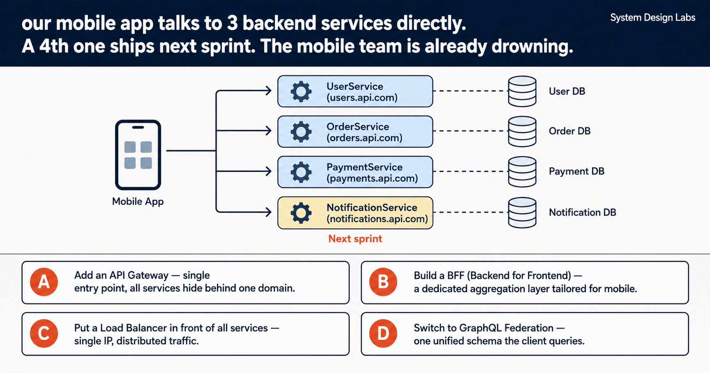
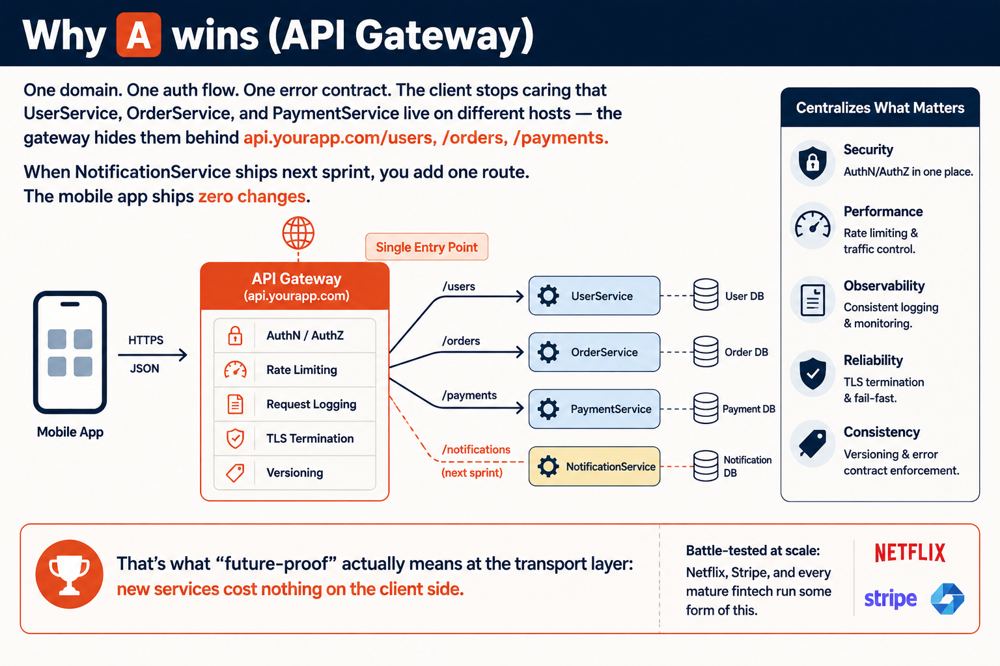

# Ngày 01: Decoupling Mobile from Backend Services

[← Ngày trước](README.md) | [Mục lục](README.md) | [Ngày tiếp theo →](day-02-killing-the-n-1-query-problem.md)

---

# NGÀY 01 · THIẾT KẾ HỆ THỐNG (DAY 01 · SYSTEM DESIGN)
## Tách rời ứng dụng Mobile khỏi các Backend Services (Decoupling Mobile from Backend Services)

Ứng dụng di động (mobile app) của chúng ta đang giao tiếp trực tiếp với 3 backend services riêng biệt. 

Một service thứ 4 sắp được bàn giao và đưa lên production trong sprint tới. Team mobile hiện tại đã bắt đầu "đuối sức" (drowning). 

Mỗi một service mới ra đời đồng nghĩa với việc:
- Phải khai báo thêm một tên miền mới vào danh sách trắng (whitelist a new domain).
- Phải tích hợp và cấu hình một cơ chế xác thực mới (auth scheme to wire).
- Phải xử lý và phân tích một cấu trúc định dạng lỗi mới (new error shape to parse).

Bạn được yêu cầu giảm độ phụ thuộc/liên kết chặt chẽ (reduce coupling) trước khi `NotificationService` chính thức đi vào hoạt động.

### Hiện trạng hệ thống (Here's the setup):
- **Mobile** → `UserService` (`users.api.com`)
- **Mobile** → `OrderService` (`orders.api.com`)
- **Mobile** → `PaymentService` (`payments.api.com`)
- …và `NotificationService` sẽ ra mắt trong sprint tới.

> [!WARNING]
> Phía Client đang phải đảm nhận công việc điều hướng/định tuyến (routing) — nhiệm vụ vốn dĩ thuộc về tầng Backend. Bạn sẽ xử lý vấn đề này như thế nào?

---

### Các phương án lựa chọn (Options):

- **A. Thêm một API Gateway** — Tạo một điểm truy cập duy nhất (single entry point), toàn bộ các services sẽ ẩn sau một domain chung.
- **B. Xây dựng một BFF (Backend for Frontend)** — Một tầng tổng hợp dữ liệu chuyên biệt (dedicated aggregation layer) được thiết kế riêng tối ưu cho mobile.
- **C. Đặt một Load Balancer (Bộ cân bằng tải) phía trước tất cả các services** — Một địa chỉ IP duy nhất, phân phối lưu lượng truy cập (distributed traffic).
- **D. Chuyển sang GraphQL Federation** — Tạo một schema thống nhất duy nhất mà client sẽ truy vấn (query).

---

# NGÀY 01 · ĐÁP ÁN & GIẢI THÍCH CHI TIẾT (DAY 01 · ANSWERS & EXPLANATIONS)

### Câu trả lời 1 (Answer 1)
> [!NOTE]
> ### ✓ ĐÁP ÁN ĐÚNG: A
> **Tại sao phương án A chiến thắng (Why A wins - API Gateway):**
> 
> - **Một domain duy nhất.**
> - **Một luồng xác thực duy nhất (One auth flow).**
> - **Một chuẩn giao ước xử lý lỗi duy nhất (One error contract).**
> 
> Phía client sẽ hoàn toàn không cần bận tâm đến việc `UserService`, `OrderService`, và `PaymentService` đang nằm trên các host khác nhau — **API Gateway** sẽ giấu tất cả chúng đằng sau các route dạng:
> - `api.yourapp.com/users`
> - `api.yourapp.com/orders`
> - `api.yourapp.com/payments`
> 
> Khi `NotificationService` xuất xưởng vào sprint tới, bạn chỉ cần cấu hình thêm duy nhất **một route** trên Gateway. Phía mobile app **không phải thay đổi bất kỳ dòng code nào (zero changes)**. Đó chính là ý nghĩa thực sự của khái niệm *"bền vững với tương lai" (future-proof)* ở tầng truyền tải (transport layer): việc bổ sung các service mới sẽ không tốn thêm bất kỳ chi phí phát triển nào ở phía client.
> 
> Giải pháp này cũng giúp tập trung hóa (centralize) các mối quan tâm dùng chung mà bạn không hề muốn bị rải rác trên cả 4 codebase khác nhau:
> - Xác thực và phân quyền (Authentication / Authorization - `authN/authZ`)
> - Giới hạn tần suất gọi API (Rate limiting)
> - Ghi nhận nhật ký yêu cầu (Request logging)
> - Kết thúc mã hóa TLS (TLS termination)
> - Quản lý phiên bản API (API versioning)
> 
> *Netflix, Stripe và mọi tổ chức Fintech trưởng thành đều vận hành một biến thể nào đó của mô hình này.*

---

### Câu trả lời 2 (Answer 2)
> [!WARNING]
> **Tại sao B lại là câu trả lời bẫy (Why B is the trap answer - BFF):**
> 
> **BFF (Backend for Frontend)** là một pattern chuẩn mực và hoàn toàn hợp lệ — nó đủ gần với bài toán để đánh lừa rất nhiều kỹ sư cấp cao (Senior Engineers). Tuy nhiên, BFF sinh ra để giải quyết một bài toán hoàn toàn khác: **cấu trúc/hình thái dữ liệu theo từng loại client (data shape per client type)**. 
> - Mobile cần một payload tinh gọn (slim payload) để tiết kiệm băng thông.
> - Web cần một payload đầy đủ, phong phú hơn (richer payload).
> - BFF cung cấp cho mỗi loại client một backend riêng để tổng hợp (aggregate) và định hình lại cấu trúc dữ liệu (reshape data).
> 
> Trong tình huống thực tế này, "nỗi đau" (pain point) của hệ thống **không nằm ở kích thước hay cấu trúc payload** — mà là vấn đề **bùng nổ domain (domain sprawl) và sự phụ thuộc quá chặt chẽ (tight coupling)**. Đưa BFF vào đây đồng nghĩa với việc bạn đánh đổi 4 URLs để lấy 1 URL kèm thêm **1 service mới hoàn toàn mà bạn phải tự xây dựng, vận hành và bảo trì từ đầu đến cuối (end-to-end)**. Đó là một sự đánh đổi (tradeoff) sai lầm.

---

### Câu trả lời 3 (Answer 3)
> [!TIP]
> **Tại sao C sai (Why C is wrong - Load Balancer):**
> 
> Một bộ cân bằng tải (**Load Balancer - LB**) làm nhiệm vụ phân phối lưu lượng truy cập giữa **các instances giống hệt nhau của cùng một service**. Nó không có khả năng định tuyến giữa các services khác nhau nằm trên các domain khác nhau. 
> 
> Việc đặt một Load Balancer phía trước cả `UserService` lẫn `OrderService` là hoàn toàn vô nghĩa — nó không có khái niệm hiểu được logic: *"gửi `/orders` về bên này và gửi `/users` về bên kia"*. Đó là hành vi **định tuyến ở tầng ứng dụng (application-layer routing / Layer 7)**, và đó chính xác là công việc mà một **API Gateway** đảm nhiệm.

---

### Câu trả lời 4 (Answer 4)
> [!TIP]
> **Tại sao D sai trong trường hợp này (Why D is wrong here - GraphQL Federation):**
> 
> **GraphQL Federation** giải quyết bài toán hợp nhất schema dữ liệu (schema unification), chứ không giải quyết bài toán phụ thuộc chặt chẽ ở tầng truyền tải (transport-layer coupling). 
> 
> Nếu chọn phương án này:
> 1. Bạn vẫn cần phải có một gateway đặt phía trước cụm federation đó.
> 2. Bạn sẽ phải đập đi viết lại (rewrite) toàn bộ backend services hiện có để chúng expose ra dưới dạng các **GraphQL subgraphs**.
> 
> Đây sẽ là một dự án chuyển đổi di chuyển (migration) tiêu tốn **nhiều quý (multi-quarter)** chỉ để giải quyết một vấn đề mà bạn hoàn toàn có thể xử lý gọn gàng **chỉ trong một sprint bằng một API Gateway**.

---

### Bảng tổng kết so sánh kiến trúc (Architecture Decision Matrix)

| Tiêu chí so sánh | A. API Gateway (Lựa chọn tối ưu) | B. BFF (Bẫy kiến trúc) | C. Load Balancer (Sai mục đích) | D. GraphQL Federation (Over-engineering) |
| :--- | :--- | :--- | :--- | :--- |
| **Vấn đề cốt lõi giải quyết** | Hợp nhất entrypoint, ẩn topology backend, giải quyết domain sprawl & cross-cutting concerns | Tối ưu hóa cấu trúc dữ liệu/payload theo từng loại giao diện/thiết bị | Cân bằng tải ngang giữa các instance giống hệt nhau | Hợp nhất schema dữ liệu phân tán thành một đồ thị duy nhất |
| **Tác động lên Client** | **0 thay đổi** code khi thêm service mới | Phải thay đổi endpoint sang BFF | Không giải quyết được bài toán | Phải viết lại toàn bộ tầng network client sang GraphQL |
| **Chi phí triển khai / Thời gian** | **Thấp** (Xong trong 1 sprint) | **Trung bình** (Phải build & maintain thêm 1 service) | **Thấp** nhưng **không hoạt động** theo yêu cầu | **Rất cao** (Multi-quarter migration) |

---

[← Ngày trước](README.md) | [Mục lục](README.md) | [Ngày tiếp theo →](day-02-killing-the-n-1-query-problem.md)
