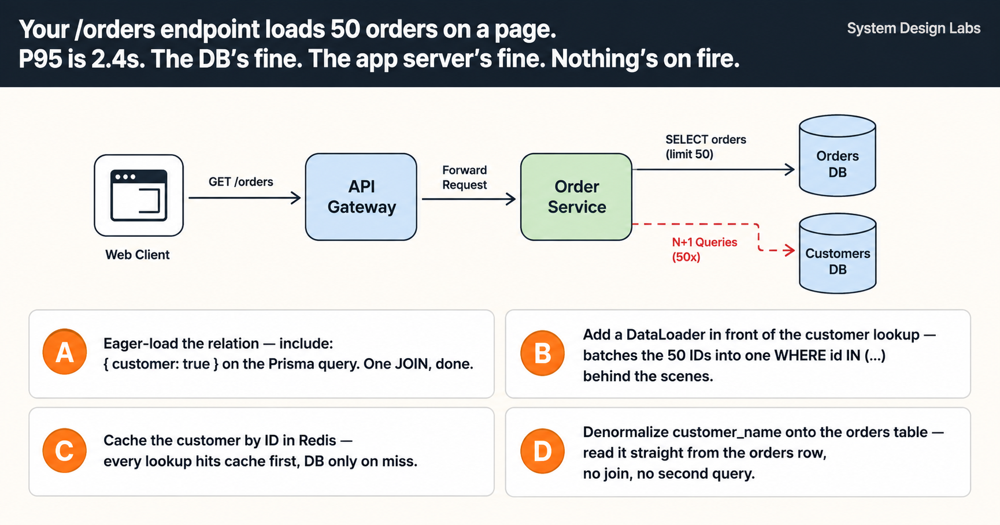
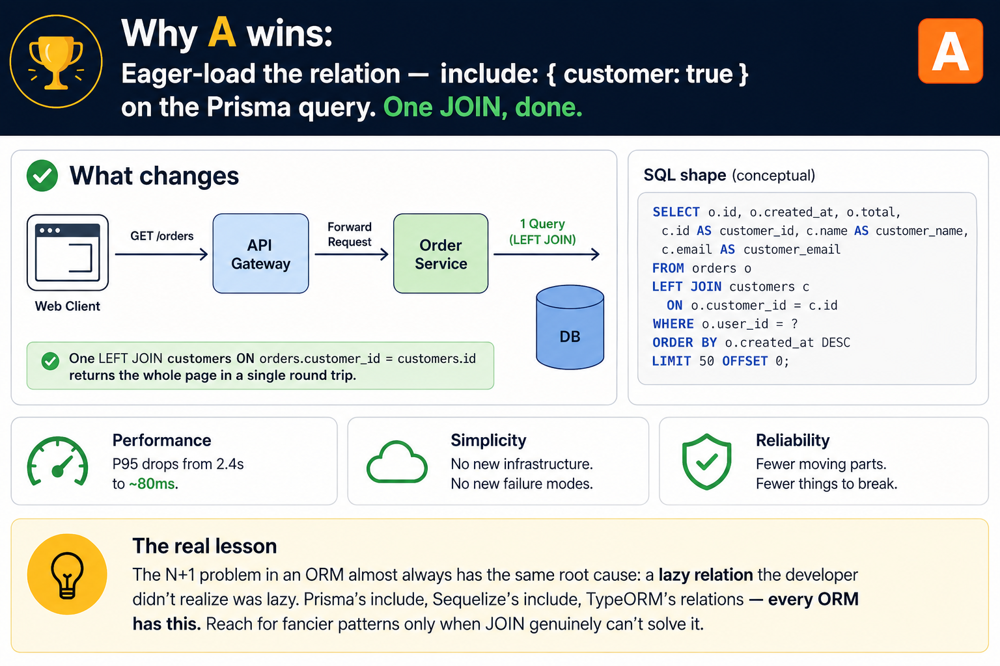

# Ngày 02: Killing the N+1 Query Problem

[← Ngày trước](day-01-decoupling-mobile-from-backend-services.md) | [Mục lục](README.md) | [Ngày tiếp theo →](day-03-rate-limiting-without-boundary-bursts.md)

---

# NGÀY 02 · THIẾT KẾ HỆ THỐNG (SYSTEM DESIGN)
## Tiêu diệt sự cố truy vấn N+1 (Killing the N+1 Query Problem)

Endpoint `/orders` của bạn tải 50 đơn hàng (orders) trên một trang.
**P95** đạt mức **2.4s**. Database (DB) vẫn ổn. App server vẫn bình thường. Không có sự cố nào bốc hỏa.

Thế rồi bạn mở log truy vấn (query log) ra.

**51 câu truy vấn trên mỗi request.** Một câu lệnh `SELECT` để lấy danh sách đơn hàng. Sau đó là 50 câu truy vấn nữa — mỗi đơn hàng một câu — để lấy dữ liệu khách hàng (`customer`). ORM đang thực hiện cơ chế nạp lười (**lazy-load**) trên thuộc tính `order.customer` bên trong vòng lặp `map` của bạn.

Một bài toán kinh điển về **N+1**. Bạn đã từng thấy nó trước đây. Cách xử lý tưởng chừng như "rõ như ban ngày" — cho đến khi vào cuộc họp nhóm, nơi mà ba kỹ sư đề xuất ba giải pháp khác nhau và ai cũng tin rằng mình đúng.

Dưới đây là những phương án được đưa lên bàn cân:

* **A.** Tải sớm quan hệ (**Eager-load the relation**) — sử dụng `include: { customer: true }` trên truy vấn Prisma. Một câu lệnh `JOIN`, xong việc.
* **B.** Thêm một **DataLoader** đứng trước thao tác tra cứu khách hàng — gom nhóm (batches) 50 ID thành một câu lệnh `WHERE id IN (...)` ở tầng ngầm bên dưới.
* **C.** Lưu trữ bộ nhớ đệm khách hàng theo ID trong Redis (**Cache the customer by ID in Redis**) — mỗi lượt tra cứu đều chạm vào cache trước, chỉ chọc vào DB khi bị trượt cache (**cache miss**).
* **D.** Phi chuẩn hóa (Denormalize) `customer_name` trực tiếp vào bảng `orders` — đọc nó thẳng từ dòng của bảng `orders`, không cần join, không cần câu truy vấn thứ hai.

---

## NGÀY 02 · CÂU TRẢ LỜI & GIẢI THÍCH CHI TIẾT (ANSWERS & EXPLANATIONS)

### Câu trả lời 1
> [!NOTE]
> ### ✓ CÂU TRẢ LỜI ĐÚNG: PHƯƠNG ÁN A

**Lý do A chiến thắng (Why A wins):**
Một câu lệnh `LEFT JOIN customers ON orders.customer_id = customers.id` sẽ trả về toàn bộ dữ liệu của trang chỉ trong một lượt truyền dữ liệu mạng duy nhất (**single round trip**). Độ trễ **P95** giảm ngay từ **2.4s** xuống còn **~80ms**. Không cần thêm hạ tầng mới. Không phát sinh thêm các trạng thái lỗi mới (**failure modes**). 

Sự cố **N+1** trong một ORM hầu như luôn luôn có chung một nguyên nhân gốc rễ (**root cause**): một quan hệ dạng lười (**lazy relation**) mà lập trình viên không hề nhận ra nó đang ở chế độ lười. Cú pháp `include` của Prisma, `include` của Sequelize, hay `relations` của TypeORM — bất kỳ ORM nào cũng có tính năng này. Hãy chỉ tìm đến các mô hình phức tạp hơn khi mà thao tác `JOIN` thực sự không thể giải quyết được bài toán.

---

### Câu trả lời 2
> [!WARNING]
> ### PHƯƠNG ÁN B: ĐÂY LÀ CÂU TRẢ LỜI BẪY (THE TRAP ANSWER)

**Tại sao B lại là cái bẫy (DataLoader):**
Đây là một mô hình thiết kế rất đẹp (**beautiful pattern**) — nhưng nó chỉ thực sự phát huy giá trị trong **GraphQL**, nơi mà đồ thị resolver phân nhánh rẽ nhánh (**fans out**) theo những cách thức mà một câu lệnh `JOIN` đơn lẻ không thể nào diễn đạt được. 

Ở đây, bạn chỉ có duy nhất một endpoint trả về danh sách với một quan hệ duy nhất. Một câu lệnh `JOIN` hoàn toàn đơn giản hơn một cách tuyệt đối và nhanh hơn một cách tuyệt đối. Bạn đang cố giải quyết một vấn đề mà bạn không hề gặp phải và tự rước lấy việc phải trả giá bằng chi phí duy trì sự phức tạp (**complexity tax**) mãi mãi về sau.

---

### Câu trả lời 3
> [!WARNING]
> ### PHƯƠNG ÁN C: SAI (WRONG)

**Tại sao C sai (Redis):**
Chiến lược ưu tiên bộ đệm (**Cache-first**) chỉ xử lý phần ngọn/triệu chứng chứ không hề giải quyết mô hình truy vấn (**query pattern**). Bạn vẫn phải phát ra 50 lệnh `GET` tới cache trên mỗi request, giờ đây bạn còn phải gánh thêm bài toán vô hiệu hóa bộ nhớ đệm (**cache invalidation problem**) mỗi khi một khách hàng cập nhật thông tin, và phải chịu hiện tượng trượt cache nguội (**cold-hit**) toàn bộ ID sau mỗi lần triển khai mã nguồn mới (**deploy**). 

Bộ nhớ đệm (**Cache**) là một công cụ để mở rộng quy mô (**scaling tool**), chứ không phải là công cụ để giải quyết bài toán N+1.

---

### Câu trả lời 4
> [!TIP]
> ### PHƯƠNG ÁN D: TRANH CÃI SUỐT SỰ NGHIỆP (THE CAREER-LONG ARGUMENT)

**Tại sao D là cuộc tranh cãi kéo dài suốt sự nghiệp (Phi chuẩn hóa - Denormalize):**
Giải pháp này hoàn toàn hợp pháp và chính đáng ở quy mô lớn như Instagram (**Instagram scale**). Nhưng nó cũng chính là nguồn cơn dẫn đến việc bạn nhận về tên thời con gái của khách hàng sau 3 năm kể từ khi họ kết hôn chỉ vì không ai lập trình luồng cập nhật dữ liệu đồng bộ (**update path**). 

Phi chuẩn hóa (**Denormalization**) thực chất là một quyết định đánh đổi làm tăng độ khuếch đại ghi (**write-amplification**) được ngụy trang dưới vỏ bọc của việc tối ưu hóa đọc (**read-optimization**). Hãy chỉ thực hiện nó khi mà câu lệnh `JOIN` thực sự không thể đáp ứng được cam kết về độ trễ (**latency SLO**) ở quy mô hệ thống của bạn — tuyệt đối không làm trước thời điểm đó.

---

### Bảng đối chiếu & Tổng kết kỹ thuật (Architectural Decision Matrix)

| Tiêu chí so sánh | Phương án A (Eager Loading / JOIN) | Phương án B (DataLoader) | Phương án C (Redis Cache) | Phương án D (Denormalization) |
| :--- | :--- | :--- | :--- | :--- |
| **Độ phức tạp hạ tầng** | Không đổi (Zero infrastructure) | Thêm logic batching ở app | Thêm Redis cluster, xử lý invalidation | Không đổi hoặc thêm background sync worker |
| **Số Round-trips** | **1 round-trip duy nhất** | 2 round-trips (1 Orders + 1 IN) | 1 round-trip DB + 50 network calls Redis | 1 round-trip |
| **Tính nhất quán dữ liệu** | Mạnh mẽ (ACID/Strong Consistency) | Mạnh mẽ (Strong Consistency) | Tiềm ẩn dữ liệu cũ (Stale Cache) | Nguy cơ sai lệch dữ liệu (Data Inconsistency) |
| **Đánh đổi chính** | Tài nguyên CPU/Memory của DB cho JOIN | Phức tạp mã nguồn không cần thiết | Gánh nặng Cache Invalidation, Cold Starts | Khuếch đại ghi (**Write-amplification**) |
| **Khi nào nên áp dụng?** | **Mặc định ưu tiên (Default choice)** | GraphQL hoặc phân tán nhiều dịch vụ | Dữ liệu đọc cực lớn, hiếm khi thay đổi | Quy mô siêu lớn (Hyper-scale) khi JOIN chạm trần SLO |

---

[← Ngày trước](day-01-decoupling-mobile-from-backend-services.md) | [Mục lục](README.md) | [Ngày tiếp theo →](day-03-rate-limiting-without-boundary-bursts.md)
