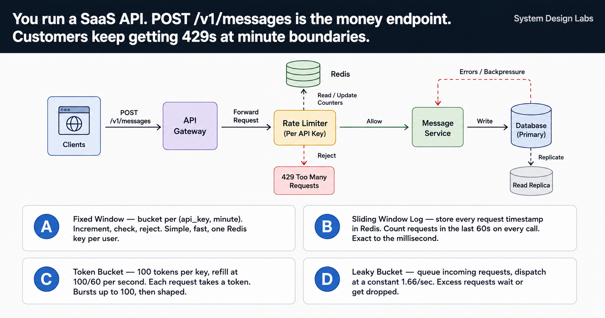
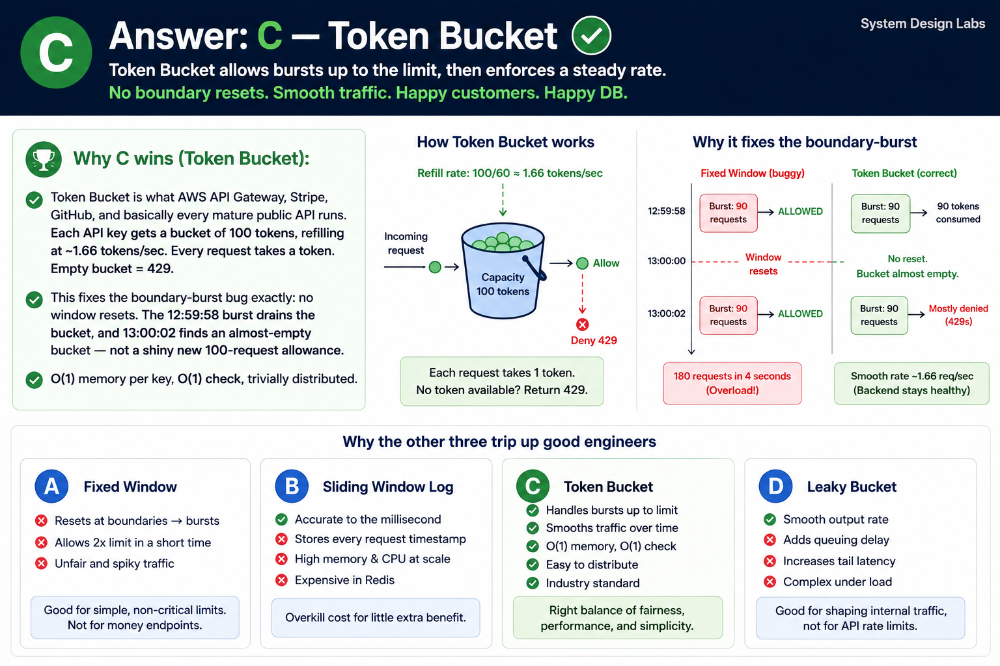

# Ngày 03: Rate Limiting Without Boundary Bursts

[← Ngày trước](day-02-killing-the-n-1-query-problem.md) | [Mục lục](README.md) | [Ngày tiếp theo →](day-04-preventing-duplicate-payment-charges.md)

---

# NGÀY 03 · THIẾT KẾ HỆ THỐNG (DAY 03 · SYSTEM DESIGN)

## Giới Hạn Tần Suất Yêu Cầu Không Bị Đột Biến Lưu Lượng Tại Biên Thời Gian (Rate Limiting Without Boundary Bursts)

Bạn đang vận hành một hệ thống **SaaS API**. Endpoint `POST /v1/messages` là endpoint hái ra tiền (**money endpoint**).

Hạn mức gói dịch vụ (**Plan limit**): **100 requests/phút** cho mỗi API key. Khách hàng liên tục nhận mã lỗi **HTTP 429 (Too Many Requests)** tại các điểm giao thời giữa các phút (**minute boundaries**), mặc dù chỉ số **RPS** (Requests Per Second) trung bình của họ thấp hơn nhiều so với ngưỡng trần cho phép.

Dưới đây là những gì thực tế đang diễn ra trên môi trường Production:

- **12:59:58** → Khách hàng gửi **90 requests** (một tác vụ xử lý hàng loạt - *batched job* được kích hoạt).
- **13:00:02** → Cùng khách hàng đó gửi thêm **90 requests** nữa (chu kỳ tick tiếp theo).
- Bộ đếm (**counter**) của bạn tự động đặt lại (**reset**) về 0 vào lúc **13:00:00**.
- Cả hai đợt bùng nổ lưu lượng (**bursts**) đều vượt qua trót lọt. Tổng cộng **180 requests** dồn vào chỉ trong vòng **4 giây**. Cơ sở dữ liệu hạ tầng phía dưới (**downstream database**) của bạn bắt đầu quá tải và "gục ngã".

Hiện tại, đội ngũ Chăm sóc khách hàng (**Support**) đang phàn nàn gay gắt với bạn về các mã lỗi **429**, trong khi đội ngũ Vận hành độ tin cậy hệ thống (**SRE - Site Reliability Engineering**) cũng gây áp lực lớn về các đợt lưu lượng tăng đột biến (**traffic spikes**). Bạn bắt buộc phải thay thế bộ giới hạn tần suất (**rate limiter**) này ngay trong tuần.

---

### BỐN PHƯƠNG ÁN ĐƯỢC ĐẶT LÊN BÀN CÂN (FOUR OPTIONS ON THE TABLE):

- **A — Cửa Sổ Cố Định (Fixed Window):** 
  Chia ngăn bộ nhớ (**bucket**) cho mỗi cặp `(api_key, minute)`. Tăng giá trị đếm (**increment**), kiểm tra (**check**), từ chối (**reject**). Đơn giản, tốc độ cực nhanh, chỉ cần đúng **một Redis key cho mỗi người dùng**.

---

- **B — Nhật Ký Cửa Sổ Trượt (Sliding Window Log):** 
  Lưu trữ dấu thời gian (**timestamp**) của từng request vào **Redis**. Đếm số lượng request phát sinh trong **60 giây gần nhất** ở mỗi lượt gọi API. Độ chính xác tuyệt đối tới từng mili-giây (**millisecond**).

- **C — Thùng Chứa Token (Token Bucket):** 
  Cấp **100 token** cho mỗi key, nạp đầy lại (**refill**) với tốc độ $100/60$ token mỗi giây. Mỗi request đến sẽ tiêu thụ một token. Cho phép lưu lượng bùng nổ (**bursts**) tức thời lên tới tối đa **100 requests**, sau đó điều tiết định hình dòng lưu lượng (**traffic shaping**).

- **D — Thùng Rò Rỉ (Leaky Bucket):** 
  Đưa các request gửi đến vào hàng đợi (**queue**), phân phối xử lý ra ngoài với tốc độ không đổi là **1.66 requests/giây**. Các request dư thừa sẽ phải chờ trong hàng đợi hoặc bị hủy bỏ (**dropped**).

---

# NGÀY 03 · ĐÁP ÁN & GIẢI THÍCH CHI TIẾT (DAY 03 · ANSWERS & EXPLANATIONS)

## Câu Trả Lời 1 (Answer 1)

### ✓ ĐÁP ÁN ĐÚNG (CORRECT ANSWER)
> **Đáp án: C — Token Bucket ✅**

Dưới đây là lý do tại sao phương án này giành chiến thắng, và tại sao ba phương án còn lại dễ làm "sảy chân" cả những kỹ sư giỏi:

### Tại sao C là lựa chọn tối ưu (Why C wins - Token Bucket):
Thuật toán **Token Bucket** là giải thuật cốt lõi đang được vận hành bởi **AWS API Gateway**, **Stripe**, **GitHub**, và hầu hết mọi nền tảng **Public API** trưởng thành trên thế giới.

Mỗi **API key** sẽ được cấp một thùng chứa gồm **100 token**, liên tục được nạp thêm với tốc độ $\approx 1.66\text{ tokens/giây}$. Mỗi request đi qua sẽ tiêu hao đúng một token. Nếu thùng hết token (**Empty bucket**) $\rightarrow$ Ngay lập tức trả về mã lỗi **429**.

Giải pháp này triệt tiêu hoàn toàn lỗi bùng nổ lưu lượng tại biên thời gian (**boundary-burst bug**): không hề có cơ chế đặt lại cửa sổ thời gian (**no window resets**). 
- Đợt bùng nổ lưu lượng lúc **12:59:58** rút cạn toàn bộ token trong thùng.
- Khi đợt lưu lượng lúc **13:00:02** ập đến, nó chỉ thấy một chiếc thùng gần như trống rỗng — chứ không phải một hạn mức mới toanh **100-request allowance** như trước. 
- Độ phức tạp bộ nhớ: $\mathcal{O}(1)$ dung lượng bộ nhớ cho mỗi key (**$\mathcal{O}(1)$ memory per key**).
- Tốc độ kiểm tra: $\mathcal{O}(1)$ thời gian xử lý (**$\mathcal{O}(1)$ check**).
- Triển khai phân tán cực kỳ đơn giản (**trivially distributed**).

---

## Câu Trả Lời 2 (Answer 2)

### Tại sao B là phương án "bẫy" (Why B is the trap - Sliding Window Log):
Về mặt toán học, thuật toán này **hoàn hảo không tỳ vết** — tuy nhiên nó buộc phải lưu một mục dữ liệu trên **Redis** cho **mỗi request của từng key** (sử dụng Redis Sorted Sets `ZADD`/`ZREMRANGEBYSCORE`). 

> [!WARNING] **Cảnh Báo Về Chi Phí Bộ Nhớ & Độ Trễ P99:**
> Khi đạt quy mô **100.000 active keys**, bạn sẽ phải đối mặt với áp lực bộ nhớ (**memory pressure**) khổng lồ trên Redis và các đợt tăng vọt độ trễ ở phân vị thứ 99 (**p99 latency spikes**). Những kỹ sư thông minh rất hay chọn phương án này mà quên tính toán đến chi phí bộ nhớ tài nguyên. Đó chính là dấu hiệu phân loại trình độ (*"That's the tell"*).

---

## Câu Trả Lời 3 (Answer 3)

### Tại sao A là phương án sai (Why A is wrong - Fixed Window):
Đây chính xác là nguyên nhân gây ra lỗi được mô tả trong bài toán. 

> [!CAUTION] **Lỗi Cố Hữu Của Cửa Sổ Cố Định:**
> Bộ đếm reset lại ngay tại biên thời gian phút $\rightarrow$ Khách hàng có thể xả lưu lượng bùng nổ **gấp đôi (2x) hạn mức cho phép** chỉ trong khoảng thời gian vỏn vẹn **2 giây**. Đây vẫn là sai lầm phổ biến nhất từng thấy trên các hệ thống Production.

---

## Câu Trả Lời 4 (Answer 4)

### Tại sao D không phù hợp ở ngữ cảnh này (Why D is wrong here - Leaky Bucket):
Thuật toán này sinh ra để giải quyết một bài toán khác: nó định hình dòng lưu lượng đầu ra (**shapes output**) bằng cách xếp các request vào hàng đợi và phân phối xử lý với một tốc độ cố định đều đặn. 

> [!NOTE] **So Sánh Triết Lý Xử Lý Lưu Lượng:**
> - **Leaky Bucket:** Rất tuyệt vời khi cần bảo vệ các dịch vụ hạ tầng mỏng manh (**fragile downstream**). Tuy nhiên, phương án này **HOÀN TOÀN SAI** đối với một **Customer-facing API** (API phục vụ trực tiếp khách hàng), bởi vì cơ chế xếp hàng đợi sẽ làm tăng thêm độ trễ (**adds latency**) cho những đợt bùng nổ lưu lượng hoàn toàn hợp lệ của người dùng.
> - **Token Bucket** thực hiện **từ chối** lưu lượng dư thừa (**rejects excess**), trong khi **Leaky Bucket** lại **trì hoãn** nó (**delays it**). 
> - Đối với một **Public API**, triết lý luôn luôn là: **Từ chối dứt khoát tốt hơn làm chậm trễ (reject > delay)**.

---

### BẢNG TỔNG KẾT SO SÁNH CÁC THUẬT TOÁN RATE LIMITING

| Thuật Toán | Độ Phức Tạp Bộ Nhớ | Độ Phức Tạp Thời Gian | Xử Lý Burst Traffic | Nguy Cơ Tiềm Ẩn | Đánh Giá Cho Public API |
| :--- | :--- | :--- | :--- | :--- | :--- |
| **Fixed Window** | $\mathcal{O}(1)$ | $\mathcal{O}(1)$ | ❌ Kém | Xuyên thủng biên thời gian $2\times$ Limit | **Sai lầm kiến trúc** |
| **Sliding Window Log** | $\mathcal{O}(N)$ | $\mathcal{O}(\log N)$ | ✅ Tốt | Đốt RAM Redis, lag p99 | **Bẫy tài nguyên** |
| **Token Bucket** | $\mathcal{O}(1)$ | $\mathcal{O}(1)$ | ✅ Cho phép burst có kiểm soát | Cần đồng bộ thời gian (NTP clock drift) | **Chiến thắng tuyệt đối ✅** |
| **Leaky Bucket** | $\mathcal{O}(Q)$ (Hàng đợi) | $\mathcal{O}(1)$ | ❌ Triệt tiêu burst | Tăng độ trễ phản hồi (latency), nghẽn queue | **Không phù hợp cho Client API** |

---

[← Ngày trước](day-02-killing-the-n-1-query-problem.md) | [Mục lục](README.md) | [Ngày tiếp theo →](day-04-preventing-duplicate-payment-charges.md)
