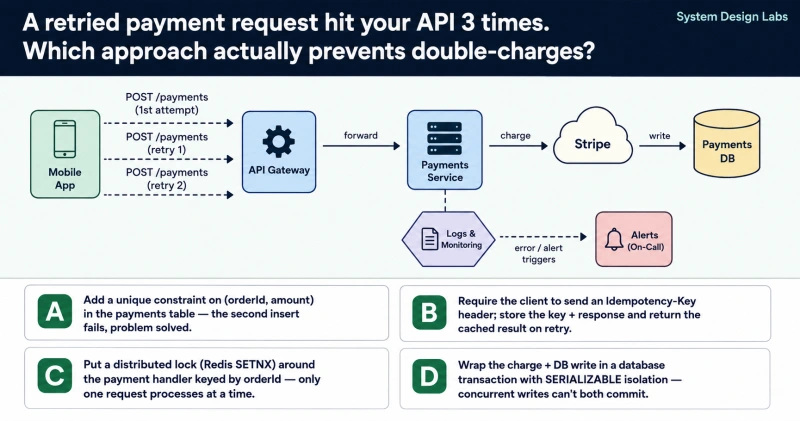
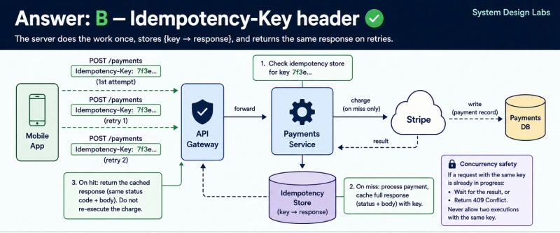

# Ngày 04: Preventing Duplicate Payment Charges

[← Ngày trước](day-03-rate-limiting-without-boundary-bursts.md) | [Mục lục](README.md) | [Ngày tiếp theo →](day-05-choosing-a-database-sharding-strategy.md)

---

# NGÀY 04 · THIẾT KẾ HỆ THỐNG (SYSTEM DESIGN)
## Ngăn chặn việc trừ tiền trùng lặp (Preventing Duplicate Payment Charges)

Người dùng bấm nút "Thanh toán $499" (Pay $499) tại bước thanh toán (checkout).  
Vòng xoay tải trang (spinner) bị treo. Họ bấm lại một lần nữa. Và thêm một lần nữa.  
Ba yêu cầu gửi tới API Thanh toán (Payments API) của bạn. Hai trong số đó thực sự thành công. Khách hàng bị trừ $1,497 và tạo ngay một phiếu hỗ trợ (support ticket) trước cả khi kỹ sư trực ca (on-call) kịp nhìn thấy cảnh báo.

**Dưới đây là kịch bản thiết lập:**
* **Thiết bị di động (Mobile) →** `POST /payments { orderId: "ord_8821", amount: 499 }`
* Mạng bị nghẽn ở yêu cầu đầu tiên → phía client thử lại (retry) hai lần.
* Dịch vụ của bạn nhận được 3 yêu cầu `POST` gần như giống hệt nhau trong vòng 4 giây.
* Stripe bị trừ tiền 3 lần. Cơ sở dữ liệu (DB) của bạn ghi nhận 3 dòng bản ghi thanh toán.

Bạn có thời gian đúng một sprint để đảm bảo rằng một yêu cầu được thử lại (retried request) sẽ không bao giờ trừ tiền hai lần nữa. **Bạn sẽ làm gì?**

---

### Các phương án lựa chọn:

* **A.** Thêm một ràng buộc duy nhất (unique constraint) trên cặp `(orderId, amount)` trong bảng `payments` — lần chèn (insert) thứ hai sẽ thất bại, vấn đề được giải quyết.
* **B.** Yêu cầu client phải gửi một tiêu đề (header) `Idempotency-Key`; lưu trữ cặp giá trị khóa + phản hồi (`key + response`) và trả về kết quả đã được lưu trong bộ nhớ đệm (cached result) khi có yêu cầu thử lại.
* **C.** Đặt một khóa phân tán (Distributed Lock - Redis `SETNX`) bao quanh bộ xử lý thanh toán (payment handler) với khóa là `orderId` — chỉ một yêu cầu được xử lý tại một thời điểm.
* **D.** Bọc lệnh trừ tiền + lệnh ghi vào DB trong một giao dịch cơ sở dữ liệu (Database Transaction) với mức cô lập tuần tự hóa (`SERIALIZABLE` isolation) — các thao tác ghi đồng thời không thể cùng commit.

---

# NGÀY 04 · ĐÁP ÁN & GIẢI THÍCH CHI TIẾT

## Câu trả lời 1
### ✓ ĐÁP ÁN ĐÚNG:
> [!IMPORTANT]
> **Đáp án: B — Tiêu đề Idempotency-Key (Idempotency-Key header) ✅**

Dưới đây là lý do tại sao, và tại sao ba phương án còn lại chính là những sai lầm điển hình mà tôi từng chứng kiến trong các buổi phân tích sự cố thực tế (post-mortems):

### Tại sao B chiến thắng (Idempotency-Key):
Client sẽ sinh ra một định danh duy nhất (UUID) trước yêu cầu đầu tiên và gắn nó vào tiêu đề `Idempotency-Key: 7f3e...` trên mỗi lần thử lại của cùng một thao tác nghiệp vụ logic đó. Máy chủ của bạn thực hiện công việc một lần duy nhất, lưu trữ `{key → response}` vào một kho lưu trữ bền vững (Durable Store như Postgres, DynamoDB, Redis có bật cơ chế lưu trữ bền vững persistence — không phải Redis thuần lưu trên RAM), và trên bất kỳ yêu cầu thử lại nào có cùng khóa đó, hệ thống sẽ trả về phản hồi gốc mà **không thực thi lại lệnh trừ tiền**.

> [!TIP]
> **Chi tiết cốt lõi mà phần lớn mọi người bỏ sót:** Bạn phải lưu vào bộ nhớ đệm (cache) **toàn bộ phản hồi** (mã trạng thái `status code` + nội dung `body`), chứ không chỉ đơn thuần là đánh dấu "tôi đã nhìn thấy khóa này". Nếu yêu cầu thử lại #2 đến trong khi yêu cầu #1 vẫn đang xử lý, bạn phải bắt nó chờ hoặc trả về mã `409 (Conflict)` — tuyệt đối không bao giờ để hai tiến trình thực thi tranh chấp (race) với cùng một khóa.

Đây chính xác là cách mà Stripe (`Idempotency-Key`), PayPal (`PayPal-Request-Id`), Shopify, và AWS (`ClientRequestToken` trên một nửa số API của họ) đều đang triển khai trên hệ thống production. Đây là cách tiếp cận duy nhất xử lý được trọn vẹn toàn bộ ma trận lỗi: thử lại do lỗi mạng (network retries), thử lại do hành vi người dùng trên client (client-triggered retries), thử lại từ bộ cân bằng tải (Load Balancer retries), và tình huống *"yêu cầu đã thành công nhưng phản hồi bị thất lạc trên đường truyền"* — đây là trường hợp hiểm hóc nhất và cũng là trường hợp mà ba phương án còn lại đều âm thầm thất bại.

---

## Câu trả lời 2
### Tại sao A là câu trả lời bẫy (Ràng buộc duy nhất trên `orderId`):
Đây là câu trả lời tôi từng gặp trong 4 codebase thực tế khác nhau, và nó sai vì một lý do rất tinh vi.

Một ràng buộc duy nhất (unique constraint) sẽ ngăn chặn thao tác chèn (insert) thứ hai commit thành công — điều này tốt. Nhưng còn lệnh trừ tiền đầu tiên gửi tới Stripe thì sao? Trong hầu hết các triển khai, bạn sẽ gọi API của Stripe trước, sau đó mới chèn dòng bản ghi thanh toán vào DB. Vì vậy, yêu cầu #1 trừ tiền trên Stripe, chèn vào DB thành công. Yêu cầu #2 lại tiếp tục trừ tiền trên Stripe một lần nữa, sau đó thao tác chèn vào DB mới thất bại do vi phạm ràng buộc duy nhất (constraint violation). Lúc này khách hàng đã bị trừ tiền hai lần. Cơ sở dữ liệu của bạn trông vẫn rất "sạch sẽ". Bản ghi log của bạn vẫn báo "đã ngăn chặn đơn hàng trùng lặp".

> [!WARNING]
> Ngay cả khi bạn đảo ngược thứ tự (chèn vào DB trước, trừ tiền Stripe sau), bạn chỉ đơn thuần là dịch chuyển điều kiện tranh chấp (race condition) sang một vị trí khác — bây giờ yêu cầu thử lại #2 thất bại tại DB, nhưng nếu yêu cầu #1 bị sập (crash) ở giữa thao tác chèn DB và thao tác gọi Stripe, bạn sẽ có một dòng thanh toán trong DB mà không hề có giao dịch trừ tiền thực tế nào. Hậu quả này còn tệ hơn cả việc trừ tiền hai lần. Đây là sự thất thoát tiền bạc trong âm thầm (Silent money loss).

Ràng buộc duy nhất (unique constraint) là một lớp phòng thủ theo chiều sâu (defense-in-depth) rất tốt. Nhưng nó **không phải** là cơ chế xử lý chính.

---

## Câu trả lời 3
### Tại sao C sai (Khóa phân tán - Distributed Lock):
Một khóa Redis trên `orderId` sẽ tuần tự hóa 3 yêu cầu thử lại để chỉ có một yêu cầu chạy tại một thời điểm. Nghe có vẻ rất gọn gàng. Nhưng nó **chỉ giải quyết được trường hợp đồng thời (concurrent case)**. Nó hoàn toàn vô dụng đối với các yêu cầu thử lại tuần tự đến sau khi khóa đã được giải phóng và phản hồi trước đó đã bị thất lạc trên đường truyền mạng.

Yêu cầu #1 lấy được khóa, trừ tiền Stripe thành công, giải phóng khóa, trả về mã 200 — nhưng phản hồi 200 không bao giờ đến được client vì kết nối mạng bị đứt. Client thử lại sau đó 30 giây. Khóa phân tán lúc này đã không còn tồn tại từ lâu. Bạn lại thực hiện trừ tiền một lần nữa.

> [!NOTE]
> * **Khóa phân tán (Distributed locks)** dùng để **ngăn chặn việc thực thi đồng thời tại cùng một thời điểm** (preventing concurrent execution).
> * **Tính lũy kế / Bất biến (Idempotency)** dùng để **ngăn chặn việc lặp lại thực thi xuyên suốt theo thời gian** (preventing repeated execution across time).
>
> Đây là hai bài toán hoàn toàn khác nhau.

Ngoài ra: Khóa phân tán nổi tiếng là cực kỳ phức tạp để triển khai cho đúng. Bài viết *"How to do distributed locking"* của Martin Kleppmann tồn tại là có lý do của nó. Đừng vội vàng dùng đến nó trừ khi bạn thực sự cần sự đảm bảo về mặt đồng thời.

---

## Câu trả lời 4
### Tại sao D sai (Giao dịch `SERIALIZABLE`):
Mức cô lập tuần tự hóa (`SERIALIZABLE` isolation) sinh ra là để bảo vệ cơ sở dữ liệu khỏi các dị thường khi ghi đồng thời (concurrent-write anomalies). Nó **không có bất kỳ tác động hay quyền hạn nào đối với tác dụng phụ bên ngoài (external side effect)** — cụ thể ở đây là lệnh gọi trừ tiền tới Stripe. Giao dịch của bạn có thể bị hoàn tác (rollback) và cơ sở dữ liệu của bạn có thể hoàn toàn nguyên vẹn, nhưng yêu cầu HTTP `POST` gửi tới Stripe thì đã được phát đi rồi, và số tiền đó đã thực sự rời khỏi tài khoản.

> [!CAUTION]
> Đây là lỗi tư duy phổ biến nhất trong danh mục "làm cho hệ thống thanh toán an toàn": coi cơ sở dữ liệu là ranh giới của tính đúng đắn (boundary of correctness), trong khi ranh giới thực sự lại nằm ở **tác dụng phụ với hệ thống bên ngoài (external side effect)**. Khoảnh khắc bạn gọi tới Stripe, trạng thái thực tế bên ngoài đã thay đổi. Giao dịch trong DB của bạn không thể nào đảo ngược được điều đó.

---

### Bảng tổng hợp so sánh các phương án

| Phương án | Cơ chế đề xuất | Xử lý được đồng thời (Concurrent)? | Xử lý được tuần tự (Sequential Retries)? | An toàn với Side Effect ngoài (Stripe)? | Kết luận |
| :--- | :--- | :---: | :---: | :---: | :--- |
| **A** | Unique Constraint `(orderId, amount)` | ❌ Một phần (vẫn lọt lệnh gọi Stripe) | ❌ Không | ❌ Không thể rollback API bên ngoài | **Bẫy nguy hiểm**: Trừ tiền 2 lần trên Stripe dù DB báo lỗi. |
| **B** | **Idempotency-Key Header + Response Cache** | **✅ Có (bằng cơ chế 409 / lock chờ)** | **✅ Có (trả về kết quả từ cache)** | **✅ Có (không bao giờ gọi lại Stripe)** | **Đáp án chuẩn xác nhất trong thực tế.** |
| **C** | Distributed Lock (Redis `SETNX`) | ✅ Có | ❌ Không (khi khóa đã nhả và mạng rớt) | ❌ Không bảo vệ được khi retry đến sau | **Sai bài toán**: Giải quyết concurrency, không giải quyết retry theo thời gian. |
| **D** | Database Transaction (`SERIALIZABLE`) | ✅ Có (ở tầng DB) | ❌ Không | ❌ Hoàn toàn vô hiệu với HTTP call ngoài | **Sai phạm vi**: DB rollback không thể undo lệnh trừ tiền Stripe. |

---

[← Ngày trước](day-03-rate-limiting-without-boundary-bursts.md) | [Mục lục](README.md) | [Ngày tiếp theo →](day-05-choosing-a-database-sharding-strategy.md)
