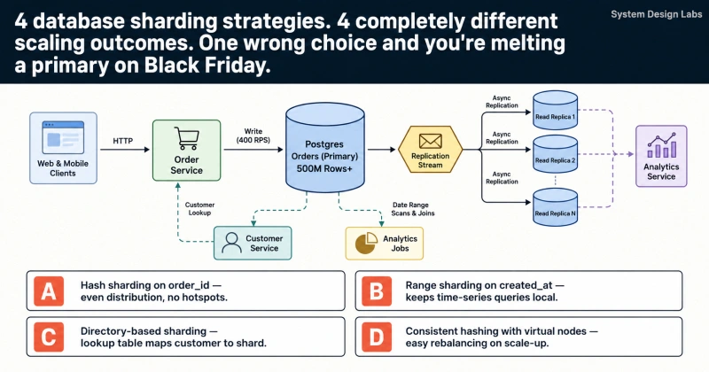

# Ngày 05: Choosing a Database Sharding Strategy

[← Ngày trước](day-04-preventing-duplicate-payment-charges.md) | [Mục lục](README.md) | [Ngày tiếp theo →](day-06-safe-distributed-locks-for-cron-jobs.md)

---

# DAY 05 · SYSTEM DESIGN
## Lựa chọn Chiến lược Sharding Cơ sở dữ liệu (Choosing a Database Sharding Strategy)

4 chiến lược sharding cơ sở dữ liệu. 4 kết quả mở rộng quy mô (scaling) hoàn toàn khác nhau. Chỉ cần chọn sai một bước, bạn sẽ làm "tan chảy" (quá tải sập nguồn) node chính (primary) ngay trong dịp Black Friday.

Bảng `orders` trên cơ sở dữ liệu Postgres của bạn vừa cán mốc **500 triệu dòng (500M rows)**.  
Các truy vấn quét theo dải (range scans) từng chỉ mất 40ms giờ đây đang tăng vọt vượt quá 800ms.  
Mở rộng theo chiều dọc (Vertical scaling) đã đi vào ngõ cụt. Bạn bắt buộc phải phân mảnh dữ liệu (shard).

---

### Tải công việc thực tế (Workload Profile):
* **`orders`** = 500 triệu dòng (500M rows), tăng trưởng thêm 3 triệu dòng/tuần (3M/week)
* **80% lượt đọc (reads)** = *"30 ngày đặt hàng gần nhất của khách hàng X"* (`"customer X's last 30 days of orders"`)
* **15% lượt đọc (reads)** = các truy vấn kết hợp phân tích theo khoảng thời gian (analytics joins on date ranges)
* **5% lượt ghi (writes)** = các đơn hàng mới (duy trì đều đặn 400 RPS, gấp đôi vào các ngày khuyến mãi / sale days)

**Bạn sẽ chọn chiến lược nào?**

---

### Các phương án lựa chọn:

* **A. Phân mảnh băm trên `order_id` (Hash sharding on `order_id`)**  
  Phân phối đồng đều, không tạo ra điểm nóng dữ liệu (hotspots).

* **B. Phân mảnh theo dải trên `created_at` (Range sharding on `created_at`)**  
  Giữ các truy vấn chuỗi thời gian (time-series queries) nằm cục bộ trên cùng phân mảnh.

* **C. Phân mảnh dựa trên thư mục tra cứu (Directory-based sharding)**  
  Sử dụng bảng tra cứu (lookup table) để ánh xạ khách hàng tới shard tương ứng.

* **D. Băm nhất quán với các node ảo (Consistent hashing with virtual nodes)**  
  Tái cân bằng (rebalancing) dễ dàng khi mở rộng quy mô hệ thống (scale-up).

---

## DAY 05 · ĐÁP ÁN & GIẢI THÍCH CHI TIẾT (ANSWERS & EXPLANATIONS)

### Câu trả lời 1: CÂU TRẢ LỜI ĐÚNG (CORRECT ANSWER)

> [!TIP]
> **Đáp án: C — Directory-based sharding ✅ (Phân mảnh dựa trên thư mục tra cứu)**

Dưới đây là lý do tại sao ba phương án còn lại đánh lừa được cả các kỹ sư dày dạn kinh nghiệm:

#### **Tại sao C chiến thắng (Why C wins - Directory-based):**
* **80% lượt đọc** tập trung vào *"các đơn hàng của khách hàng X"*. Bạn sẽ muốn toàn bộ đơn hàng của một khách hàng nằm trọn vẹn trên đúng một shard duy nhất. Khi đó, một truy vấn đọc theo phạm vi khách hàng (customer-scoped read) chỉ chạm tới đúng một node, hoàn toàn không gây ra hiện tượng phân tán rồi tổng hợp tốn kém (**scatter-gather fan-out**).
* Bạn duy trì một bảng `customer_shard_map` (được lưu bộ đệm trên Redis / cached in Redis). Nếu shard 3 trở nên quá nóng (hot shard), bạn có thể di chuyển (migrate) đích danh các khách hàng lớn/khách hàng VIP dùng nhiều tài nguyên (**whales**) sang shard khác mà **không cần phải băm lại toàn bộ dữ liệu (rehashing)**. Khả năng tái cân bằng có mục tiêu (targeted rebalancing) chính là "siêu năng lực" của kiến trúc này.
* **Figma, Notion và Slack** đều đang áp dụng kiến trúc này.

---

### Câu trả lời 2: Bẫy kỹ thuật (The Trap Answer)

> [!WARNING]
> **Tại sao A là cái bẫy (Why A is the trap - Hash on `order_id`):**
>
> Đây là câu trả lời kinh điển trong các bài hướng dẫn (tutorials): *"Cứ băm khóa chính (Hash the primary key)!"* Nhưng nó sẽ hủy hoại hệ thống của bạn trong trường hợp này. 
> 
> 200 đơn hàng của một khách hàng đơn lẻ sẽ bị phân tán rải rác trên khắp tất cả các shard. Mỗi thao tác đọc dữ liệu sẽ biến thành một đợt phân tán truy vấn ra 4 shard (**4-shard fan-out**) và tốc độ phản hồi bị giới hạn bởi chính node xử lý chậm nhất của bạn. Độ trễ **P99 latency** vì thế sẽ tăng vọt.

---

### Câu trả lời 3: Phân tích phương án sai (Why B is wrong)

> [!CAUTION]
> **Tại sao B sai (Why B is wrong - Range on `created_at`):**
>
> Cách này tự tạo ra một điểm nóng dữ liệu (hot shard) ngay từ trong thiết kế:
> * Mọi đơn hàng mới phát sinh đều sẽ ghi dồn vào cùng một shard duy nhất.
> * Shard mới nhất của bạn sẽ phải gánh trọn **100% lượt ghi (writes)** và **70% lượt đọc (reads)**. 
> * Vào dịp Black Friday, shard này chắc chắn sẽ "tan chảy" (cháy tải/sập hệ thống) trong khi các shard còn lại hoàn toàn nhàn rỗi (idle).

---

### Câu trả lời 4: Phân tích phương án sai (Why D is wrong)

> [!NOTE]
> **Tại sao D sai (Why D is wrong - Consistent hashing):**
>
> Băm nhất quán (Consistent hashing) rất tuyệt vời đối với dữ liệu đồng nhất (uniform data), nhưng bạn **không thể chủ động di chuyển (migrate) đích danh các tenant/khách hàng đặc biệt nặng ký**. Nếu chẳng may 4 khách hàng dạng "cá voi" (whales) cùng bị băm và rơi vào chung một shard, hệ thống của bạn sẽ hoàn toàn bị mắc kẹt mà không thể giải phóng tải linh hoạt.

---

[← Ngày trước](day-04-preventing-duplicate-payment-charges.md) | [Mục lục](README.md) | [Ngày tiếp theo →](day-06-safe-distributed-locks-for-cron-jobs.md)
