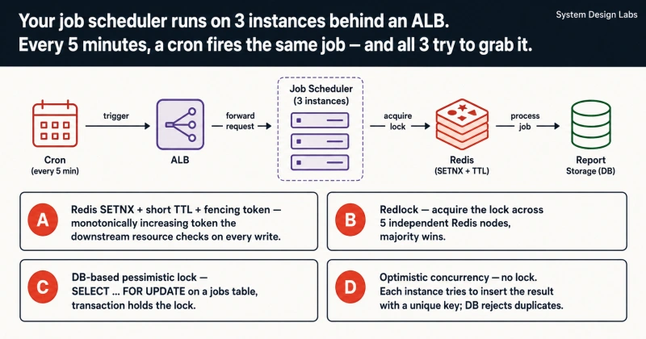

# Ngày 06: Safe Distributed Locks for Cron Jobs

[← Ngày trước](day-05-choosing-a-database-sharding-strategy.md) | [Mục lục](README.md) | [Ngày tiếp theo →](day-07-event-ordering-in-a-message-queue.md)

---


# NGÀY 06 · THIẾT KẾ HỆ THỐNG (DAY 06 · SYSTEM DESIGN)

## Khóa phân tán an toàn cho Cron Jobs (Safe Distributed Locks for Cron Jobs)



Bộ lập lịch công việc (*job scheduler*) của bạn chạy trên **3 instances** đặt phía sau một bộ cân bằng tải ALB (*Application Load Balancer*).

Cứ mỗi 5 phút, một tiến trình cron lại kích hoạt cùng một tác vụ `"generate-daily-report"` (tạo báo cáo hàng ngày) — và cả 3 instances đều cố gắng tranh giành quyền xử lý nó.

Bạn tìm đến giải pháp kinh điển: một khóa phân tán Redis `SETNX` (*Distributed Lock*).

```text
SET job:daily-report locked NX EX 300
```
$\rightarrow$ Chỉ có duy nhất một instance giành được quyền thực thi. Xong.

Hệ thống hoạt động hoàn hảo trong suốt một tháng. Cho đến 2 giờ sáng một ngày thứ Bảy.

- **Instance B** giành được khóa (*lock*). Bắt đầu thực thi công việc. Chạy được 60 giây, pod bị hệ điều hành tắt do tràn bộ nhớ (*OOM-killed*). Khóa phân tán vẫn tồn tại trên Redis. Thời gian sống TTL (*Time-To-Live*) hiển thị còn tới 300 giây. Trong khi đó, báo cáo được thiết lập chạy định kỳ 5 phút một lần.
- Không có tiến trình nào xử lý báo cáo đó trong 4 phút tiếp theo. Sau đó, **instance A** chộp lấy khóa — nhưng pod của **instance B** vừa khởi động lại và **CŨNG** đang cố gắng chạy lại tác vụ đó ngay lúc này. Cả hai instances cùng lúc xử lý chung một công việc.
- Tồi tệ hơn: một đợt tạm dừng thu gom rác (*GC pause - Garbage Collection pause*) kéo dài trên **instance A** khiến nó giữ khóa vượt quá thời gian TTL. Redis âm thầm bàn giao khóa lại cho **instance C**. Giờ đây, A vẫn ngỡ rằng mình đang nắm giữ khóa. C cũng nghĩ rằng mình đang sở hữu khóa. Cả hai cùng ghi đè dữ liệu vào chung một đầu ra (*output*).

> **Mô hình kiến trúc (pattern) chuẩn xác nhất trong tình huống này là gì?**

---

### Các phương án lựa chọn

* **A.** **Redis `SETNX` + TTL ngắn (*short TTL*) + Fencing Token** — một mã định danh tăng dần đơn điệu (*monotonically increasing token*) mà tài nguyên hạ tầng hạ nguồn (*downstream resource*) sẽ kiểm tra trên mỗi thao tác ghi.
* **B.** **Redlock** — xác lập khóa đồng thời trên 5 nút Redis độc lập (*independent Redis nodes*), theo cơ chế đa số thắng (*majority wins*).
* **C.** **Khóa bi quan dựa trên cơ sở dữ liệu (*DB-based pessimistic lock*)** — sử dụng `SELECT ... FOR UPDATE` trên bảng quản lý tác vụ (*jobs table*), giao dịch (*transaction*) sẽ nắm giữ khóa.
* **D.** **Kiểm soát đồng thời lạc quan (*Optimistic Concurrency*)** — không dùng khóa. Mỗi instance cố gắng chèn (*insert*) kết quả với một khóa duy nhất (*unique key*); cơ sở dữ liệu sẽ từ chối các bản ghi trùng lặp (*reject duplicates*).

---

## NGÀY 06 · ĐÁP ÁN & GIẢI THÍCH CHI TIẾT (DAY 06 · ANSWERS & EXPLANATIONS)


### Câu trả lời 1

#### ✓ ĐÁP ÁN ĐÚNG
**Đáp án: A — `SETNX` + TTL ngắn + Fencing Token ✅**

Dưới đây là lý do tại sao phương án này chiến thắng, và lý do tại sao 3 phương án còn lại dễ dàng đánh lừa cả những kỹ sư giàu kinh nghiệm:

#### Vì sao đáp án A chiến thắng (`SETNX` + TTL + Fencing Token):
Một mình cơ chế khóa (*lock*) **không thể** bảo vệ một tài nguyên phân tán. Bạn buộc phải giả định rằng tiến trình giữ khóa có thể đã chết, bị tạm dừng (*GC pause / thread suspension*), hoặc bị cô lập mạng (*network partitioned*) — và khóa hoàn toàn có thể bị tái cấp phát cho tiến trình khác trong khi tiến trình ban đầu vẫn tưởng mình đang nắm giữ khóa. 

Đây chính xác là kịch bản đã nêu ở trên: Tiến trình bị dừng do GC (*GC pause*), thời gian TTL hết hạn, Redis cấp khóa cho một tiến trình khác, rồi tiến trình ban đầu thức dậy và tiếp tục thực hiện lệnh ghi.

> [!NOTE] 
> **Fencing Token giải quyết triệt để vấn đề này:**
> Mỗi khi một khóa được xác lập thành công, Redis (hoặc dịch vụ quản lý khóa) sẽ phát ra một số nguyên tăng dần đơn điệu (*monotonically increasing number*) — ví dụ: 42, 43, 44.
> 
> Tài nguyên ở hạ nguồn (*downstream resource* như Database, hệ thống lưu trữ S3, hay hàng đợi đầu ra) sẽ ghi nhớ giá trị token cao nhất mà nó từng ghi nhận, và **từ chối thẳng thừng bất kỳ thao tác ghi nào mang token thấp hơn**.

Vì vậy, khi **instance A** thức dậy sau đợt tạm dừng GC với token 42 trên tay, trong khi **instance C** đã và đang ghi dữ liệu với token 43, thao tác ghi của A sẽ **bị chính cơ sở dữ liệu từ chối**. 

**Tài nguyên đích mới chính là nguồn chân lý duy nhất (*single source of truth*) — chứ không phải dịch vụ quản lý khóa (*lock service*).**

---

Đây chính là cơ chế mà hệ thống **Chubby của Google** áp dụng. Đó cũng là giải pháp mà **Martin Kleppmann** khuyến nghị trong bài phân tích nổi tiếng *"How to do distributed locking"*. Đây là pattern duy nhất trong danh sách thực sự an toàn trước các hiện tượng tạm dừng tiến trình (*process pauses*).

---

### Câu trả lời 2

#### Vì sao đáp án B là một cái bẫy (Redlock):
**Redlock** là giải pháp mà đa số các kỹ sư cấp cao (*Senior Engineers*) thường nghĩ tới đầu tiên. Nó tạo cảm giác rất chặt chẽ và an toàn. Tuy nhiên, Martin Kleppmann đã viết một bài đăng nổi tiếng (năm 2016) chỉ ra rằng Redlock **không hề an toàn** trong chính kịch bản nêu trên: bất kỳ tiến trình nào cũng có thể bị tạm dừng đủ lâu để mất khóa mà bản thân nó không hề hay biết.

Quan trọng hơn — **Redlock nếu không có fencing token thì vẫn mắc phải lỗ hổng cốt lõi y hệt như `SETNX`**. Nếu tài nguyên đích của bạn không thể xác thực token khi ghi, Redlock hoàn toàn vô dụng. Bạn đang phải duy trì vận hành cụm 5 Redis độc lập chỉ để giải quyết một bài toán mà 1 fencing token trên 1 cụm Redis đã có thể xử lý triệt để.

---

### Câu trả lời 3

#### Vì sao đáp án C sai (Khóa bi quan DB - DB pessimistic lock):
Cú pháp `SELECT ... FOR UPDATE` bên trong một giao dịch (*transaction*) hoạt động tốt — **nhưng chỉ đối với các vùng tranh chấp rất ngắn (*tiny critical sections*)**. Khóa sẽ tự động giải phóng khi giao dịch kết thúc hoặc khi kết nối mạng bị ngắt.

Tuy nhiên, khóa này lại nằm trọn trong một transaction duy nhất của DB. Nếu tác vụ của bạn là `"generate a daily report"` vốn mất tới 60 giây để ghi file lên S3 và gọi hàng loạt API bên ngoài, bạn sẽ vô tình **chiếm giữ một khóa cấp dòng (*row lock*) trên cơ sở dữ liệu chính (*primary DB*) suốt 60 giây cho mỗi tác vụ**. Hậu quả: cạn kiệt *connection pool*, mọi truy vấn khác trong hệ thống đều bị nghẽn và xếp hàng chờ đợi phía sau.

---

### Câu trả lời 4

#### Vì sao đáp án D sai trong trường hợp này (Kiểm soát đồng thời lạc quan - Optimistic Concurrency):
Kiểm soát đồng thời lạc quan (*Optimistic Concurrency*) rất tuyệt vời khi áp dụng đúng ngữ cảnh — không cần dịch vụ khóa, không cần tiến trình giữ khóa, không lo nguy cơ khóa tồn tại dai dẳng (*stale-lock*). Mỗi instance cứ việc thử thực hiện thao tác; ràng buộc duy nhất (*unique constraint*) của DB sẽ loại bỏ các tiến trình thua cuộc.

Tuy nhiên, mô hình này sẽ **đổ vỡ hoàn toàn khi công việc không có tính lũy kế/bất biến (*non-idempotent*) hoặc không chỉ gói gọn trong một lệnh ghi duy nhất**. Ba instances cùng lao vào tranh đua thực hiện đồng nghĩa với:
- Số lượng thao tác ghi lên S3 tăng gấp 3 lần.
- Số lượng thông báo gửi vào Slack tăng gấp 3 lần.
- Chi phí tài nguyên tính toán (*compute cost*) tiêu tốn gấp 3 lần.

---

### Bảng tổng hợp so sánh các phương án

| Phương án | Cơ chế cốt lõi | Rủi ro chính | Mức độ an toàn thực tế |
| :--- | :--- | :--- | :--- |
| **A. `SETNX` + Fencing Token** | Phân phối số tăng đơn điệu; Downstream resource tự kiểm tra và từ chối token cũ. | Cần downstream resource hỗ trợ kiểm tra token hợp lệ. | **An toàn tuyệt đối** trước GC pause & tiến trình bị treo. |
| **B. Redlock** | Đồng thuận đa số (*majority consensus*) trên 5 nút Redis. | Vẫn dính lỗi process pause/split-brain nếu thiếu fencing token; chi phí vận hành cao. | **Không an toàn** cho tài nguyên ghi bên ngoài. |
| **C. DB Pessimistic Lock** | `SELECT ... FOR UPDATE` giữ transaction liên tục. | Giữ kết nối DB quá lâu; cạn kiệt *connection pool*; tắc nghẽn toàn hệ thống. | **Chỉ phù hợp** cho các tác vụ cập nhật DB cực ngắn (vài ms). |
| **D. Optimistic Concurrency** | Thực thi trước, dùng DB unique constraint chặn bản ghi sau. | Lãng phí 300% tài nguyên tính toán, gọi API ngoài và ghi file S3 bị trùng lặp nhiều lần (*non-idempotent side effects*). | **Không phù hợp** cho tác vụ chạy batch/cron job nặng. |


---

[← Ngày trước](day-05-choosing-a-database-sharding-strategy.md) | [Mục lục](README.md) | [Ngày tiếp theo →](day-07-event-ordering-in-a-message-queue.md)
