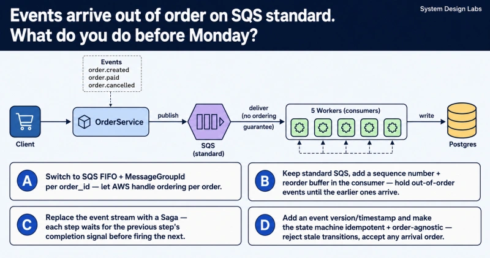

# Ngày 07: Event Ordering in a Message Queue

[← Ngày trước](day-06-safe-distributed-locks-for-cron-jobs.md) | [Mục lục](README.md) | [Ngày tiếp theo →](day-08-keeping-cache-and-database-in-sync.md)

---

# NGÀY 07 · SYSTEM DESIGN (THIẾT KẾ HỆ THỐNG)

## Thứ tự xử lý sự kiện trong hàng đợi tin nhắn (Event Ordering in a Message Queue)

### Bối cảnh tình huống (Scenario)

Dịch vụ đơn hàng (**Order Service**) của bạn phát hành (**publish**) 3 sự kiện (**events**) cho mỗi đơn hàng: `created` (đã tạo), `paid` (đã thanh toán), `cancelled` (đã hủy).

Hệ thống sử dụng **Standard SQS queue** (hàng đợi SQS tiêu chuẩn), **5 consumers (workers)**, lưu lượng đạt khoảng **~2.000 đơn hàng/phút** vào giờ cao điểm.

Đêm qua, hệ thống production phát cảnh báo: **47 đơn hàng bị kẹt ở trạng thái "cancelled" mà không có bất kỳ bản ghi "created" nào**. Khách hàng được hoàn tiền cho những đơn hàng chưa từng được ghi nhận là đã đặt. Bộ phận Tài chính (**Finance**) đang vô cùng tức giận.

Bạn đi sâu vào điều tra: Đơn hàng đã được đặt, thanh toán và hủy chỉ trong vòng **400ms**. Cả ba tin nhắn (**messages**) đều đi vào SQS theo đúng thứ tự. Ba consumers đã nhặt ba tin nhắn này xử lý song song (**in parallel**). Tin nhắn `cancelled` lại được xử lý xong trước tiên. Máy trạng thái (**state machine**) sau đó từ chối sự kiện `created` vì cho rằng trạng thái không hợp lệ. Dữ liệu hiện tại đã bị sai lệch hoàn toàn.

**Mô hình thiết lập hiện tại (Setup):**
> `OrderService` → `SQS (standard)` → `5 workers` → `Postgres`
> 
> **Chuỗi sự kiện (Events):** `order.created` → `order.paid` → `order.cancelled`

> [!WARNING]
> **Vấn đề cốt lõi (Problem):** Các workers xử lý song song, trong khi SQS tiêu chuẩn (**SQS standard**) không đảm bảo thứ tự (**doesn't guarantee order**). Máy trạng thái ở tầng hạ nguồn (**downstream state machine**) bị gãy vỡ khi các sự kiện đến lệch thứ tự (**out of sequence**).

**Bạn có hạn chót xử lý đến thứ Hai. Bạn sẽ làm gì?**

---

### Các phương án lựa chọn (Options)

- **A.** Chuyển sang dùng **SQS FIFO** kết hợp với `MessageGroupId` theo `order_id` — để AWS tự quản lý và đảm bảo thứ tự cho từng đơn hàng (**per order**).
- **B.** Giữ nguyên **SQS tiêu chuẩn (standard SQS)**, bổ sung thêm số thứ tự (**sequence number**) + bộ đệm sắp xếp lại (**reorder buffer**) tại consumer — giữ lại các sự kiện đến lệch thứ tự cho đến khi các sự kiện trước đó được xử lý xong.
- **C.** Thay thế luồng sự kiện (**event stream**) bằng mô hình **Saga** — mỗi bước sẽ chờ tín hiệu hoàn thành của bước trước đó trước khi kích hoạt bước tiếp theo.
- **D.** Bổ sung phiên bản sự kiện/dấu thời gian (**event version/timestamp**) và làm cho máy trạng thái đạt tính bất biến khi lặp lại (**idempotent**) + không phụ thuộc vào thứ tự (**order-agnostic**) — từ chối các bước chuyển trạng thái cũ (**stale transitions**), chấp nhận mọi thứ tự đến của sự kiện.

---

## NGÀY 07 · ĐÁP ÁN & GIẢI THÍCH CHI TIẾT (ANSWERS & EXPLANATIONS)

### Câu trả lời 1 (Answer 1)
#### ✓ ĐÁP ÁN ĐÚNG (CORRECT ANSWER)

> [!TIP]
> **✅ Đáp án: A — SQS FIFO + MessageGroupId per order_id**

#### Tại sao A chiến thắng (Why A wins):
Bạn không cần đảm bảo thứ tự trên quy mô toàn cục (**global ordering**) — bạn chỉ cần đảm bảo **thứ tự trên từng đơn hàng riêng biệt (per-order ordering)**. Hãy thiết lập:
$$\text{MessageGroupId} = \text{order\_id}$$

Hàng đợi **FIFO** bảo đảm rằng tất cả các tin nhắn có cùng một Group ID sẽ được phân phối chính xác theo thứ tự đã gửi, và **chỉ có duy nhất một consumer xử lý group đó tại một thời điểm**. 

Lưu lượng 2.000 đơn hàng/phút của bạn vẫn được phân phối song song (**fan out**) đồng đều qua 5 workers — thông lượng (**throughput**) hoàn toàn không bị ảnh hưởng. Chuỗi sự kiện của Đơn hàng #12345 gồm `created` → `paid` → `cancelled` sẽ luôn luôn được ghi nhận theo đúng trình tự.

* **Chi phí đánh đổi:** Độ trễ tăng thêm vài mili-giây (**a few ms latency**). Triển khai ngay vào thứ Hai!

---

### Câu trả lời 2 (Answer 2)
#### Tại sao B là phương án bẫy (Why B is the trap - reorder buffer):
Phương án này rất dễ đánh lừa các kỹ sư cấp cao (**Senior Engineers**) khi vẽ giải pháp trên bảng trắng (**whiteboard**). Thực tế, bạn sẽ kết thúc bằng việc phải tự tay xây dựng:
- Bộ nhớ đệm trong bộ nhớ (**in-memory buffer**) theo từng `order_id`.
- Logic thời gian sống (**TTL logic**).
- Luồng xử lý tin nhắn chết (**dead-letter path**) cho các lỗ hổng mất tin nhắn.
- Khả năng phục hồi sau sự cố sập ứng dụng (**crash recovery**).
- Giám sát tình trạng kẹt bộ đệm (**stuck buffer monitoring**).

Bạn vừa tự code lại toàn bộ cơ chế của **FIFO** ngay trong tầng ứng dụng (**app code**). Nhưng đi kèm với **nhiều lỗi (bugs) hơn**, và bạn phải tự gánh chịu mọi trường hợp biên (**edge cases**). Phương án B chỉ hợp lý khi bạn không có khả năng sử dụng FIFO (ví dụ: dùng **Kafka** với một **partition key** đã bị chiếm dụng/cố định). Đó không phải là trường hợp trong tình huống này.

---

### Câu trả lời 3 (Answer 3)
#### Tại sao C sai (Why C is wrong - Saga):
**Saga Pattern** được thiết kế cho các giao dịch phân tán kéo dài (**long-running distributed transactions**) với các hành động bù trừ (**compensating actions**) (ví dụ: đặt vé máy bay → trừ tiền thẻ → đặt phòng khách sạn). 

Vấn đề thực tế của bạn ở đây chỉ là một **luồng trạng thái (state stream) cho một thực thể đơn lẻ (one entity)** — chứ không phải là một giao dịch trải rộng trên nhiều dịch vụ (**multi-service transaction**). Việc gượng ép áp dụng Saga sẽ biến các sự kiện bất đồng bộ (**async events**) thành các cuộc gọi RPC đồng bộ (**sync RPC**), làm tăng tính liên kết phụ thuộc (**coupling**), mà bản chất vẫn không giải quyết được bài toán bảo đảm thứ tự.

---

### Câu trả lời 4 (Answer 4)
#### Tại sao D sai (Why D is wrong - event versioning):
Phương án này chỉ giải quyết được một phần (**partially works**) — nhưng bạn sẽ vô tình đánh rơi các sự kiện hợp lệ (**drop legitimate events**). 

Nếu `cancelled` đến trước, hệ thống đẩy trạng thái tiến về phía trước, sau đó sự kiện `created` đến sau sẽ bị từ chối thẳng thừng. Cơ sở dữ liệu (**DB**) khi đó sẽ ghi nhận đơn hàng ở trạng thái đã hủy mà hoàn toàn không có bất kỳ bản ghi khởi tạo nào. Để phương án D hoạt động chính xác, bạn cần phải chuyển đổi sang toàn bộ kiến trúc **Event Sourcing** (đây là một đợt đập đi viết lại mất 6 tháng, chứ không thể là một bản vá gấp rút cho ngày thứ Hai).

---

### Bảng tổng kết so sánh các phương án

| Phương án | Bản chất giải pháp | Tính khả thi trước thứ Hai | Đánh giá kiến trúc |
| :--- | :--- | :---: | :--- |
| **A (SQS FIFO + GroupId)** | Ủy quyền việc bảo đảm thứ tự per-order cho AWS | **Rất cao (Khuyên dùng)** | **Chuẩn xác nhất.** Tận dụng hạ tầng đám mây sẵn có, giữ nguyên throughput, xử lý dứt điểm race condition. |
| **B (Reorder Buffer)** | Tự dựng cơ chế FIFO bằng in-memory buffer | **Rất thấp** | **Phương án bẫy.** Tự làm phức tạp ứng dụng, gánh nặng stateful, rủi ro crash và rò rỉ bộ nhớ. |
| **C (Saga Pattern)** | Điều phối giao dịch phân tán kèm compensating actions | **Thấp** | **Sai công cụ.** Biến async thành sync RPC, tăng coupling không cần thiết. |
| **D (Event Versioning)** | Đánh version sự kiện + từ chối chuyển trạng thái cũ | **Trung bình** | **Sai logic nghiệp vụ.** Bỏ rơi sự kiện hợp lệ, đòi hỏi Event Sourcing toàn diện (mất 6 tháng). |

---

[← Ngày trước](day-06-safe-distributed-locks-for-cron-jobs.md) | [Mục lục](README.md) | [Ngày tiếp theo →](day-08-keeping-cache-and-database-in-sync.md)
