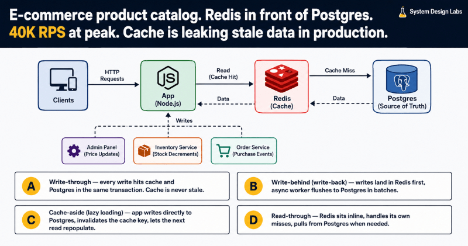

# Ngày 08: Keeping Cache and Database in Sync

[← Ngày trước](day-07-event-ordering-in-a-message-queue.md) | [Mục lục](README.md) | [Ngày tiếp theo →](day-09-splitting-read-and-write-data-models.md)

---

# NGÀY 08 · THIẾT KẾ HỆ THỐNG (DAY 08 · SYSTEM DESIGN)
## Đồng bộ Dữ liệu giữa Cache và Cơ sở dữ liệu (Keeping Cache and Database in Sync)

Danh mục sản phẩm của hệ thống thương mại điện tử (E-commerce product catalog). **Redis** được đặt trước **Postgres**. Đạt mức **40K RPS** vào giờ cao điểm.

Tại môi trường Staging, tỷ lệ trúng cache (**cache hit ratio**) đạt 94%. Thời gian phản hồi (**response time**) dưới 20ms. Mọi thứ vận hành hoàn hảo.

Triển khai lên môi trường Production. Trong vòng 48 giờ, các vé hỗ trợ sự cố (**support tickets**) bắt đầu dồn dập gửi về:
- Khách hàng nhìn thấy giá sai lệch.
- Số lượng hàng tồn kho cũ.
- Sản phẩm hiển thị trạng thái "còn hàng" (**"available"**) dù thực tế đã được xuất kho từ 3 giờ trước.

Cấu hình hệ thống hiện tại:
- **Ứng dụng (App - Node.js)** → **Redis (Cache)** → **Postgres (Source of truth)**
- **Các luồng ghi (Writes come from):** 
  - Bảng điều khiển quản trị (**Admin panel** - cập nhật giá).
  - Dịch vụ tồn kho (**Inventory service** - trừ số lượng tồn kho).
  - Dịch vụ đơn hàng (**Order service** - sự kiện mua hàng).
- **Các luồng đọc (Reads come from):** 
  - Trang chi tiết sản phẩm (**Product pages**).
  - Kết quả tìm kiếm (**Search results**).
  - Luồng thanh toán (**Checkout flow**).

> [!WARNING]
> Cache đang bị rò rỉ dữ liệu cũ/lỗi thời (**leaking stale data**) trên môi trường Production. Đội ngũ kỹ sư của bạn đang tranh luận gay gắt về chiến lược hủy bỏ hiệu lực cache (**invalidation strategy**). Bạn sẽ lựa chọn triển khai phương án nào?

---

### CÁC PHƯƠNG ÁN LỰA CHỌN:

- **A. Ghi xuyên (Write-through):** Mỗi thao tác ghi đều tác động đồng thời vào Cache và Postgres trong cùng một Transaction. Cache không bao giờ bị lỗi thời (**stale**).
- **B. Ghi trễ (Write-behind / Write-back):** Thao tác ghi được ghi nhận vào Redis trước, sau đó tiến trình nền bất đồng bộ (**async worker**) sẽ ghi định kỳ theo lô (**flush in batches**) vào Postgres.
- **C. Đọc lười / Đọc qua ứng dụng (Cache-aside / Lazy loading):** Ứng dụng ghi trực tiếp vào Postgres, hủy bỏ khóa cache tương ứng (**invalidates the cache key**), và để cho lần đọc tiếp theo tự nạp lại dữ liệu mới vào cache.
- **D. Đọc xuyên (Read-through):** Redis đóng vai trò trung gian nội tuyến (**in-line**), tự xử lý các trường hợp không trúng cache (**cache misses**) và tự động kéo dữ liệu từ Postgres về khi cần.

---

# NGÀY 08 · ĐÁP ÁN & GIẢI THÍCH CHI TIẾT (DAY 08 · ANSWERS & EXPLANATIONS)

### Câu trả lời 1 (Answer 1)
> [!NOTE]
> ### ✓ CÂU TRẢ LỜI ĐÚNG
> ✅ **Đáp án: C — Cache-aside (Lazy loading)**

#### Lý do phương án C chiến thắng (Why C wins):
Nhiều luồng ghi khác nhau (Bảng điều khiển quản trị, Dịch vụ tồn kho, Dịch vụ đơn hàng) đều tác động độc lập vào Postgres. Mô hình **Cache-aside** là sự lựa chọn hoàn hảo: 
1. Mỗi luồng ghi sẽ cập nhật vào Postgres.
2. Hủy bỏ khóa cache tương ứng (`DEL product:123`).
3. Lần đọc tiếp theo bị trượt cache (**cache miss**).
4. Kéo dữ liệu mới nhất từ database về.
5. Nạp lại dữ liệu mới vào Redis.

Postgres luôn giữ vững vị thế là nguồn chân lý duy nhất (**uncontested source of truth**). Redis lúc này chỉ đóng vai trò là một bộ gia tốc đọc có thể loại bỏ bất cứ lúc nào (**disposable read accelerator**). Nếu Redis gặp sự cố hoặc ngừng hoạt động, ứng dụng vẫn vận hành bình thường — tốc độ phản hồi có thể chậm hơn, nhưng dữ liệu luôn tuyệt đối chính xác. 

> [!TIP]
> Đây chính là kiến trúc thực tế đang được vận hành trên Production tại **Shopify**, **Etsy**, và trong hầu hết các kiến trúc tham chiếu chuẩn của **AWS**.

---

### Câu trả lời 2 (Answer 2)
#### Vì sao A lại là phương án bẫy (Why A is the trap - Write-through):
*"Chúng ta ghi vào cả hai hệ thống một cách nguyên tử (atomically)"* — thực tế là **không hề tồn tại Distributed Transaction giữa Redis và Postgres**. 

Bạn ghi vào Postgres, sau đó mới ghi vào Redis. Nếu thao tác ghi vào Redis thất bại (do sự cố mạng thoáng qua - network blip, hoặc timeout), bạn sẽ rơi vào tình trạng: **Postgres mang dữ liệu nhất quán + Redis mang dữ liệu lỗi thời (stale)**. Đây chính xác là lỗi (bug) mà bạn đang tìm cách khắc phục!

Nghiêm trọng hơn, **Write-through** làm gắn kết chặt chẽ (**couples**) mọi dịch vụ vào Redis — giờ đây cả Dịch vụ tồn kho lẫn Dịch vụ đơn hàng đều phải nắm giữ thông tin xác thực truy cập (**credentials**) vào Redis. Một khi Redis gặp sự cố gián đoạn (**outage**), toàn bộ luồng ghi dữ liệu của hệ thống sẽ bị đánh sập hoàn toàn. 

Mô hình này hoạt động rất tốt đối với hệ thống đơn dịch vụ / đơn luồng ghi (**single-service / single-writer**), nhưng sẽ hoàn toàn đổ vỡ khi đối mặt với kiến trúc có nhiều luồng ghi cùng lúc (**multiple writers**).

---

### Câu trả lời 3 (Answer 3)
#### Vì sao B sai (Why B is wrong - Write-behind):
Lúc này Redis bị biến thành nguồn chân lý (**source of truth**). Tuy nhiên, Redis hoàn toàn có thể bị mất dữ liệu trong các tình huống chuyển đổi dự phòng (**failover**), bị hệ điều hành tiêu diệt do hết bộ nhớ (**OOM kills - Out of Memory**), hoặc độ trễ ghi log (**AOF lag**). 

Lập luận *"Chúng ta có thể bị mất một vài lần cập nhật giá gần nhất"* là điều **không thể chấp nhận hay bào chữa được** trong một buổi họp đánh giá sự cố (**postmortem**) khi có liên quan trực tiếp đến tiền tệ thực tế của doanh nghiệp. 

Mô hình **Write-behind** chỉ phù hợp cho các luồng xử lý số liệu đo lường (**metrics pipelines**) và các bộ đếm phân tích dữ liệu (**analytics counters**) — tuyệt đối không được dùng cho luồng ghi của hệ thống thương mại điện tử.

---

### Câu trả lời 4 (Answer 4)
#### Vì sao D sai (Why D is wrong - Read-through):
Phương án này **chỉ giải quyết được bài toán ở phía đọc (read side)**. Các luồng ghi của bạn vẫn đang đi qua 3 dịch vụ khác nhau mà không hề có bất kỳ tín hiệu nào thông báo cho Cache biết. 

**Read-through** không thể giải quyết được tình trạng dữ liệu bị cũ/lỗi thời sinh ra từ nhiều luồng ghi khác nhau — về bản chất, bạn vẫn phải tự bổ sung thêm cơ chế hủy bỏ hiệu lực cache (**invalidation**) đè lên trên, và khi đó nó chẳng qua chỉ là **Cache-aside** nhưng lại rườm rà thêm nhiều bước phức tạp không cần thiết.

---

### BẢNG TỔNG KẾT SO SÁNH CÁC CHIẾN LƯỢC CACHING

| Tiêu chí / Chiến lược | A. Write-through | B. Write-behind (Write-back) | C. Cache-aside (Lazy loading) ✅ | D. Read-through |
| :--- | :--- | :--- | :--- | :--- |
| **Bản chất luồng ghi** | Ghi đồng thời vào Cache & DB | Ghi Cache trước, flush DB sau (Async) | Ghi DB trước, xóa/hủy khóa Cache | Ghi thẳng vào DB (không can thiệp Cache) |
| **Bảo toàn dữ liệu** | Có rủi ro lệch do thiếu Distributed Transaction | **Rất cao**: Dễ mất dữ liệu khi failover/OOM | **Tối đa**: DB là Source of Truth duy nhất | Không quản lý tính nhất quán luồng ghi |
| **Độ phức tạp phụ thuộc** | Cao (Tất cả Service ghi đều phụ thuộc Cache) | Cao (Cache đóng vai trò Storage chính) | **Thấp** (Cache hỏng hệ thống vẫn sống) | Trung bình (Cần thêm cơ chế invalidation) |
| **Khả năng áp dụng** | Single-writer / Dịch vụ đơn lẻ | Bộ đếm View, Metric, Click stream | **E-commerce, Hệ thống Multi-writers** | Hệ thống Read-heavy đơn giản |

---

[← Ngày trước](day-07-event-ordering-in-a-message-queue.md) | [Mục lục](README.md) | [Ngày tiếp theo →](day-09-splitting-read-and-write-data-models.md)
