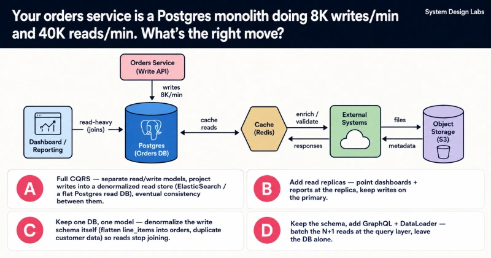

# Ngày 09: Splitting Read and Write Data Models

[← Ngày trước](day-08-keeping-cache-and-database-in-sync.md) | [Mục lục](README.md) | [Ngày tiếp theo →](day-10-distributed-transactions-across-services.md)

---

# NGÀY 09 · THIẾT KẾ HỆ THỐNG (DAY 09 · SYSTEM DESIGN)
## Phân Tách Mô Hình Dữ Liệu Đọc và Ghi (Splitting Read and Write Data Models)

### Bối cảnh tình huống (Scenario)
Dịch vụ đơn hàng (`orders service`) của bạn là một hệ thống nguyên khối trên Postgres (**Postgres monolith**), đang xử lý **8.000 lượt ghi/phút** (8K writes/min) và **40.000 lượt đọc/phút** (40K reads/min).

Cùng một bảng dữ liệu. Cùng một lược đồ cấu trúc (**schema**). Toàn bộ hệ thống đang bị quá tải và chậm chạp đến mức đình trệ.

- **Phía Ghi (Write side)** cần một lược đồ đã được chuẩn hóa (**normalized schema**) — bao gồm các bảng `orders`, `line_items`, `payments`, `shipments`, `addresses`. Các ràng buộc khóa ngoại (**Foreign Keys - FKs**) rõ ràng, đảm bảo tính toán vẹn **ACID**, không có dữ liệu trùng lặp.
- **Phía Đọc (Read side)** lại đòi hỏi điều hoàn toàn ngược lại — giao diện bảng điều khiển (**dashboard**) phải thực hiện phép nối (**join**) tới **7 bảng** chỉ để kết xuất (**render**) một thẻ hiển thị đơn hàng (`order card`), và các câu truy vấn báo cáo đang đẩy **CPU chạm ngưỡng 85%** đều đặn vào 9 giờ sáng mỗi ngày.

Bạn đã tối ưu hóa các chỉ mục (**indexes**). Bạn cũng đã thêm tầng bộ nhớ đệm (**caching**). Vấn đề cốt lõi ở đây không nằm ở phần cứng — mà là **mô hình đọc (read model) và mô hình ghi (write model) đòi hỏi hình thái dữ liệu (data shape) hoàn toàn khác nhau từ cùng một nguồn dữ liệu**, và bạn đã giả vờ rằng chúng giống nhau trong suốt hai năm qua.

---

### Các phương án quyết định được đưa ra bàn thảo:

* **A — CQRS Toàn Diện (Full CQRS):**  
  Tách biệt hoàn toàn mô hình đọc/ghi (**read/write models**), đồng bộ/chiếu các thao tác ghi sang một kho lưu trữ dữ liệu đọc đã được phi chuẩn hóa (**denormalized read store**) (như **Elasticsearch** hoặc một cơ sở dữ liệu đọc Postgres dạng bảng phẳng - **flat Postgres read DB**), chấp nhận tính nhất quán cuối cùng (**eventual consistency**) giữa hai phía.

* **B — Thêm các bản sao đọc (Add read replicas):**  
  Trỏ các bảng điều khiển (**dashboards**) và báo cáo truy vấn vào bản sao chỉ đọc (**replica**), giữ toàn bộ thao tác ghi trên nút chính (**primary**).

* **C — Giữ nguyên một Database, một Data Model (Keep one DB, one model):**  
  Phi chuẩn hóa chính lược đồ ghi (**denormalize the write schema itself**) (làm phẳng bảng `line_items` gộp vào `orders`, nhân bản dữ liệu khách hàng `customer`) để phía đọc không còn phải thực hiện phép nối (**join**) nữa.

* **D — Giữ nguyên lược đồ, bổ sung GraphQL + DataLoader (Keep the schema, add GraphQL + DataLoader):**  
  Gom cụm (**batch**) các thao tác đọc bị phân mảnh $N+1$ tại tầng truy vấn ứng dụng (**query layer**), không can thiệp vào cơ sở dữ liệu (**DB**).

---

# NGÀY 09 · ĐÁP ÁN & GIẢI THÍCH CHI TIẾT (DAY 09 · ANSWERS & EXPLANATIONS)

### Câu trả lời 1 (Answer 1)
> [!NOTE]  
> **✓ ĐÁP ÁN CHÍNH XÁC (CORRECT ANSWER):**  
> **✅ Đáp án: A — CQRS Toàn Diện (Full CQRS)**

#### Vì sao phương án A chiến thắng (Why A wins):
Nỗi đau ở đây không phải là "thao tác đọc bị chậm" — mà là **phía ghi cần một lược đồ chuẩn hóa (normalized schema) còn phía đọc lại cần một lược đồ phi chuẩn hóa (denormalized schema)**, và bạn đang ép buộc chúng phải chia sẻ chung một cấu trúc. Không một cấu hình phần cứng nào có thể sửa chữa được sự lệch pha về mặt hình thái lược đồ (**schema shape mismatch**).

* **Phía Ghi (Write side) giữ nguyên sự tinh gọn:** các bảng `orders`, `line_items`, `payments` đều được chuẩn hóa, đảm bảo tính chất **ACID**, thực thi nghiêm ngặt các ràng buộc khóa ngoại (**FK-enforced**).
* **Phía Đọc (Read side) là một hình chiếu (projection):** một bảng phẳng `order_view` (hoặc một chỉ mục trên **Elasticsearch**) nơi mỗi thẻ đơn hàng (`order card`) được kết xuất trực tiếp chỉ từ một dòng duy nhất, **không cần bất kỳ phép join nào (zero joins)**.
* **Bộ đồng bộ chiếu (Projector) giữ chúng đồng bộ:** sử dụng mẫu hình **Transactional Outbox** $\rightarrow$ **Kafka** $\rightarrow$ bộ cập nhật mô hình đọc (**read-model updater**), hoặc Kỹ thuật thu thập thay đổi dữ liệu (**Change Data Capture - CDC**).
* **Chấp nhận tính nhất quán cuối cùng (Eventual consistency):** Bảng điều khiển có thể bị trễ vài trăm mili-giây. Đối với 95% lưu lượng đọc (dashboards, báo cáo, tìm kiếm), độ trễ này hoàn toàn vô hình đối với người dùng. Đối với 5% còn lại bắt buộc tính nhất quán mạnh (**strong consistency**) (ví dụ: màn hình xác nhận đơn hàng của chính người dùng vừa mua), hãy đọc trực tiếp từ phía ghi (**write side**).

---

### Câu trả lời 2 (Answer 2)
> [!WARNING]  
> **Vì sao B là phương án bẫy (Why B is the trap - Read replicas):**  
> Phương án B chỉ giải quyết được **tải đọc (read load)**, chứ **không giải quyết được hình thái dữ liệu đọc (read shape)**.

Phép nối 7 bảng (**7-table join**) thì bản chất vẫn là phép nối 7 bảng — nó chỉ được chuyển sang chạy trên một phần cứng khác. Bạn chỉ dời hóa đơn chi phí **CPU** sang chỗ khác chứ không hề triệt tiêu nó. Độ trễ (**latency**) có thể giảm tạm thời trong vòng 6 tháng trong lúc lưu lượng truy cập tiếp tục tăng trưởng, sau đó bạn sẽ quay trở lại vạch xuất phát với 3 bản sao (**replicas**) đều đồng loạt chạy những câu truy vấn kết nối bảng nặng nề và tốn kém như nhau.

* **B là lựa chọn đúng:** Khi các phép nối bảng về mặt cấu trúc là hợp lý nhưng cơ sở dữ liệu chính (**primary**) bị quá tải tài nguyên.
* **B là lựa chọn sai:** Khi bản thân các phép nối bảng (**joins**) chính là nguồn cơn của vấn đề.

---

### Câu trả lời 3 (Answer 3)
> [!CAUTION]  
> **Vì sao C sai (Why C is wrong - Denormalize the write model):**  
> Phi chuẩn hóa trực tiếp mô hình ghi sẽ phá vỡ tính toàn vẹn và gia tăng khuếch đại ghi.

Mỗi thay đổi đối với một dòng mặt hàng (`line-item`) giờ đây sẽ phải ghi đè lại toàn bộ hàng của đơn hàng (`order row`). Mỗi lần cập nhật địa chỉ sẽ phải cập nhật dây chuyền (**cascades**) qua mọi đơn hàng từng được đặt trong lịch sử. Hiện tượng **khuếch đại ghi (write amplification)** sẽ cộng dồn và nhân lên khủng khiếp ở mức **8.000 lượt ghi/phút**.

Lược đồ dữ liệu sẽ trở nên xơ cứng (**ossifies**) — việc thêm một trường dữ liệu mới vào `line_items` đồng nghĩa với việc phải di chuyển dữ liệu (**migrate**) cho hàng triệu hàng đã bị phi chuẩn hóa. Đây là một nước đi kinh điển kiểu "tránh né cuộc thảo luận về thay đổi kiến trúc". Nó giúp bạn mua được một quý yên ổn, nhưng thế chấp và đánh đổi bằng hai quý tiếp theo đầy thảm họa.

---

### Câu trả lời 4 (Answer 4)
> [!TIP]  
> **Vì sao D sai (Why D is wrong - GraphQL + DataLoader):**  
> **DataLoader gom cụm các lệnh gọi API (API calls), chứ không gom cụm các phép nối bảng (joins).**

Phép nối 7 bảng diễn ra bên trong cơ sở dữ liệu (**database**), chứ không phải ở tầng ứng dụng (**application layer**). Sau 3 tháng trời vật lộn để di chuyển sang **GraphQL**, tốc độ đọc của hệ thống vẫn sẽ chậm y nguyên như trước.

* **D là câu trả lời đúng:** Khi vấn đề nghẽn cổ chai xuất phát từ phía máy khách (**clients**).
* **D là câu trả lời sai:** Khi vấn đề cốt lõi nằm ở lược đồ cơ sở dữ liệu (**DB schema**).

---

### Bảng tổng kết so sánh các phương án:

| Tiêu chí so sánh | Phương án A (Full CQRS) | Phương án B (Read Replicas) | Phương án C (Denormalize Write DB) | Phương án D (GraphQL + DataLoader) |
| :--- | :--- | :--- | :--- | :--- |
| **Bản chất giải pháp** | Tách riêng Model Đọc & Ghi | Nhân bản phần cứng chịu tải | Gộp bảng ở DB chính | Gom batch call ở tầng App |
| **Xử lý Shape Mismatch?** | **Có (Triệt để)** | **Không** (Vẫn join 7 bảng) | **Có** (Nhưng phá vỡ Write) | **Không** (DB vẫn tự join) |
| **Tác động phía Ghi** | Giữ nguyên chuẩn hóa, ACID | Không ảnh hưởng | Gây Write Amplification trầm trọng | Không ảnh hưởng |
| **Mô hình Nhất quán** | Eventual Consistency | Eventual (Replication Lag) | Strong Consistency | Phụ thuộc DB gốc |
| **Đánh giá kiến trúc** | **Giải pháp chuẩn xác** | Bẫy kiến trúc (Tạm thời) | Nợ kỹ thuật lớn | Giải quyết sai tầng |

---

[← Ngày trước](day-08-keeping-cache-and-database-in-sync.md) | [Mục lục](README.md) | [Ngày tiếp theo →](day-10-distributed-transactions-across-services.md)
