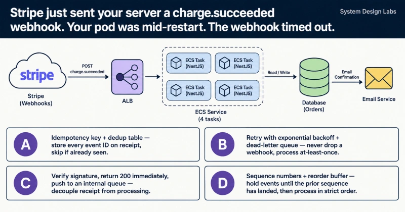

# Ngày 11: Handling Webhook Retries Idempotently

[← Ngày trước](day-10-distributed-transactions-across-services.md) | [Mục lục](README.md) | [Ngày tiếp theo →](day-12-indexing-a-high-ingest-table.md)

---

# NGÀY 11 · THIẾT KẾ HỆ THỐNG (DAY 11 · SYSTEM DESIGN)

## Xử lý Webhook Retry chuẩn Idempotent (Handling Webhook Retries Idempotently)

Stripe vừa gửi đến server của bạn một sự kiện webhook `charge.succeeded`.  
Pod của bạn đang nằm ở giữa quá trình khởi động lại (restart). Webhook bị hết thời gian chờ (timed out). Stripe sẽ thực hiện retry — nhưng giờ đây bạn đang rơi vào tình trạng tương tranh (race condition).

### Thiết lập hạ tầng hiện tại (The setup):
* **NestJS API** chạy trên **ECS**, gồm 4 tasks nằm sau **ALB (Application Load Balancer)**.
* Stripe gửi các HTTP POST request sự kiện `charge.succeeded` tới endpoint `/webhooks/stripe`.
* Bạn có khoảng **~10 giây** để phản hồi mã trạng thái HTTP 200 trước khi Stripe coi là timed out và đưa vào hàng đợi để retry.
* Vào sự kiện Black Friday, bạn phải xử lý khoảng **~80 webhooks/giây**.

---

### Ba kịch bản lỗi (failure modes) đang diễn ra trực tiếp trên Production:

1. **Pod khởi động lại giữa lúc deploy (Pod restarts mid-deploy):**  
   Webhook bị bỏ lỡ $\rightarrow$ Stripe thực hiện retry $\rightarrow$ Bạn xử lý sự kiện đó, nhưng một pod thứ hai cũng vừa xử lý sự kiện ban đầu $\rightarrow$ Gửi trùng email xác nhận thanh toán 2 lần (double charge confirmation email).
2. **Database bị nghẽn chậm vào giờ cao điểm (DB is slow at peak):**  
   Hàm xử lý (handler) mất tới 12 giây $\rightarrow$ Stripe bị timed out $\rightarrow$ Stripe retry $\rightarrow$ Giờ đây bạn đang xử lý cùng một sự kiện hai lần trong khi tiến trình đầu tiên vẫn đang tiếp tục chạy.
3. **Stripe gửi `charge.succeeded` rồi đến `charge.refunded` cách nhau chỉ 200ms:**  
   Queue nội bộ phân phối sự kiện bị đảo lộn thứ tự (out of order) $\rightarrow$ Bạn đánh dấu đơn hàng là "đã thanh toán" (paid) SAU KHI nó vốn dĩ đã được hoàn tiền (refunded).

> [!WARNING]  
> Hàm xử lý (handler) hiện tại là một function vỏn vẹn 30 dòng code, hoạt động chính xác trong 99% trường hợp. Nhưng **1% lỗi còn lại đang giết chết hệ thống của bạn**.

---

---

## Bạn sẽ làm gì? (What do you do?)

* **A.** **Idempotency Key + Dedup Table:** Lưu mọi event ID ngay khi nhận được, bỏ qua nếu ID đó đã tồn tại trong hệ thống.
* **B.** **Retry với Exponential Backoff + Dead-Letter Queue (DLQ):** Không bao giờ làm rơi rớt webhook, đảm bảo xử lý theo cơ chế ít nhất một lần (at-least-once).
* **C.** **Xác thực chữ ký số (Verify signature), trả về HTTP 200 ngay lập tức, đẩy vào Internal Queue:** Tách rời hoàn toàn bước tiếp nhận (receipt) khỏi bước xử lý (processing).
* **D.** **Sequence Numbers + Reorder Buffer:** Giữ lại các sự kiện cho đến khi số thứ tự trước đó đã cập bến an toàn, sau đó mới tiến hành xử lý theo đúng thứ tự nghiêm ngặt.

---

# NGÀY 11 · CÂU TRẢ LỜI & GIẢI THÍCH (DAY 11 · ANSWERS & EXPLANATIONS)

## Câu trả lời (Answer 1)

### ✓ CÂU TRẢ LỜI CHÍNH XÁC (CORRECT ANSWER)

> [!TIP]  
> **Đáp án: C — Xác thực chữ ký số (Verify signature), trả về HTTP 200 ngay lập tức, đẩy vào một internal queue ✅**

---

---

### Dưới đây là lý do, và tại sao ba phương án còn lại đánh lừa được cả những kỹ sư thông minh:

### Tại sao C chiến thắng (Tiếp nhận đồng bộ + Xử lý bất đồng bộ - Sync receipt + async processing):

Vấn đề cốt lõi ở đây là: **đồng hồ đo thời gian của Stripe và đồng hồ đo thời gian của handler bên bạn hoàn toàn tách biệt (decoupled)**. Stripe cho bạn khoảng ~10 giây để gửi tín hiệu xác nhận (ACK). Các thao tác như ghi Database, kiểm tra gian lận (fraud check), gửi email — tuyệt đối **không bao giờ được phép nằm trong cửa sổ 10 giây đó**. 

Mô hình chuẩn (The pattern):
1. Xác thực HMAC signature trong thời gian **< 5ms**.
2. Ghi payload nguyên bản (raw payload) vào **SQS / Kafka / Redis Streams**.
3. Phản hồi HTTP 200 ngay lập tức.

Giờ đây, thời gian phản hồi của handler chỉ bị giới hạn bởi độ trễ mạng + thời gian xác thực chữ ký, hoàn toàn không bị ảnh hưởng bởi việc các dịch vụ hạ nguồn (downstream services) đang làm gì lúc đó. 

* **Pod bị restart giữa quá trình xử lý?** Message đã nằm an toàn, bền vững (durable) trong queue — một worker khác sẽ nhặt ra để xử lý.
* **Database bị chậm?** Webhook endpoint không quan tâm — nó đã trả về HTTP 200 chỉ sau 8ms. 

> [!NOTE]  
> Đây chính xác là những gì Stripe, Shopify và GitHub hướng dẫn bạn triển khai trong tài liệu tài liệu kỹ thuật (docs) chính thức về webhook của họ.

---

## Phân tích các phương án còn lại

### Câu trả lời 2 (Answer 2)
#### Tại sao A là câu trả lời bẫy (Idempotency key + dedup table):
Đây là câu trả lời thường đánh lừa các kỹ sư cấp cao (Senior Engineers) trong các buổi phỏng vấn — và nó không sai, **nó chỉ chưa đầy đủ**.

Đúng vậy, bạn chắc chắn cần cơ chế Idempotency. Stripe sẽ phân phối cùng một event ID nhiều hơn một lần. Một bảng Dedup Table lấy khóa chính là `event.id` cùng với ràng buộc Unique Constraint là điều kiện tối thiểu bắt buộc (table stakes). Nhưng nó **không giải quyết được nỗi đau ban đầu**: handler của bạn vẫn chạy theo kiểu đồng bộ (synchronous), vẫn nằm trên đường dẫn tới hạn 10 giây (critical 10-second path), và vẫn tiếp tục bị chết đứng khi pod restart ngay giữa tiến trình ghi dữ liệu (mid-write).

Nếu bạn chỉ triển khai mỗi phương án A:
* Bạn ngăn chặn được việc xử lý trùng lặp (double-processing).
* Nhưng hệ thống vẫn bị timeout, vẫn kích hoạt retry từ nhà cung cấp, và vẫn tiếp tục tạo ra các điều kiện dẫn đến tương tranh (race condition). 

> [!IMPORTANT]  
> **Idempotency là một đặc tính mà handler của bạn bắt buộc phải có, chứ không phải là một kiến trúc tổng thể.**  
> **C mới là kiến trúc; còn A là thành phần nằm bên trong kiến trúc C.** Cái bẫy của kỹ sư senior là coi idempotency là toàn bộ câu trả lời, trong khi nó thực chất chỉ là một trong ba tầng lớp phòng thủ.

---

### Câu trả lời 3 (Answer 3)
#### Tại sao B là lựa chọn sai (Retry + DLQ):
Stripe vốn dĩ đã tự thực hiện cơ chế retry kèm theo thuật toán Exponential Backoff rồi. Đó là trách nhiệm của họ, không phải của bạn. Stripe sẽ chủ động retry các webhook thất bại trong thời gian lên tới 3 ngày kèm theo backoff. Bạn không cần phải xây dựng lại cơ chế đó cho các webhook gửi đến (inbound webhooks) — làm vậy là bạn đang tái tạo lại hành vi của nhà cung cấp một cách dư thừa.

Mô hình **Retry + DLQ là mô hình chuẩn xác cho internal queue của bạn** (hàng đợi được tạo ra ở đáp án C), chứ không phải dành cho chính webhook endpoint tiếp nhận. Nếu worker của bạn xử lý thất bại một sự kiện đã được đưa vào hàng đợi, chắc chắn rồi, hãy retry và đưa vào DLQ sau $N$ lần thử. Nhưng đó là bài toán ở tầng hạ nguồn (downstream concern). Đặt "logic retry" ngay tại tầng tiếp nhận webhook sẽ gây nhầm lẫn tai hại giữa ngữ nghĩa của **inbound retry** và **outbound retry**.

---

### Câu trả lời 4 (Answer 4)
#### Tại sao D sai (Sequence numbers + reorder buffer):
Phương án này nghe có vẻ rất chặt chẽ và thường là giải pháp mà các kỹ sư tìm đến sau khi từng bị "bỏng tay" vì các sự cố về thứ tự sự kiện (ordering). 

Tuy nhiên, vấn đề thực tế là:
1. **Hầu hết các nhà cung cấp webhook không cung cấp Sequence Number (số thứ tự).** Stripe không cung cấp. GitHub không cung cấp. Thậm chí ngay cả khi họ có cung cấp (ví dụ `X-Shopify-Webhook-Id` của Shopify), các khoảng trống số thứ tự không hề liên tục (not dense) — bạn không thể phân biệt được giữa việc "bị thiếu mất sự kiện số 47" với "sự kiện số 47 đã bị lọc bỏ (filtered)".
2. **Quan trọng hơn: Quản lý thứ tự tại tầng tiếp nhận (receiver) là sai tầng kiến trúc.** Bạn phải xử lý thứ tự ở **tầng nghiệp vụ (domain level)** — khi bạn xử lý sự kiện `charge.refunded`, bạn phải kiểm tra trạng thái hiện tại của đơn hàng trước khi thực hiện chuyển đổi trạng thái (state transition). Nếu đơn hàng đã ở trạng thái `refunded` (đã hoàn tiền), bạn chỉ cần bỏ qua (no-op).

> [!TIP]  
> **State Machine (Máy trạng thái) luôn đánh bại Reorder Buffer** bởi vì nó xử lý được cả trường hợp các sự kiện đến lệch thứ tự LẪN trường hợp một trong số các sự kiện đó vĩnh viễn không bao giờ tới. Việc dùng Reorder Buffer đồng nghĩa với việc hệ thống của bạn sẽ bị đình trệ (stall) mãi mãi nếu một sự kiện bị đánh rơi ở phía thượng nguồn (upstream).

---

[← Ngày trước](day-10-distributed-transactions-across-services.md) | [Mục lục](README.md) | [Ngày tiếp theo →](day-12-indexing-a-high-ingest-table.md)
