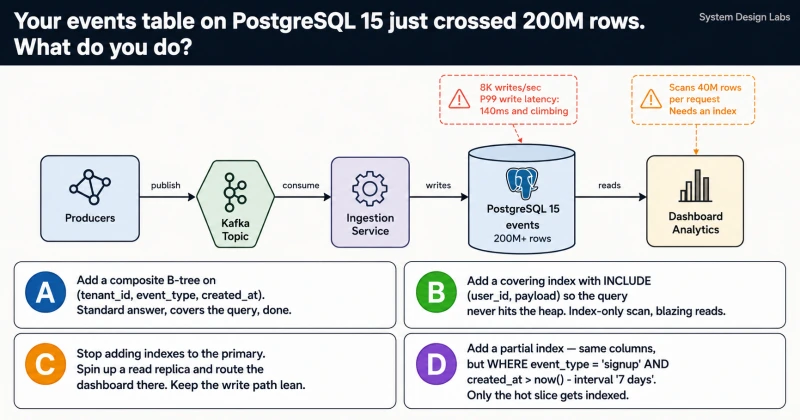

# Ngày 12: Indexing a High-Ingest Table

[← Ngày trước](day-11-handling-webhook-retries-idempotently.md) | [Mục lục](README.md) | [Ngày tiếp theo →](day-13-managing-a-shared-connection-pool.md)

---


# NGÀY 12 · SYSTEM DESIGN (THIẾT KẾ HỆ THỐNG)
## Đánh chỉ mục cho bảng có tốc độ ghi nhận dữ liệu cao (Indexing a High-Ingest Table)



### Tình huống thực tế (Scenario)
Bảng `events` (sự kiện) của bạn trên **PostgreSQL 15** vừa cán mốc **200 triệu dòng (200M rows)**.

Tốc độ ghi nhận dữ liệu (**ingestion rate**) đạt **8.000 lượt ghi/giây (8K writes/sec)** từ một Kafka consumer. Độ trễ ghi **P99 write latency** ban đầu là **12ms** — hiện tại đã vọt lên **140ms** và tiếp tục tăng không ngừng.

Đội ngũ phụ trách Dashboard đang phản ánh dữ dội. Truy vấn của họ lọc theo bộ ba `(tenant_id, event_type, created_at)` và phải quét toàn bộ **40 triệu dòng (40M rows)** cho mỗi lượt request. Họ muốn có một **Index (chỉ mục)** ngay lập tức.

Bạn kiểm tra `pg_stat_user_indexes`. Bảng hiện tại đã có sẵn **4 indexes**. Mỗi thao tác ghi mới đều phải cập nhật đồng thời lên toàn bộ 4 indexes này. Nếu thêm một index thứ 5, hiện tượng trễ ghi nhận (**ingestion lag**) sẽ biến thành sự cố sập ghi nhận (**ingestion failure**).

Tuy nhiên, **92% các truy vấn Dashboard** chỉ nhắm vào các sự kiện đăng ký (`signup`) trong vòng **7 ngày gần nhất** của duy nhất một `tenant`. Đây chỉ là một lát cắt cực nhỏ (**tiny slice**) trong một bảng dữ liệu khổng lồ.

**Bạn sẽ xử lý như thế nào?**

---

### Các phương án lựa chọn

* **A)** Thêm một chỉ mục kết hợp **Composite B-tree Index** trên các cột `(tenant_id, event_type, created_at)`. Đây là câu trả lời chuẩn tắc (standard answer), bao phủ hoàn toàn truy vấn, giải quyết xong vấn đề.
* **B)** Thêm một chỉ mục bao phủ (**Covering Index**) sử dụng mệnh đề `INCLUDE (user_id, payload)` để truy vấn không bao giờ phải truy xuất vào vùng nhớ bảng (**heap**). Thực hiện quét chỉ trên index (**Index-only scan**).
* **C)** Ngừng thêm index vào nút cơ sở dữ liệu chính (**primary database**). Khởi tạo một bản sao chỉ đọc (**Read Replica**) và điều hướng toàn bộ truy vấn Dashboard sang đó để giữ cho luồng ghi trên Primary luôn tinh gọn (**lean**).
* **D)** Thêm một chỉ mục cục bộ có điều kiện (**Partial Index**) — sử dụng cùng các cột trên, nhưng đi kèm điều kiện lọc:
  ```sql
  WHERE event_type = 'signup' AND created_at > now() - interval '7 days'
  ```
  Chỉ có lát cắt dữ liệu nóng (**hot slice**) mới được đánh chỉ mục.

---


---

## ĐÁP ÁN & GIẢI THÍCH CHI TIẾT (ANSWERS & EXPLANATIONS)

### Câu trả lời 1
### ✓ ĐÁP ÁN CHÍNH XÁC: **D — Partial Index (Chỉ mục cục bộ)** ✅

Dưới đây là lý do vì sao phương án D vượt trội, và tại sao ba phương án còn lại dễ dàng đánh lừa cả những kỹ sư giàu kinh nghiệm:

#### Vì sao D chiến thắng (Partial Index)
92% các truy vấn của bạn chỉ đánh vào các sự kiện `signup` trong vòng 7 ngày gần nhất của một tenant. Một **Partial Index** chỉ đánh chỉ mục cho những dòng dữ liệu thỏa mãn mệnh đề điều kiện `WHERE` của nó — toàn bộ các dòng khác khi ghi vào bảng sẽ hoàn toàn không đụng chạm đến index này.

> [!NOTE]
> **Bài toán định lượng:**
> * Giả sử các sự kiện `signup` chỉ chiếm **~4%** tổng lưu lượng dữ liệu (**stream**).
> * Khung thời gian 7 ngày chỉ chiếm khoảng **~5%** dung lượng của toàn bảng.
> * Khi đó, **Partial Index** của bạn chỉ bao phủ vỏn vẹn xấp xỉ **0.2% tổng số dòng** dữ liệu.
> 
> Các lệnh `INSERT` không thỏa mãn điều kiện lọc sẽ **không tốn bất kỳ chi phí ghi nào** trên index này. Hiện tượng khuếch đại ghi (**write amplification**) gần như bị triệt tiêu hoàn toàn.

Trình tối ưu hóa truy vấn của PostgreSQL (**PostgreSQL's Planner**) sẽ tự động sử dụng Partial Index cho bất kỳ truy vấn nào có mệnh đề `WHERE` là tập con (**subset**) của điều kiện index. Nhờ đó, truy vấn Dashboard của bạn được bao phủ hoàn toàn: **Thao tác đọc (Reads) giữ được tốc độ nhanh, trong khi thao tác ghi (Writes) vẫn được duy trì ổn định.**

> [!WARNING]
> **Điểm đánh đổi (The catch):**
> Khi đội ngũ Dashboard muốn mở rộng phạm vi truy vấn lên 30 ngày thay vì 7 ngày, bạn sẽ phải xây dựng lại (**rebuild**) index. Nhưng đây là một chi phí đã được lường trước (**known cost**), chứ không phải là một rủi ro tiềm ẩn (**hidden cost**).

---

### Câu trả lời 2
#### Vì sao B là câu trả lời bẫy (Covering Index kết hợp INCLUDE)
Phương án này đánh lừa các kỹ sư cấp cao (**Senior Engineers**) nhiều hơn bất kỳ lựa chọn nào khác. Một kế hoạch thực thi **Index-only scan** trông cực kỳ đẹp mắt trong câu lệnh `EXPLAIN`. Tuy nhiên, vấn đề cốt lõi nằm ở những gì bạn nhồi nhét vào mệnh đề `INCLUDE`.

* Cột `payload` thường là một trường dữ liệu dạng `JSONB` nhị phân có kích thước trung bình vài KB.
* Giờ đây, mỗi thao tác `INSERT` không chỉ ghi dòng dữ liệu vào bảng chính (**heap**), mà còn phải ghi một mục chỉ mục phình to (**fat index entry**) chứa toàn bộ `payload`.
* Mỗi thao tác `UPDATE` tác động lên `user_id` hoặc `payload` đều phải ghi lại toàn bộ mục chỉ mục này.
* Thay vì giảm thiểu chi phí ghi — bạn đã **nhân thừa (multiply)** chi phí đó lên gấp nhiều lần.

Với tốc độ **8K writes/sec** trên một bảng vốn dĩ đã gánh nặng index (**index-heavy**), việc tạo một Covering Index chứa `JSONB` chính là cách nhanh nhất biến độ trễ P99 từ **140ms vọt thẳng lên 800ms**. Mệnh đề `INCLUDE` chỉ là lựa chọn phù hợp cho các cột có kích thước hẹp (**narrow columns**) trên các bảng thiên về đọc dữ liệu (**read-heavy tables**). Ở tình huống này, hệ thống không đáp ứng được cả hai tiêu chí trên.

---

### Câu trả lời 3
#### Vì sao A sai (Full composite B-tree)
Một chỉ mục tổng hợp trên `(tenant_id, event_type, created_at)` chắc chắn sẽ giúp Dashboard chạy nhanh. Tuy nhiên, nó cũng sẽ đánh chỉ mục cho **từng dòng một** trong số **8.000 lượt ghi/giây (8K writes/sec)** trên toàn bộ các tenants và tất cả các loại sự kiện (`event_type`). 

Bạn đang phải trả toàn bộ chi phí ghi (**full write cost**) khổng lồ chỉ để phục vụ cho một truy vấn chỉ chạm vào **0.2% dữ liệu**. Đó chính là định nghĩa điển hình của một sự đánh đổi tồi tệ (**bad tradeoff**).

---

### Câu trả lời 4
#### Vì sao C sai (Read replica - Bản sao chỉ đọc)
Các chỉ mục vẫn bắt buộc phải tồn tại ở một nơi nào đó:

* Nếu bạn đặt các chỉ mục đó trên bản sao (**Read Replica**), replica sẽ bị tụt lại phía sau (**fall behind / replication lag**) trong quá trình đồng bộ và phát lại nhật ký ghi trước (**replaying WAL - Write-Ahead Logging**) do phải liên tục duy trì và cập nhật index.
* Nếu bạn đặt index trên cơ sở dữ liệu chính (**Primary**), bạn lại quay trở về đúng điểm nghẽn ban đầu.

> [!TIP]
> **Nguyên lý kiến trúc:**
> Các bản sao chỉ đọc (**Read Replicas**) giải quyết bài toán *"Nút chính (Primary) không đủ năng lực phục vụ toàn bộ lưu lượng đọc"*. Chúng **hoàn toàn không thể giải quyết** bài toán *"Đường ống ghi (Write path) bị nghẽn cổ chai do chi phí duy trì chỉ mục (Index maintenance)"*.

---

### Bảng tổng kết so sánh các phương án

| Phương án | Tác động lên Read Latency | Tác động lên Write Latency (8K writes/sec) | Bản chất kỹ thuật & Đánh giá |
| :--- | :--- | :--- | :--- |
| **A) Composite B-tree** | Nhanh | **Tăng mạnh** (Ghi thêm vào index cho 100% lượt ghi) | Đánh đổi tồi: Tốn tài nguyên ghi cho 100% dữ liệu chỉ để phục vụ 0.2% nhu cầu đọc. |
| **B) Covering Index (INCLUDE)** | Rất nhanh (Index-only scan) | **Tê liệt hoàn toàn** (P99 từ 140ms $\rightarrow$ 800ms+) | **Cạm bẫy:** Chứa `payload JSONB` cồng kềnh làm phình to index và nhân rộng chi phí ghi. |
| **C) Read Replica** | Nhanh | Không cải thiện (Gây **Replication Lag** trên replica) | Hiểu sai công năng: Replica không khắc phục được nghẽn đường ghi do Index Maintenance. |
| **D) Partial Index** | **Nhanh** (Phục vụ 92% truy vấn) | **Gần như không ảnh hưởng** (Chỉ index 0.2% dữ liệu) | **Tối ưu nhất:** Giảm thiểu triệt để hiện tượng khuếch đại ghi (**Write Amplification**). |


---

[← Ngày trước](day-11-handling-webhook-retries-idempotently.md) | [Mục lục](README.md) | [Ngày tiếp theo →](day-13-managing-a-shared-connection-pool.md)
