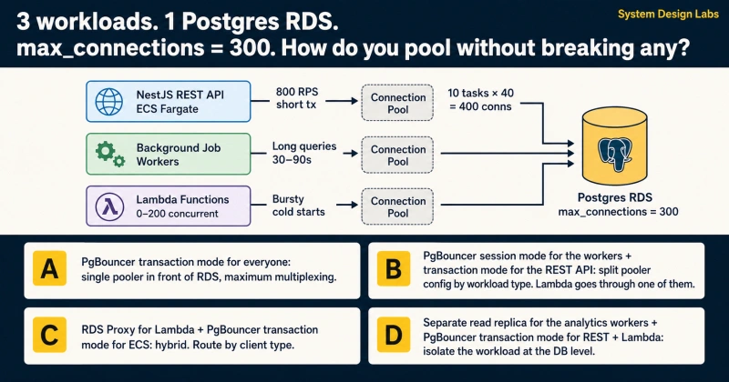

# Ngày 13: Managing a Shared Connection Pool

[← Ngày trước](day-12-indexing-a-high-ingest-table.md) | [Mục lục](README.md) | [Ngày tiếp theo →](day-14-safely-rolling-out-a-risky-change.md)

---

# NGÀY 13 · THIẾT KẾ HỆ THỐNG (SYSTEM DESIGN)
## Quản lý một Connection Pool dùng chung (Managing a Shared Connection Pool)

Bạn đang chạy 3 tải công việc (**workloads**) cùng trỏ vào một phiên bản cơ sở dữ liệu (**database instance**) Postgres RDS. Cấu hình `max_connections = 300`. Tất cả chúng đều cần một nhóm kết nối (**connection pool**), nhưng không tải công việc nào chịu nhường nhịn chia sẻ cho nhau.

**Dưới đây là thiết lập hạ tầng hiện tại:**
*   **→ NestJS REST API chạy trên ECS Fargate:** Các giao dịch ngắn (**short transactions**), thông lượng **800 RPS**, gồm `10 tasks × 40 pool = 400 connections` được yêu cầu (**connections requested**).
*   **→ Background job workers:** Thực thi các truy vấn phân tích dữ liệu chạy dài (**long-running analytics queries**). Mỗi truy vấn giữ kết nối từ **30–90 giây**.
*   **→ Lambda functions:** Tải tăng đột biến không ổn định (**bursty**), độ trễ khởi động nguội cao (**cold-start heavy**), mức độ đồng thời từ **0–200 concurrent invocations**.

> **Bài toán đặt ra:** Ba ứng dụng khách (**clients**). Một cơ sở dữ liệu (**database**). Giới hạn tối đa **300 max connections**. Phép tính toán học hoàn toàn bất khả thi.

Bạn cần phải gom nhóm kết nối (**pool**) mà không làm gián đoạn hay phá hỏng bất kỳ ứng dụng nào trong số đó. Hãy chọn phương án đánh đổi của bạn:

---

### Các phương án lựa chọn

*   **A.** Sử dụng **PgBouncer transaction mode** cho tất cả: đặt một bộ điều phối nhóm kết nối duy nhất (**single pooler**) đứng trước RDS để tối đa hóa khả năng ghép kênh (**multiplexing**).
*   **B.** Sử dụng **PgBouncer session mode** cho các worker + **transaction mode** cho REST API: phân tách cấu hình pooler theo từng loại tải công việc (**workload type**). Lưu lượng Lambda sẽ đi qua một trong hai cổng này.
*   **C.** Sử dụng **RDS Proxy** cho Lambda + **PgBouncer transaction mode** cho ECS: mô hình kết hợp (**hybrid**). Điều hướng dựa trên loại ứng dụng khách (**route by client type**).
*   **D.** Tách riêng một **read replica** cho các analytics worker + **PgBouncer transaction mode** cho REST + Lambda: cô lập tải công việc ngay tại tầng cơ sở dữ liệu (**isolate the workload at the DB level**).

---

# ĐÁP ÁN & GIẢI THÍCH CHI TIẾT

## Câu trả lời 1: ĐÁP ÁN CHÍNH XÁC

> [!TIP]
> **Đáp án: B — PgBouncer session mode cho workers + transaction mode cho REST API ✅**

Câu hỏi này chính là ranh giới phân định giữa những kỹ sư đã thực chiến vận hành PgBouncer trên môi trường production và những người mới chỉ dừng lại ở mức đọc tài liệu (**documentation**). Dưới đây là phân tích chi tiết:

### Tại sao B chiến thắng (phân tách cấu hình pooler theo loại tải công việc):

Bản chất cốt lõi của **PgBouncer** là khả năng ghép kênh (**multiplexing**) — một kết nối phía backend của Postgres có thể phục vụ đồng thời nhiều kết nối ứng dụng khách (**client connections**), nhưng cơ chế này chỉ an toàn khi kết nối được trả lại nhóm (**pool**) giữa các giao dịch (**transactions**). Đó chính là **chế độ giao dịch (transaction mode)**.

*   **Transaction mode là sự lựa chọn hoàn hảo cho NestJS REST API:** Các giao dịch ngắn, 800 RPS, không lưu trạng thái phiên (**no session state**), không dùng `SET LOCAL`, không giữ khóa tư vấn trên nhiều truy vấn (**no advisory locks held across queries**), không yêu cầu các câu lệnh tiền biên dịch cần duy trì lâu dài (**no prepared statements that need to survive**). Yêu cầu 400 kết nối từ phía REST API được nén gọn lại chỉ còn khoảng **~30–50 kết nối backend thực tế** đến Postgres. Phép toán bỗng nhiên trở nên hoàn toàn hợp lý.
*   **Transaction mode lại là thảm họa cho các analytics worker:** Các truy vấn phân tích chạy từ 30–90 giây và trải dài trên nhiều giao dịch — một số giữ trạng thái phiên (**session state**), một số sử dụng bảng tạm (**temporary tables**), một số dùng `SET search_path`, số khác lại sử dụng con trỏ (**cursors**). Nếu trả kết nối lại nhóm giữa các giao dịch, toàn bộ trạng thái đó sẽ biến mất hoàn toàn. Nghiêm trọng hơn: với áp lực 800 RPS từ phía API, khả năng worker nhận lại đúng kết nối backend cũ cho giao dịch tiếp theo gần như bằng không. Worker sẽ bị lỗi âm thầm (**silently breaks**).

Vì vậy, bạn cấu hình cho các worker một pool riêng trên PgBouncer chạy ở **chế độ phiên (session mode)** — quy ước: **một kết nối client = một kết nối backend** trong suốt toàn bộ phiên làm việc. Nhóm này nhận được ít kết nối hơn, nhưng chúng được giữ kết nối liên tục — đáp ứng đúng bản chất vận hành mà chúng thực sự cần.

Lưu lượng từ **Lambda** sẽ được dẫn qua pool **transaction-mode** dùng chung với REST API (bởi vì Lambda cũng phi trạng thái - stateless, vòng đời ngắn - short-lived — cùng cấu trúc đặc thù như API). Toàn bộ hệ thống chạy trên **một phiên bản pooler duy nhất (one pooler instance), hai cấu hình pool (two pool configs), hai cổng lắng nghe riêng biệt (two listening ports)**. PgBouncer hỗ trợ kiến trúc này ở mức nguyên bản (**natively**).

> [!NOTE]
> **Trạng thái cuối cùng (End state):** API đạt được khả năng ghép kênh tối đa (**multiplexing**), workers không bị bỏ đói tài nguyên (**don't starve**), tổng số kết nối backend tới Postgres luôn được duy trì **dưới ngưỡng 300**, không dịch vụ nào bị gián đoạn hay đổ vỡ. Đây chính là đáp án chính xác thực tế, đáng tin cậy nhất khi trực vận hành on-call.

---

## Câu trả lời 2: Tại sao A là câu trả lời bẫy (PgBouncer transaction mode cho tất cả)

> [!WARNING]
> **Cái bẫy lý thuyết:** "Transaction mode = khả năng ghép kênh tốt nhất."

Đây là đáp án mà phần lớn các kỹ sư vội vàng lựa chọn vì suy nghĩ mặc định rằng *"transaction mode = tối ưu ghép kênh nhất"*. Nó hoạt động xuất sắc đối với API, nhưng sẽ âm thầm phá hủy toàn bộ hệ thống worker.

Ngay khoảnh khắc một truy vấn phân tích cần bất kỳ thứ gì không nằm trọn vẹn trong một giao dịch đơn lẻ — chẳng hạn:
* Một bảng tạm (**temp table**)
* Một biến phiên (**session variable**)
* Lệnh `SET LOCAL`
* Một prepared statement
* Một con trỏ (**cursor**) sống lâu hơn vòng đời của một giao dịch

PgBouncer sẽ lập tức thu hồi và trả kết nối đó về nhóm kết nối chung. Đến truy vấn tiếp theo? Ứng dụng sẽ nhận một kết nối backend hoàn toàn khác. Toàn bộ trạng thái trước đó bốc hơi. Truy vấn thất bại, hoặc tồi tệ hơn là **trả về dữ liệu sai lệch mà không hề báo lỗi**.

Kiểu lỗi này là loại quái ác nhất trong kỹ thuật phần mềm: nó chạy hoàn hảo ở môi trường phát triển (dev - do mức độ đồng thời thấp, ăn may nhận lại cùng một kết nối), chạy ổn định ở môi trường kiểm thử (staging - do tải nhẹ), nhưng sẽ chết đứng trên production vào thời điểm API đang dồn ép lưu lượng nghẽn pool và worker không thể duy trì kết nối ổn định. Bạn sẽ phải đối mặt để xử lý sự cố này vào lúc 3 giờ sáng giữa kỳ chốt sổ tài chính (**financial close**).

---

## Câu trả lời 3: Tại sao C sai (RDS Proxy cho Lambda + PgBouncer cho ECS)

> [!CAUTION]
> **Vấn đề của phương án kết hợp (Hybrid):** Chi phí vận hành kép và bỏ quên bài toán cốt lõi.

Phương án này nghe có vẻ hợp lý trên mặt lý thuyết. **RDS Proxy** thực sự làm rất tốt vai trò của nó với Lambda — giải quyết triệt để cơn bão kết nối khởi động nguội (**cold-start connection storm**), quản lý xác thực IAM (**IAM auth**), và tích hợp mượt mà với VPC. Nếu đề bài chỉ đơn thuần là *"Lambda + Postgres"*, thì C là một lựa chọn đúng đắn.

Tuy nhiên, C hoàn toàn không giải quyết được vấn đề của các worker:
1. Chúng vẫn là các tác vụ chạy dài (**long-running**), vẫn cần duy trì trạng thái phiên (**session state**).
2. Bạn tự đưa thêm một sản phẩm quản lý nhóm kết nối thứ hai vào hệ thống để vận hành, giám sát và trả tiền hóa đơn hàng tháng.
3. RDS Proxy đắt đỏ hơn nhiều so với PgBouncer tính trên đơn vị connection-hour, đồng thời không hỗ trợ cơ chế ghim phiên (**session pinning**) xuyên suốt các giao dịch linh hoạt như cách PgBouncer chạy ở session mode.

C chỉ giải quyết được phần việc dễ nhất trong 3 bài toán, và bỏ ngỏ hoàn toàn bài toán hóc búa nhất.

---

## Câu trả lời 4: Tại sao D là cái bẫy dành cho Kỹ sư Cấp cao (Senior-Engineer Trap)

> [!NOTE]
> **Cái bẫy khớp mẫu (Pattern-matching):** Nhầm lẫn giữa bài toán cạn kiệt tài nguyên tính toán (IOPS/Cache) và bài toán cạn kiệt số lượng kết nối (Connection Exhaustion).

Đây là phương án đánh lừa ngay cả những kỹ sư giàu kinh nghiệm, bởi vì họ thường có phản xạ nhận diện mẫu (**pattern-match**) là *"phải cô lập tải công việc (isolate the workload)"*. Việc cô lập tác vụ phân tích (analytics) khỏi hệ thống giao dịch trực tuyến (**OLTP**) tại tầng cơ sở dữ liệu là một định hướng xuất sắc — nhưng là để giải quyết cho **một bài toán hoàn toàn khác**.

| Tiêu chí so sánh | Phương án D (Read Replica) | Vấn đề thực tế của đề bài |
| :--- | :--- | :--- |
| **Mục tiêu giải quyết** | Mở rộng quy mô đọc (**Read scaling**), tránh hiện tượng láng giềng ồn ào (**Noisy neighbor**) tranh chấp bộ nhớ đệm (**buffer cache**), gói truy vấn (**query plans**) và I/O. | Giới hạn số lượng kết nối tối đa (**Connection math limits**). |
| **Bản chất kết nối** | Read replica vẫn sở hữu mức trần `max_connections` của riêng nó. Worker vẫn chiếm dụng kết nối từ **30–90 giây**. | Tình trạng cạn kiệt kết nối bị chuyển từ primary instance sang replica instance. |
| **Hệ quả phát sinh** | Gánh nặng chi phí cho một phiên bản RDS bổ sung mà không gỡ được nút thắt cổ chai kết nối. | Vẫn thiếu hụt kết nối nghiêm trọng. |

*   Nếu đề bài đặt ra là: *"Các truy vấn phân tích đang làm nghẽn và chiếm đoạt tài nguyên của tải công việc OLTP"*, thì **D sẽ là câu trả lời chính xác**.
*   Nhưng đề bài hiện tại là: *"Chúng ta không có đủ kết nối (we don't have enough connections)"*. Nỗi đau khác biệt đòi hỏi mô hình giải pháp khác biệt.

> [!TIP]
> **Quy trình triển khai chuẩn kiến trúc:** Phương án **D** là bước bạn triển khai **sau khi** bạn đã cấu hình thành công phương án **B**, và nhận thấy rằng các truy vấn phân tích bắt đầu cạnh tranh tài nguyên IOPS cũng như buffer cache với hệ thống.

---

[← Ngày trước](day-12-indexing-a-high-ingest-table.md) | [Mục lục](README.md) | [Ngày tiếp theo →](day-14-safely-rolling-out-a-risky-change.md)
