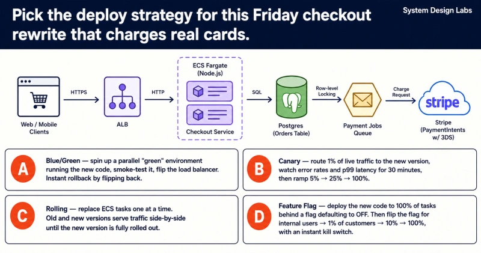

# Ngày 14: Safely Rolling Out a Risky Change

[← Ngày trước](day-13-managing-a-shared-connection-pool.md) | [Mục lục](README.md) | [Ngày tiếp theo →](day-15-fast-has-the-user-seen-this-checks.md)

---

# NGÀY 14 · THIẾT KẾ HỆ THỐNG (SYSTEM DESIGN)
## Triển khai an toàn một thay đổi đầy rủi ro (Safely Rolling Out a Risky Change)

---

### Tình huống thực tế (Scenario)

Bạn chuẩn bị đưa lên production bản viết lại (rewrite) toàn bộ luồng ghi thanh toán (checkout write path) vào thứ Sáu.

- **Kiến trúc vận hành:** Node.js chạy trên AWS ECS Fargate.
- **Tải hệ thống:** Đạt đỉnh ~3.000 RPS (Requests Per Second).
- **Cơ sở dữ liệu:** PostgreSQL với cơ chế khóa cấp dòng (row-level locking) trên bảng `orders`.
- **Phạm vi thay đổi:** Bản cập nhật này can thiệp trực tiếp vào đúng dòng mã nguồn thực hiện việc trừ tiền trên thẻ của khách hàng — luồng cũ (old path) sử dụng **Stripe Charges API**, luồng mới (new path) chuyển sang sử dụng **PaymentIntents** tích hợp xác thực bảo mật **3DS** (3D Secure).

Môi trường kiểm thử QA hoàn toàn xanh (green). Kiểm thử tải (load test) đã vượt qua. Kỹ sư Staff Engineer của bạn đã ký duyệt (sign off).

> [!WARNING]
> **Nhưng đây là luồng thanh toán (checkout).** Nếu luồng này gãy, tiền bạc sẽ gặp sự cố ngay lập tức. Và bạn **không thể hoàn tác (rollback)** một chiếc thẻ tín dụng đã bị trừ tiền thành công.

---

### Hãy chọn chiến lược triển khai (Deploy Strategy):

#### **A. Blue/Green Deployment**
Khởi tạo một môi trường song song "Green" chạy mã nguồn mới, thực hiện kiểm thử khói (smoke-test), sau đó chuyển hướng bộ cân bằng tải (Load Balancer). Hoàn tác tức thì (instant rollback) bằng cách chuyển hướng ngược lại.

#### **B. Canary Deployment**
Định tuyến 1% lưu lượng truy cập thực tế (live traffic) sang phiên bản mới, theo dõi tỷ lệ lỗi (error rates) và độ trễ phân vị p99 (p99 latency) trong 30 phút, sau đó tăng dần lưu lượng theo tỷ lệ 5% → 25% → 100%.

#### **C. Rolling Deployment**
Thay thế từng tác vụ ECS (ECS tasks) một cách tuần tự. Phiên bản cũ và phiên bản mới cùng song song phục vụ lưu lượng truy cập cho đến khi phiên bản mới được triển khai hoàn tất 100%.

#### **D. Feature Flag**
Triển khai mã nguồn mới lên 100% các ECS tasks nhưng ẩn sau một Feature Flag mặc định ở trạng thái TẮT (OFF). Sau đó bật cờ tính năng theo từng giai đoạn: cho người dùng nội bộ (internal users) → 1% khách hàng → 10% → 100%, đi kèm một công tắc ngắt khẩn cấp tức thì (instant kill switch).

---

### NGÀY 14 · ĐÁP ÁN & GIẢI THÍCH CHI TIẾT (ANSWERS & EXPLANATIONS)

#### Đáp án 1: ĐÁP ÁN ĐÚNG
> [!IMPORTANT]
> **Đáp án: D — Feature Flag ✅**

Dưới đây là lý do tại sao phương án D chiến thắng, và tại sao ba phương án còn lại trông có vẻ đúng nhưng sẽ âm thầm thất bại khi thay đổi chạm đến luồng tiền tệ:

##### Vì sao D chiến thắng (Why D wins - Feature Flag):
Cờ tính năng (**Feature Flags**) tách biệt hoàn toàn giữa việc đưa mã lên hệ thống (**Deploy**) và việc phát hành tính năng tới người dùng (**Release**). Mã nguồn mới được đưa lên 100% các ECS tasks của bạn — nhưng ở trạng thái ngủ đông (dormant). Không có bất kỳ logic mới nào được thực thi cho đến khi bạn gạt cờ kích hoạt.

- **Hoàn tác (Rollback) chỉ là một thao tác cập nhật cấu hình (config push), không phải là một đợt deploy lại:** Thời gian phản hồi tính bằng mili-giây (sub-second). Không cần khởi động lại ECS tasks, không cần chờ rút cạn kết nối trên Load Balancer (LB connection draining), không bị ảnh hưởng bởi bộ đệm DNS TTL.
- **Bạn nhắm mục tiêu chính xác vào ai là người thấy luồng mới, chứ không chia theo % lưu lượng ngẫu nhiên:** Một khách hàng giao dịch $0.99 và một khách hàng doanh nghiệp B2B giao dịch $40.000 không thể bị đặt vào trò tung đồng xu may rủi ngang nhau — đó không phải là chiến lược, đó là cầu may.
- **Bạn có thể giữ cho luồng mã nguồn cũ luôn sẵn sàng (keep warm) trong nhiều tuần:** Gặp trường hợp ngoại lệ (edge case) với xác thực 3DS trên một ngân hàng phát hành thẻ cụ thể tại Brazil? Bạn chỉ cần gạt cờ chuyển riêng nhóm người dùng đó quay trở lại luồng v1, trong khi vẫn giữ nguyên tất cả những người dùng khác tiếp tục sử dụng v2.

---

#### Đáp án 2: Vì sao B là câu trả lời bẫy (Why B is the trap - Canary):
1. **Canary định tuyến theo từng yêu cầu (request), không theo danh tính khách hàng (customer):** Một tác vụ thanh toán hóa đơn tự động định kỳ (billing job) của khách hàng B2B gửi liên tục 50 requests vào hệ thống và rơi đúng vào nhóm 1% Canary trong vòng một giờ. Nếu có lỗi nghiệp vụ xảy ra với loại thẻ của họ, bạn đã trừ tiền của họ 50 lần trước khi bảng giám sát (dashboards) kịp phát hiện ra.
2. **Lỗi thanh toán không xuất hiện dưới dạng lỗi mã phản hồi 5xx:** Chúng hiển thị dưới dạng các phản hồi thành công mã HTTP 200 nhưng đã trừ sai số tiền thực tế. Cảnh báo tỷ lệ lỗi (error-rate alarm) của bạn sẽ không bao giờ được kích hoạt.

---

#### Đáp án 3: Vì sao A sai (Why A is wrong - Blue/Green):
Việc "chuyển đổi tức thì" (**Instant cutover**) chính là nguồn cơn vấn đề. Ngay thời điểm bạn chuyển hướng Load Balancer, 100% lưu lượng truy cập thực tế sẽ đâm thẳng vào mã nguồn mới — bao gồm cả các webhook xác nhận từ Stripe gửi về cho các `PaymentIntents` vốn được tạo ra bởi mã nguồn cũ trước đó. 

Điều này dẫn đến tình trạng tương tranh giữa các phiên bản (**Cross-version race condition**) trực tiếp trên tiền thật của khách hàng. Thêm vào đó, việc hoàn tác (rollback) không thể tự động hủy bỏ một giao dịch đã trừ tiền thành công.

---

#### Đáp án 4: Vì sao C sai (Why C is wrong - Rolling):
Trong khoảng thời gian từ 5 đến 10 phút, các ECS tasks cũ và mới sẽ phục vụ luồng thanh toán đồng thời. 

Yêu cầu "Tạo đơn hàng" (Create order) được xử lý bởi phiên bản v1. Nhưng webhook "Xác nhận thanh toán" (Confirm payment) gửi tới sau đó 800ms lại rơi vào phiên bản v2. Hậu quả là trạng thái dữ liệu bất nhất (inconsistent state) được ghi nhận bởi hai phiên bản mã nguồn chưa từng được kiểm thử để chạy chung với nhau.

---

### Bảng tổng kết so sánh các chiến lược triển khai cho luồng thanh toán

| Chiến lược | Cơ chế điều phối lưu lượng | Rủi ro cốt lõi với luồng tiền tệ | Thời gian phục hồi khi có sự cố | Đánh giá |
| :--- | :--- | :--- | :--- | :--- |
| **Blue/Green** | Chuyển toàn bộ 100% qua Load Balancer | Race condition giữa Webhook xác nhận và đơn hàng tạo ở v1 | Phải flip LB ngược lại; không đảo ngược được giao dịch thẻ đã trừ | ❌ Nguy hiểm |
| **Canary** | Phân bổ % request ngẫu nhiên | Trừ tiền trùng lặp cho các tác vụ lặp lại; lỗi nghiệp vụ vẫn trả về 200 OK | Phải rollback deployment (mất vài phút) | ⚠️ Bẫy ngầm |
| **Rolling** | Thay thế task dần dần | v1 và v2 xử lý lẫn lộn giữa luồng Create Order và Confirm Payment | Phải deploy ngược lại toàn bộ cụm ECS tasks | ❌ Bất nhất dữ liệu |
| **Feature Flag** | Tách rời Deploy và Release, nhắm đúng tập User | Kiểm soát rủi ro ở mức granular (từng User ID / Merchant ID) | **Sub-second** (gạt tắt kill switch ngay lập tức) | ✅ **Tối ưu nhất** |

---

[← Ngày trước](day-13-managing-a-shared-connection-pool.md) | [Mục lục](README.md) | [Ngày tiếp theo →](day-15-fast-has-the-user-seen-this-checks.md)
