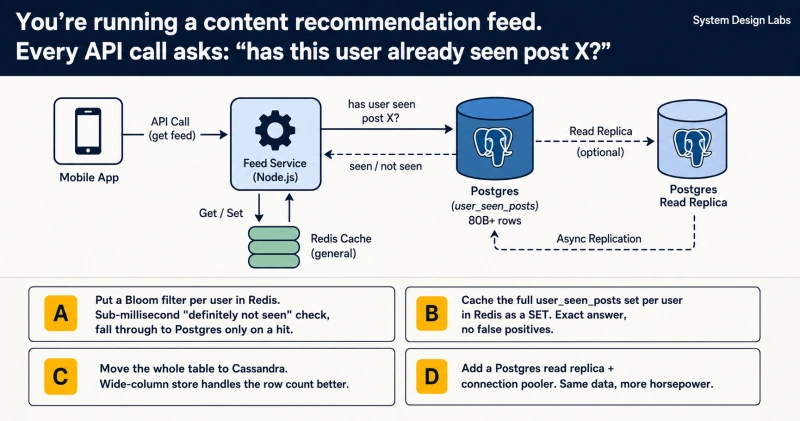

# Ngày 15: Fast “Has the User Seen This?” Checks

[← Ngày trước](day-14-safely-rolling-out-a-risky-change.md) | [Mục lục](README.md) | [Ngày tiếp theo →](day-16-taming-a-hot-partition-key.md)

---

# NGÀY 15 · THIẾT KẾ HỆ THỐNG (SYSTEM DESIGN)
## Kiểm Tra Nhanh Trạng Thái: “Người Dùng Đã Xem Bài Viết Này Chưa?” (Fast “Has the User Seen This?” Checks)

Bạn đang vận hành một bảng tin đề xuất nội dung (content recommendation feed) phục vụ **50 triệu người dùng (50M users)**.  
Mỗi lệnh gọi API đều đặt câu hỏi: *"Người dùng này đã xem bài viết X chưa?"*

Hiện tại, với mỗi lượt kiểm tra, bạn đều phải truy vấn trực tiếp vào PostgreSQL. Bảng `user_seen_posts` hiện đã chạm mốc **80 tỷ dòng (80B rows)** và con số này vẫn đang tiếp tục tăng trưởng chóng mặt.  
Độ trễ `p99 latency` trên endpoint của bảng tin (feed endpoint) vừa vượt ngưỡng **600ms**, và DBA (quản trị viên cơ sở dữ liệu) đang gửi cho bạn ảnh chụp màn hình biểu đồ CPU đỏ rực lúc 2 giờ sáng.

### Thông số thiết lập hiện tại (Setup):
* **Feed service (Dịch vụ bảng tin):** Node.js, lưu lượng tải đỉnh điểm khoảng **~120K RPS (Requests Per Second)**.
* **Thao tác kiểm tra "Đã xem chưa" ("Already seen" check):** Thực hiện câu lệnh `SELECT` trực tiếp vào Postgres trên mỗi đề xuất nội dung.
* **Cấu trúc bảng (Table schema):** `user_seen_posts(user_id, post_id, seen_at)` (đã được chia phân vùng - *partitioned*, đã đánh chỉ mục - *indexed*, nhưng vẫn rất chậm).
* **Tỷ lệ trúng bộ nhớ đệm (Cache hit ratio):** Vẫn ổn định. Vấn đề cốt lõi nằm ở độ trễ đuôi dài (long tail) của các truy vấn lạnh (cold lookups).
* **Dung sai lỗi:** Chấp nhận được tỷ lệ dương tính giả (False Positives - nhầm rằng người dùng đã xem). Tỷ lệ âm tính giả (False Negatives - hiển thị trùng lặp lại một bài viết đã xem) tuy không tốt nhưng vẫn có thể chấp nhận được.

> [!IMPORTANT]
> **Mục tiêu từ Product Team:** Ép độ trễ `p99 latency` xuống **dưới 100ms**. Bạn chỉ có đúng **một sprint** để hoàn thành. Bạn sẽ làm gì?

---

## Các Phương Án Lựa Chọn (Options)

* **A.** Đặt một **Bloom Filter** cho mỗi người dùng trong **Redis**. Cung cấp khả năng kiểm tra dưới 1 mili-giây (*sub-millisecond*) khẳng định chắc chắn "chưa từng xem", và chỉ truy vấn xuyên xuống (fall through) Postgres khi có kết quả trả về là trùng khớp (*hit*).
* **B.** Lưu bộ nhớ đệm toàn bộ tập dữ liệu `user_seen_posts` của từng người dùng vào **Redis** dưới dạng tập hợp **SET**. Cho ra kết quả chính xác tuyệt đối, không có sai số dương tính giả (*zero false positives*).
* **C.** Di chuyển toàn bộ bảng dữ liệu sang **Cassandra**. Cơ sở dữ liệu dạng cột mở rộng (*wide-column store*) xử lý số lượng dòng khổng lồ tốt hơn.
* **D.** Bổ sung thêm bản sao chỉ đọc của Postgres (**Postgres Read Replica**) kèm theo bộ gom nhóm kết nối (**Connection Pooler**). Giữ nguyên mô hình dữ liệu, tăng cường thêm tài nguyên xử lý (*horsepower*).

---

## NGÀY 15 · ĐÁP ÁN & GIẢI THÍCH CHI TIẾT (ANSWERS & EXPLANATIONS)

---

### Đáp án 1: A — Bloom Filter cho mỗi người dùng trong Redis
> [!TIP]
> **✓ ĐÁP ÁN ĐÚNG NHẤT (THE RIGHT ANSWER)**

**Bloom filter** mang lại một sự đảm bảo chắc chắn tuyệt đối (*ironclad guarantee*): **"Phần tử này CHẮC CHẮN KHÔNG CÓ trong tập hợp (DEFINITELY NOT in the set)."**  
* Nếu bộ lọc trả về **NO (Không)** $\rightarrow$ Bỏ qua hoàn toàn việc truy vấn vào Postgres.  
* Nếu bộ lọc trả về **MAYBE (Có thể)** $\rightarrow$ Truy vấn xuyên xuống Postgres để xác nhận lại.

#### Vì sao phương án này chiến thắng áp đảo tại đây:
* **~97% các lần kiểm tra trên feed** là dành cho những bài viết mà người dùng **chưa từng xem bao giờ** $\rightarrow$ Nhận phản hồi "chắc chắn không" từ Redis chỉ trong thời gian dưới 1 mili-giây (*sub-millisecond*), hệ thống hoàn toàn không cần chạm tới Postgres.
* **Bài toán tính toán dung lượng bộ nhớ (Memory math):**
  * Lưu trữ 10.000 bài viết (10K posts) cho mỗi người dùng trong một Bloom filter với tỷ lệ dương tính giả 1% (*1% false-positive*) chỉ tốn **12 KB**.
  * Cùng lượng dữ liệu đó nếu lưu bằng **Redis SET** sẽ tiêu tốn **từ 80 KB trở lên**, và kích thước tăng tuyến tính theo số lượng bài viết.
* **Ở quy mô 50 triệu người dùng (50M users):**
  * Bloom filter: tốn khoảng **~600 GB RAM**.
  * Redis SET: tốn khoảng **~4 TB RAM**.  
  * Đó chính là sự khác biệt mang tính quyết định về mặt chi phí và tài nguyên.
* **Các trường hợp sử dụng trong thực tế:**
  * Tính năng *"Bạn đã đọc bài này chưa"* của Medium.
  * Kỹ thuật ngắt sớm việc đọc SSTable (*SSTable short-circuit*) trong Cassandra.
  * Các ví tiền mã hóa SPV (*Simplified Payment Verification wallets*) của Bitcoin.

Tỷ lệ dương tính giả 1% (*1% false positive*) ở đây đồng nghĩa với việc đôi khi hệ thống sẽ bỏ qua một bài viết mà người dùng thực tế chưa xem. Đội ngũ phát triển sản phẩm (Product) đã xác nhận điều này hoàn toàn chấp nhận được. Quan trọng nhất: **Bloom filters không bao giờ tạo ra lỗi âm tính giả (False Negatives - hiển thị một bài viết hai lần)** — điều vốn được xem là "bản án tử" phá hỏng trải nghiệm người dùng (*dealbreaker*).

---

### Đáp án 2: B — Redis SET cho mỗi người dùng
> [!WARNING]
> **CẠM BẪY CỦA KỸ SƯ KINH NGHIỆM (SENIOR ENGINEER TRAP)**

Trên lý thuyết, phương án này trông có vẻ vượt trội hoàn toàn: tốc độ truy xuất đạt mức $O(1)$, độ chính xác tuyệt đối, không có sai số dương tính giả. Lệnh `SISMEMBER` của Redis đã được kiểm chứng qua vô số trận chiến thực tế (*battle-tested*).

**Cạm bẫy nằm ở đâu:** Bộ nhớ RAM sẽ bùng nổ mất kiểm soát đối với nhóm người dùng hoạt động mạnh (*power users*).  
* Một người dùng đã xem 50.000 bài viết (50K posts) sẽ ngốn tới **3–4 MB** trong một Redis SET.
* Chỉ cần **5% nhóm người dùng hoạt động tích cực nhất** cũng đủ sức đánh sập toàn bộ cụm Redis cluster của bạn.
* Bạn sẽ rơi vào tình thế tiến thoái lưỡng nan: hoặc phải cấp phát tài nguyên dư thừa vượt mức (*over-provision* - cực kỳ tốn kém), hoặc phải bắt đầu cơ chế thu hồi/xóa bớt dữ liệu (*eviction*) của những người dùng nóng (*hot users* - điều này làm mất đi toàn bộ ý nghĩa ban đầu của giải pháp).

> [!NOTE]
> **Quy tắc bỏ túi (Rule of thumb):**
> * Sử dụng **Redis SET** khi số lượng phần tử (*cardinality*) nhỏ ($< 1.000$ phần tử trên mỗi khóa) hoặc khi hệ thống không thể chấp nhận bất kỳ tỷ lệ dương tính giả nào.
> * Sử dụng **Bloom Filter** khi số lượng phần tử lớn và câu trả lời "rất có thể là chưa xem" (*probably not*) đã đủ tốt cho yêu cầu nghiệp vụ.

---

### Đáp án 3: C — Chuyển toàn bộ dữ liệu sang Cassandra
> [!WARNING]
> **ÁP DỤNG ĐÚNG MÔ HÌNH NHƯNG GIẢI SAI VẤN ĐỀ (RIGHT PATTERN, WRONG PROBLEM)**

Cassandra xử lý dữ liệu dạng cột mở rộng (*wide-column*) và số lượng dòng dữ liệu khổng lồ cực kỳ xuất sắc. Tuy nhiên, vấn đề nhức nhối ở đây **không phải là dung lượng lưu trữ** — PostgreSQL nếu được chia phân vùng hợp lý (*proper partitioning*) hoàn toàn đủ sức gánh 80 tỷ dòng. Điểm nghẽn thực sự chính là **độ trễ đọc dữ liệu dưới tải cao (read latency under load)**.

Việc thay đổi công cụ lưu trữ nền tảng (*storage engine*) không giải quyết được bản chất của cơ chế đọc (*read pattern*). Bạn vẫn đang thực hiện thao tác tra cứu điểm (*point lookup*) cho từng đề xuất nội dung.  
Hơn nữa, phương án này sẽ cuốn bạn vào một chiến dịch di chuyển dữ liệu kéo dài qua nhiều quý (*multi-quarter migration*), đồng thời đòi hỏi đội ngũ phải trang bị kỹ năng vận hành (*ops skillset*) hoàn toàn mới — chỉ để giải quyết một bài toán mà vốn dĩ có thể xử lý dứt điểm **ngay trong 1 sprint với 12 KB bộ nhớ cho mỗi người dùng trên Redis**.

> [!NOTE]
> **Cassandra là câu trả lời khi:** Nút thắt cổ chai nằm ở thông lượng ghi (*write throughput*) hoặc khi cần quét các dải dữ liệu hàng rộng (*wide-row scans*). Cassandra **không sinh ra** để phục vụ **120K truy vấn tra cứu điểm mỗi giây** trên đường dẫn tải nóng (*hot path*).

---

### Đáp án 4: D — Thêm Postgres Read Replica + Connection Pooler
> [!CAUTION]
> **ĐÁNH ĐỒNG GIỮA SỨC CHỨA VÀ CHI PHÍ HIỆU NĂNG (CAPACITY ≠ COST)**

Việc bổ sung thêm các bản sao chỉ đọc (*read replicas*) chỉ giúp bạn mua thêm sức mạnh phần cứng thô (*horsepower*), chứ không hề cải thiện hiệu quả xử lý (*efficiency*).  
* Bạn vẫn đang buộc hệ thống phải đọc đĩa cứng (*hitting disk*) trên từng lượt kiểm tra.
* Bạn vẫn phải thực hiện thao tác duyệt cây chỉ mục B-tree (*B-tree lookup*).
* Bạn vẫn phải trả chi phí cho độ trễ vòng lặp mạng (*round-trip time*) trên từng request.
* Thêm 3 replicas $\rightarrow$ may ra bạn chỉ tăng được khoảng **2.5 lần** thông lượng đọc trước khi độ trễ nhân bản dữ liệu (*replication lag*) và giới hạn số lượng kết nối (*connection limits*) quay lại bóp nghẹt hệ thống.

Để đạt được mục tiêu `p99 latency < 100ms` tại mức tải `120K RPS`, giải pháp không phải là "nhồi nhét thêm cơ sở dữ liệu" — mà là **ngăn chặn 97% các request không phải chạm vào cơ sở dữ liệu** đối với những trường hợp câu trả lời là "chưa xem" ("no").

> [!NOTE]
> Đây là lựa chọn điển hình của những đội ngũ luôn xem mọi vấn đề về hiệu năng đều là vấn đề về sức chứa/quy mô phần cứng (*capacity problem*).

---

### Bảng So Sánh Tổng Hợp Các Phương Án Kiến Trúc

| Tiêu chí so sánh | Phương án A (Bloom Filter / Redis) | Phương án B (Redis SET) | Phương án C (Cassandra) | Phương án D (Postgres Read Replica) |
| :--- | :--- | :--- | :--- | :--- |
| **Độ trễ p99** | **< 5ms** (chặn được 97% truy vấn vào DB) | **< 5ms** | 20ms – 50ms (vẫn tốn I/O đĩa) | 300ms – 500ms (vẫn nghẽn do đọc đĩa) |
| **Chi phí bộ nhớ (RAM)** | **Rất thấp (~600 GB / 50M users)** | Cực lớn (~4 TB, phình to do power users) | Trung bình (cần cụm cluster lớn) | Rất cao (chi phí máy chủ DB phụ trợ) |
| **Thời gian triển khai** | **Trong 1 Sprint** | Trong 1 Sprint | Nhiều quý (Multi-quarter migration) | Nhanh, nhưng không giải quyết gốc rễ |
| **Mức độ khả thi với bài toán** | **Tối ưu tuyệt đối** | Rủi ro sập cụm bộ nhớ cache | Sai bản chất vấn đề đọc tải nóng | Càng scale càng lãng phí chi phí |

---

[← Ngày trước](day-14-safely-rolling-out-a-risky-change.md) | [Mục lục](README.md) | [Ngày tiếp theo →](day-16-taming-a-hot-partition-key.md)
