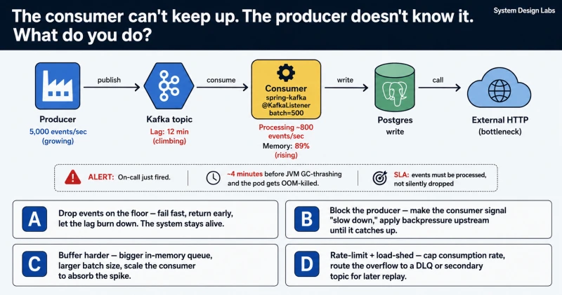

# Ngày 17: Backpressure on an Overwhelmed Consumer

[← Ngày trước](day-16-taming-a-hot-partition-key.md) | [Mục lục](README.md) | [Ngày tiếp theo →](day-18-surviving-a-cache-stampede.md)

---

# NGÀY 17 · THIẾT KẾ HỆ THỐNG (DAY 17 · SYSTEM DESIGN)

## Áp lực ngược lên Consumer đang bị quá tải (Backpressure on an Overwhelmed Consumer)

Kafka Consumer của bạn hiện chỉ xử lý được **800 events/giây**.  
Producer vừa mới chạm mốc **5.000 events/giây** và lưu lượng này hoàn toàn không có dấu hiệu giảm xuống.  

Biểu đồ độ trễ (**Consumer Lag**): đang tụt lại sau **12 phút** và tiếp tục tăng vọt. Bộ nhớ của Consumer (**Consumer Memory**): đã đạt **89%** và vẫn đang tăng. Cảnh báo trực ca (**On-call alert**) vừa mới kích hoạt.  

Bạn chỉ còn khoảng **~4 phút** trước khi JVM bắt đầu rơi vào tình trạng **GC-thrashing** (rác dọn dẹp liên tục làm tê liệt hệ thống) và Pod sẽ bị hệ điều hành tiêu diệt vì cạn bộ nhớ (**OOM-killed**).

---

### Mô hình thiết lập hệ thống (The setup):
* **Producer** → Ghi vào Kafka topic (lưu lượng 5.000 events/giây, và đang tiếp tục tăng)
* **Consumer** → Sử dụng `spring-kafka` với annotation `@KafkaListener`, cấu hình `batch=500`, tốc độ xử lý thực tế khoảng **~800 events/giây**
* **Downstream** → Ghi dữ liệu vào Postgres + gọi HTTP ra bên ngoài (**external HTTP call** — đây chính là nút thắt cổ chai thực sự / *the real bottleneck*)
* **SLA** → Toàn bộ events bắt buộc phải được xử lý, tuyệt đối không được âm thầm đánh rơi (**silently dropped**)

> [!WARNING]
> Consumer không thể theo kịp tốc độ. Producer thì hoàn toàn không hay biết điều đó. Bạn sẽ xử lý như thế nào?

---

### Các phương án lựa chọn (Options):

* **A. Bỏ qua các sự kiện (Drop events on the floor)**  
  Thất bại nhanh (**fail fast**), trả về sớm (**return early**), để lượng độ trễ (**lag**) tự tiêu biến. Hệ thống sẽ duy trì được sự sống.

* **B. Chặn Producer (Block the producer)**  
  Làm cho Consumer phát tín hiệu "hãy chậm lại" (*slow down*), áp dụng cơ chế áp lực ngược (**backpressure**) ngược dòng (*upstream*) cho đến khi nó bắt kịp tiến độ.

* **C. Tăng cường bộ đệm (Buffer harder)**  
  Tăng hàng đợi trong bộ nhớ (**in-memory queue**) lớn hơn, tăng kích thước xử lý theo lô (**batch size**) lớn hơn, mở rộng quy mô (**scale**) Consumer để hấp thụ đợt tăng đột biến (**spike**).

* **D. Giới hạn tốc độ + Giảm tải (Rate-limit + load-shed)**  
  Khống chế trần tỷ lệ tiêu thụ (**cap consumption rate**), định tuyến lượng dữ liệu tràn (**overflow**) sang một Dead Letter Queue (**DLQ**) hoặc một topic thứ cấp (**secondary topic**) để xử lý phát lại sau (**later replay**).

---

# NGÀY 17 · ĐÁP ÁN & GIẢI THÍCH CHI TIẾT (DAY 17 · ANSWERS & EXPLANATIONS)

## Câu trả lời 1 (Answer 1)

### ✓ ĐÁP ÁN CHÍNH XÁC (CORRECT ANSWER)
**Đáp án: D — Giới hạn tốc độ + Giảm tải (Rate-limit + load-shed) ✅**

#### Vì sao D chiến thắng (Why D wins):
Cam kết mức dịch vụ (**SLA**) quy định rõ ràng rằng các sự kiện bắt buộc phải được xử lý — không được phép đánh rơi (**dropped**), cũng không được chặn đứng (**blocked**). Điều này loại bỏ ngay lập tức phương án **A** và **B**.

Khống chế mức tiếp nhận đầu vào của Consumer ở mức khoảng **~1.000 events/giây** (có sẵn một khoảng dự phòng an toàn / *headroom*), định tuyến lưu lượng vượt ngưỡng (**overflow**) sang một topic thứ cấp bền vững (**durable secondary topic**, ví dụ: `events.overflow`) với một nhóm Consumer riêng biệt (**consumer group**) chuyên rút cạn dữ liệu này trong các khung giờ thấp điểm (**off-peak**). 

* Producer vẫn tiếp tục sản xuất dữ liệu bình thường.
* Consumer chính duy trì nhịp tim (**heartbeat**) ổn định để giữ kết nối với Kafka cluster.
* Dữ liệu tràn được xử lý sau.

Đó chính là mô hình suy thoái mềm dẻo (**Graceful Degradation**). Cả **Stripe** và **Shopify** đều từng xuất bản các bài viết kiến trúc chia sẻ chính xác mẫu thiết kế (**design pattern**) này.

---

## Câu trả lời 2 (Answer 2)

#### Vì sao B là câu trả lời gài bẫy (Why B is the trap answer):
> [!NOTE]
> Đây chính là cái bẫy thường đánh lừa các kỹ sư cấp cao (**Senior Engineers**).

Cơ chế "áp lực ngược bằng cách chặn" (**Backpressure-as-blocking**) hoạt động rất hiệu quả trong **Project Reactor**, **RxJava**, hay **Akka** — bởi vì các giao thức này hỗ trợ truyền tải tín hiệu ngược dòng qua kết nối mạng. 

Tuy nhiên, **Apache Kafka** lại hoạt động theo cơ chế kéo (**Pull-based**) và được tách rời hoàn toàn (**Decoupled**). Producer hoàn toàn không biết đến sự tồn tại của Consumer. Không hề có bất kỳ tín hiệu áp lực ngược nào ở cấp độ Socket (**socket-level backpressure signal**) truyền ngược dòng lên phía trên.

Các kỹ sư có nền tảng từ **gRPC streaming** hoặc **RxJava** thường chọn **B** vì cách này đã từng chạy tốt ở các hệ thống đó. Nhưng trong một hệ sinh thái dựa trên Message Broker, tách rời hoàn toàn và lưu trữ theo mô hình log phân tán (**log-based system**) — giải pháp này **hoàn toàn không thể áp dụng**.

---

## Câu trả lời 3 (Answer 3)

#### Vì sao A sai (Why A is wrong):
Làm đánh rơi dữ liệu (**Drops events**). Yêu cầu SLA nêu rõ: *"Bắt buộc phải được xử lý, không được âm thầm đánh rơi"*. Không cần bàn cãi thêm.

---

## Câu trả lời 4 (Answer 4)

#### Vì sao C sai (Why C is wrong):
> [!TIP]
> Sử dụng bộ đệm chỉ là một chiến thuật trì hoãn (**delay tactic**).

Một bộ đệm lớn hơn chỉ có thể giúp hấp thụ một đợt tăng đột biến kéo dài 30 giây — chứ không thể xử lý một luồng đầu vào liên tục **5.000 events/giây** dội lên một Consumer chỉ có khả năng xử lý **800 events/giây**.

Làm một phép toán đơn giản:
$$\text{Tốc độ trễ} = 5.000 - 800 = 4.200 \text{ events/giây}$$

Một hàng đợi bộ đệm chứa được **1 triệu events** chỉ giúp bạn cầm cự thêm được khoảng **~4 phút**. Sau đó, bạn lại quay trở về đúng điểm xuất phát ban đầu, nhưng lần này đi kèm với thảm họa cạn kiệt bộ nhớ (**memory exhaustion / OOM**). 

Hơn nữa, nút thắt cổ chai thực sự lại nằm ở **lời gọi HTTP ra bên ngoài (external HTTP call)** — việc tăng gấp 5 lần số lượng Consumer chẳng mang lại lợi ích gì nếu như hệ thống downstream giới hạn tốc độ (**rate-limit**) của bạn ngay từ request thứ 51!

---

### Bảng tổng hợp so sánh các phương án:

| Phương án | Bản chất cơ chế | Vi phạm kỹ thuật / Nghiệp vụ | Kết quả thực tế |
| :--- | :--- | :--- | :--- |
| **A. Drop events** | Fail-fast, ngắt bỏ | Vi phạm SLA (yêu cầu không được mất mát dữ liệu) | Mất dữ liệu của người dùng |
| **B. Block producer** | Socket-level backpressure | Vi phạm kiến trúc Decoupled & Pull-based của Kafka | Không thể thực thi về mặt giao thức |
| **C. Buffer harder** | Tăng In-memory Queue | Chỉ là trì hoãn; Downstream HTTP call vẫn nghẽn | JVM OOM-Killed sau 4 phút |
| **D. Rate-limit + Load-shed** | Phân tầng xử lý + Secondary Topic | **Không vi phạm** (Đạt chuẩn Graceful Degradation) | **Hệ thống sống sót, dữ liệu toàn vẹn** |

---

[← Ngày trước](day-16-taming-a-hot-partition-key.md) | [Mục lục](README.md) | [Ngày tiếp theo →](day-18-surviving-a-cache-stampede.md)
