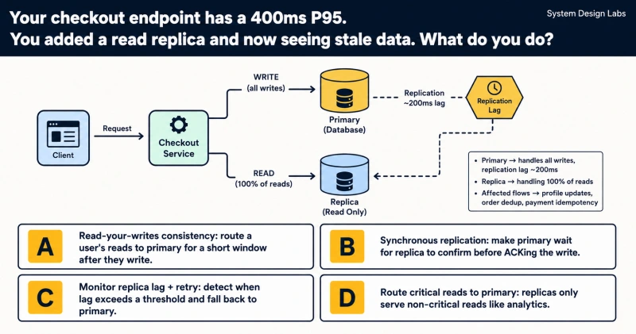

# Ngày 19: Read-Your-Writes with Read Replicas

[← Ngày trước](day-18-surviving-a-cache-stampede.md) | [Mục lục](README.md) | [Ngày tiếp theo →](day-20-containing-a-failing-downstream-dependency.md)

---

# NGÀY 19 · THIẾT KẾ HỆ THỐNG (SYSTEM DESIGN)
## Tính nhất quán Đọc-sau-khi-ghi với các Bản sao đọc (Read-Your-Writes with Read Replicas)

Endpoint thanh toán (checkout endpoint) của bạn có độ trễ P95 là 400ms. Kết quả phân tích hiệu năng (profiling) cho thấy 70% thời gian đó là do các thao tác đọc cơ sở dữ liệu (DB reads).

Bạn bổ sung thêm một bản sao đọc (read replica) và trỏ toàn bộ các truy vấn `SELECT` vào đó. P95 giảm xuống chỉ còn 90ms. Cả đội ngũ ăn mừng chiến thắng.

Hai giờ sau, các yêu cầu hỗ trợ (support tickets) ồ ạt đổ về. Khách hàng cập nhật địa chỉ giao hàng nhưng vẫn nhìn thấy địa chỉ cũ trên màn hình xác nhận. Một khách hàng bị trừ tiền hai lần vì bước kiểm tra "đơn hàng đã tồn tại" (order already exists) đã đọc phải dữ liệu cũ (stale data) và bỏ sót đơn hàng trùng lặp.

**Dưới đây là cấu hình hiện tại (setup):**
* **Primary (Node chính)** $\rightarrow$ Xử lý toàn bộ các thao tác ghi (writes), độ trễ nhân bản (replication lag) $\sim$ 200ms.
* **Replica (Node phụ/bản sao)** $\rightarrow$ Xử lý 100% các thao tác đọc (reads).
* **Các luồng bị ảnh hưởng (Affected flows)** $\rightarrow$ Cập nhật thông tin người dùng (profile updates), chống trùng lặp đơn hàng (order dedup), tính bất biến của thanh toán (payment idempotency).

> [!WARNING]
> Replica đang hoạt động chính xác tuyệt đối theo đúng thiết kế của nó. Đó mới chính là vấn đề.

**Bạn sẽ làm gì?**

* **A.** **Tính nhất quán đọc-sau-khi-ghi (Read-your-writes consistency):** Điều hướng các truy vấn đọc của người dùng về node chính (primary) trong một khoảng thời gian ngắn (short window) ngay sau khi họ thực hiện thao tác ghi.
* **B.** **Nhân bản đồng bộ (Synchronous replication):** Bắt buộc node chính (primary) phải chờ node bản sao (replica) xác nhận trước khi phản hồi xác nhận (ACK - acknowledge) thao tác ghi.
* **C.** **Giám sát độ trễ bản sao + thử lại (Monitor replica lag + retry):** Phát hiện khi độ trễ nhân bản (lag) vượt qua một ngưỡng cho phép và tự động dự phòng (fall back) đọc về node chính (primary).
* **D.** **Điều hướng các truy vấn đọc quan trọng về node chính (Route critical reads to primary):** Các bản sao (replicas) chỉ phục vụ các truy vấn đọc không quan trọng (non-critical reads) như báo cáo phân tích dữ liệu (analytics).

---

# NGÀY 19 · ĐÁP ÁN & GIẢI THÍCH CHI TIẾT (ANSWERS & EXPLANATIONS)

### Câu trả lời 1
> [!NOTE]
> ### ✓ ĐÁP ÁN CHÍNH XÁC: A

#### Tại sao phương án A chiến thắng (Why A wins):
Sau khi một người dùng thực hiện một thao tác ghi, các truy vấn đọc tiếp theo của chính họ sẽ được điều hướng về node chính (primary) trong một khoảng thời gian ngắn (short window): thường là vài giây, hoặc cho đến khi độ trễ nhân bản của replica bắt kịp (replica lag catches up). 

Tất cả những người dùng khác vẫn tiếp tục đọc từ replica. Lợi ích tối ưu hiệu năng vẫn được bảo toàn trọn vẹn cho đại đa số lưu lượng truy cập (vast majority of traffic).

---

### Câu trả lời 2
#### Tại sao phương án D là câu trả lời bẫy (Why D is the trap):
Khái niệm "Quan trọng" (Critical) không phải là một danh mục cố định và ổn định. Danh sách các truy vấn đọc cần đưa về primary sẽ âm thầm bị thu hẹp dần theo thời gian, các lỗi đọc dữ liệu cũ (stale read bugs) sẽ quay trở lại, và bạn sẽ phải dành cả quý tiếp theo để chơi trò "đập chuột" (whack-a-mole) với các lỗi bất đồng bộ dữ liệu (consistency bugs). 

Bạn đã đánh đổi một giải pháp mang tính hệ thống (systematic solution) để lấy việc đưa ra phán đoán cảm tính riêng lẻ cho từng tính năng (per-feature judgment call).

---

### Câu trả lời 3
#### Tại sao phương án B sai (Why B is wrong):
Nhân bản đồng bộ (Synchronous replication) đồng nghĩa với việc node chính (primary) phải đợi replica xác nhận cho từng thao tác ghi một. 

Độ trễ nhân bản (Replica lag) sẽ giảm về bằng 0, nhưng độ trễ ghi P95 của bạn sẽ tăng vọt từ 20ms lên đến 80–120ms. Tệ hơn nữa, bạn đã liên kết chặt chẽ (coupled) tính sẵn sàng (availability) của node chính với trạng thái sức khỏe (health) của replica.

---

### Câu trả lời 4
#### Tại sao phương án C sai (Why C is wrong):
Độ trễ trung bình (Average lag) không phải là vấn đề của bạn. Vấn đề cốt lõi của bạn là người dùng đọc lại dữ liệu do chính họ vừa ghi trong vòng 200ms kể từ khi thực hiện thao tác đó. 

Chỉ số đo lường độ trễ (lag metric) trông vẫn hoàn toàn bình thường (200ms được coi là "bình thường"), nhưng dữ liệu mà người dùng thực sự cần đọc thì vẫn đang trên đường truyền (in transit).

---

### Tổng kết so sánh các phương án kiến trúc

| Phương án | Độ trễ đọc (Read Latency) | Độ trễ ghi (Write Latency) | Đảm bảo tính nhất quán (Consistency) | Đánh giá kiến trúc |
| :--- | :--- | :--- | :--- | :--- |
| **A. Read-Your-Writes** *(Được chọn)* | Tối ưu cho >95% người dùng, chỉ trỏ về primary ngắn hạn cho người vừa ghi | Không bị ảnh hưởng | **Triệt để**: Không bao giờ thấy dữ liệu cũ của chính mình | Giải pháp chuẩn mực (Golden standard), duy trì cân bằng giữa Performance & Consistency. |
| **B. Synchronous Replication** | Rất thấp (đọc ở đâu cũng mới) | Tăng vọt (từ 20ms $\rightarrow$ 80-120ms) | Rất cao (Strong Consistency) | **Sai lầm**: Ảnh hưởng thông lượng ghi, làm giảm Availability của Primary. |
| **C. Lag Monitor + Retry** | Tiềm ẩn độ trễ do retry | Không bị ảnh hưởng | Kém: Bỏ lọt các truy vấn xảy ra ngay trong cửa sổ 200ms lag bình thường | **Không giải quyết được gốc rễ**: 200ms lag là "bình thường" nhưng vẫn gây lỗi stale read. |
| **D. Split Critical Reads** | Phụ thuộc vào việc phân loại logic | Không bị ảnh hưởng | Kém bền vững theo thời gian | **Bẫy kiến trúc (Trap)**: Tạo technical debt và gánh nặng bảo trì logic cho từng endpoint. |

---

[← Ngày trước](day-18-surviving-a-cache-stampede.md) | [Mục lục](README.md) | [Ngày tiếp theo →](day-20-containing-a-failing-downstream-dependency.md)
