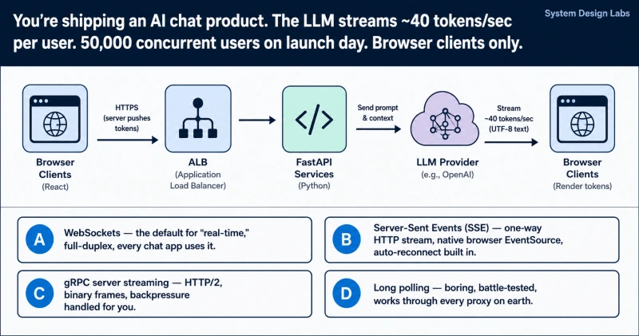

# Ngày 21: Choosing a Real-Time Streaming Transport

[← Ngày trước](day-20-containing-a-failing-downstream-dependency.md) | [Mục lục](README.md) | [Ngày tiếp theo →](day-22-reliable-messaging-across-services.md)

---

# NGÀY 21 · THIẾT KẾ HỆ THỐNG (DAY 21 · SYSTEM DESIGN)
## Lựa chọn giao thức truyền tải Streaming theo thời gian thực (Choosing a Real-Time Streaming Transport)

Bạn đang triển khai một sản phẩm AI Chat. Mô hình ngôn ngữ lớn (LLM) phát luồng (stream) ~40 token/giây trên mỗi người dùng.  
Dự kiến có **50.000 người dùng đồng thời (50K concurrent users)** trong ngày ra mắt. Chỉ phục vụ các máy khách trình duyệt (Browser clients only). Dòng chảy token diễn ra **theo một chiều (one way): máy chủ (server) → người dùng (user)**.

Đội ngũ của bạn họp để chọn giao thức truyền tải (transport). Mọi người đều đưa ra quan điểm cá nhân rất gay gắt.

### Bối cảnh thiết lập hệ thống (Setup):
- **Frontend**: React chạy trên trình duyệt (browser).
- **Backend**: Python (FastAPI) đứng sau bộ cân bằng tải ứng dụng ALB (Application Load Balancer).
- **Tải trọng dữ liệu (Payload)**: Các token văn bản UTF-8, kích thước ~5–20 bytes mỗi token.
- **Chiều dữ liệu (Direction)**: Máy chủ đẩy dữ liệu (server pushes), máy khách chỉ thực hiện kết xuất hiển thị (client just renders).
- **Khả năng kết nối lại (Reconnects)**: Phải hoàn toàn trong suốt/vô hình với người dùng (mạng di động rớt kết nối liên tục).

> [!NOTE]
> Trưởng nhóm kỹ thuật (Team lead) khẳng định: *"Hiển nhiên là WebSockets rồi."* Kỹ sư hạ tầng (Platform engineer) kịch liệt phản đối. Bạn sẽ chọn giải pháp nào để đưa vào production?

---

### Các phương án lựa chọn:

- **A. WebSockets** — Lựa chọn mặc định cho các ứng dụng "thời gian thực" (real-time), song công toàn phần (full-duplex), mọi ứng dụng trò chuyện (chat app) đều sử dụng nó.
- **B. Server-Sent Events (SSE)** — Luồng HTTP một chiều (one-way HTTP stream), hỗ trợ native trên trình duyệt qua `EventSource`, tích hợp sẵn cơ chế tự động kết nối lại (auto-reconnect).
- **C. gRPC server streaming** — Chạy trên nền tảng HTTP/2, đóng gói khung nhị phân (binary frames), cơ chế kiểm soát áp lực ngược (backpressure) được xử lý tự động cho bạn.
- **D. Long polling** — Đơn điệu, đã được kiểm chứng thực tế qua nhiều năm (battle-tested), hoạt động xuyên suốt qua mọi hệ thống proxy trên thế giới.

---

# NGÀY 21 · CÂU TRẢ LỜI & GIẢI THÍCH CHI TIẾT (DAY 21 · ANSWERS & EXPLANATIONS)

## Câu trả lời 1 (Answer 1)

### ✓ CÂU TRẢ LỜI ĐÚNG: B

### Tại sao B chiến thắng (Why B wins - SSE):

Lưu lượng truy cập là **một chiều (one-way)**. Máy chủ đẩy token, máy khách kết xuất giao diện. Chỉ có vậy. Máy khách không bao giờ gửi ngược một token nào về giữa chừng luồng streaming — yêu cầu nhập liệu của người dùng (user input) được gửi thông qua một yêu cầu `POST` riêng biệt. Do đó, bạn đang phải trả giá cho một giải pháp song công toàn phần (full-duplex) để giải quyết một bài toán bán song công/một chiều (half-duplex).

**SSE (Server-Sent Events)** được thiết kế chính xác cho kiến trúc dạng này:
- Một kết nối HTTP duy nhất kéo dài (long-lived HTTP connection).
- Định dạng chuẩn `text/event-stream`.
- Phía máy chủ chỉ việc ghi dữ liệu (server writes), API `EventSource` nguyên bản của trình duyệt (browser's native `EventSource`) đảm nhận việc đọc dữ liệu.
- Không cần nâng cấp giao thức (No protocol upgrade).
- Không cần cơ chế đóng khung mới (No new framing).
- Không cần xây dựng một luồng xác thực mới (No new auth path).

> [!TIP]
> **Tính năng sát thủ (The killer feature): Tự động kết nối lại (automatic reconnect) với `Last-Event-ID`.**  
> Khi trình duyệt bị rớt mạng, hoặc thiết bị di động chuyển từ Wi-Fi sang LTE — `EventSource` sẽ tự động kết nối lại mà không cần can thiệp code và gửi báo cáo cho máy chủ ID của sự kiện cuối cùng mà nó nhận được (`Last-Event-ID`). Hệ thống của bạn chỉ cần phát lại dữ liệu (replay) tiếp tục từ mốc đó. Với WebSockets, bạn sẽ phải tự code toàn bộ logic đó bằng tay, và bạn sẽ viết sai tới 3 lần đầu tiên.

API streaming của OpenAI dùng gì? **SSE**.  
API streaming của Anthropic dùng gì? **SSE**.

---

## Câu trả lời 2 (Answer 2)

### Tại sao A là câu trả lời bẫy (Why A is the trap - WebSockets):

Từ khóa **"chat"** đã đánh lừa mọi người. Ứng dụng trò chuyện giữa người dùng với người dùng (User-to-user chat như Slack, WhatsApp) là **hai chiều (bidirectional)**. Nhưng ứng dụng AI Chat lại là một **luồng token đơn hướng (unidirectional token stream)** kết hợp với một yêu cầu `POST` riêng biệt dành cho câu lệnh nhắc (prompt). Hình thái kiến trúc khác nhau đòi hỏi giao thức truyền tải khác nhau.

> [!WARNING]
> **Cái giá phải trả ở quy mô 50.000 kết nối (50K connections):**
> - Phải cấu hình phiên duy trì kết nối (Sticky sessions) trên ALB (Application Load Balancer).
> - Tự viết logic kết nối lại (reconnect) và phát lại dữ liệu (replay) bằng tay.
> - Phải thiết lập cơ chế nhịp tim (Heartbeats) và gửi gói tin ping/pong liên tục để phát hiện các kết nối chết (dead connections).
> - Tiêu tốn dung lượng bộ nhớ (RAM) cao hơn trên mỗi kết nối cho các bộ đệm (buffers) mà bạn không bao giờ dùng đến.
>
> Mỗi vấn đề kể trên đều có thể biến thành những cuộc gọi báo động khẩn cấp giữa đêm (on-call page).

---

## Câu trả lời 3 (Answer 3)

### Tại sao C sai (Why C is wrong - gRPC streaming):

Trình duyệt không hỗ trợ giao tiếp gRPC nguyên bản (Browsers don't speak gRPC). Bạn sẽ phải dựng thêm tầng **Envoy Proxy + gRPC-Web**, điều này làm suy giảm mô hình streaming (downgrades the streaming model) và phát sinh thêm một chặng trung gian qua proxy (proxy hop). 

Lúc này, bạn tự chuốc thêm việc vận hành Envoy và phải ngồi gỡ lỗi các khung nhị phân Protobuf (debugging Protobuf frames) ngay trong tab Network của trình duyệt — chỉ để truyền các token văn bản UTF-8 đơn giản. gRPC rất tuyệt vời cho giao tiếp giữa các dịch vụ nội bộ (service-to-service), nhưng là **công cụ hoàn toàn sai lầm khi dùng trực tiếp trên trình duyệt**.

---

## Câu trả lời 4 (Answer 4)

### Tại sao D sai (Why D is wrong - Long polling):

Với tốc độ ~40 token/giây, mỗi chu kỳ thăm dò (poll cycle) sẽ ngốn sạch một yêu cầu HTTP đầy đủ (full HTTP request). 

$$\text{50.000 người dùng} \times \text{40 req/giây} = \mathbf{2.000.000\text{ RPS (Yêu cầu/giây)}}$$

...chỉ nhằm mục đích duy nhất là hiển thị văn bản!

Long polling là một cơ chế dự phòng (fallback) hợp lý khi các kết nối SSE/WebSockets bị tường lửa hoặc proxy chặn. Nhưng nó **không thể là giao thức truyền tải chính (primary transport) của bạn vào năm 2026**.

---

### Bảng tổng hợp so sánh quyết định kiến trúc:

| Tiêu chí so sánh | WebSockets (Phương án A) | Server-Sent Events - SSE (Phương án B - Thắng) | gRPC Server Streaming (Phương án C) | Long Polling (Phương án D) |
| :--- | :--- | :--- | :--- | :--- |
| **Bản chất luồng** | Song công toàn phần (Full-duplex / 2 chiều) | Đơn hướng (Unidirectional / Server → Client) | Đơn hướng (giao thức HTTP/2) | Thăm dò chu kỳ lặp lại |
| **Giao thức mạng** | Giao thức riêng biệt (`ws://`, `wss://`) qua HTTP Upgrade | Chuẩn HTTP thông thường (`text/event-stream`) | HTTP/2 (cần Envoy + gRPC-Web cho web) | HTTP tiêu chuẩn (Request/Response) |
| **Khả năng tự kết nối lại** | Tự code bằng tay (`ping/pong`, reconnect logic) | **Tự động native** với `Last-Event-ID` | Phụ thuộc vào client library | Tự gửi request mới |
| **Chi phí hạ tầng ALB** | Cần Sticky Sessions, đệm kết nối lớn | Hoạt động bình thường qua mọi HTTP Load Balancer | Phức tạp, thêm proxy hop (Envoy) | Quá tải: 2 triệu RPS cho 50K user |
| **Trường hợp áp dụng** | Game, Canvas cộng tác thời gian thực, Slack | **AI Streaming, Bảng giá chứng khoán, Live Log** | Giao tiếp Backend-to-Backend | Cơ chế Fallback cuối cùng |

---

[← Ngày trước](day-20-containing-a-failing-downstream-dependency.md) | [Mục lục](README.md) | [Ngày tiếp theo →](day-22-reliable-messaging-across-services.md)
