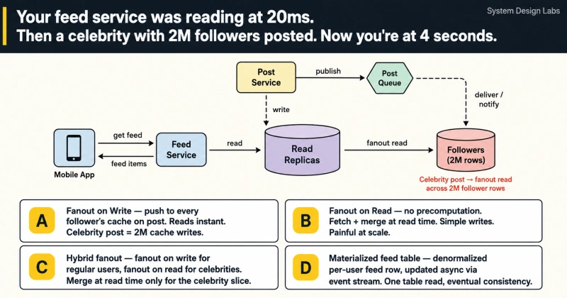

# Ngày 23: Feed Fanout for Celebrity Accounts

[← Ngày trước](day-22-reliable-messaging-across-services.md) | [Mục lục](README.md) | [Ngày tiếp theo →](day-24-paginating-large-result-sets-efficiently.md)

---

# NGÀY 23 · THIẾT KẾ HỆ THỐNG (DAY 23 · SYSTEM DESIGN)

## Phân phối Bảng tin cho Tài khoản Người nổi tiếng (Feed Fanout for Celebrity Accounts)

Dịch vụ bảng tin (*feed service*) của bạn trước đây có độ trễ đọc (*read latency*) ở mức **20ms**.  
Sau đó, một tài khoản người nổi tiếng (*celebrity*) với **2 triệu người theo dõi (2M followers)** đăng bài.  
Hiện tại, độ trễ đã tăng vọt lên **4 giây**. Chỉ số **P99 đang bốc hỏa** (*P99 latency is on fire*).

### Bối cảnh thiết lập (Setup):
- **10 triệu người dùng (10M users)**.
- **~50.000 bài đăng/ngày (~50k posts/day)**.
- **Một tài khoản: 2 triệu người theo dõi (2M followers)**.
- Mỗi lần tài khoản đó đăng bài, truy vấn bảng tin (*feed query*) của bạn phải phân tán (*fan out*) qua 2 triệu dòng người theo dõi, sắp xếp theo mốc thời gian (*timestamp*), và nhấn chìm toàn bộ các bản sao đọc cơ sở dữ liệu (*read replicas*).

Nhóm của bạn đang tranh luận về cách khắc phục mô hình phân phối (*delivery model*) — **không phải tối ưu câu truy vấn, mà là tái cấu trúc kiến trúc (architecture)**.

---

### Các phương án lựa chọn (Options):

- **A) Fanout on Write (Phân phối khi ghi / Push Model)** — Đẩy thẳng (*push*) vào bộ nhớ đệm (*cache*) của từng người theo dõi ngay khi có bài đăng. Tốc độ đọc là tức thì (*instant reads*). Một bài đăng của người nổi tiếng = **2 triệu lượt ghi vào cache (2M cache writes)**.
- **B) Fanout on Read (Phân phối khi đọc / Pull Model)** — Không tính toán trước (*no precomputation*). Truy xuất (*fetch*) + hợp nhất (*merge*) ngay tại thời điểm đọc. Thao tác ghi đơn giản. Cực kỳ đau đớn khi mở rộng quy mô (*painful at scale*).
- **C) Hybrid Fanout (Phân phối lai)** — *Fanout on write* đối với người dùng thông thường, *fanout on read* đối với tài khoản người nổi tiếng. Chỉ hợp nhất (*merge*) tại thời điểm đọc cho lát cắt của người nổi tiếng (*celebrity slice*).
- **D) Materialized Feed Table (Bảng bảng tin phi chuẩn hóa/vật chất hóa)** — Mỗi người dùng có một dòng bảng tin phi chuẩn hóa (*denormalized per-user feed row*), được cập nhật bất đồng bộ (*async*) qua luồng sự kiện (*event stream*). Chỉ cần đọc một bảng (*one table read*), chấp nhận tính nhất quán cuối cùng (*eventual consistency*).

---

# NGÀY 23 · ĐÁP ÁN & GIẢI THÍCH CHI TIẾT (DAY 23 · ANSWERS & EXPLANATIONS)

## Câu trả lời 1 (Answer 1)

> [!TIP]
> ### ✓ CÂU TRẢ LỜI ĐÚNG: C — Hybrid Fanout (Mô hình phân phối lai)

### Vì sao phương án C chiến thắng (Why C wins):
Đây chính là cách Twitter thực tế đã giải quyết bài toán này — họ đã công bố kiến trúc của mình. 

**Điểm cốt lõi (The insight):**
- **Fanout-on-write** mang lại tốc độ cực nhanh cho người đọc nhưng lại là **thảm họa đối với các tài khoản có lượng người theo dõi lớn**.
- **Fanout-on-read** có thiết kế đơn giản nhưng sẽ **hủy diệt độ trễ (latency) khi ở quy mô lớn**.
- **Mô hình Hybrid (Lai)** nhìn nhận sòng phẳng điểm nghẽn và chế độ lỗi (*failure modes*) của cả hai phương pháp trên.

#### Luồng hoạt động:
1. Khi một bài đăng được tạo → **Kiểm tra số lượng người theo dõi (*follower count*)**.
   - **Dưới 10.000 (< 10k)?** → Thực hiện phân phối ngay lập tức (*fan out immediately*) vào bộ nhớ đệm bảng tin Redis (*Redis feed caches*) của toàn bộ người theo dõi.
   - **Trên 10.000 (> 10k - Người nổi tiếng)?** → **Bỏ qua thao tác phân phối (*skip the fanout*)**.
2. **Tại thời điểm đọc (*read time*)**, truy xuất dữ liệu từ hai nguồn:
   - Bộ nhớ đệm đã được tính toán trước (*precomputed cache*) từ các tài khoản thông thường.
   - Truy vấn thời gian thực (*real-time query*) đối với các tài khoản người nổi tiếng.
3. **Hợp nhất và loại bỏ trùng lặp (*Merge + Deduplicate*)**:
   - Lát cắt bài đăng từ người nổi tiếng (*celebrity slice*) luôn nhỏ và có giới hạn (*bounded*).

> [!NOTE]
> **Kết quả:** Độ trễ **P99 luôn duy trì tốc độ cao**, đồng thời loại bỏ hoàn toàn việc phải thực hiện **2 triệu lượt ghi đồng bộ (*2M synchronous writes*)** mỗi khi người nổi tiếng đăng bài.

---

## Câu trả lời 2 (Answer 2)

> [!WARNING]
> ### Vì sao phương án A là câu trả lời bẫy (Why A is the trap - Fanout on Write):

Thoạt nhìn trông có vẻ hoàn hảo: Tốc độ đọc là tức thì (*instant reads*). 

Cho đến khi một siêu sao như Cristiano Ronaldo đăng bài và hệ thống của bạn phải ghi đồng thời vào **500 triệu bộ nhớ đệm song song (*500M caches in parallel*)**. 

- Ở mức 2 triệu người theo dõi (2M followers), ngay cả khi mỗi lượt ghi chỉ tốn **1ms** → bạn đã phải tốn đến **2.000 giây công việc ghi (*2,000 seconds of write work*)**.
- Cụm bộ nhớ đệm (*cache cluster*) bị bão hòa.
- Hàng đợi ghi (*write queue*) bị ùn tắc nghẽn ứ.
- Hiện tượng **Đoàn người ùa vào / Bầy đàn sấm sét (*Thundering herd problem*)** xảy ra sau mỗi bài đăng của người nổi tiếng.

> Các đội ngũ kỹ sư thường triển khai phương án này, hệ thống chạy rất mượt mà ở quy mô 1 triệu người dùng (1M users), nhưng sau đó sẽ vấp phải **vấn đề người nổi tiếng (*celebrity problem*)** khi hệ thống đã đi vào môi trường sản xuất thực tế (*production*). **Đó chính là cái bẫy.**

---

## Câu trả lời 3 (Answer 3)

> [!CAUTION]
> ### Vì sao phương án B sai (Why B is wrong - Fanout on Read):

Nếu một người dùng theo dõi 500 tài khoản = hệ thống phải thực hiện **500 truy vấn** (hoặc một câu lệnh `JOIN` khổng lồ), sau đó phải **sắp xếp trong bộ nhớ (*sorted in memory*)** trước khi trả về bất kỳ kết quả nào cho người dùng.

Bạn có thể lưu kết quả này vào cache — nhưng khi đó bạn đang phải thực hiện **tính toán cực kỳ tốn kém chỉ để nạp dữ liệu vào một cache sẽ hết hạn sau 30 giây**. 

Thực chất, đó chỉ là một dạng **fanout-on-write chậm chạp với độ trễ cộng thêm**. Giải pháp này **hoàn toàn không thể sống sót ở quy mô 10 triệu người dùng (10M users)**.

---

## Câu trả lời 4 (Answer 4)

> [!WARNING]
> ### Vì sao phương án D sai (Why D is wrong - Materialized Feed Table):

Nghe có vẻ rất sạch sẽ — một dòng dữ liệu phi chuẩn hóa cho mỗi người dùng (*denormalized row per user*), được cập nhật bất đồng bộ thông qua CDC (*Change Data Capture*) hoặc luồng sự kiện (*event stream*). 

Tuy nhiên:
- Một bài đăng của người nổi tiếng **vẫn kích hoạt 2 triệu lượt cập nhật dòng (*2M row updates*)**, chỉ là diễn ra dưới dạng bất đồng bộ.
- Bạn **không hề giải quyết bài toán khuếch đại ghi (*write amplification*)**, bạn chỉ đang **hoãn việc xử lý nó lại**.
- **Gia tăng độ phức tạp vận hành (*operational complexity*)**: Quản lý luồng sự kiện (*event stream*) + các tiến trình tiêu thụ dữ liệu đảm bảo tính lũy thừa (*idempotent consumers*) + logic đối soát và hòa giải dữ liệu (*reconciliation logic*).
- Thêm quá nhiều thành phần chuyển động (*moving parts*) phức tạp nhưng bản chất vấn đề vẫn y nguyên.

---

### Bảng so sánh tổng hợp kiến trúc (Architecture Comparison Matrix)

| Kiến trúc | Tốc độ Đọc (Read Latency) | Tác động Ghi khi có Celebrity | Độ phức tạp hệ thống | Phù hợp quy mô lớn? |
| :--- | :--- | :--- | :--- | :--- |
| **A) Fanout on Write** | Cực nhanh (O(1)) | Thảm họa (Kẹt hàng đợi, thundering herd) | Thấp | Không (Gặp Celebrity Problem) |
| **B) Fanout on Read** | Chậm (Phụ thuộc số following) | Rất nhanh (O(1)) | Thấp | Không (P99 tăng vọt ở 10M users) |
| **C) Hybrid Fanout** | **Rất nhanh (O(1) + O(k celebrities))** | **Cân bằng (Bỏ qua celebrity fanout)** | **Trung bình** | **Tối ưu nhất (Thực tế Twitter/Meta)** |
| **D) Materialized Table** | Nhanh (Đọc 1 dòng/bảng) | Vẫn bị khuếch đại ghi (2M updates async) | Rất cao (CDC, Idempotency, Event Stream) | Không giải quyết gốc rễ khuếch đại ghi |

---

[← Ngày trước](day-22-reliable-messaging-across-services.md) | [Mục lục](README.md) | [Ngày tiếp theo →](day-24-paginating-large-result-sets-efficiently.md)
