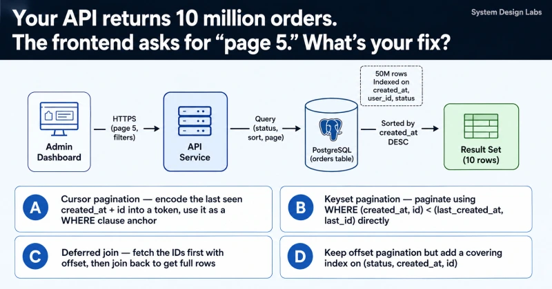

# Ngày 24: Paginating Large Result Sets Efficiently

[← Ngày trước](day-23-feed-fanout-for-celebrity-accounts.md) | [Mục lục](README.md) | [Ngày tiếp theo →](day-25-queue-backpressure-under-a-traffic-spike.md)

---


# NGÀY 24 · THIẾT KẾ HỆ THỐNG (SYSTEM DESIGN)
## Phân Trang Hiệu Quả Cho Tập Kết Quả Lớn (Paginating Large Result Sets Efficiently)



API của bạn trả về 10 triệu đơn hàng (orders).  
Phía giao diện người dùng (frontend) yêu cầu "trang 5".  
`Offset 40, limit 10`. Nghe đủ đơn giản — cho đến khi Quản trị viên cơ sở dữ liệu (DBA) nhắn tin cho bạn lúc 2 giờ sáng.  
Thời gian truy vấn (query time): 4,2 giây. Quét toàn bộ bảng (table scans) tăng vọt. Môi trường production đang bị giật lag nghiêm trọng.  

Dưới đây là ngăn xếp công nghệ (tech stack): **PostgreSQL**, **50 triệu dòng (50M rows)** trong bảng `orders`, được sắp xếp theo `created_at DESC`. Người dùng có thể lọc theo trạng thái (`status`).  
Bạn đang thực hiện phân trang cho một bảng điều khiển quản trị (admin dashboard) được sử dụng đồng thời bởi 200 nhân viên hỗ trợ (support agents).  

Phân trang bằng Offset (Offset pagination) hoạt động hoàn hảo ở mức 10.000 dòng (10K rows). Nhưng ở mức 50 triệu dòng (50M rows), nó đang phải **đọc và loại bỏ tới 40 triệu dòng chỉ để trả về đúng 10 dòng**.  

Bạn cần phải khắc phục vấn đề này trước khi đợt sprint tiếp theo phát hành phiên bản dành cho khách hàng (customer-facing version) — phiên bản sẽ có lượng truy cập (traffic) gấp 10 lần.  

**Thiết lập hiện tại của bạn:**
* **Bảng (Table):** `orders` — 50 triệu dòng (50M rows), được đánh chỉ mục (indexed) trên các cột `created_at`, `user_id`, `status`
* **Truy vấn (Query):** Được sắp xếp theo `created_at DESC`, lọc theo `status`
* **Phía Client:** Cần điều hướng "trước/sau" (previous/next) + nhảy trực tiếp đến trang bất kỳ (jump-to-page)
* **SLA:** $p99 < 200\text{ms}$

Bốn kỹ sư đề xuất bốn cách tiếp cận khác nhau:

* **A. Phân trang bằng con trỏ (Cursor pagination)** — Mã hóa cặp giá trị `created_at` + `id` nhìn thấy cuối cùng thành một token, sử dụng nó làm điểm neo (anchor) cho mệnh đề `WHERE`.
* **B. Phân trang bằng bộ khóa (Keyset pagination)** — Phân trang bằng cách sử dụng trực tiếp cấu trúc so sánh `WHERE (created_at, id) < (last_created_at, last_id)`.
* **C. Phép nối trì hoãn (Deferred join)** — Lấy trước danh sách các `id` bằng offset, sau đó kết nối ngược lại (join back) để lấy đầy đủ các dòng dữ liệu.
* **D. Giữ nguyên phân trang offset nhưng thêm chỉ mục bao phủ (covering index)** trên `(status, created_at, id)`.

---

# NGÀY 24 · ĐÁP ÁN & GIẢI THÍCH CHI TIẾT (ANSWERS & EXPLANATIONS)


## Đáp án 1: LỰA CHỌN CHÍNH XÁC (CORRECT ANSWER)

### Phương án A — Phân trang bằng con trỏ (Cursor pagination) ✅ CHÍNH XÁC (CORRECT)

> [!NOTE]  
> Mã hóa bộ giá trị nhìn thấy cuối cùng `(created_at, id)` thành một token mờ đục (opaque token). Trong yêu cầu tiếp theo, giải mã token đó và sử dụng mệnh đề sau làm điểm neo (anchor) của bạn:  
> `WHERE created_at < :last_ts OR (created_at = :last_ts AND id < :last_id)`

**Lý do phương án này giành chiến thắng tại đây (Why this wins here):**
* **Truy vấn luôn đánh trúng chỉ mục (hits the index) ngay tại điểm neo:** Không quét dư thừa (no scan), không loại bỏ dòng dữ liệu (no discard).
* **Độ trễ $p99$ duy trì ổn định (stays flat):** Bất kể bạn đang ở trang 1 hay trang 50.000.
* **Hoạt động tốt với bộ lọc trạng thái (status filter):**  
  `WHERE status = 'pending' AND (created_at, id) < (anchor)`
* **Con trỏ có tính ổn định vị trí (position-stable):** Các dòng dữ liệu mới được chèn vào trước con trỏ của bạn sẽ không làm xê dịch (shift) trang hiện tại.

> [!TIP]  
> **Sự đánh đổi về trải nghiệm người dùng (UX tradeoff):** Không hỗ trợ tính năng nhảy trực tiếp đến trang (no jump-to-page). Chỉ hỗ trợ tiến/lùi (previous/next). Tuy nhiên, đây là sự đánh đổi hoàn toàn chính xác cho bảng điều khiển (dashboard) này. Các nhân viên hỗ trợ (support agents) điều hướng tuần tự. Không ai có nhu cầu "nhảy đến trang 3.847" cả.

Ở quy mô 50 triệu dòng dữ liệu với các bộ lọc đồng thời, phân trang bằng con trỏ (**Cursor pagination**) là cách tiếp cận duy nhất đạt được SLA $p99 < 200\text{ms}$ một cách đáng tin cậy.

---

## Đáp án 2: BẪY THIẾT KẾ (THE TRAP ANSWER)

### Phương án B — Phân trang bằng bộ khóa (Keyset pagination)

Thoạt nhìn bên ngoài, Keyset trông hoàn toàn giống hệt Cursor. Sự khác biệt ở đây rất tinh vi: **Keyset là một mẫu truy vấn (query pattern), còn Cursor là một quyết định về mặt sản phẩm (product decision).**

Keyset sử dụng `WHERE (created_at, id) < (val1, val2)` như một cấu trúc thuần SQL. Cursor bao bọc cấu trúc đó vào một token đã được mã hóa mà client không thể tự ý kiểm tra hay can thiệp chỉnh sửa.

> [!WARNING]  
> **Điểm gãy đổ của phương án này:** Bộ lọc `status` làm phá vỡ cơ chế so sánh bộ dòng (row-tuple comparison) trong hầu hết các bộ tối ưu hóa truy vấn (query planners).  
> Câu lệnh `WHERE status = 'pending' AND (created_at, id) < (anchor)` **không sử dụng chỉ mục kết hợp (composite index) một cách hiệu quả** trong PostgreSQL khi cột so sánh bằng (`status`) không nằm trong phép so sánh tuple. Bạn sẽ kết thúc với một đợt quét chỉ mục một phần (partial index scan) và hiệu năng sẽ suy giảm nghiêm trọng dưới các bộ lọc có độ biến thiên cao (high cardinality filters).

Cursor pagination xử lý triệt để điều này bằng cách mã hóa toàn bộ ngữ cảnh của mệnh đề `WHERE`, chứ không chỉ riêng điểm neo vị trí. Đó chính là lỗ hổng. Nó rất tinh vi, và chính là thứ sẽ "cắn" bạn trên môi trường production ba tháng sau khi bạn đưa tính năng này lên vận hành.

---

## Đáp án 3: TỐI ƯU NỬA VỜI (OPTIMIZATION, NOT A SOLUTION)

### Phương án C — Phép nối trì hoãn (Deferred join)

```sql
SELECT o.* FROM orders o
JOIN (
  SELECT id FROM orders
  WHERE status = 'pending'
  ORDER BY created_at DESC
  OFFSET 500000 LIMIT 10
) ids ON o.id = ids.id
```

Đây là một kỹ thuật tối ưu hóa hợp lệ cho phân trang bằng offset. Truy vấn con bên trong chỉ lấy duy nhất các `id` (nằm trọn vẹn trong index, nhanh hơn rất nhiều), sau đó phép nối ngoài (outer join) chỉ lấy các dòng đầy đủ cho đúng 10 bản ghi.

Điều này có thật. Nó hoạt động được. Shopify sử dụng một biến thể của kỹ thuật này.

> [!IMPORTANT]  
> **Tuy nhiên:** Bạn vẫn phải trả chi phí độ phức tạp thuật toán là $\mathcal{O}(\text{offset})$ trên truy vấn con khi truy cập các trang sâu (deep pages). Nó giúp cải thiện — nhưng **không giải quyết dứt điểm vấn đề**. Ở trang 50.000, bạn vẫn đang phải quét 500.000 mục chỉ mục. Bạn chỉ gọt giũa được 80% chi phí nhưng vẫn giữ lại 20% của vấn đề.

---

## Đáp án 4: GIẢI PHÁP PHẦN CỨNG / SAI BẢN CHẤT THUẬT TOÁN

### Phương án D — Chỉ mục bao phủ (Covering index)

Việc thêm chỉ mục:
```sql
CREATE INDEX ON orders(status, created_at DESC, id DESC);
```
là một ý tưởng tốt bất kể bạn lựa chọn cách tiếp cận nào. Nó loại bỏ việc truy xuất vào vùng nhớ bảng (heap fetches) đối với các truy vấn lọc theo `status`.

> [!WARNING]  
> Nhưng một chỉ mục **không thể làm thay đổi độ phức tạp thuật toán (algorithmic complexity) của `OFFSET`**. Nó chỉ làm cho các đợt quét bảng (table scans) của bạn chạy nhanh hơn, chứ không làm cho quãng đường quét ngắn lại.  
> Đây là câu trả lời theo kiểu "ném phần cứng vào để giải quyết vấn đề" (throw hardware at it). Nó chỉ mua thêm thời gian cho bạn, chứ không phải là một giải pháp tận gốc.

---

### Bảng tổng hợp so sánh các giải pháp (Architectural Comparison)

| Phương pháp | Độ phức tạp thuật toán | Tính ổn định kết quả (Drift-safe) | Hỗ trợ Jump-to-Page | Đạt SLA $p99 < 200\text{ms}$ tại trang sâu? | Đánh giá kiến trúc |
| :--- | :---: | :---: | :---: | :---: | :--- |
| **A. Cursor Pagination** | $\mathcal{O}(1)$ | **Có** | Không | **Đạt** | **Tối ưu nhất** cho hệ thống lớn, ổn định tuyệt đối |
| **B. Keyset Pagination** | $\mathcal{O}(1)$ | **Có** | Không | **Dễ hỏng index** | Phụ thuộc Query Planner khi kết hợp bộ lọc khác |
| **C. Deferred Join** | $\mathcal{O}(\text{offset})$ | Không | **Có** | **Không** | Cải thiện tạm thời, vẫn nghẽn khi offset lớn |
| **D. Covering Index** | $\mathcal{O}(\text{offset})$ | Không | **Có** | **Không** | "Ném phần cứng vào", không đổi được độ phức tạp |


---

[← Ngày trước](day-23-feed-fanout-for-celebrity-accounts.md) | [Mục lục](README.md) | [Ngày tiếp theo →](day-25-queue-backpressure-under-a-traffic-spike.md)
