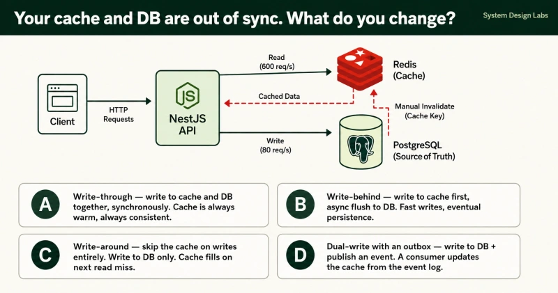

# Ngày 26: Write-Path Cache Consistency

[← Ngày trước](day-25-queue-backpressure-under-a-traffic-spike.md) | [Mục lục](README.md) | [Ngày tiếp theo →](day-27-keeping-an-llm-s-answers-up-to-date.md)

---

# NGÀY 26 · THIẾT KẾ HỆ THỐNG (SYSTEM DESIGN)

## Tính nhất quán của Cache trên Luồng Ghi (Write-Path Cache Consistency)

Cache và Database (DB) của bạn lại bị lệch pha (out of sync). Lại một lần nữa.

Một người dùng cập nhật thông tin hồ sơ của họ (profile). Cache vẫn tiếp tục trả về tên cũ trong suốt 10 phút tiếp theo. Đội hỗ trợ (Support) nhận một ticket khiếu nại. Bạn vá tạm thời bằng cách xóa sạch cache (cache flush). Nhưng tuần sau sự cố tương tự lại tái diễn.

Bạn được giao nhiệm vụ phải xử lý dứt điểm tính nhất quán khi ghi dữ liệu (write consistency) trước khi nó biến thành một sự cố nghiêm trọng ảnh hưởng trực tiếp tới khách hàng (customer-facing incident).

### Bối cảnh hệ thống (Setup):
- **Kiến trúc:** NestJS API → PostgreSQL (Nguồn chân lý dữ liệu - Source of Truth) + Redis (Cache)
- **Tải hệ thống ở giờ cao điểm (Peak traffic):** ~600 req/s (yêu cầu/giây) cho luồng đọc (reads), ~80 req/s cho luồng ghi (writes)
- **Mô hình hiện tại (Current pattern):** Ghi vào DB, chủ động hủy cache key (manually invalidate cache key) sau khi ghi DB thành công
- **Thực trạng:** 3 sự cố (incidents) trong tháng này — tất cả đều bắt nguồn từ việc cache bị cũ/lạc hậu (stale cache) sau khi ghi
- **Mục tiêu:** Bạn cần một chiến lược có khả năng chống chịu được tranh chấp tài nguyên (race conditions), cơ chế thử lại (retries) và các lỗi cục bộ/bán phần (partial failures)

**Bạn sẽ thay đổi điều gì?**

---

### Các phương án lựa chọn:

- **A. Write-through** — Ghi đồng thời vào cả Cache và DB một cách đồng bộ (synchronously). Cache luôn luôn ấm (warm) và luôn luôn nhất quán (consistent).
- **B. Write-behind** — Ghi vào Cache trước, sau đó xả bất đồng bộ (async flush) xuống DB. Tốc độ ghi nhanh, đảm bảo tính nhất quán sau cùng (eventual persistence).
- **C. Write-around** — Bỏ qua hoàn toàn Cache ở luồng ghi. Chỉ ghi vào DB. Cache sẽ được nạp lại vào lần đọc hụt (read miss) tiếp theo.
- **D. Dual-write with an outbox** — Ghi kép kết hợp mẫu Transactional Outbox: Ghi vào DB + xuất bản (publish) một sự kiện. Một Consumer sẽ cập nhật lại Cache từ nhật ký sự kiện (event log) này.

---

## NGÀY 26 · ĐÁP ÁN & GIẢI THÍCH CHI TIẾT (ANSWERS & EXPLANATIONS)

### Câu trả lời 1:
> [!TIP]
> ### ✓ ĐÁP ÁN CHÍNH XÁC: **D — Dual-write with an outbox**

Vấn đề cốt lõi ở đây không phải là *"thứ tự ghi như thế nào"* — mà là *"chuyện gì sẽ xảy ra khi một thao tác ghi thành công còn thao tác kia thất bại?"*

#### Tại sao phương án D chiến thắng (Why D wins):
Mọi phương pháp ghi kép ngây thơ (naive dual-write) đều gặp phải chung một tình trạng tranh chấp (race condition): ghi vào DB, ghi vào Cache, hệ thống bị sập (crash) ở giữa hai thao tác → dẫn đến **cache bị cũ/lạc hậu (stale cache) vô thời hạn**.

Mẫu Outbox biến việc cập nhật Cache thành một **hệ quả tất yếu (consequence)** của thao tác ghi DB, chứ không phải là hai thao tác ngang hàng (sibling operation) chạy độc lập. Tất cả nằm trong một giao dịch nguyên tử duy nhất trên DB (one atomic DB transaction): lưu bản ghi dữ liệu + lưu sự kiện outbox. 

Sau đó, một consumer sẽ đọc sự kiện và cập nhật lại Redis. Cách tiếp cận này cũng cung cấp cho bạn khả năng phát lại (replay) — nếu Redis bị sập và phục hồi trở lại, hệ thống chỉ cần xử lý lại các sự kiện từ bảng outbox.

---

### Câu trả lời 2:
> [!WARNING]
> ### Tại sao phương án A thất bại (Why A fails — Write-through):
> Trông có vẻ an toàn nhất nhưng thực tế lại **nguy hiểm nhất khi mở rộng quy mô (at scale)**.

Phương pháp này tạo ra hai thao tác I/O đồng bộ (synchronous I/Os) trên mỗi lượt ghi. Nếu Redis phản hồi chậm, toàn bộ Write API của bạn sẽ bị chậm theo. Nếu Redis bị sập hoàn toàn (down), liệu bạn có chặn (block) không cho người dùng thực hiện thao tác hay không? Bạn đã vô tình biến Redis trở thành một phụ thuộc cứng (hard dependency) bắt buộc phải có trên luồng ghi của mình.

---

### Câu trả lời 3:
> [!CAUTION]
> ### Tại sao phương án B thất bại (Why B fails — Write-behind):
> Tốc độ ghi rất nhanh, nhưng: **nếu tiến trình chạy ngầm bất đồng bộ (async worker) bị sập trước khi kịp xả dữ liệu xuống DB (DB flush), thao tác ghi đó sẽ biến mất hoàn toàn (mất dữ liệu).**

Mô hình này có thể chấp nhận được đối với các bộ đếm phân tích/thống kê (analytics counters). Nhưng **tuyệt đối không bao giờ được chấp nhận** đối với dữ liệu là nguồn chân lý (source of truth).

---

### Câu trả lời 4:
> [!NOTE]
> ### Tại sao phương án C chỉ là giải pháp khắc phục một phần (Why C is a partial fix — Write-around):
> Giải quyết được bài toán cache cũ (stale cache) bằng cách không ghi vào cache nữa. 

Cách này rất gọn gàng (clean) — tuy nhiên tính nhất quán đọc-ngay-sau-khi-ghi (read-after-write consistency) sẽ bị phá vỡ hoàn toàn khi có độ trễ đồng bộ bản sao DB (replica lag), và các khối lượng công việc có tần suất ghi cao (high-write workloads) sẽ kéo tụt nghiêm trọng tỷ lệ trúng cache (cache hit rate) của bạn.

---

### Bảng so sánh tổng hợp các chiến lược Write Cache

| Chiến lược (Pattern) | Độ trễ luồng ghi (Write Latency) | Rủi ro mất mát dữ liệu (Data Loss) | Nguy cơ Stale Cache / Race Condition | Tính khả thi cho Source of Truth |
| :--- | :--- | :--- | :--- | :--- |
| **A. Write-through** | Cao (Chờ cả DB + Redis I/O đồng bộ) | Thấp | Cao (Redis chậm/lỗi gây nghẽn luồng ghi) | Kém ở quy mô lớn (Hard dependency) |
| **B. Write-behind** | Rất thấp (Chỉ ghi vào Cache) | **Rất cao** (Worker sập trước khi flush DB) | Rất cao | **Tuyệt đối không** |
| **C. Write-around** | Trung bình (Chỉ ghi DB) | Thấp | Trung bình (Gãy do Replica lag, Cache thrashing) | Bị động, Cache hit rate thấp |
| **D. Dual-write with Outbox** | Thấp (1 Atomic DB Transaction) | **Không** (Đảm bảo bằng Transactional Outbox) | **Rất thấp** (Được xử lý tuần tự qua Event Log, có Replay) | **Lựa chọn tối ưu nhất** |

---

[← Ngày trước](day-25-queue-backpressure-under-a-traffic-spike.md) | [Mục lục](README.md) | [Ngày tiếp theo →](day-27-keeping-an-llm-s-answers-up-to-date.md)
