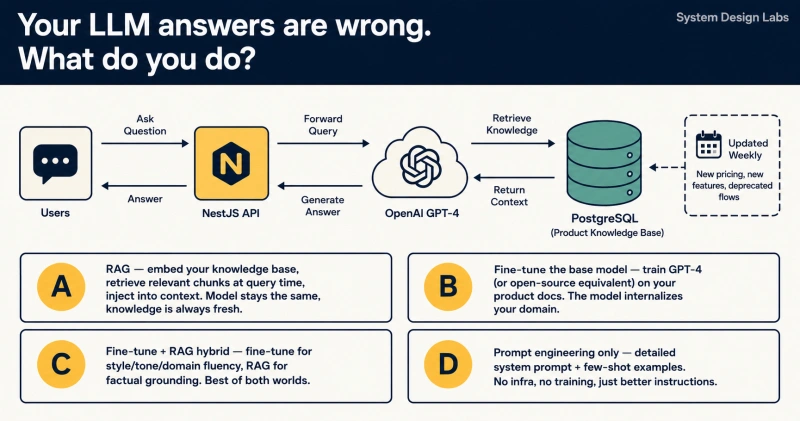

# Ngày 27: Keeping an LLM’s Answers Up to Date

[← Ngày trước](day-26-write-path-cache-consistency.md) | [Mục lục](README.md) | [Ngày tiếp theo →](day-28-choosing-a-vector-store-for-semantic-search.md)

---

# NGÀY 27 · THIẾT KẾ HỆ THỐNG (SYSTEM DESIGN)

## Giữ cho câu trả lời của LLM luôn được cập nhật mới nhất (Keeping an LLM’s Answers Up to Date)

Câu trả lời từ mô hình ngôn ngữ lớn (LLM - Large Language Model) của bạn đang bị sai. Không phải lỗi sai do ảo giác (hallucination-wrong) — mà là **sai do lỗi thời (outdated-wrong)**.

Bạn đã triển khai một bot hỗ trợ khách hàng (customer support bot) dựa trên **GPT-4**. Mô hình này được huấn luyện (trained) đến đầu năm 2024. Kể từ thời điểm đó đến nay, sản phẩm của bạn đã thay đổi tới 14 lần. Mỗi tuần, người dùng đều nhận được những câu trả lời vốn chính xác vào 8 tháng trước nhưng hiện tại thì hoàn toàn sai lệch.

Đội ngũ kỹ sư đang tranh luận về giải pháp khắc phục.

---

### Bối cảnh thiết lập hệ thống (The setup):

* **Kiến trúc:** NestJS API → OpenAI GPT-4 + PostgreSQL (Cơ sở tri thức sản phẩm - product knowledge base).
* **Tải hệ thống:** ~2,000 truy vấn hỗ trợ/ngày (~2,000 support queries/day), trong đó **15% trả về câu trả lời sai do tri thức bị cũ (stale knowledge)**.
* **Tần suất cập nhật:** Cơ sở tri thức (Knowledge base) được cập nhật hàng tuần — bảng giá mới (new pricing), tính năng mới (new features), các luồng thao tác cũ đã bị ngừng hỗ trợ (deprecated flows).
* **Ngân sách (Budget):** Startup quy mô vừa, không có ngân sách để huấn luyện mô hình tùy chỉnh từ đầu (training custom models from scratch).
* **Mục tiêu:** Bạn cần các câu trả lời chính xác, cập nhật theo thời gian thực mà **không phải huấn luyện lại mô hình (re-training)** sau mỗi lần cập nhật sản phẩm.

**Bạn sẽ làm gì?**

---

### Các phương án lựa chọn:

* **A) RAG (Retrieval-Augmented Generation):** Tạo vector nhúng (embed) cho cơ sở tri thức của bạn, truy xuất các đoạn văn bản liên quan (retrieve relevant chunks) tại thời điểm truy vấn (query time), và đưa vào ngữ cảnh (inject into context). Mô hình giữ nguyên không đổi, trong khi tri thức luôn được làm mới.
* **B) Tinh chỉnh mô hình nền tảng (Fine-tune the base model):** Huấn luyện GPT-4 (hoặc một mô hình mã nguồn mở tương đương) trên tài liệu sản phẩm của bạn. Mô hình sẽ nội hóa (internalize) miền tri thức nghiệp vụ của bạn.
* **C) Mô hình lai Tinh chỉnh + RAG (Fine-tune + RAG hybrid):** Tinh chỉnh (fine-tune) để định hình văn phong/tông giọng/độ trôi chảy ngôn ngữ chuyên ngành (style/tone/domain fluency), kết hợp RAG để neo giữ dữ liệu thực tế (factual grounding). Kết hợp những ưu điểm tốt nhất của cả hai phương pháp.
* **D) Chỉ sử dụng Kỹ thuật Prompt (Prompt engineering only):** Xây dựng system prompt chi tiết + các ví dụ mẫu (few-shot examples). Không tốn hạ tầng (no infra), không cần huấn luyện (no training), chỉ cần các chỉ dẫn tốt hơn.

---

---

## NGÀY 27 · ĐÁP ÁN & GIẢI THÍCH CHI TIẾT (ANSWERS & EXPLANATIONS)

### Câu trả lời 1

#### ✓ ĐÁP ÁN CHÍNH XÁC: **A — RAG (Retrieval-Augmented Generation)**

> [!NOTE]
> **Bản chất vấn đề:** Vấn đề ở đây là **tính cập nhật mới của dữ liệu (freshness)** — mô hình không nắm được những gì đã thay đổi, chứ không phải mô hình không hiểu miền nghiệp vụ (domain) của bạn.

* **RAG tách biệt hoàn toàn giữa tri thức (knowledge) và khả năng lập luận (reasoning):** 
  * Mô hình nền tảng được giữ đóng băng (frozen model), giúp **không phát sinh chi phí huấn luyện lại (no retraining cost)** và **không có chu kỳ triển khai phức tạp (no deployment cycle)**.
  * Cơ sở tri thức của bạn nằm trong một cơ sở dữ liệu vector (vector store) — khi cập nhật tài liệu, bạn chỉ cần tạo lại vector nhúng (re-embed) cho tài liệu đó là xong. Bảng giá mới phát hành vào Thứ Hai thì ngay trong Thứ Hai bot của bạn đã nắm được thông tin.
* **Quy trình xử lý tại thời điểm chạy (Runtime pipeline):**
  $$\text{Người dùng hỏi} \longrightarrow \text{Embed truy vấn} \longrightarrow \text{Truy xuất Top-K đoạn liên quan} \longrightarrow \text{Bơm vào ngữ cảnh (Context)} \longrightarrow \text{LLM lập luận trên nội dung chuẩn xác}$$
* **Chuyển đổi bài toán:** Bạn đã chuyển một bài toán về mô hình AI phức tạp thành một **bài toán đường ống dữ liệu (data pipeline problem)**. Mọi đội ngũ kỹ thuật đều đã thành thạo cách giải quyết các bài toán về data pipeline.

---

### Câu trả lời 2

#### **B — Tinh chỉnh mô hình (Fine-tuning) — *Cạm bẫy điển hình (The trap answer)***

> [!WARNING]
> Mang lại cảm giác như một sự nâng cấp hiển nhiên, nhưng thực tế lại **làm cho vấn đề trở nên tồi tệ hơn**.

* **Đóng cứng tri thức vào trọng số:** Fine-tuning sẽ nướng cứng tri thức vào các trọng số (weights) của mô hình. Các trọng số này là **tĩnh (static)** cho đến khi bạn thực hiện huấn luyện lại.
* **Chi phí và rủi ro lớn:** Việc cập nhật sản phẩm hàng tuần đồng nghĩa với việc bạn phải **huấn luyện lại hàng tuần** với chi phí thực tế rất tốn kém (thời gian + tiền bạc) kèm theo rủi ro thực sự về **quên lãng thảm họa (catastrophic forgetting)** — việc huấn luyện mới có thể làm suy giảm khả năng nhớ lại các nội dung cũ nếu không được quản lý cẩn trọng.
* **Sai mục đích sử dụng:** Fine-tuning là giải pháp phù hợp cho các thay đổi về mặt hành vi — tông giọng (tone), định dạng (format), độ trôi chảy của miền nghiệp vụ (domain fluency), thuật ngữ nội bộ (internal jargon). Nó dạy cho mô hình **cách hành xử (how to behave)** chứ không phải **cần biết những gì (what to know)**. Đây là công cụ hoàn toàn sai cho bài toán dữ liệu cần độ mới liên tục (freshness problem).

---

### Câu trả lời 3

#### **C — Mô hình lai Tinh chỉnh + RAG (Fine-tune + RAG hybrid) — *Dư thừa năng lực (Overkill)***

> [!TIP]
> Đây thực sự là một kiến trúc mạnh mẽ — nhưng nó là **Bước 3, không phải Bước 1**.

* Bạn không thể tinh chỉnh mô hình theo phong cách (style) một cách hiệu quả nếu nền tảng neo giữ dữ liệu thực tế (factual grounding) chưa được thiết lập vững chắc.
* Kiến trúc lai (hybrid) là giải pháp bạn chỉ nên hướng tới **sau khi đã triển khai RAG hoàn chỉnh** và chạm đến giới hạn trần của việc chỉ sử dụng truy xuất đơn thuần (retrieval).
* Đối với một công ty khởi nghiệp (startup) đang gặp tỷ lệ trả lời sai 15% do dữ liệu cũ, việc triển khai giải pháp lai sẽ biến thành một dự án kéo dài 3 tháng, trong khi **một giải pháp RAG chỉ mất 2 tuần triển khai đã có thể giải quyết triệt để vấn đề cốt lõi**.

---

### Câu trả lời 4

#### **D — Chỉ dùng Kỹ thuật Prompt (Prompt engineering only) — *Chạm trần giới hạn rất nhanh (Hits the ceiling fast)***

* **Đặc điểm:** Nhanh nhất để triển khai (fastest to ship), nhưng cũng là giải pháp đầu tiên bị sụp đổ (first to break).
* **Hạn chế:** Một prompt hệ thống (system prompt) chi tiết có thể thiết lập được tông giọng và định dạng, nhưng **không thể nhồi nhét 400 trang tài liệu sản phẩm cập nhật** mà không chạm đến giới hạn token (token limits). 
* Nếu bạn chọn cách thủ công lọc xem tài liệu nào cần đưa vào prompt, thì đó thực chất chính là làm RAG nhưng lại thiếu đi hạ tầng truy xuất tự động (retrieval infrastructure).
* Prompt engineering chỉ hoạt động hiệu quả khi mô hình đã nắm sẵn những thông tin cần thiết. Nó **không thể bù đắp được khoảng trống tri thức (knowledge gap)**.

---

### Bảng tổng kết so sánh các phương án (Architectural Decision Matrix)

| Tiêu chí so sánh | A) RAG (Được chọn) | B) Fine-tuning (Bẫy) | C) Fine-tune + RAG (Overkill) | D) Prompt Eng Only |
| :--- | :--- | :--- | :--- | :--- |
| **Xử lý dữ liệu mới (Data Freshness)** | **Tức thì (Real-time)** | Tĩnh (Cần train lại) | Tức thì (qua RAG) | Không thể mở rộng (Token limit) |
| **Chi phí vận hành & Triển khai** | **Thấp - Trung bình** | Rất cao (Tốn GPU, compute) | Cao | Rất thấp |
| **Thời gian đưa ra thị trường (TTM)** | **~2 tuần** | Lâu (Chu kỳ train + test) | ~3 tháng | Ngay lập tức |
| **Rủi ro quên lãng (Catastrophic Forgetting)**| **Không có** | Rất cao | Cao | Không có |
| **Phù hợp nhất cho** | **Cập nhật tri thức động** | Thay đổi phong cách/hành vi | Tối ưu hóa sâu toàn diện | Định hình format/tone cơ bản |

---

[← Ngày trước](day-26-write-path-cache-consistency.md) | [Mục lục](README.md) | [Ngày tiếp theo →](day-28-choosing-a-vector-store-for-semantic-search.md)
