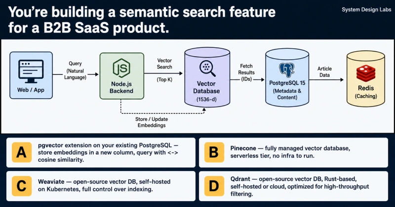

# Ngày 28: Choosing a Vector Store for Semantic Search

[← Ngày trước](day-27-keeping-an-llm-s-answers-up-to-date.md) | [Mục lục](README.md) | [Ngày tiếp theo →](day-29-coordinating-a-multi-agent-workflow.md)

---

# NGÀY 28 · SYSTEM DESIGN (THIẾT KẾ HỆ THỐNG)
## Lựa chọn Vector Store cho Tìm kiếm Ngữ nghĩa (Semantic Search)

### Bối cảnh tình huống (Scenario)

Bạn đang xây dựng tính năng **tìm kiếm ngữ nghĩa** (*semantic search*) cho một sản phẩm B2B SaaS.

* **Tập dữ liệu (*corpus*):** 4 triệu bài viết hỗ trợ (*support articles*), tài liệu kỹ thuật (*docs*), và ticket do người dùng tạo (*user-generated tickets*).
* **Kỳ vọng người dùng:** Người dùng nhập các truy vấn bằng ngôn ngữ tự nhiên (*natural language queries*) và kỳ vọng chất lượng kết quả tương đương Google — chứ không phải chỉ là khớp từ khóa đơn thuần (*keyword matching*).
* **Công nghệ hiện tại (*current stack*):** PostgreSQL 15, Redis, và backend Node.js. Nhóm tìm kiếm xác nhận rằng `ILIKE` và extension `pg_trgm` (trigram) không còn đáp ứng được yêu cầu nữa. Vector nhúng (*embeddings*) chính là giải pháp.
* **Yêu cầu kỹ thuật:** Bạn cần một nơi để lưu trữ và truy vấn các vector 1536 chiều (**OpenAI ada-002**) với độ trễ **p99 < 100ms**.
* **Quy mô dữ liệu & tải:**
  * 4 triệu bản ghi (*rows*).
  * Khoảng **~24GB** dữ liệu vector nhúng thô (*raw embeddings*).
  * Tần suất truy vấn (*query volume*): **300 req/s**, với lưu lượng đột biến cuối tuần (*weekend spikes*) lên đến **900 req/s**.

**Bạn sẽ lưu trữ và truy vấn những vector đó ở đâu?**

---

### Các phương án lựa chọn

* **A.** Sử dụng extension **pgvector** ngay trên hệ thống PostgreSQL hiện có của bạn — lưu trữ embeddings trong một cột mới, truy vấn bằng độ tương đồng cosine (*cosine similarity*) `<->`.
* **B.** **Pinecone** — cơ sở dữ liệu vector được quản lý hoàn toàn (*fully managed vector database*), gói serverless (*serverless tier*), không tốn chi phí vận hành hạ tầng (*no infra to run*).
* **C.** **Weaviate** — cơ sở dữ liệu vector mã nguồn mở (*open-source vector DB*), tự lưu trữ (*self-hosted*) trên Kubernetes, kiểm soát toàn diện cơ chế đánh chỉ mục (*indexing*).
* **D.** **Qdrant** — cơ sở dữ liệu vector mã nguồn mở (*open-source vector DB*), viết bằng Rust (*Rust-based*), hỗ trợ self-hosted hoặc cloud, được tối ưu hóa cho lọc dữ liệu thông lượng cao (*high-throughput filtering*).

---

# NGÀY 28 · ĐÁP ÁN & GIẢI THÍCH CHI TIẾT (ANSWERS & EXPLANATIONS)

## Câu trả lời 1: ✓ ĐÁP ÁN CHÍNH XÁC

### Vì sao D chiến thắng (Why D wins - Qdrant):

> [!NOTE]
> **Qdrant** được thiết kế chuyên biệt (*purpose-built*) cho chính xác khối lượng công việc (*workload*) dạng này:
> * **Lõi viết bằng Rust (*Rust core*):** Mang lại độ trễ thấp (*low latency*) và mức sử dụng bộ nhớ có thể dự đoán được (*predictable memory*) dưới tải cao.
> * **Độ tương đồng xấp xỉ (*ANN - Approximate Nearest Neighbor*):** Ở mức tải 300 req/s, bạn cần một bộ chỉ mục có khả năng xử lý các truy vấn ANN đồng thời (*concurrent ANN queries*) mà không bị suy giảm hiệu năng — bản cài đặt HNSW (*Hierarchical Navigable Small World*) của Qdrant được tinh chỉnh tối ưu riêng biệt cho điều này.

* **Tính năng quyết định (*The killer feature*): Lọc payload (*Payload filtering*)**
  * Trong một sản phẩm B2B, người dùng thường tìm kiếm trong phạm vi một không gian làm việc (*workspace*), người thuê (*tenant*), hoặc dòng sản phẩm (*product line*) — chứ **không tìm kiếm trên quy mô toàn cầu (*globally*)**.
  * Qdrant xử lý **vector search + metadata filter** (tìm kiếm vector + lọc siêu dữ liệu) trong **một lượt duy nhất (*in one pass*)**.
  * Mọi lựa chọn khác đều buộc phải thực hiện lọc sau (*post-filtering*), điều này làm suy giảm nghiêm trọng độ phủ/độ nhớ (*recall*) và làm tăng thêm các lượt truyền nhận mạng (*round-trips*).
* **Toàn quyền kiểm soát khi Self-hosted:** Cho phép bạn cấu hình sâu các tham số thuật toán HNSW (`m`, `ef_construction`), ánh xạ bộ nhớ (*memory mapping*), và lập chỉ mục trên ổ đĩa (*on-disk indexing*) — cực kỳ quan trọng khi tập dữ liệu (*corpus*) của bạn vượt quá dung lượng RAM.

---

## Câu trả lời 2

### Vì sao A là phương án bẫy (Why A is the trap - pgvector):

> [!WARNING]
> **pgvector** rất tuyệt vời để bắt đầu — dưới **~500k vector**, đây thường là lựa chọn đúng đắn vì bạn đã làm chủ và vận hành sẵn PostgreSQL. 
> 
> Tuy nhiên, ở quy mô **4 triệu dòng** và **300 req/s**:
> * Bộ chỉ mục HNSW chạy bên trong vùng nhớ đệm (*buffer pool*) của Postgres, trực tiếp cạnh tranh tài nguyên với khối lượng công việc giao dịch (*transactional workload*) hiện tại.
> * Độ trễ (*latency*) sẽ tăng vọt phi tuyến tính (*goes non-linear*) khi xử lý đồng thời (*under concurrency*).
> * Quá trình bảo trì dọn dẹp bộ nhớ (**`VACUUM`**) trên một bảng embeddings lớn là một cơn ác mộng (*painful*).

* **Nguyên tắc kinh nghiệm (*Rule of thumb*):**
  * `pgvector` dưới 500k vector + mức độ đồng thời thấp (*low concurrency*) = **Ổn định**.
  * Trên ngưỡng đó, bạn chỉ đang "vay nợ" hiệu năng và sẽ phải trả giá bằng những vấn đề đau đầu trong tương lai.

---

## Câu trả lời 3

### Vì sao B thất bại (Why B loses - Pinecone):

> [!CAUTION]
> **Pinecone** hoạt động tốt và giúp các nhóm triển khai ra thị trường cực kỳ nhanh chóng. Tuy nhiên:
> * **Mô hình chi phí (*cost model*):** Cực kỳ đắt đỏ ở mức tải duy trì liên tục **300 req/s** — gói serverless tính tiền theo đơn vị truy vấn (*per query unit*), bạn sẽ phải đối mặt với hóa đơn hàng nghìn USD mỗi tháng.
> * **Khóa chặt nhà cung cấp (*Proprietary lock-in*):** Pinecone không dùng giao thức kết nối tiêu chuẩn (*standard wire protocol*), vì vậy nếu sau này cần di chuyển (*migrating*), bạn sẽ phải viết lại toàn bộ đường ống nạp dữ liệu (*ingestion pipeline*) từ con số không.

* **Khi nào nên dùng Pinecone?** Khi **tốc độ đưa sản phẩm ra thị trường (*speed to market*)** quan trọng hơn chi phí, và lưu lượng truy vấn duy trì ở mức **dưới ~50 req/s**.

---

## Câu trả lời 4

### Vì sao C thất bại (Why C loses - Weaviate):

> [!TIP]
> **Weaviate** là một hệ thống rất vững chắc với khả năng tìm kiếm kết hợp (*hybrid search: BM25 + vector*) xuất sắc cùng khả năng hỗ trợ đa phương thức (*multi-modal*). 
> 
> Tuy nhiên:
> * **Dấu chân tài nguyên Kubernetes (*Kubernetes footprint*):** Nặng nề và cồng kềnh hơn Qdrant đáng kể đối với ca sử dụng (*use case*) này.
> * Đối với một nhóm phát triển hiện **chưa vận hành sẵn cụm K8s** cho tầng vector của họ, chi phí vận hành bảo trì (*operational overhead*) là một gánh nặng thực tế.
> * Weaviate phát huy sức mạnh vượt trội nhất trong các bài toán tìm kiếm đa phương thức (*multi-modal search*) hoặc quan hệ đồ thị ngữ nghĩa (*semantic graph relationships*) — còn đối với bài toán tìm kiếm vector dày đặc thuần túy kết hợp bộ lọc (*pure dense vector search with filtering*), **Qdrant tinh gọn (*leaner*) và hiệu quả hơn hẳn**.

---

### Bảng tổng hợp so sánh kiến trúc (Architecture Decision Matrix)

| Tiêu chí so sánh | Qdrant (Lựa chọn tối ưu) | pgvector (Phương án bẫy) | Pinecone (Managed Cloud) | Weaviate (Full Suite) |
| :--- | :--- | :--- | :--- | :--- |
| **Công nghệ lõi** | Rust (Hiệu năng cao, tiết kiệm RAM) | C (Extension chạy trong Postgres) | Độc quyền (Proprietary Cloud) | Go (Rich features, Graph/Multi-modal) |
| **Khả năng lọc (Filtering)** | **Single-stage payload filter** (1 lượt) | Phụ thuộc index Postgres | Metadata filter cơ bản | Hỗ trợ GraphQL, Hybrid search tốt |
| **Độ trễ khi tải cao (300-900 req/s)** | **Rất thấp & ổn định (<100ms p99)** | Tăng phi tuyến tính, nghẽn buffer pool | Thấp, đáp ứng tốt | Ổn định nhưng tốn nhiều compute |
| **Chi phí vận hành** | Tối ưu tài nguyên, dễ tự host | Rẻ ban đầu, đắt khi scale DB chính | Rất đắt với 300 req/s liên tục | Tốn tài nguyên K8s lớn |
| **Độ phức tạp hạ tầng** | Độc lập, nhẹ nhàng (Container/Binary) | Tận dụng sẵn DB cũ (gây rủi ro tải) | Không cần quản lý infra | Yêu cầu K8s phức tạp |

---

[← Ngày trước](day-27-keeping-an-llm-s-answers-up-to-date.md) | [Mục lục](README.md) | [Ngày tiếp theo →](day-29-coordinating-a-multi-agent-workflow.md)
