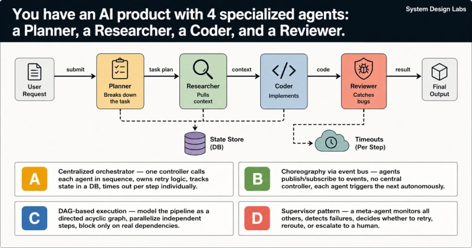

# Ngày 29: Coordinating a Multi-Agent Workflow

[← Ngày trước](day-28-choosing-a-vector-store-for-semantic-search.md) | [Mục lục](README.md) | [Ngày tiếp theo →](day-30-choosing-a-file-storage-backend.md)

---


# NGÀY 29 · SYSTEM DESIGN (THIẾT KẾ HỆ THỐNG)
## Phối hợp Luồng công việc Đa Agent (Coordinating a Multi-Agent Workflow)



Bạn sở hữu một sản phẩm AI gồm 4 Agent chuyên biệt (specialized agents): **Planner** (Lập kế hoạch), **Researcher** (Nghiên cứu / Thu thập ngữ cảnh), **Coder** (Lập trình), và **Reviewer** (Đánh giá mã nguồn).

- **Planner** phân rã tác vụ (breaks down the task).
- **Researcher** trích xuất ngữ cảnh (pulls context).
- **Coder** triển khai mã nguồn (implements).
- **Reviewer** rà soát và bắt lỗi (catches bugs).

Trên lý thuyết thì rất đơn giản. Nhưng khi đưa lên môi trường Production, hệ thống đang dần vỡ vụn.

**Dưới đây là những gì đang thực sự xảy ra:**
* **Researcher đôi khi phản hồi trước khi Planner hoàn thành** $\rightarrow$ **Coder** nhận ngữ cảnh không đầy đủ (incomplete context).
* **Reviewer gắn cờ phát hiện lỗi** $\rightarrow$ nhưng hệ thống không có vòng lặp thử lại (retry loop), dẫn đến lỗi vẫn bị đưa lên Production (bugs ship anyway).
* **Một Agent bị quá thời gian chờ (timeout)** làm treo toàn bộ đường ống xử lý (pipeline) trong suốt 40 giây.
* Bạn **hoàn toàn không có khả năng quan sát (no visibility)** để biết Agent nào bị lỗi hoặc lý do tại sao lỗi.

Bạn cần phải tái thiết kế lại tầng điều phối (orchestration layer). Bạn sẽ chọn phương án nào?

---

### CÁC PHƯƠNG ÁN LỰA CHỌN:

* **A) Bộ điều phối tập trung (Centralized orchestrator)** — một bộ điều khiển duy nhất (central controller) gọi từng Agent theo trình tự tuần tự, nắm giữ toàn bộ logic thử lại (retry logic), theo dõi trạng thái (state) trong cơ sở dữ liệu (DB), và thiết lập thời gian chờ (timeout) độc lập cho từng bước.
* **B) Vũ đạo hóa qua Bus sự kiện (Choreography via event bus)** — các Agent thực hiện cơ chế phát hành/đăng ký nhận sự kiện (publish/subscribe to events), không có bộ điều khiển trung tâm, mỗi Agent sẽ tự chủ kích hoạt Agent kế tiếp.
* **C) Thực thi dựa trên đồ thị có hướng không chu trình (DAG-based execution)** — mô hình hóa đường ống xử lý dưới dạng một đồ thị có hướng không chu trình (Directed Acyclic Graph - DAG), song song hóa các bước độc lập, và chỉ chặn (block) dựa trên các quan hệ phụ thuộc thực tế (real dependencies).
* **D) Mẫu giám sát (Supervisor pattern)** — một meta-agent đóng vai trò giám sát toàn bộ các Agent khác, phát hiện sự cố/lỗi, và đưa ra quyết định xem nên thử lại (retry), định tuyến lại (reroute), hay chuyển giao mức độ nghiêm trọng lên con người (escalate to a human).

---


---

# NGÀY 29 · ĐÁP ÁN & GIẢI THÍCH CHI TIẾT (ANSWERS & EXPLANATIONS)

## Đáp án 1

> [!TIP]
> ### ✓ CÂU TRẢ LỜI ĐÚNG:
> **Đáp án đúng: C — Thực thi dựa trên DAG (DAG-based execution)**

Đường ống xử lý (pipeline) của bạn tồn tại **các ràng buộc phụ thuộc cứng (hard dependencies)** (*Coder bắt buộc phải chờ CẢ Planner VÀ Researcher hoàn thành*) ĐỒNG THỜI cần có **các vòng lặp thử lại (retry loops)** (*Reviewer $\rightarrow$ Coder khi phát hiện lỗi*).

Một đồ thị **DAG** mô hình hóa chính xác và tường minh cấu trúc này:

```text
Planner ──┐
          ├──► Coder ──► Reviewer
Researcher┘              │
              ◄───────── (retry on failure)
```

### Những vấn đề mà giải pháp này trực tiếp giải quyết:
* **Tình trạng tranh chấp (Race condition)** $\rightarrow$ Đồ thị DAG sẽ chặn (block) Coder cho tới khi cả hai node (nút) thượng nguồn hoàn tất. Không cần phải viết các bước kiểm tra thủ công (manual checks).
* **Tình trạng một Agent timeout làm treo toàn bộ pipeline** $\rightarrow$ Mỗi node sở hữu một hạn định thời gian (deadline) riêng biệt. Việc một Agent bị timeout sẽ không đóng băng toàn bộ hệ thống.
* **Thiếu vòng lặp thử lại (No retry loop)** $\rightarrow$ Cơ chế thử lại (retry) được xem là một cạnh hạng nhất (first-class edge) trong đồ thị, chứ không phải là logic được chắp vá tạm bợ (bolted-on logic).
* **Mất khả năng quan sát (No visibility)** $\rightarrow$ Các công cụ thực thi DAG (DAG engines) cung cấp dấu vết thực thi toàn diện (full execution trace) trên từng lượt chạy.

> [!NOTE]
> **Các triển khai thực tế trong ngành:**  
> **LangGraph, Temporal, AWS Step Functions, Prefect, Dagster**. Tất cả các giải pháp này đều hội tụ về mô hình DAG vì nó giúp các quan hệ phụ thuộc trở nên trực quan (visible), cô lập lỗi ở phạm vi cục bộ (local failures), và giúp quá trình thực thi có thể kiểm thử được (testable execution).

---

## Đáp án 2

### A — Bộ điều phối tập trung (Centralized orchestrator) *(Cái bẫy dành cho Kỹ sư Cấp cao / Senior Engineer Trap)*

> [!WARNING]
> Đây là phương án sai tiệm cận với đáp án đúng nhất. Một bộ điều khiển trung tâm (central controller) với timeout riêng biệt cho từng bước và lưu trữ trạng thái vào DB tạo cảm giác rất chuẩn xác — nó có cấu trúc, có logic retry, và có khả năng giám sát (visibility).

* **Vấn đề cốt lõi:** Nó mặc định chạy **tuần tự (sequential by default)**. Planner và Researcher vẫn sẽ phải chạy nối tiếp nhau trừ khi bạn chủ động viết thêm logic xử lý thực thi song song (parallel execution logic).  
* Về bản chất, bạn đang tự tay xây dựng một DAG theo phong cách lập trình mệnh lệnh (hand-building a DAG imperatively), và bạn sẽ làm điều đó rất vụng về, dễ lỗi. Mỗi một quan hệ phụ thuộc mới phát sinh sẽ buộc bạn phải can thiệp thay đổi mã nguồn.
* **Vì sao nó là cái bẫy đối với Senior Engineer:** Nó trông giống như một "kiến trúc chuẩn mực" (proper architecture), nhưng thực chất chỉ là cơ chế điều phối mệnh lệnh (imperative orchestration) đi kèm với nhiều thủ tục rườm rà không cần thiết (extra ceremony).

---

## Đáp án 3

### B — Vũ đạo hóa qua Bus sự kiện (Choreography via event bus)

Mô hình này hoạt động hiệu quả cho các đường ống xử lý có mức độ liên kết lỏng lẻo (loosely coupled), dạng kích hoạt rồi bỏ qua (fire-and-forget pipelines) *(Ví dụ: Đơn hàng đã tạo $\rightarrow$ Hóa đơn được phát hành $\rightarrow$ Email thông báo được gửi)*. 

Tuy nhiên, pipeline của bạn lại có **các ràng buộc phụ thuộc chặt chẽ (tight dependencies)** — Coder theo nghĩa đen là **không thể bắt đầu** nếu không có sự hoàn tất của **CẢ Planner VÀ Researcher**.

* Với phong cách Choreography thuần túy, hoàn toàn **không có cơ chế nguyên thủy (primitive) tự nhiên nào để thực hiện việc "chờ cả hai tác vụ này hoàn tất"**.
* Bạn sẽ buộc phải nhồi nhét logic điều phối (coordination logic) vào sâu bên trong nội tại của các Agent. Khi đó, Coder lại phải gánh thêm phần việc điều phối luồng (orchestration work). Điều này thậm chí còn tồi tệ hơn vấn đề bạn đang gặp phải ban đầu.

> [!IMPORTANT]
> **Quy tắc cốt lõi (Rule of thumb):**  
> Dùng **Choreography (Vũ đạo hóa)** cho sự **độc lập (independence)**; dùng **Orchestration (Điều phối tập trung / DAG)** khi có **quan hệ phụ thuộc (dependency)**.

---

## Đáp án 4

### D — Mẫu giám sát (Supervisor pattern)

Một meta-agent giám sát có khả năng theo dõi, phát hiện lỗi và định tuyến lại là một tầng bổ trợ tuyệt vời **đặt lên trên giải pháp C** — phục vụ cho việc chuyển tiếp lên con người (human escalation), phát hiện bất thường (anomaly detection), hoặc định tuyến động (dynamic rerouting) khi đồ thị DAG không thể tự xử lý.

* **Nếu chọn nó làm mô hình điều phối nền tảng (base orchestration model)?** Nó sẽ làm tăng độ trễ (latency) *(vì mọi quyết định đều phải thông qua Agent giám sát)*, tạo ra một điểm nghẽn chịu lỗi đơn lẻ (Single Point of Failure - SPOF), và **hoàn toàn không giải quyết được bài toán quan hệ phụ thuộc (dependency problem)**.
* Agent giám sát vẫn cần phải hiểu được thứ tự thực thi — và thứ tự đó thực chất chỉ là một đồ thị DAG ngầm ẩn (implicit DAG) nằm trong "bộ não" của chính Agent giám sát đó.

> [!NOTE]
> **Kết luận kiến trúc:**  
> Hãy sử dụng mô hình Supervisor như một giải pháp tăng cường khả năng phục hồi (resilience) **được xây dựng trên nền tảng của C**, chứ **không phải để thay thế hoàn toàn C**.

---

### BẢNG TỔNG HỢP SO SÁNH CÁC KIẾN TRÚC PHỐI HỢP AGENT

| Tiêu chí so sánh | A) Centralized Orchestrator | B) Event-driven Choreography | C) DAG-based Execution (Đúng) | D) Supervisor Pattern |
| :--- | :--- | :--- | :--- | :--- |
| **Xử lý quan hệ phụ thuộc (Dependencies)** | Tuần tự thủ công; khó song song hóa | Kém; phải tự code logic chờ ở Agent | **Tự nhiên, tường minh thông qua các Node/Edge** | Ngầm định trong prompt / logic của Supervisor |
| **Độ trễ & Khả năng song song (Parallelism)** | Kém (mặc định chạy tuần tự) | Tốt (không đồng bộ) | **Tối ưu (chạy song song các bước độc lập)** | Kém (nghẽn cổ chai tại Meta-Agent) |
| **Cơ chế Thử lại (Retry Loop)** | Code thủ công trong controller | Rất khó kiểm soát vòng lặp kín | **Hạng nhất (First-class Edge trong đồ thị)** | Động nhưng phụ thuộc vào khả năng suy luận của LLM |
| **Khả năng quan sát (Observability / Trace)** | Trung bình (tự ghi log ra DB) | Rất phân tán, khó lần vết luồng | **Toàn diện qua Execution Trace của DAG Engine** | Phụ thuộc vào chất lượng reasoning log của Supervisor |
| **Đánh giá kiến trúc** | Bẫy Senior (cồng kềnh, mệnh lệnh) | Sai mục đích (dùng cho loose-coupling) | **Kiến trúc nền tảng tối ưu (Foundational standard)** | Tầng nâng cao bổ trợ (Layer on top of DAG) |


---

[← Ngày trước](day-28-choosing-a-vector-store-for-semantic-search.md) | [Mục lục](README.md) | [Ngày tiếp theo →](day-30-choosing-a-file-storage-backend.md)
