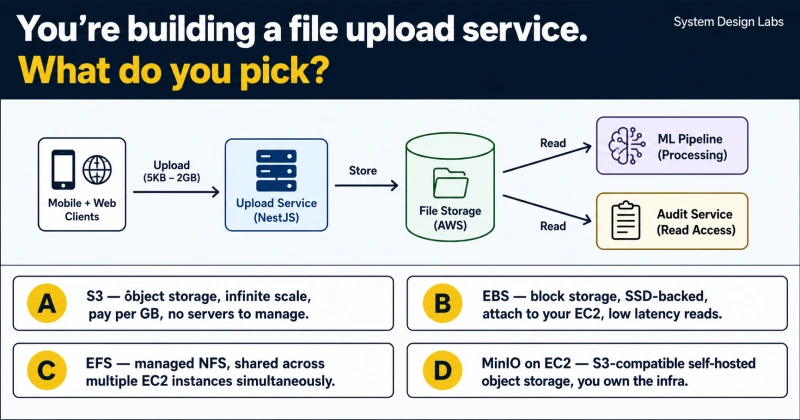

# Ngày 30: Choosing a File Storage Backend

[← Ngày trước](day-29-coordinating-a-multi-agent-workflow.md) | [Mục lục](README.md) | [Ngày tiếp theo →](day-31-cutting-cross-region-latency.md)

---

# NGÀY 30 · THIẾT KẾ HỆ THỐNG (SYSTEM DESIGN)
## Lựa chọn tầng lưu trữ File Backend (Choosing a File Storage Backend)

Bạn đang xây dựng một dịch vụ tải tệp tin (file upload service). Hiện tại có **10TB** tệp tin của người dùng. Dự kiến đạt **100TB** sau 12 tháng.

Nội bộ nhóm của bạn đang xảy ra tranh luận gay gắt:
- **Backend Lead** nói: *"Cứ dùng S3 đi. Xong việc."*
- **DevOps Engineer** nói: *"Gắn thêm một ổ đĩa EBS volume (Mount an EBS volume). Đơn giản hơn, nhanh hơn."*
- **Platform Architect** nói: *"Chúng ta cần EFS — nhiều service cần đọc chung các tệp tin này."*
- **Startup CTO** nói: *"Chúng ta không đủ ngân sách chi trả cho cloud storage ở quy mô lớn. Hãy tự host (Self-host) với MinIO."*

Cả bốn người họ đều đã từng triển khai giải pháp của mình trên môi trường Production. Cả bốn đều có những quan điểm đúc kết từ "xương máu" thực tế.

### Bối cảnh thiết lập hệ thống (Setup):
- **Upload service (NestJS):** tiếp nhận tệp tin từ các client ứng dụng di động (mobile) và web.
- **ML pipeline:** cần đọc các hình ảnh đã tải lên để phục vụ xử lý học máy.
- **Audit service:** cần quyền truy cập đọc (read access) vào cùng các tệp tin đó.
- Kích thước tệp tin dao động từ ảnh đại diện (profile pics) **5KB** cho đến các video xuất khẩu (video exports) dung lượng **2GB**.
- Hệ thống của bạn đang chạy trên nền tảng **AWS**.

---

### Bạn sẽ chọn phương án nào?

- **A) S3** — Lưu trữ đối tượng (Object storage), khả năng mở rộng vô hạn (infinite scale), trả tiền theo GB (pay per GB), không cần quản lý máy chủ (no servers to manage).
- **B) EBS** — Lưu trữ dạng khối (Block storage), hỗ trợ bởi ổ cứng SSD (SSD-backed), gắn trực tiếp vào EC2 của bạn (attach to your EC2), độ trễ đọc thấp (low latency reads).
- **C) EFS** — Hệ thống tệp mạng được quản lý (Managed NFS), chia sẻ đồng thời trên nhiều EC2 instance (shared across multiple EC2 instances simultaneously).
- **D) MinIO trên EC2** — Lưu trữ đối tượng tự host tương thích chuẩn S3 (S3-compatible self-hosted object storage), bạn tự làm chủ toàn bộ hạ tầng (you own the infra).

---

# NGÀY 30 · ĐÁP ÁN & GIẢI THÍCH CHI TIẾT (ANSWERS & EXPLANATIONS)

## Đáp án 1: ✓ CÂU TRẢ LỜI ĐÚNG

### Vì sao A chiến thắng (Why A wins - S3):

Một tầng lưu trữ duy nhất (**One storage layer**). Không cần bận tâm về việc lập kế hoạch dung lượng (**Zero capacity planning**). Mọi service đều đọc từ cùng một bucket thông qua khóa S3 (`S3 key`) được lưu trữ trong cơ sở dữ liệu (Database) của bạn.

- Ở mức **100TB** → chi phí xấp xỉ **~$2,300/tháng**.
- Các chính sách vòng đời (**Lifecycle policies**) tự động chuyển dịch các tệp ít truy cập (cold files) sang **S3 Glacier**.
- Các sự kiện của S3 (**S3 events**) kích hoạt ML pipeline của bạn ngay khoảnh khắc tệp tin vừa được ghi nhận thành công.
- Quản lý phiên bản (**Versioning**), mã hóa (**Encryption**), nhật ký kiểm toán (**Audit logs**) — tất cả đều được tích hợp sẵn (built-in), không tốn thêm bất kỳ công sức phát triển nào.

> [!TIP]
> Đối với các dịch vụ đám mây xây dựng mới hoàn toàn (**greenfield cloud services**), đây luôn là lựa chọn mặc định tiêu chuẩn (**default**). Bạn chỉ nên đi chệch khỏi hướng này khi có một lý do cực kỳ đặc thù.

---

## Đáp án 2: 
### Vì sao B âm thầm phá hủy kiến trúc của bạn (Why B destroys your architecture quietly - EBS):

**EBS là một ổ đĩa (disk)**. Một ổ đĩa nhanh, đáng tin cậy — nhưng chỉ được gắn (**attached**) vào duy nhất một EC2 instance tại một thời điểm.

- Ngay khi **ML pipeline** của bạn chạy trên một instance khác với **Upload service**, nó sẽ **không thể đọc** được các tệp tin đó.
- Bạn thêm cơ chế tự động co giãn (**Auto-scaling**)? Mỗi instance mới sinh ra sẽ nhận một ổ đĩa trống hoàn toàn.
- Bạn triển khai trên hai vùng khả dụng (**Deploy across two AZs**)? Bạn sẽ gặp chính xác cùng vấn đề đó.

> [!WARNING]
> Hoạt động hoàn hảo trong môi trường phát triển (Dev). Nhưng sẽ âm thầm đổ vỡ ngay khoảnh khắc bạn mở rộng theo chiều ngang (**Scale horizontally**). Nhóm kỹ thuật chọn EBS trong tình huống này thường phát hiện ra sai lầm sau 6 tháng, khi họ buộc phải thực hiện một đợt di chuyển hệ thống (migration) đầy đau đớn dưới áp lực ngặt nghèo.

---

## Đáp án 3:
### Vì sao C rất tuyệt vời — nhưng không phải ở đây (Why C is great — but not here - EFS):

**EFS thực sự rất mạnh mẽ**. Hệ thống NFS chia sẻ, nhiều EC2 instance có thể gắn kết (mount) đồng thời, hỗ trợ đầy đủ ngữ nghĩa chuẩn hệ thống tệp POSIX (**POSIX semantics**).

**Vấn đề cốt lõi:** Chi phí lên đến **$0.30/GB/tháng**. 
- Ở quy mô **100TB**, con số đó là **$30,000/tháng** so với mức **$2,300/tháng** của S3. 
- Mức chênh lệch chi phí lên tới **gấp 13 lần (13x cost difference)**.

> [!NOTE]
> EFS là câu trả lời chính xác khi ứng dụng cũ (legacy app) của bạn bị gắn chặt (hardcoded) vào các lệnh gọi hệ thống tệp tin như `open()`, `read()`, `write()` và không thể tái cấu trúc (refactor). Nhưng đối với một dịch vụ **NestJS** xây mới hoàn toàn với **AWS S3 SDK**? Bạn đang phải trả giá gấp 13 lần cho những ngữ nghĩa hệ thống tệp (filesystem semantics) mà bạn hoàn toàn không hề cần tới.

---

## Đáp án 4:
### Vì sao D là một cái bẫy tiết kiệm chi phí (Why D is a cost-savings trap - MinIO):

**MinIO** là một sản phẩm thực thụ được sử dụng ở quy mô siêu lớn (**hyperscale**). Cung cấp API tương thích chuẩn S3 (S3-compatible API), thông lượng cao (high throughput), chạy trực tiếp trên phần cứng của riêng bạn.

Tuy nhiên, tự host (**self-hosted**) đồng nghĩa với việc bạn phải tự chịu trách nhiệm về:
- Tính sẵn sàng cao (**High Availability**)
- Hỏng hóc ổ đĩa vật lý (**Disk failures**)
- Sao lưu dự phòng (**Backups**)
- Lập kế hoạch dung lượng (**Capacity planning**)
- Các sự cố báo động lúc 3 giờ sáng (**3am incidents**)

> [!CAUTION]
> Ở quy mô từ **10–100TB**, chi phí nhân sự kỹ thuật (engineering cost) để vận hành MinIO một cách ổn định và đáng tin cậy sẽ **vượt xa rất nhiều** chi phí sử dụng AWS S3. Bạn không hề tiết kiệm được tiền — bạn chỉ đang chuyển đổi chi phí dịch vụ đám mây (cloud spend) thành giờ công kỹ thuật (engineering hours), thứ vốn có giá đắt đỏ hơn nhiều.
> 
> MinIO chỉ thực sự hợp lý ở quy mô hàng **Petabyte (PB)** với đội ngũ hạ tầng chuyên trách (dedicated infra teams) và hóa đơn chi phí truyền dữ liệu ra ngoài (**egress bills**) quá đau đầu. Hoàn toàn không phù hợp cho trường hợp này.

---

### Bảng tổng hợp so sánh các phương án (Storage Backend Comparison):

| Tiêu chí | A) AWS S3 (Lựa chọn tối ưu) | B) AWS EBS | C) AWS EFS | D) MinIO trên EC2 |
| :--- | :--- | :--- | :--- | :--- |
| **Loại lưu trữ (Storage Type)** | Object Storage | Block Storage | Network File System (NFS) | Object Storage (Self-hosted) |
| **Truy cập đồng thời đa Node** | Tuyệt vời (qua S3 API/SDK) | Không (chỉ 1 EC2 instance/volume) | Rất tốt (POSIX shared mount) | Tốt (qua S3 API) |
| **Chi phí ước tính / 100TB** | **~$2,300/tháng** (Rất tối ưu) | Cao (nếu tính dự phòng/nhân bản) | **~$30,000/tháng** (Đắt gấp ~13 lần) | Chi phí EC2 + EBS + **Chi phí nhân sự rất lớn** |
| **Vận hành & Bảo trì** | Zero Maintenance (Serverless) | Tự quản lý phân vùng/máy chủ | Managed hoàn toàn | Tự bảo trì, backup, trực sự cố 24/7 |
| **Tích hợp mở rộng (Ecosystem)** | S3 Events trigger Lambda/ML, Lifecycle | Hạn chế | Hạn chế | Phải tự xây dựng giải pháp event/trigger |

---

[← Ngày trước](day-29-coordinating-a-multi-agent-workflow.md) | [Mục lục](README.md) | [Ngày tiếp theo →](day-31-cutting-cross-region-latency.md)
