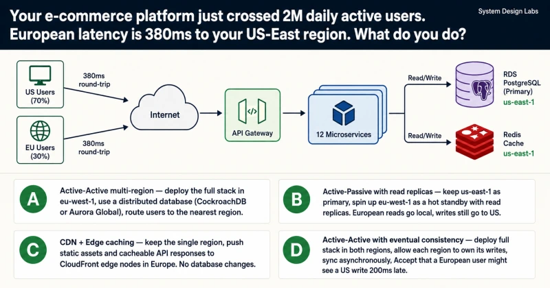

# Ngày 31: Cutting Cross-Region Latency

[← Ngày trước](day-30-choosing-a-file-storage-backend.md) | [Mục lục](README.md) | [Ngày tiếp theo →](day-32-managing-secrets-and-credentials.md)

---

# NGÀY 31 · SYSTEM DESIGN (THIẾT KẾ HỆ THỐNG)

## Cắt giảm độ trễ xuyên vùng (Cutting Cross-Region Latency)

### 1. Tình huống thực tế (Scenario)

Nền tảng thương mại điện tử (e-commerce platform) của bạn vừa vượt mốc **2 triệu người dùng hoạt động hàng ngày (2M DAU - Daily Active Users)**. Trong đó, **70%** ở Mỹ và **30%** ở Châu Âu.

Các khiếu nại về độ trễ (latency) đang tăng dồn dập từ phía người dùng Châu Âu — thời gian phản hồi khứ hồi trung bình (**average round-trip**) lên tới **380ms** khi kết nối về vùng **US-East** của bạn. Số lượng phiếu hỗ trợ (support tickets) đã tăng **40%**. Sự kiện **Black Friday** chỉ còn cách đúng **6 tuần**.

**Hiện trạng hạ tầng của bạn:**
* Một vùng (single region) duy nhất trên AWS: `us-east-1`
* Cơ sở dữ liệu chính: **RDS PostgreSQL (primary)**
* Bộ nhớ đệm: **Redis cache**
* **12 microservices** nằm phía sau một **API Gateway**

> [!IMPORTANT]
> **Yêu cầu & Ràng buộc cốt lõi:**
> * Bạn cần hạ độ trễ của người dùng Châu Âu xuống **dưới 80ms**. 
> * Nhóm kỹ thuật (engineering team) đang tranh luận về 4 hướng tiếp cận.
> * **Ràng buộc của bạn:** Bạn **không thể chi trả cho việc viết lại/thay đổi toàn bộ cơ sở dữ liệu (full database rewrite)**, và bạn phải **triển khai hoàn tất giải pháp này trước thềm Black Friday (trong vòng 6 tuần)**.

---

### 2. Các phương án lựa chọn (Options)

* **A) Active-Active đa vùng (Active-Active multi-region):**  
  Triển khai toàn bộ hệ thống (**full stack**) tại `eu-west-1`, sử dụng một cơ sở dữ liệu phân tán (**distributed database** như CockroachDB hoặc Aurora Global), định tuyến người dùng đến vùng gần nhất. Các thao tác ghi (**writes**) được thực hiện đồng thời tới cả hai vùng.

* **B) Active-Passive với các bản sao chỉ đọc (Active-Passive with read replicas):**  
  Giữ nguyên `us-east-1` làm vùng chính (**primary**), khởi tạo `eu-west-1` làm vùng dự phòng nóng (**hot standby**) với các bản sao chỉ đọc (**read replicas**). Các tác vụ đọc của người dùng Châu Âu được xử lý tại chỗ (**local reads**), các tác vụ ghi (**writes**) vẫn chuyển tiếp về Mỹ. Khôi phục sau thảm họa (**failover**) chỉ mất vài phút nếu vùng Mỹ gặp sự cố.

* **C) CDN + Bộ đệm tại vùng biên (CDN + Edge caching):**  
  Giữ nguyên một vùng duy nhất, đẩy các tài nguyên tĩnh (**static assets**) và các phản hồi API có thể lưu đệm (**cacheable API responses**) tới các điểm biên (**edge nodes**) của CloudFront tại Châu Âu. Không thay đổi cơ sở dữ liệu.

* **D) Active-Active với tính nhất quán sau cùng (Active-Active with eventual consistency):**  
  Triển khai toàn bộ hệ thống (**full stack**) ở cả hai vùng, cho phép mỗi vùng tự làm chủ các thao tác ghi của chính nó, sau đó đồng bộ hóa bất đồng bộ (**sync asynchronously**). Chấp nhận việc một người dùng Châu Âu có thể nhìn thấy dữ liệu ghi từ Mỹ trễ hơn 200ms.

---

### 3. Đáp án & Giải thích chi tiết (Answers & Explanations)

#### Đáp án 1

> [!TIP]
> ### ✓ CÂU TRẢ LỜI ĐÚNG: B
> **Lý do phương án B giành chiến thắng (Why B wins):**
> 
> **Chính điều kiện ràng buộc đã đưa ra câu trả lời.** Bạn không thể viết lại cơ sở dữ liệu, và bạn chỉ có vỏn vẹn 6 tuần.
> 
> Người dùng Châu Âu đang phàn nàn về **độ trễ đọc (read latency)** — duyệt xem sản phẩm (browsing products), kiểm tra trạng thái đơn hàng (checking order status), tải thông tin hồ sơ (loading profile). Tất cả những tác vụ đó đều là đọc (**reads**).
> 
> Việc thiết lập một bản sao chỉ đọc **RDS read replica** tại `eu-west-1` chỉ tốn của bạn **1–2 ngày xử lý hạ tầng (infra work)** và ngay lập tức kéo độ trễ đọc của người dùng Châu Âu xuống **~15ms** thay vì **380ms**. 
> 
> Các thao tác ghi (**writes**) vẫn được chuyển về `us-east-1` (điều này hoàn toàn chấp nhận được — người dùng sẵn sàng chờ độ trễ ghi cao hơn một chút khi tiến hành thanh toán / checkout). Độ trễ sao chép (**replication lag**) thông thường ở mức **dưới 100ms**.
> 
> Mô hình **Active-Passive** cũng mang lại cho bạn một kịch bản dự phòng thực sự (**real failover story**): Khi vùng Mỹ (US) gặp sự cố $\rightarrow$ nâng cấp (**promote**) bản sao tại Châu Âu (EU replica) thành primary chỉ trong vài phút.

---

#### Đáp án 2

> [!WARNING]
> ### Tại sao A là câu trả lời bẫy (Why A is the trap - Active-Active + distributed DB):
> 
> Đây là câu trả lời mang tính "đúng đắn ở quy mô lớn" (**correct at scale**) nhưng sẽ **"bức tử" đội ngũ kỹ thuật trước thềm Black Friday**.
> 
> Việc chuyển đổi từ RDS PostgreSQL sang CockroachDB hoặc Aurora Global dưới áp lực thời hạn 6 tuần là một **dự án kéo dài nhiều quý (multi-quarter project)** — liên quan đến các giao dịch phân tán (**distributed transactions**), độ lệch đồng hồ toàn cầu (**global clock skew**), và hàng loạt kịch bản lỗi mới (**failure modes**) cần phải kiểm thử. 
> 
> Đây là kiến trúc đúng đắn về mặt dài hạn, nhưng lại là **câu trả lời sai cho bài toán được đặt ra trong tình huống này**.

---

#### Đáp án 3

> [!NOTE]
> ### Tại sao C là phương án sai (Why C is wrong - CDN + Edge caching):
> 
> CDN chỉ giải quyết độ trễ cho các tài nguyên tĩnh (**static asset latency**) — hình ảnh, tệp tin JS, CSS. 
> 
> Nó **hoàn toàn vô tác dụng đối với các tác vụ đọc dữ liệu động (dynamic reads)** (giỏ hàng của người dùng, lịch sử đơn hàng, dữ liệu tài khoản) và **bằng không (zero) đối với độ trễ ghi (write latency)**. 
> 
> Đây chỉ là một tầng bổ trợ mà bạn xếp chồng lên một giải pháp thực sự, chứ không thể dùng để thay thế giải pháp đó. Phương án này chỉ nhận điểm một phần (**partial credit**), không phải là đáp án giải quyết vấn đề.

---

#### Đáp án 4

> [!CAUTION]
> ### Tại sao D lại nguy hiểm (Why D is dangerous - Active-Active + eventual consistency):
> 
> Đây là phiên bản chân thực nhất của kiến trúc đa vùng (**multi-region**) — và cũng là **phiên bản nguy hiểm nhất nếu triển khai mà không có sự chuẩn bị kỹ lưỡng**.
> 
> **Tính nhất quán sau cùng (Eventual consistency)** xuyên vùng đồng nghĩa với việc: khi một người dùng Châu Âu đặt một đơn hàng, vùng tại Mỹ sẽ nhìn thấy số lượng tồn kho (**inventory count**) bị lệch trong 200ms. 
> * Đối với các mặt hàng có số lượng giới hạn = **bán vượt tồn kho (oversell)**. 
> * Đối với quy trình thanh toán = **trừ tiền trùng lặp (duplicate charges)**.
> 
> Xử lý xung đột (**conflict resolution**) thực chất là một **vấn đề nghiệp vụ sản phẩm (product problem)** được ngụy trang dưới danh nghĩa một **vấn đề hạ tầng kỹ thuật (infra problem)**.

---

### Bảng tổng kết so sánh các phương án

| Phương án | Ưu điểm cốt lõi | Rủi ro / Điểm nghẽn | Đánh giá |
| :--- | :--- | :--- | :--- |
| **A) Active-Active + Distributed DB** | Tối ưu độ trễ đọc/ghi toàn cầu, mở rộng tốt về lâu dài. | Di chuyển DB cực lớn, xử lý clock skew, cần nhiều quý thực hiện. | ❌ **Bẫy kiến trúc** (Không kịp trước Black Friday). |
| **B) Active-Passive + Read Replica** | Giảm read latency xuống ~15ms, triển khai 1–2 ngày, có failover. | Write vẫn về US (~380ms), chấp nhận replication lag <100ms. | ✅ **Chiến thắng** (Đúng hạn, đúng ràng buộc). |
| **C) CDN + Edge Caching** | Cải thiện static assets, không cần đụng tới DB. | Không giải quyết dynamic reads và write latency. | ❌ **Sai** (Chỉ là lớp bổ trợ, không giải quyết triệt để). |
| **D) Active-Active + Eventual Consistency** | Xử lý ghi tại chỗ ở từng vùng, giảm tối đa độ trễ. | Lỗi oversell, trùng lặp charge tiền, giải quyết xung đột phức tạp. | ⚠️ **Cực kỳ nguy hiểm** (Rủi ro nghiệp vụ nghiêm trọng). |

---

[← Ngày trước](day-30-choosing-a-file-storage-backend.md) | [Mục lục](README.md) | [Ngày tiếp theo →](day-32-managing-secrets-and-credentials.md)
