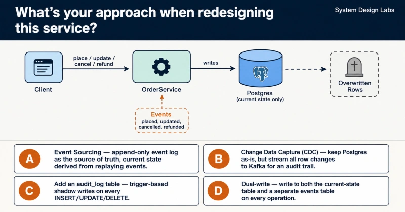
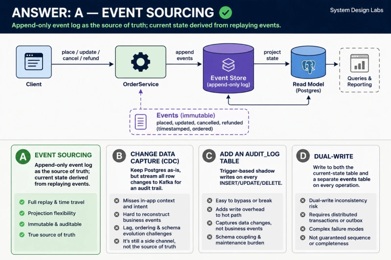

# Ngày 33: Reconstructing State with Event Sourcing

[← Ngày trước](day-32-managing-secrets-and-credentials.md) | [Mục lục](README.md) | [Ngày tiếp theo →](day-34-improving-llm-classification-accuracy.md)

---

# NGÀY 33 · THIẾT KẾ HỆ THỐNG (DAY 33 · SYSTEM DESIGN)
## Tái tạo Trạng thái với Event Sourcing (Reconstructing State with Event Sourcing)

---

### Đề bài Tình huống (Scenario)

Dịch vụ Đơn hàng (**Order Service**) của bạn xử lý **200 lượt ghi/giây (writes/sec)** vào thời điểm cao điểm.

Bạn tiến hành kiểm toán dữ liệu trong 6 tháng qua. Có điều gì đó bất thường — hai đơn hàng hiển thị cùng một mã định danh (**ID**), nhưng tổng tiền (**totals**) lại khác nhau.

Bạn chỉ nắm trong tay **trạng thái hiện tại (current state)**. Bạn hoàn toàn không biết **làm thế nào mà hệ thống lại rơi vào trạng thái đó (how it got there)**.

Cơ sở dữ liệu (**DB**) của bạn giống như một "nghĩa địa" chứa đầy các dòng dữ liệu bị ghi đè (**overwritten rows**).

**Kiến trúc hệ thống hiện tại:**
- **OrderService** → **Postgres** (chỉ lưu trữ trạng thái hiện tại - *current state only*)
- Các sự kiện (**Events**): Đã đặt hàng (*placed*), Đã cập nhật (*updated*), Đã hủy (*cancelled*), Đã hoàn tiền (*refunded*)
- Mỗi lệnh `UPDATE` đều ghi đè lên dòng dữ liệu trước đó
- Không có nhật ký kiểm toán (**audit log**). Không có lịch sử sự kiện (**event history**). Không có khả năng phát lại sự kiện (**no replay**).

Một khiếu nại thanh toán (**billing dispute**) vừa phát sinh. Bạn cần phải tái tạo lại chính xác những gì đã xảy ra với Đơn hàng `#8471`. Nhưng bạn không thể làm được điều đó.

Thay vì lưu trữ trạng thái hiện tại, bạn lưu trữ chuỗi các sự kiện đã tạo ra trạng thái đó.

**Đâu là cách tiếp cận của bạn khi tái thiết kế (redesigning) lại dịch vụ này?**

---

### Các Phương án Lựa chọn (Options)

- **A. Event Sourcing** — Sử dụng nhật ký sự kiện chỉ ghi nối thêm (**append-only event log**) làm nguồn chân lý duy nhất (**source of truth**), trạng thái hiện tại được suy ra từ việc phát lại các sự kiện (**replaying events**).
- **B. Change Data Capture (CDC)** — Giữ nguyên cơ sở dữ liệu **Postgres**, nhưng truyền phát toàn bộ các thay đổi của từng dòng dữ liệu (**stream all row changes**) vào **Kafka** để làm nhật ký kiểm toán (**audit trail**).
- **C. Thêm bảng `audit_log`** — Thực hiện ghi dữ liệu bóng (**shadow writes**) dựa trên bộ kích hoạt (**trigger-based**) trên mỗi thao tác `INSERT`/`UPDATE`/`DELETE`.
- **D. Ghi kép (Dual-write)** — Ghi đồng thời vào cả bảng trạng thái hiện tại (**current-state table**) lẫn một bảng sự kiện riêng biệt (**events table**) trên mỗi thao tác xử lý.

---

### Đáp án & Giải thích Chi tiết (Answers & Explanations)

#### Đáp án Chính xác (Answer 1)

> [!NOTE]
> **✓ ĐÁP ÁN CHÍNH XÁC: A — Event Sourcing ✅**

Dưới đây là lý do tại sao phương án **A** chiến thắng, và vì sao ba phương án còn lại thoạt nhìn có vẻ hợp lý nhưng lại đi chệch khỏi bản chất của vấn đề:

#### Vì sao A chiến thắng (Why A wins - Event Sourcing):

**Event Sourcing** đảo ngược hoàn toàn mô hình dữ liệu truyền thống. Thay vì lưu trữ trạng thái mới nhất và làm mất đi toàn bộ lịch sử dẫn đến trạng thái đó, bạn lưu trữ mọi sự kiện từng xảy ra trong hệ thống. Trạng thái hiện tại thực chất chỉ là một hình chiếu (**projection**) — được tính toán bằng cách phát lại các sự kiện (**replaying events**) từ thời điểm bắt đầu (hoặc từ một bản chụp trạng thái - **snapshot**).

- **Đối với Đơn hàng `#8471`:** Bạn không truy vấn một dòng dữ liệu đơn thuần. Bạn phát lại chuỗi sự kiện: `OrderPlaced` (Đã đặt hàng), `OrderUpdated` (Đã cập nhật đơn), `PaymentCaptured` (Đã thu tiền), `RefundInitiated` (Đã kích hoạt hoàn tiền).
- Mọi biến động dữ liệu (**mutation**) đều được bảo toàn nguyên vẹn, gắn dấu thời gian (**timestamped**), và có tính chất bất biến (**immutable**).
- Bạn có thể **tái tạo lại trạng thái tại bất kỳ thời điểm nào trong quá khứ**.
- Bạn có thể xây dựng các mô hình chiếu mới (**projections**) — ví dụ: *"tổng doanh thu theo từng mã sản phẩm (SKU) trong 90 ngày qua"* — mà không cần thay đổi mô hình dữ liệu cốt lõi, chỉ cần phát lại chuỗi sự kiện và thực hiện phép chiếu theo cách khác.

Đây chính là cơ chế mà **Axon**, **EventStoreDB**, và các tầng **Event-Sourced** trong hầu hết các hệ thống tài chính công nghệ (**Fintech**) và thương mại điện tử (**E-commerce**) quy mô lớn đang vận hành. Đây không đơn thuần chỉ là một tệp log — mà chính là **mô hình dữ liệu chính (primary data model)** của hệ thống.

---

#### Vì sao B là câu trả lời "bẫy" (Why B is the trap - CDC):

> [!WARNING]
> **CDC ghi nhận độ lệch trạng thái (state deltas), không phải sự kiện nghiệp vụ (business events).**

**CDC (Change Data Capture)** là một công nghệ mạnh mẽ và thường bị đánh giá thấp. Các công cụ như **Debezium + Kafka** cho phép bạn truyền phát mọi thay đổi trên các dòng dữ liệu của **Postgres** đến các hệ thống hạ nguồn mà không cần chạm vào mã nguồn ứng dụng. Nhìn từ bên ngoài, nó rất giống với **Event Sourcing** — bạn cũng có một chuỗi các thay đổi.

**Nhưng cái bẫy nằm ở đây:**
- **CDC chỉ chụp lại độ lệch trạng thái (state deltas), chứ không phải các sự kiện nghiệp vụ mang tính ngữ cảnh (business events).**
- Bạn chỉ nhận được thông tin: *tổng tiền thay đổi từ 89.99 thành 79.99* — chứ không biết được rằng sự kiện nghiệp vụ là *`DiscountApplied` bởi mã giảm giá `SAVE10`*.
- **Ý nghĩa ngữ nghĩa nghiệp vụ (semantic meaning) hoàn toàn bị biến mất.**
- Bạn có thể tái dựng lại **cái gì đã thay đổi (what changed)**, nhưng không thể biết được **tại sao nó lại thay đổi (why it changed)**. Sự khác biệt mang tính cốt tử này sẽ khiến bạn thất bại hoàn toàn trong các đợt giải quyết khiếu nại tranh chấp và kiểm toán tuân thủ pháp lý (**compliance audits**).

> [!TIP]
> **CDC** là một sự bổ sung tuyệt vời cho **Event Sourcing** trong việc nhân bản và truyền bá dữ liệu (**propagation**), nhưng nó **không thể thay thế** được Event Sourcing.

---

#### Vì sao C sai (Why C is wrong - audit_log table):

Bảng nhật ký kiểm toán dựa trên bộ kích hoạt (**trigger-based audit logs**) là giải pháp chắp vá kinh điển.

**Vấn đề cốt lõi:** Bạn vẫn đang coi dòng dữ liệu (**row**) là nguồn chân lý duy nhất (**source of truth**) và xem việc ghi log thay đổi chỉ là một tác dụng phụ (**side effect**).

- Các tác dụng phụ rất dễ bị phá vỡ.
- Các bộ kích hoạt (**Triggers**) thường bị vô hiệu hóa trong các đợt di chuyển dữ liệu (**migrations**).
- Các thao tác nhập dữ liệu hàng loạt (**bulk imports**) thường bỏ qua triggers.
- Những lần thay đổi cấu trúc dữ liệu (**schema changes**) có thể làm các trigger bị lỗi thời hoặc mất liên kết (*orphan the trigger*).
- Sáu tháng sau nhìn lại, bảng `audit_log` xuất hiện các lỗ hổng mất mát dữ liệu — đúng vào thời điểm bạn cần nó nhất.

Bảng kiểm toán này chỉ là một chiếc bóng mờ (**shadow**), hoàn toàn không thể làm nền tảng (**foundation**) vững chắc cho hệ thống.

---

#### Vì sao D sai (Why D is wrong - Dual-write):

Cơ chế ghi kép (**Dual-write**) thoạt nghe có vẻ hợp lý. Tuy nhiên, bạn đã vô tình tự tạo ra một bài toán nhất quán phân tán (**distributed consistency problem**) ngay bên trong chính dịch vụ nội bộ của mình:

- Nếu thao tác ghi trạng thái thành công nhưng thao tác ghi sự kiện thất bại — do sự cố mạng, ứng dụng bị sập (**crash**), hoặc cạn kiệt bộ nhớ (**OOM - Out of Memory**) — bạn sẽ rơi vào tình trạng: **có trạng thái nhưng không có sự kiện tương ứng**.
- Chuỗi nhật ký kiểm toán (**audit trail**) trở nên không đáng tin cậy ngay từ bản thiết kế ban đầu.

Đây chính là vấn đề cụ thể mà mô hình **Transactional Outbox Pattern** được phát minh ra để giải quyết. Nhưng nếu bạn phải đi xa đến mức thiết kế cả Outbox Pattern, thì bạn thực chất đã đi được nửa chặng đường để tiến tới một kiến trúc **Event Sourcing** chuẩn mực rồi.

---

### Bảng Tổng hợp So sánh các Phương án Kiến trúc

| Phương thức | Cơ chế Lưu trữ | Ngữ nghĩa Nghiệp vụ (*Semantic Meaning*) | Độ tin cậy Kiểm toán (*Audit Reliability*) | Khả năng Tái tạo Trạng thái (*State Reconstruction*) |
| :--- | :--- | :--- | :--- | :--- |
| **A. Event Sourcing** ✅ | Chỉ ghi nối thêm chuỗi sự kiện (*Append-only events*) | **Tuyệt đối** (Lưu rõ *Why* & *What*) | **100% Bất biến** (*Immutable source of truth*) | Tái tạo tại bất kỳ thời điểm nào qua *Replay* |
| **B. Change Data Capture** | Giữ nguyên DB + Stream delta qua Kafka | **Mất ngữ nghĩa** (Chỉ lưu *What changed*, mất *Why*) | Khá cao, phụ thuộc vào tầng DB | Chỉ tái tạo trạng thái dữ liệu thô, không rõ nghiệp vụ |
| **C. Trigger audit_log** | Ghi bảng phụ qua DB Triggers | **Kém** (Phụ thuộc vào DB level) | **Dễ hổng** (Bị tắt khi migration, bulk import) | Dễ bị đứt đoạn và không toàn vẹn |
| **D. Dual-write** | Ghi song song bảng State & bảng Events | Có thể lưu sự kiện nghiệp vụ | **Không đáng tin cậy** (Gặp lỗi phân tán / Partial failure) | Dữ liệu không nhất quán khi một bên bị lỗi |

---

[← Ngày trước](day-32-managing-secrets-and-credentials.md) | [Mục lục](README.md) | [Ngày tiếp theo →](day-34-improving-llm-classification-accuracy.md)
