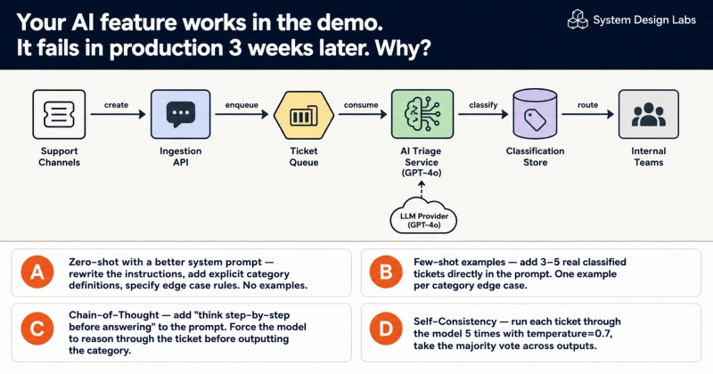

# Ngày 34: Improving LLM Classification Accuracy

[← Ngày trước](day-33-reconstructing-state-with-event-sourcing.md) | [Mục lục](README.md) | [Ngày tiếp theo →](day-35-geospatial-find-nearby-drivers-at-scale.md)

---

# NGÀY 34 · SYSTEM DESIGN: NÂNG CAO ĐỘ CHÍNH XÁC PHÂN LOẠI CỦA LLM (IMPROVING LLM CLASSIFICATION ACCURACY)

---

### --- Trang 138 ---

Tính năng AI của bạn hoạt động hoàn hảo trong bản demo.  
Nhưng nó thất bại trên môi trường thực tế (production) chỉ 3 tuần sau đó. Không ai động vào mô hình. Không ai thay đổi code.  
Thứ duy nhất thay đổi: dữ liệu đầu vào ngày càng lộn xộn và phức tạp hơn (inputs got messier).

#### Bối cảnh đặt ra (The setup):
Bạn đang làm việc tại một công ty SaaS với **50.000 vé hỗ trợ (support tickets) mỗi tuần**. Đội ngũ của bạn xây dựng một hệ thống phân luồng bằng AI (AI triage system) — sử dụng **GPT-4o** để phân loại mỗi ticket vào **6 danh mục** (*billing* - thanh toán, *bug* - lỗi phần mềm, *feature request* - yêu cầu tính năng, *account access* - truy cập tài khoản, *security* - bảo mật, *other* - khác) để đội ngũ phụ trách phù hợp nhận được ngay lập tức.

* Trong môi trường phát triển (dev), mô hình đạt **71% độ chính xác (accuracy)**. 
* Bạn cần đạt mức **90%+** để có thể cắt giảm quy trình rà soát thủ công (manual review).
* Mô hình đã bị cố định (locked model - không fine-tune trọng số). Ngân sách cho chi phí suy luận (inference budget) không phải là vô hạn. 
* Bạn cần phải **thu hẹp khoảng cách 19% (19-point gap)** này.

---

#### Dưới đây là 4 phương án lựa chọn của bạn:

* **A) Zero-shot với System Prompt tốt hơn (Zero-shot with a better system prompt)** — Viết lại toàn bộ câu lệnh hướng dẫn (instructions), bổ sung các định nghĩa danh mục rõ ràng, chỉ định các quy tắc xử lý trường hợp biên (edge case rules). Tuyệt đối không dùng ví dụ mẫu (no examples).
* **B) Các ví dụ mẫu Few-shot (Few-shot examples)** — Thêm trực tiếp 3–5 ticket thực tế đã được gán nhãn chính xác vào trong prompt. Một ví dụ cho mỗi trường hợp biên (edge case) của từng danh mục.

---

### --- Trang 139 ---

* **C) Chuỗi suy luận (Chain-of-Thought - CoT)** — Thêm câu lệnh *"suy nghĩ từng bước một trước khi trả lời"* (*think step-by-step before answering*) vào prompt. Ép mô hình phải suy luận, phân tích nội dung ticket trước khi xuất ra nhãn danh mục.
* **D) Tự nhất quán (Self-Consistency)** — Chạy mỗi ticket qua mô hình 5 lần với tham số `temperature = 0.7`, sau đó lấy kết quả biểu quyết theo đa số (majority vote) trên các kết quả đầu ra.

---

### --- Trang 140 ---

## NGÀY 34 · ĐÁP ÁN & GIẢI THÍCH CHI TIẾT (ANSWERS & EXPLANATIONS)

---

### Đáp án 1: Phương án B
> [!NOTE]
> ### ✓ CÂU TRẢ LỜI ĐÚNG: B — Few-shot (Lựa chọn tối ưu nhất)
> * **Độ chính xác (Accuracy):** 88–93%  
> * **Gia tăng chi phí (Cost increase):** Gần như bằng 0 (near-zero)

**Few-shot** giúp dịch chuyển mô hình từ việc *"đọc hiểu quy tắc văn bản"* sang cơ chế **khớp mẫu dựa trên ví dụ thực tế (pattern-matching against real examples)**. Đây là một tín hiệu định hướng (signal) mạnh mẽ hơn về mặt bản chất.

**Điểm sai lầm mà phần lớn các đội ngũ kỹ thuật mắc phải:** Họ thường chọn các ví dụ quá hiển nhiên:
* Một ticket thanh toán rõ như ban ngày (*crystal-clear billing ticket*).
* Một báo cáo lỗi phần mềm chuẩn sách giáo khoa (*textbook bug report*).

Những ví dụ đó **không dạy cho mô hình thêm bất kỳ điều gì** ngoài những thứ nó vốn đã biết.

Cái bạn thực sự cần đưa vào là **những trường hợp nhập nhằng, đa nghĩa (ambiguous cases)**:
* Ticket thoạt nhìn giống như vấn đề thanh toán (*billing*) nhưng bản chất lại là lỗi truy cập tài khoản (*account access*).
* Yêu cầu tính năng mới (*feature request*) nhưng đọc lại như một báo cáo lỗi (*bug*).

Đó chính là những nơi mà mô hình hiện tại đang phân loại sai — và chính những ví dụ này sẽ giúp bạn **san lấp khoảng cách hiệu năng**.

> [!TIP]
> **Quy tắc vàng:** Chỉ cần chọn đúng tập ví dụ mẫu, bạn sẽ thu hẹp được phần lớn khoảng cách 19% kia mà không cần phải can thiệp hay sửa đổi thêm bất cứ thứ gì khác.

---

### Đáp án 2: Phương án A
> [!WARNING]
> ### A — Zero-shot với System Prompt tốt hơn
> * **Ngưỡng trần độ chính xác (Accuracy ceiling):** ~78–82%

Đây là điểm khởi đầu của mọi đội ngũ kỹ thuật. Bạn liên tục tinh chỉnh prompt, thêm định nghĩa chi tiết cho từng danh mục, liệt kê tường tận các trường hợp biên (*edge cases*). Cảm giác như bạn đang đạt được tiến triển. Và đúng là nó có hiệu quả trong một chừng mực nhất định.

**Bức tường ngăn cản không thể vượt qua (The hard wall):**
Các tập lệnh hướng dẫn chỉ có thể *mô tả* các danh mục. Chúng **không thể chỉ cho mô hình thấy** các trường hợp nhập nhằng, lưỡng lự sẽ rơi chính xác vào phân loại nào.

**Ví dụ thực tế:**  
Bạn định nghĩa danh mục *"billing"* là bất kỳ vấn đề gì liên quan đến phí hay hóa đơn. Sau đó hệ thống nhận được ticket này:  
> *"Tôi không thể đăng nhập được và tôi bị trừ tiền hai lần vào tháng trước."*

Là **Billing**? **Account Access**? Hay cả hai?

Không một cách hành văn hay viết lại câu lệnh nào có thể khẳng định chắc chắn cho mô hình biết ticket này thuộc nhóm nào. Mô hình sẽ **đoán sai từ 20–25% số lần** gặp các trường hợp biên. Trong khi đó, tập dữ liệu thực tế ngoài production của bạn lại tràn ngập các edge case. Ngưỡng trần hiệu năng của phương pháp này là có thật.

---

### --- Trang 141 ---

### Đáp án 3: Phương án C
> [!WARNING]
> ### C — Chain-of-Thought (Chuỗi suy luận - CoT)
> * **Độ biến thiên chính xác (Accuracy delta):** ±2%  
> * **Độ trễ gia tăng (Latency):** +200–400ms

**CoT là kỹ thuật bị lạm dụng sai chỗ nhiều nhất** trong các hệ thống AI Production hiện nay. Các nhóm kỹ sư có xu hướng nhét cụm từ *"suy nghĩ từng bước một" (think step-by-step)* vào bất kỳ bài toán nào. Đối với một số tác vụ nhất định, nó hoạt động hiệu quả. Nhưng **không phải** tác vụ phân loại này.

**Tại sao CoT lại gặp bế tắc ở đây:**  
Mô hình sinh ra một chuỗi lập luận logic (*reasoning chain*), sau đó chốt hạ một nhãn (*label*). Đối với các ticket nhập nhằng, **chính chuỗi suy luận đó lại trở thành điểm yếu chí mạng (liability)**:  
> *"Ticket có nhắc đến việc trừ tiền... nhưng cũng có vấn đề đăng nhập... việc trừ tiền được nhắc đến trước... có lẽ là billing."*  
> $\rightarrow$ Kết quả: Nó chọn **Billing**, trong khi câu trả lời đúng phải là **Account Access**.

**Bản chất vấn đề:**  
* **CoT phát huy tác dụng** khi câu trả lời xuất phát từ **quá trình suy luận logic (reasoning)** — như giải toán, debug code, lập kế hoạch.
* Đối với bài toán phân loại (*classification*), câu trả lời lại xuất phát từ **sự chuẩn hóa ranh giới (calibration)**. Quá trình suy luận thuần túy không thể thay thế cho việc hiệu chuẩn ranh giới dữ liệu.

> [!NOTE]
> Bạn chỉ nên xếp lớp (layer) CoT lên trên **Few-shot** nếu bạn vẫn còn bỏ sót các trường hợp biên phức tạp. Đừng bao giờ chọn CoT làm giải pháp đầu tiên.

---

### Đáp án 4: Phương án D
> [!WARNING]
> ### D — Self-Consistency (Tự nhất quán)
> * **Độ chính xác (Accuracy):** 93–96%  
> * **Chi phí (Cost):** Tăng gấp 5 lần (**5x**)  
> * **Độ trễ (Latency):** Tăng gấp 5 lần (**5x**)

Chạy cùng một ticket từ 5–10 lần ở mức `temperature = 0.7`, sau đó lấy kết quả theo cơ chế biểu quyết đa số (*majority vote*). Phương pháp này hiệu quả vì mỗi lần chạy sẽ lấy mẫu theo một lộ trình hơi khác nhau một chút — các tín hiệu nhiễu (*noise*) sẽ triệt tiêu lẫn nhau qua các lần chạy.

**Về mặt toán học:** Rất tốt.  
**Về mặt chi phí:** Cực kỳ tàn khốc.

$$\text{50.000 tickets/tuần} \times \$0,002 \times 5 \text{ lần chạy} = \mathbf{\$500/\text{tuần}}$$
*(So với mức **\$100/tuần** khi áp dụng Few-shot)*.

Bạn đang phải trả thêm **\$400 mỗi tuần** chỉ để đổi lấy mức tăng khiêm tốn **3–5%** trên những ca khó nhất.

**Khi nào nên dùng Self-Consistency:**  
Nó chỉ xứng đáng khi **cái giá của sự sai sót là quá đắt đỏ (being wrong is expensive)**:
* Hệ thống phát hiện gian lận (*Fraud Detection*): một cảnh báo bị bỏ lọt gây thiệt hại hàng trăm USD.
* Phân luồng y tế (*Medical Triage*): phân loại sai danh mục dẫn đến tổn hại tính mạng con người.

Còn đối với hệ thống điều hướng vé hỗ trợ khách hàng (*support routing*), một ticket bị phân loại sai chỉ tiêu tốn khoảng **~\$0,10** chi phí thời gian nhân viên chuyển tiếp thủ công lại. 

**Kết luận:** Hãy chọn **B (Few-shot)**.

---

### BẢNG TỔNG HỢP SO SÁNH CÁC PHƯƠNG ÁN (ARCHITECT SUMMARY)

| Phương pháp | Độ chính xác (Accuracy) | Chi phí suy luận (Inference Cost) | Độ trễ (Latency) | Đánh giá kiến trúc |
| :--- | :---: | :---: | :---: | :--- |
| **A) Zero-shot Prompt tốt hơn** | ~78–82% | 1x (Cơ sở) | Thấp nhất | Chạm trần hiệu năng; hướng dẫn văn bản không giải quyết được ranh giới nhập nhằng (*ambiguity*). |
| **B) Few-shot (Edge Cases)** | **88–93%** | **~1x (Tăng không đáng kể)** | **Rất thấp** | **LỰA CHỌN TỐI ƯU.** Cung cấp tín hiệu định hướng bằng mẫu thực tế, chi phí cực rẻ, đáp ứng ngay mục tiêu 90%+. |
| **C) Chain-of-Thought (CoT)** | $\pm 2\%$ | ~1.5x (Do sinh thêm token) | +200–400ms | Bẫy kỹ thuật. Suy luận logic không thay thế được việc chuẩn hóa ranh giới phân loại. |
| **D) Self-Consistency** | 93–96% | 5x | 5x | Lãng phí tài nguyên (*overkill*) cho bài toán phân luồng ticket; chỉ phù hợp cho hệ thống tài chính/y tế rủi ro cực cao. |

---

[← Ngày trước](day-33-reconstructing-state-with-event-sourcing.md) | [Mục lục](README.md) | [Ngày tiếp theo →](day-35-geospatial-find-nearby-drivers-at-scale.md)
