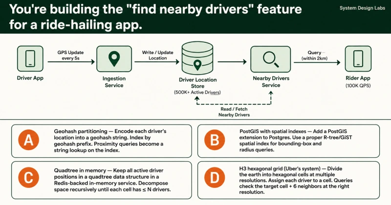

# Ngày 35: Geospatial “Find Nearby Drivers” at Scale

[← Ngày trước](day-34-improving-llm-classification-accuracy.md) | [Mục lục](README.md) | [Ngày tiếp theo →](day-36-choosing-http-3-vs-http-2-at-the-edge.md)

---


# NGÀY 35 · THIẾT KẾ HỆ THỐNG (DAY 35 · SYSTEM DESIGN)

## Bài toán Không gian Địa lý: Tính năng "Tìm tài xế gần đây" ở quy mô lớn (Geospatial “Find Nearby Drivers” at Scale)

Bạn đang xây dựng tính năng "tìm tài xế ở gần" (*find nearby drivers*) cho một ứng dụng gọi xe công nghệ (*ride-hailing app*).

Ở thời điểm cao điểm (*peak*), bạn có **500.000 tài xế đang hoạt động** (*active drivers*) liên tục cập nhật vị trí GPS của họ sau mỗi **5 giây**. Khách đi xe (*riders*) sẽ truy vấn tìm kiếm các tài xế trong bán kính **2km**. Ở quy mô lớn (*at scale*), bạn phải xử lý khoảng **~100.000 truy vấn lân cận mỗi giây** (*proximity queries per second*).

Cách triển khai sơ khai (*naive implementation*) của bạn thực hiện như sau:

```sql
SELECT * FROM drivers
WHERE lat BETWEEN ? AND ?
  AND lng BETWEEN ? AND ?
```

Cách này chạy ổn khi chỉ có 1.000 tài xế. Nhưng khi đạt 500.000 tài xế, nó trở thành một thao tác quét toàn bộ bảng (**full table scan**) trên mọi truy vấn. Độ trễ (*latency*) vọt lên tới 800ms. Khách đi xe phải nhìn màn hình quay vòng chờ đợi (*spinner*). Tài xế bị lỡ các chuyến xe.



Đội ngũ kỹ thuật của bạn đề xuất 4 phương án tiếp cận để khắc phục vấn đề này:

* **A) Phân vùng Geohash (Geohash partitioning)** — Mã hóa vị trí của từng tài xế thành một chuỗi geohash (*geohash string*). Đánh chỉ mục theo tiền tố geohash (*geohash prefix*). Các truy vấn lân cận sẽ trở thành thao tác tìm kiếm chuỗi trên chỉ mục (*string lookup on the index*).
* **B) PostGIS với chỉ mục không gian (PostGIS with spatial indexes)** — Cài đặt thêm extension PostGIS vào PostgreSQL. Sử dụng một chỉ mục không gian R-tree/GiST chuẩn (*proper R-tree/GiST spatial index*) cho các truy vấn theo hộp bao (*bounding-box*) và truy vấn theo bán kính (*radius queries*).
* **C) Cây tứ phân lưu trên bộ nhớ (Quadtree in memory)** — Duy trì toàn bộ vị trí của các tài xế đang hoạt động trong một cấu trúc dữ liệu cây tứ phân (*quadtree*) bên trong một dịch vụ chạy hoàn toàn trên bộ nhớ có Redis hỗ trợ (*Redis-backed in-memory service*). Phân rã không gian theo phương pháp đệ quy cho đến khi mỗi ô có $\le N$ tài xế.
* **D) Lưới lục giác H3 - Hệ thống của Uber (H3 hexagonal grid - Uber's system)** — Chia trái đất thành các ô lục giác (*hexagonal cells*) ở nhiều mức độ phân giải (*multiple resolutions*). Gán mỗi tài xế vào một ô tương ứng. Các truy vấn sẽ kiểm tra ô mục tiêu cộng với 6 ô láng giềng kề cạnh (*target cell + 6 neighbors*) ở mức độ phân giải phù hợp.

> [!IMPORTANT]
> **Yêu cầu kỹ thuật cốt lõi:**
> Bạn cần đạt độ trễ **p99 dưới 50ms (sub-50ms p99 latency)**, hỗ trợ cập nhật thời gian thực (**real-time updates**), và hệ thống phải duy trì độ chính xác tuyệt đối tại các đường ranh giới của ô (**stay accurate at cell boundaries**).

---

# NGÀY 35 · ĐÁP ÁN & GIẢI THÍCH CHI TIẾT (DAY 35 · ANSWERS & EXPLANATIONS)

Mỗi phương án ở đây đều đi kèm với sơ đồ minh họa riêng, vì vậy không có một hình ảnh duy nhất nào đánh dấu câu trả lời; lựa chọn của tác giả là **D — Lưới lục giác H3 (H3 Hexagonal Grid)** (Lời giải 1 bên dưới).

---

### Lời giải 1 (Answer 1)

## ✓ ĐÁP ÁN ĐÚNG: D — Lưới lục giác H3 (H3 Hexagonal Grid)


### Tại sao D chiến thắng (Why D wins):

Uber đã mã nguồn mở hệ thống **H3** chính xác là để giải quyết bài toán này:
* **Tính đồng khoảng cách (Equidistant):** Các hình lục giác có 6 ô láng giềng bao quanh, và tất cả chúng đều có khoảng cách bằng nhau tính từ tâm. Trong khi đó, các ô hình vuông (như Geohash) có các ô láng giềng ở góc xa hơn khoảng ~40% — điều này làm méo mó các truy vấn "trong phạm vi 2km" (*distorts "within 2km" queries*).
* **Đa tầng phân giải (Hierarchical resolution):** H3 sở hữu 16 cấp độ phân giải khác nhau (không cần phải tái đánh chỉ mục — *reindexing* — khi mức độ thu phóng / zoom thay đổi).
* **Tính năng sát thủ (The killer feature):** Truy vấn vòng tròn $k$ láng giềng (**k-ring query** bao gồm ô mục tiêu + 6 ô lân cận kề sát) đảm bảo **không có bất kỳ tài xế nào bị bỏ sót ở khu vực gần đường biên (boundary)**.
* **Hiệu năng thực chiến:** Uber thực hiện các truy vấn tìm kiếm với độ trễ **dưới 10ms (sub-10ms)** trên hàng triệu tài xế: *lấy danh sách các ô trong vòng tròn k-ring $\rightarrow$ truy xuất danh sách ID từ tập hợp Redis (Redis set) được gắn khóa theo từng ô*. Lyft, Airbnb, và DoorDash đều đang sử dụng các biến thể của kiến trúc này.

---

### Lời giải 2 (Answer 2)

## Tại sao A là câu trả lời bẫy (Why A is the trap - Geohash):


* **Chuẩn thực chiến, phổ biến rộng rãi — nhưng lại sai trong bài toán này:** Geohash sử dụng đường cong bậc Z (**Z-order curve** / các bit xen kẽ) vốn **không đảm bảo tính kề cận về mặt địa lý (geographic adjacency)** cho các chuỗi tiền tố liền kề nhau.
* **Vấn đề ranh giới:** Hai tài xế chỉ đứng cách nhau vỏn vẹn 1 mét vẫn có thể có chuỗi tiền tố hoàn toàn khác nhau nếu họ vô tình đứng ở hai bên của một đường ranh giới ô (*cell boundary*).
* **Hậu quả:** Điều này sẽ dẫn đến một **tỷ lệ bỏ sót mang tính hệ thống (systematic miss rate)** khi chịu tải 100.000 truy vấn/giây. 

> [!WARNING]
> Geohash phù hợp cho việc phân vùng thô (ví dụ: *sharding* theo khu vực/vùng địa lý lớn), nhưng hoàn toàn sai lầm khi áp dụng cho bài toán tìm kiếm lân cận thời gian thực ở quy mô dưới 1km (*real-time sub-km proximity*).

---

### Lời giải 3 (Answer 3)

## Tại sao B thất bại ở quy mô lớn (Why B fails at scale - PostGIS):


* **PostGIS hoàn toàn chính xác về mặt nghiệp vụ:** Đây là câu trả lời chuẩn xác cho hệ thống quản lý hạm đội 5.000 xe tải trên màn hình dashboard giám sát. Nhưng nó **không thể đáp ứng** cho 500.000 tài xế liên tục cập nhật vị trí mỗi 5 giây.
* **Phép tính toán tải (The math):**
  $$\text{500.000 tài xế} \times 12\text{ lần cập nhật/phút} = \mathbf{100.000\text{ thao tác ghi/giây (writes/sec)}}\text{ lên chỉ mục GiST.}$$
* **Nút thắt cổ chai:** Các chỉ mục GiST tiêu tốn rất nhiều tài nguyên cho thao tác ghi (*write-expensive*). Cơ sở dữ liệu của bạn sẽ đốt cháy một nửa năng lực xử lý chỉ dành cho việc bảo trì chỉ mục (*index maintenance*). 
* Thêm vào đó, bạn không thể dễ dàng mở rộng quy mô ghi của Postgres theo chiều ngang (**scale Postgres writes horizontally**). 

> [!NOTE]
> PostGIS chỉ là điểm khởi đầu cho hệ thống nhỏ — kiến trúc kết hợp **H3 + Redis** mới là đích đến khi PostGIS quá tải và sụp đổ.

---

### Lời giải 4 (Answer 4)

## Tại sao C gần như hiệu quả nhưng vẫn chưa đủ (Why C almost works - Quadtree):


* **Độ phức tạp lý tưởng trên lý thuyết:** Độ phức tạp thao tác chèn/truy vấn đạt $\mathcal{O}(\log n)$, rất tuyệt vời về mặt lý thuyết.
* **Gãy vỡ ở mật độ gọi xe thực tế:** Một tài xế chỉ cần di chuyển băng qua đường ranh giới của một ô sẽ kích hoạt chuỗi thao tác: **xóa (delete) + chèn lại (reinsert) + khả năng phải tái cân bằng cây (potential rebalancing)**, diễn ra 100.000 lần mỗi giây.
* **Vấn đề ranh giới chữ nhật:** Cây tứ phân gặp phải đúng vấn đề ranh giới hình chữ nhật tương tự như Geohash.
* **Mất cân bằng dữ liệu:** Các khu vực đô thị đông đúc sẽ tạo ra các nhánh cây rất sâu và không đồng đều (*deep uneven trees*). 

> [!TIP]
> Quadtree chỉ là một khối thành phần xây dựng nền tảng (*building block*) — chứ không phải là một giải pháp hoàn chỉnh ở quy mô tải cực lớn này.

---

### Bảng tóm tắt so sánh kiến trúc (Architectural Comparison)

| Tiêu chí | A) Geohash | B) PostGIS (GiST) | C) Quadtree | D) H3 Hexagonal Grid (Winner) |
| :--- | :--- | :--- | :--- | :--- |
| **Cấu trúc ô** | Hình chữ nhật / lưới vuông | Đa giác hình học vector | Hình chữ nhật phân cấp | **Lục giác đều (Hexagon)** |
| **Tính đồng khoảng cách** | ❌ Góc xa hơn ~40% | N/A (tính toán khoảng cách thực) | ❌ Bị méo góc như Geohash | **✅ 6 láng giềng đều cách đều tâm** |
| **Vấn đề ranh giới biên** | ❌ Dễ lệch tiền tố, tỷ lệ sót cao | ✅ Chính xác qua phép toán không gian | ❌ Gặp lỗi biên như hình chữ nhật | **✅ k-ring query quét sạch 6 láng giềng** |
| **Khả năng chịu tải ghi** | Tùy DB lưu trữ | ❌ Kém (chỉ mục GiST nặng, nghẽn write) | ❌ Cân bằng lại cây liên tục | **✅ Cực cao (kết hợp In-Memory / Redis Set)** |
| **Độ trễ p99** | Trung bình | Cao (>100ms khi tải lớn) | Thấp nhưng không ổn định | **✅ Dưới 10ms (sub-10ms)** |


---

[← Ngày trước](day-34-improving-llm-classification-accuracy.md) | [Mục lục](README.md) | [Ngày tiếp theo →](day-36-choosing-http-3-vs-http-2-at-the-edge.md)
