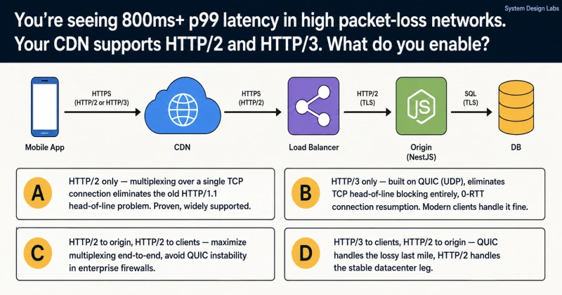

# Ngày 36: Choosing HTTP/3 vs HTTP/2 at the Edge

[← Ngày trước](day-35-geospatial-find-nearby-drivers-at-scale.md) | [Mục lục](README.md) | [Ngày tiếp theo →](day-37-multi-writer-conflicts-in-collaborative-editing.md)

---

# DAY 36 · SYSTEM DESIGN

## Lựa chọn HTTP/3 so với HTTP/2 tại tầng biên (Edge)

Thời gian phản hồi API (API response) của bạn giảm từ **320ms xuống còn 95ms** sau khi chuyển đổi CDN.  
Không có gì thay đổi trên máy chủ (server). Cùng một máy chủ gốc (origin). Cùng một dung lượng tải (payload).  
Sự khác biệt duy nhất: CDN bắt đầu giao tiếp bằng **HTTP/3** tới các máy khách (clients) của bạn.

**Mô hình thiết lập hiện tại:**

$$\text{Mobile app} \longrightarrow \text{Load Balancer} \longrightarrow \text{Origin (NestJS)} \longrightarrow \text{Database (DB)}$$

Mọi yêu cầu (request) đều đi qua CDN trước. Độ trễ (latency) ở mức chấp nhận được — cho đến khi gặp các môi trường mất gói tin cao (high packet-loss environments) như chuyển đổi mạng di động từ 4G sang 5G, mạng Wi-Fi chập chờn (flaky WiFi), hoặc các tuyến định tuyến khu vực Châu Á - Thái Bình Dương (Asia-Pacific routes). Bạn đang ghi nhận độ trễ đuôi (tail latency) mức **p99 vượt quá 800ms+**.

CDN của bạn hỗ trợ cả **HTTP/2** và **HTTP/3**. Bạn sẽ kích hoạt tùy chọn nào?

---

---

### Các phương án lựa chọn:

* **A. Chỉ HTTP/2 (HTTP/2 only):**  
  Ghép kênh (multiplexing) trên một kết nối TCP duy nhất giúp loại bỏ vấn đề nghẽn đầu hàng (Head-of-Line blocking - HoL) cũ kỹ của HTTP/1.1. Đã được chứng minh trong thực tế và được hỗ trợ rộng rãi.

* **B. Chỉ HTTP/3 (HTTP/3 only):**  
  Được xây dựng trên nền tảng QUIC (UDP), loại bỏ hoàn toàn hiện tượng nghẽn đầu hàng TCP (TCP Head-of-Line blocking), hỗ trợ nối lại kết nối không cần độ trễ (0-RTT connection resumption). Các máy khách (clients) hiện đại xử lý rất tốt giao thức này.

* **C. HTTP/2 tới Origin, HTTP/2 tới Clients:**  
  Tối đa hóa khả năng ghép kênh (multiplexing) từ đầu cuối đến đầu cuối (end-to-end), tránh sự thiếu ổn định của giao thức QUIC khi đi qua các tường lửa doanh nghiệp (enterprise firewalls).

* **D. HTTP/3 tới Clients, HTTP/2 tới Origin:**  
  QUIC xử lý chặng cuối nhiều mất mát dữ liệu (lossy last mile), HTTP/2 xử lý chặng trung tâm dữ liệu ổn định (stable datacenter leg).

---

# DAY 36 · ĐÁP ÁN & GIẢI THÍCH CHI TIẾT

---

---

### Phân tích đáp án 1 (Answer 1)

> [!IMPORTANT]
> **✓ ĐÁP ÁN CHÍNH XÁC: D — HTTP/3 tới clients, HTTP/2 tới origin**

Vấn đề cốt lõi nằm ở **chặng cuối (last mile)**. Các máy khách di động (mobile clients) hoạt động trên các kết nối dễ mất gói tin chính là nơi giao thức TCP bộc lộ sự đổ vỡ.

* **HTTP/2** đã giải quyết hiện tượng nghẽn đầu hàng ở tầng ứng dụng (application-layer Head-of-Line blocking) của HTTP/1.1 bằng cách ghép kênh nhiều luồng (multiplexing streams) trên một kết nối TCP duy nhất. Tuy nhiên, bản thân giao thức **TCP vẫn bị nghẽn đầu hàng ở tầng giao vận (transport-layer Head-of-Line blocking)**. Chỉ một gói tin bị thất thoát sẽ làm **tắc nghẽn TẤT CẢ các luồng (streams)** cho đến khi gói tin đó được truyền lại thành công. Trên một kết nối 4G bị rơi rớt 2% gói tin, kết nối HTTP/2 gồm 20 luồng đồng thời của bạn sẽ bị đình trệ hoàn toàn.
* **HTTP/3** chạy trên nền tảng **QUIC (UDP)**. Mỗi luồng dữ liệu (stream) là hoàn toàn độc lập. Một gói tin bị rớt chỉ làm tắc nghẽn duy nhất luồng đó, 19 luồng còn lại vẫn tiếp tục lưu thông bình thường. Kết hợp thêm cơ chế **khôi phục kết nối 0-RTT (0-RTT resumption)** — các kết nối tiếp theo sẽ bỏ qua hoàn toàn bước bắt tay (handshake) — giúp bạn cắt giảm được từ 1 đến 2 vòng lặp truyền/nhận (round trips) trên mỗi lần kết nối lại. Đó chính là nguồn gốc giúp tối ưu độ trễ vượt trội.

Tuy nhiên, **chặng trung tâm dữ liệu (datacenter leg từ CDN tới origin)** lại là một câu chuyện hoàn toàn khác:
* Đây là một mạng riêng (private network) ổn định, tỉ lệ mất gói tin cực thấp (low-loss).
* Các ưu thế của QUIC sẽ biến mất trên các kết nối có độ tin cậy cao.
* Khả năng ghép kênh của HTTP/2 đã rất hoàn thiện, được tối ưu hóa tốt và không phải gánh chịu chi phí tiêu tốn chu kỳ CPU (CPU overhead) cho việc mã hóa mật mã như của QUIC (QUIC mã hóa mọi thứ ngay tại tầng giao vận, hoàn toàn không bao giờ truyền bản rõ/cleartext).

> [!TIP]
> Đây chính xác là cách các mạng phân phối nội dung hàng đầu như **Cloudflare**, **Fastly**, và **Akamai** đang vận hành: triển khai **HTTP/3 ở phía đối mặt biên (edge-facing / client-side)**, và **HTTP/2** (hoặc thậm chí là **HTTP/1.1 kèm keep-alive**) ở **phía kết nối máy chủ gốc (origin-facing)**.

---

### Phân tích đáp án 2 (Answer 2)

> [!WARNING]
> **Tại sao phương án A chưa đạt yêu cầu (Chỉ HTTP/2 - HTTP/2 only):**

Cơ chế ghép kênh (multiplexing) của HTTP/2 là một cải tiến thực sự so với HTTP/1.1, nhưng nó **không giải quyết được vấn đề nghẽn đầu hàng của TCP (TCP Head-of-Line blocking)**. Trên các kết nối di động hay mất gói tin, bạn vẫn hoàn toàn chịu sự chi phối từ cửa sổ truyền lại của TCP (TCP retransmission window). Đối với độ trễ đuôi mức **p99 (tail latency)** trên các đường truyền mạng kém, HTTP/2 sẽ không thể tạo ra sự khác biệt rõ rệt nào.

---

### Phân tích đáp án 3 (Answer 3)

> [!NOTE]
> **Tại sao phương án B sai (Chỉ HTTP/3 - HTTP/3 only):**

Sử dụng HTTP/3 tới tận máy chủ gốc (origin) mang lại rủi ro vận hành (operational risk) thực tế rất lớn:
* Tường lửa doanh nghiệp (enterprise firewalls) và một số bộ cân bằng tải đám mây (cloud load balancers) thường **chặn cổng UDP 443** hoặc giới hạn tốc độ (rate-limit) đối với cổng này.
* Hạ tầng máy chủ gốc của bạn không phải là nút thắt cổ chai (bottleneck), mà **chặng cuối (last mile) mới chính là nút thắt**. 
* Việc "sửa chữa" chặng kết nối tới origin bằng QUIC không giúp giải quyết được bài toán; nó chỉ làm tăng thêm độ phức tạp và nguy cơ phát sinh lỗi làm gián đoạn hệ thống.

---

### Phân tích đáp án 4 (Answer 4)

> [!NOTE]
> **Tại sao phương án C sai (HTTP/2 từ đầu cuối đến đầu cuối - HTTP/2 end-to-end):**

Gặp cùng một vấn đề như phương án A: bạn **chưa làm bất cứ điều gì để giải quyết vấn đề ở chặng cuối (last mile)**. Việc giữ giao thức HTTP/2 nhất quán từ đầu đến cuối (end-to-end) nghe có vẻ gọn gàng, sạch sẽ về mặt kiến trúc, nhưng sự "gọn gàng" đó sẽ không giúp cải thiện được chỉ số p99 của bạn.

---

### Bảng tóm tắt so sánh kiến trúc Edge vs Origin:

| Tiêu chí | Chặng Edge (Client $\rightarrow$ CDN) | Chặng Origin (CDN $\rightarrow$ Server/LB) |
| :--- | :--- | :--- |
| **Giao thức khuyến nghị** | **HTTP/3 (QUIC / UDP)** | **HTTP/2 (TCP)** |
| **Đặc điểm đường truyền** | Dễ mất gói (lossy), mạng di động/WiFi chập chờn | Ổn định cao, mạng nội bộ/backbone, độ trễ thấp |
| **Cơ chế HoL Blocking** | Độc lập từng luồng (Per-stream isolation) | Chấp nhận TCP HoL do tỉ lệ rớt gói gần như bằng 0 |
| **Chi phí bắt tay (Handshake)** | Tối ưu với 0-RTT connection resumption | Kết nối tái sử dụng lâu dài (Persistent Connection pool) |
| **Mức tiêu hao CPU** | Chấp nhận overhead mã hóa tầng giao vận | Tiết kiệm CPU, tối ưu hóa throughput của Datacenter |

---

[← Ngày trước](day-35-geospatial-find-nearby-drivers-at-scale.md) | [Mục lục](README.md) | [Ngày tiếp theo →](day-37-multi-writer-conflicts-in-collaborative-editing.md)
