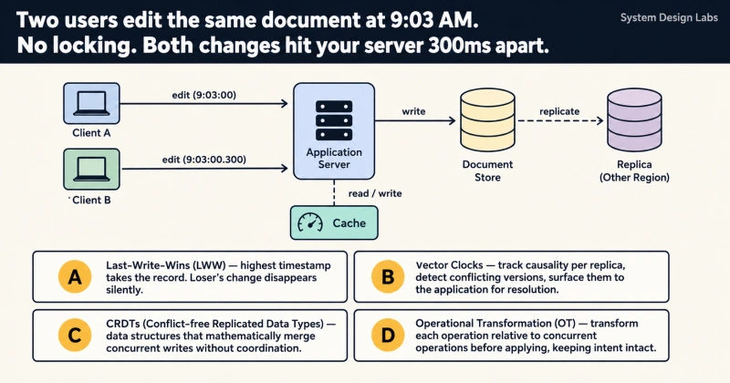

# Ngày 37: Multi-Writer Conflicts in Collaborative Editing

[← Ngày trước](day-36-choosing-http-3-vs-http-2-at-the-edge.md) | [Mục lục](README.md) | [Ngày tiếp theo →](day-38-fitting-a-large-document-into-an-llm.md)

---

# DAY 37 · SYSTEM DESIGN

## Xung đột Nhiều bên ghi trong Chỉnh sửa cộng tác (Multi-Writer Conflicts in Collaborative Editing)

Hai người dùng cùng chỉnh sửa một tài liệu vào lúc 9:03 sáng.  
Không có cơ chế khóa (**No locking**). Không có sự điều phối (**No coordination**). Chỉ đơn thuần là hai máy trạm (**clients**) cùng ghi dữ liệu vào một bản ghi (**record**).

Cả hai thay đổi đều ập đến máy chủ của bạn chỉ cách nhau **300ms**. Một thay đổi đến trước. Thay đổi còn lại ghi đè lên nó.  
Công sức của Người dùng A (**User A**) hoàn toàn biến mất. Họ chẳng bao giờ nhận được bất kỳ thông báo lỗi nào. Họ chỉ đơn giản là… bị mất sạch thay đổi của mình.

Đây chính là bài toán **xung đột nhiều bên ghi (Multi-Writer Conflict)**. Mọi hệ thống cộng tác sớm muộn gì cũng sẽ phải đối mặt với nó. Các lựa chọn kiến trúc của bạn:

* **A) Last-Write-Wins (LWW)** — Bản ghi nào có mốc thời gian (**timestamp**) lớn nhất sẽ giành chiến thắng. Thay đổi của bên thua cuộc sẽ âm thầm biến mất.
* **B) Vector Clocks** — Theo dõi quan hệ nhân quả (**causality**) trên từng bản sao (**replica**), phát hiện các phiên bản xung đột, sau đó chuyển giao lên tầng ứng dụng (**application layer**) để tự giải quyết.
* **C) CRDTs (Conflict-free Replicated Data Types)** — Các cấu trúc dữ liệu được thiết kế để hợp nhất (**merge**) các thao tác ghi đồng thời theo nguyên lý toán học mà không cần bất kỳ sự điều phối tập trung nào (**zero coordination**).
* **D) Operational Transformation (OT)** — Biến đổi từng thao tác tương đối theo các thao tác đồng thời khác trước khi áp dụng, nhằm giữ trọn vẹn mục đích chỉnh sửa ban đầu (**intent**).

---

# DAY 37 · ĐÁP ÁN & GIẢI THÍCH CHI TIẾT (ANSWERS & EXPLANATIONS)

### Phân tích Phương án 1 (Answer 1)

> [!NOTE]
> ### ✓ CÂU TRẢ LỜI CHÍNH XÁC
> **Đáp án: C — CRDTs** *(tuy nhiên câu trả lời thực tế phụ thuộc vào mô hình xung đột (conflict model) của bạn — xem phân tích chi tiết toàn diện bên dưới)*

#### C — CRDTs chiến thắng ở quy mô lớn (wins at scale)

**CRDTs (Conflict-free Replicated Data Types)** là các cấu trúc dữ liệu được thiết kế sao cho bất kỳ hai bản sao (**replicas**) nào cũng luôn có thể được hợp nhất (**merged**) — hoàn toàn dựa trên nguyên lý toán học, không cần sự điều phối tập trung (**without coordination**).

> [!TIP]
> **Điểm mấu chốt cốt lõi:** Nếu các thao tác thỏa mãn đồng thời tính chất **giao hoán (commutative)**, **kết hợp (associative)**, và **lũy đẳng (idempotent)**, thì về mặt cấu trúc, **xung đột hoàn toàn không thể tồn tại**.

**Các ví dụ điển hình:**
* **G-Counter (Grow-only Counter):** Chỉ hỗ trợ thao tác tăng dần. Hợp nhất (**Merge**) = lấy giá trị lớn nhất (**max**) trên từng bản sao (**replica**). Luôn luôn hội tụ (**Always converges**).
* **LWW-Element-Set:** Hợp nhất (**union**) của các tập hợp thêm vào (**adds**) + xóa đi (**removes**) kèm theo mốc thời gian (**timestamps**).
* **RGA / YATA (Sequence CRDTs):** Mỗi ký tự được gán một định danh duy nhất (**unique ID**), các thao tác chèn đồng thời (**concurrent inserts**) được sắp xếp theo thứ tự tất định (**deterministically ordered**) — đây chính là nền tảng cốt lõi của tính năng chỉnh sửa văn bản cộng tác đồng thời.

Bảng vẽ (**canvas**) của **Figma** vận hành trên nền tảng **CRDTs**. Mô hình khối (**block model**) của **Notion** cũng dựa trên **CRDTs**. Với hàng triệu người cùng ghi đồng thời (**concurrent writers**) trải dài trên nhiều vùng địa lý phân tán (**distributed regions**), mỗi nút (**node**) đều hội tụ độc lập — **hoàn toàn không cần sự điều phối tập trung (zero coordination required)**.

**Điểm hạn chế (The catch):**  
**CRDTs** ràng buộc rất chặt chẽ lên mô hình dữ liệu (**data model**) của bạn. Không phải mọi nghiệp vụ đều có thể ánh xạ một cách mượt mà. Một số thao tác (chẳng hạn như di chuyển một tệp tin giữa các thư mục khác nhau) cực kỳ khó để biểu diễn mà không làm mất đi mục đích chỉnh sửa ban đầu (**intent**).

---

### Phân tích Phương án 2 (Answer 2)

#### D — Operational Transformation (OT) ⚠️ Ấn tượng nhưng cực kỳ phức tạp (impressive but hard)

**OT** là cách tiếp cận nguyên bản đầu tiên của **Google Docs**. Khi hai thao tác xuất hiện đồng thời, bạn sẽ biến đổi (**transform**) từng thao tác dựa trên tương quan với thao tác còn lại trước khi chính thức áp dụng nó. 

* *Ví dụ:* Người dùng A chèn ký tự ở vị trí số 5, Người dùng B xóa ký tự ở vị trí số 3 cùng lúc — **OT** sẽ tự động điều chỉnh vị trí chèn của A để bù đắp cho thao tác xóa của B. Mục đích chỉnh sửa (**Intent**) được bảo toàn nguyên vẹn.

Đó là lý do vì sao **Google Docs** tạo cảm giác kỳ diệu đến vậy vào năm 2009.

> [!WARNING]
> **Thách thức vận hành của OT:**
> * **Độ phức tạp khổng lồ:** Các hàm biến đổi (**transformation functions**) cực kỳ khó để thiết kế chuẩn xác — ngay cả các bài báo nghiên cứu gốc về **OT** cũng từng dính lỗi logic (**bugs**).
> * **Bùng nổ tổ hợp:** Mỗi loại thao tác mới được bổ sung sẽ kéo theo số lượng cặp biến đổi tăng theo cấp số nhân bậc hai (**quadratically**).
> * **Phụ thuộc máy chủ tập trung:** **OT** bắt buộc phải có một máy chủ trung tâm (**centralized server**) để đánh số thứ tự tuần tự các thao tác; nó không thể phân tán đa vùng một cách liền mạch (**doesn't distribute cleanly**).

Hiện nay, **Google Docs** hiện đại đã chuyển dịch sang kiến trúc lai (**hybrid**) kết hợp các ý tưởng tương tự **CRDTs**. Đứng độc lập một mình, **OT không thể mở rộng (scale) lên quy mô phân tán hoàn toàn**.

---

### Phân tích Phương án 3 (Answer 3)

#### B — Vector Clocks ⚠️ Minh bạch nhưng chưa trọn vẹn (honest but incomplete)

**Vector Clocks** có chức năng theo dõi mối quan hệ nhân quả (**track causality**). Mỗi lượt ghi dữ liệu sẽ mang theo một véc-tơ phiên bản (**version vector**) — gồm một bộ đếm (**counter**) cho mỗi bản sao (**replica**). Khi hai lượt ghi không hề có mối quan hệ nhân quả với nhau (không có lượt nào xảy ra trước lượt nào - *"happened before"*), hệ thống xác định chắc chắn đã có xung đột xảy ra. Cả hai phiên bản sẽ được đẩy lên **tầng ứng dụng (application layer)** để xử lý.

Hệ thống **Dynamo** nội bộ của **Amazon** từng áp dụng giải pháp này. Nó hoạt động chính xác và minh bạch.

> [!CAUTION]
> **Vấn đề cốt lõi:** Trách nhiệm giải quyết xung đột (**conflict resolution**) giờ đây bị dồn hoàn toàn về phía bạn. Bạn phải tự tay viết mã nguồn logic hợp nhất (**merge logic**) cho từng loại dữ liệu riêng biệt.
> * Với giỏ hàng (**shopping carts**), việc này còn khả thi (chỉ cần lấy phép hợp (**union**) tất cả các mặt hàng).
> * Nhưng đối với các tài liệu văn bản tự do tùy ý? Cơ chế này sẽ nhanh chóng đổ vỡ.

**Vector Clocks** chỉ cho bạn biết **xung đột nằm ở đâu**. Chúng **không thể chỉ cho bạn cách khắc phục và giải quyết chúng như thế nào**.

---

### Phân tích Phương án 4 (Answer 4)

#### A — Last-Write-Wins (LWW) ❌ Cực kỳ nguy hiểm (dangerous)

Đơn giản. Đơn giản đến mức tàn nhẫn. Mốc thời gian (**timestamp**) lớn nhất sẽ giành chiến thắng. Thay đổi của bên thua cuộc biến mất hoàn toàn — không có lỗi cảnh báo, không có thông báo, đơn giản là biến mất không dấu vết.

**Apache Cassandra** mặc định sử dụng cơ chế này. 
* Đối với các khối lượng công việc chỉ nối thêm dữ liệu (**append-only workloads**) như: số liệu giám sát (**metrics**), nhật ký sự kiện (**event logs**), dữ liệu đo xa viễn thám (**telemetry**), cơ chế này hoàn toàn ổn.
* Nhưng đối với bất kỳ nội dung nào do con người trực tiếp chỉnh sửa? Đây chính là hành vi **mất mát dữ liệu âm thầm (silent data loss)** được gắn kèm theo một mốc thời gian. 

Điểm nguy hiểm và phản trắc nhất: **Người dùng không bao giờ nhận được bất kỳ thông báo lỗi nào. Thành quả lao động của họ đơn giản là bốc hơi khỏi hệ thống.**

---

### Bảng Tổng hợp So sánh Toàn diện (System Design Summary)

| Tiêu chí so sánh | Last-Write-Wins (LWW) | Vector Clocks | Operational Transformation (OT) | CRDTs |
| :--- | :--- | :--- | :--- | :--- |
| **Bản chất cơ chế** | Ghi đè dựa trên mốc thời gian lớn nhất | Gắn bộ đếm nhân quả, đẩy xung đột lên App | Biến đổi tọa độ thao tác qua máy chủ tuần tự | Cấu trúc dữ liệu tự hợp nhất theo toán học |
| **Điều phối tập trung** | Không | Không | **Bắt buộc có (Centralized Server)** | **Không cần (Zero Coordination)** |
| **Mất mát dữ liệu** | ⚠️ **Có (Mất dữ liệu âm thầm)** | Không (Bảo toàn phiên bản xung đột) | Không (Bảo toàn mục đích chỉnh sửa) | Không (Hội tụ dữ liệu toán học) |
| **Độ phức tạp xử lý** | Cực kỳ thấp | Tầng ứng dụng phải tự viết logic hợp nhất | Cực kỳ phức tạp (bùng nổ hàm biến đổi) | Ràng buộc mô hình dữ liệu thiết kế |
| **Trường hợp áp dụng chuẩn** | Metrics, Telemetry, Append-only logs | Giỏ hàng e-commerce (Dynamo-style) | Google Docs cổ điển (Client-Server) | Figma, Notion, Biên tập tài liệu P2P/Phân tán |

---

[← Ngày trước](day-36-choosing-http-3-vs-http-2-at-the-edge.md) | [Mục lục](README.md) | [Ngày tiếp theo →](day-38-fitting-a-large-document-into-an-llm.md)
