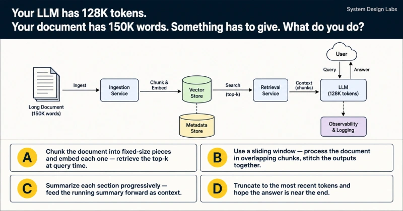

# Ngày 38: Fitting a Large Document into an LLM

[← Ngày trước](day-37-multi-writer-conflicts-in-collaborative-editing.md) | [Mục lục](README.md) | [Ngày tiếp theo →](day-39-preventing-concurrent-balance-overspend.md)

---

# DAY 38 · THIẾT KẾ HỆ THỐNG (SYSTEM DESIGN)

## Đưa một tài liệu dung lượng lớn vào mô hình LLM (Fitting a Large Document into an LLM)

### Tình huống thực tế (Scenario)
- **Cửa sổ ngữ cảnh của LLM (LLM Context Window):** 128K tokens.
- **Dung lượng tài liệu của bạn:** 150K words (tương đương khoảng ~200K tokens).
- **Vấn đề:** Không thể nhét toàn bộ tài liệu vào một prompt duy nhất. Bắt buộc phải có giải pháp đánh đổi/xử lý. Bạn sẽ làm gì?

---

### Các phương án lựa chọn (Options)

* **A.** Phân mảnh tài liệu thành các đoạn có kích thước cố định (Chunking) và tạo vector nhúng (Embedding) cho từng đoạn — thực hiện truy xuất $Top\text{-}k$ đoạn liên quan nhất tại thời điểm truy vấn (Query Time).
* **B.** Sử dụng cơ chế cửa sổ trượt (Sliding Window) — xử lý tài liệu qua các đoạn phân mảnh gối đầu lên nhau (Overlapping Chunks), sau đó ghép nối các kết quả đầu ra lại với nhau (Stitch outputs together).
* **C.** Tóm tắt lũy tiến từng phần (Progressive Summarization) — đưa bản tóm tắt tích lũy liên tục làm ngữ cảnh nối tiếp cho phần sau.
* **D.** Cắt tỉa (Truncate) lấy các token gần nhất / mới nhất và hy vọng câu trả lời nằm ở gần cuối tài liệu.

---

---

# DAY 38 · ĐÁP ÁN & GIẢI THÍCH CHI TIẾT (ANSWERS & EXPLANATIONS)

## Câu trả lời 1: ✓ ĐÁP ÁN ĐÚNG

### Vì sao phương án A chiến thắng (RAG kết hợp Phân mảnh Vector Embeddings):

Bạn chia nhỏ tài liệu thành các đoạn phân mảnh có độ gối đầu lên nhau (~500 tokens, độ gối đầu overlap khoảng ~10–20%), tạo vector nhúng (Embed) cho từng đoạn, lưu trữ vào một cơ sở dữ liệu vector (Vector Database như **Pinecone**, **pgvector**, **Qdrant**), và tiến hành truy xuất $Top\text{-}k$ đoạn tương đồng nhất tại thời điểm có truy vấn (Query Time).

* **Khả năng mở rộng (Scalability):** Phương pháp này mở rộng quy mô cho bất kỳ kích thước tài liệu nào (Document Size). Ngữ cảnh LLM tại thời điểm suy luận (Inference Time) chỉ tiếp nhận các đoạn phân mảnh được truy xuất về — hoàn toàn nằm gọn an toàn bên trong giới hạn cửa sổ ngữ cảnh (Context Window).
* **Độ trễ thấp (Low Latency):** Độ trễ của hệ thống giữ ở mức rất thấp vì bước truy xuất là một phép tra cứu tìm kiếm láng giềng gần đúng (**ANN - Approximate Nearest Neighbor Lookup**) cực nhanh, chứ không phải quét tuần tự toàn bộ dữ liệu (Sequential Scan).

> [!WARNING] Điểm cạm bẫy kỹ thuật (The catch):
> Ranh giới phân mảnh (**Chunking boundaries**) có thể phá vỡ tính mạch lạc ngữ nghĩa (**Semantic Coherence**). Nếu một điều khoản hợp đồng bắt đầu ở trang 12 và kết thúc ở trang 13, một ranh giới phân mảnh cứng ngắc (**Hard Chunk Boundary**) nằm giữa hai trang sẽ khiến cho không một mảnh nào trong số đó có thể được truy xuất chính xác cho câu hỏi liên quan. Đây là lý do tại sao việc tinh chỉnh độ gối đầu (**Overlap Tuning**) và kích thước phân mảnh (**Chunk Size Tuning**) lại đóng vai trò tối quan trọng. Phần lớn các đội ngũ kỹ thuật đều đánh giá thấp điều này.

> [!TIP] Giải pháp thực chiến trong môi trường Production (Production Fix):
> - **Sentence/Paragraph Boundaries Chunking:** Phân mảnh theo ranh giới câu hoặc đoạn văn, tuyệt đối không cắt theo số lượng ký tự thô (Character counts).
> - **Hybrid Retrieval:** Sử dụng cơ chế truy xuất lai kết hợp giữa từ khóa (**Keyword / BM25**) và ngữ nghĩa (**Semantic Vector Search**) để xử lý triệt để các trường hợp ngoại lệ (Edge cases).

---

## Câu trả lời 2

### Vì sao phương án B là đáp án bẫy (Sliding Window):

Cơ chế cửa sổ trượt trông có vẻ rất thanh lịch — xử lý tài liệu qua các lượt quét gối đầu lên nhau rồi tích lũy câu trả lời dần dần. Nhưng trên thực tế, nó **không hề giải quyết được bài toán giới hạn cửa sổ ngữ cảnh**.

* Bạn vẫn bắt buộc phải xử lý tuần tự từng đoạn một (**Sequentially**), và câu trả lời cho một câu hỏi mà ngữ cảnh của nó nằm rải rác giữa đoạn phân mảnh số 1 và đoạn phân mảnh số 47 sẽ hoàn toàn bị thất lạc.
* **Chi phí tính toán bùng nổ:** Bạn đang thực hiện độ phức tạp $O(n)$ lượt gọi LLM cho mỗi một câu truy vấn (Query). Với tài liệu 150K từ và thời gian gọi LLM trung bình là 3 giây/lần gọi, bạn sẽ mất tới hàng phút cho một truy vấn duy nhất. **Không một ai đưa giải pháp này lên môi trường Production cho bài toán Hỏi-Đáp (QA) trên tài liệu lớn.**
* Phương pháp này chỉ hoạt động tốt cho các tác vụ tóm tắt (**Summarization Tasks**) - nơi mà kết quả đầu ra từ đoạn phân mảnh $N$ được dùng làm đầu vào cho đoạn phân mảnh $N+1$. Còn đối với bài toán truy xuất thông tin (**Retrieval**)? Đây hoàn toàn là một công cụ sai lầm.

---

## Câu trả lời 3

### Vì sao phương án C đôi khi có tác dụng (Progressive Summarization):

* **Khi nào hiệu quả:** Dùng để tóm tắt một tài liệu dài 200 trang? Rất vững chắc. Bạn áp dụng mô hình **Map-Reduce** cho tài liệu — tóm tắt từng phần, sau đó tóm tắt lại các bản tóm tắt đó. GPT-4o xử lý tác vụ này cực kỳ tốt.
* **Khi nào thất bại:** Dùng để trả lời một câu hỏi cụ thể, chi tiết về điều khoản 38(b) ở trang 97? Hoàn toàn không thể. Bản tóm tắt trung gian sẽ nén và loại bỏ mất chi tiết cụ thể mà bạn đang tìm kiếm. Áp dụng nén mất dữ liệu (**Lossy Compression**) vào bài toán truy xuất thông tin (**Information Retrieval**) là một sai lầm bản chất về mặt phân loại danh mục bài toán (Category Error).

> [!NOTE] Nguyên tắc áp dụng:
> Hãy sử dụng tóm tắt lũy tiến (**Progressive Summarization**) khi bạn cần sự thấu hiểu ở mức bao quát/tổng quan cấp cao (**High-level Understanding**). Tuyệt đối không dùng khi các sự kiện, số liệu hoặc chi tiết cụ thể bắt buộc phải còn nguyên vẹn cho đến cuối đường ống dẫn dữ liệu (**Pipeline**).

---

## Câu trả lời 4

### Vì sao phương án D hiển nhiên sai (nhưng lại xuất hiện phổ biến một cách đáng kinh ngạc):

Cắt tỉa lấy $N$ token cuối cùng là hành vi mặc định của hầu hết các thư viện đóng gói gọi LLM API (**LLM API Wrappers**) khi bạn vượt quá giới hạn ngữ cảnh mà không chủ động xử lý ngoại lệ. Rất nhiều đội ngũ kỹ thuật đã vô tình đưa lỗi này lên môi trường Production mà không hề hay biết.

Ngoài vấn đề hiển nhiên là **mất mát dữ liệu nghiêm trọng**, mô hình LLM còn gặp phải hiện tượng lỗi **"Lạc lối ở giữa" (Lost in the middle)** *(Liu et al., 2023)*:
* Hiệu năng thực thi trên các tác vụ truy xuất đạt mức cao nhất khi câu trả lời nằm ở phần **bắt đầu** hoặc phần **cuối** của cửa sổ ngữ cảnh.
* Hiệu năng suy giảm nghiêm trọng khi câu trả lời bị chôn vùi ở **khoảng giữa**. Do đó, ngay cả khi bạn có thể nhét vừa vặn mọi thứ vào ngữ cảnh, vị trí đặt thông tin vẫn mang tính quyết định.

> [!CAUTION] Hệ quả:
> Cắt xén dữ liệu càng làm trầm trọng thêm vấn đề này — bạn không chỉ đánh mất dữ liệu, mà bạn đang **đánh mất dữ liệu một cách hoàn toàn không thể dự đoán được (Unpredictably)**.

---

### Bảng tổng hợp so sánh các phương pháp tiếp cận

| Tiêu chí so sánh | Phương án A (RAG + Chunking) | Phương án B (Sliding Window) | Phương án C (Progressive Summarization) | Phương án D (Truncation) |
| :--- | :--- | :--- | :--- | :--- |
| **Bản chất kỹ thuật** | Phân mảnh, Embed, lưu Vector DB & truy xuất $Top\text{-}k$ | Quét tuần tự từng chunk gối đầu nhau | Map-reduce tóm tắt phân tầng | Cắt bỏ phần đầu, chỉ giữ lại phần đuôi |
| **Độ phức tạp cuộc gọi LLM** | **$O(1)$** (1 lần gọi sau khi truy xuất) | **$O(n)$** (gọi liên tục theo số chunk) | **$O(n)$** (gọi ở bước map-reduce) | **$O(1)$** (1 lần gọi duy nhất) |
| **Độ trễ truy vấn (Latency)** | **Rất thấp** (tính bằng mili-giây qua ANN) | **Cực cao** (tính bằng phút) | **Cao** | **Thấp** (nhưng sai kết quả) |
| **Độ chính xác dữ kiện chi tiết** | **Rất cao** (nếu tune chunk size/overlap tốt) | **Thấp** (dễ gãy ngữ cảnh giữa các chunk xa nhau) | **Rất thấp** (bị nén mất dữ liệu) | **Gần như bằng 0** (do mất dữ liệu) |
| **Phù hợp nhất cho** | **Hệ thống Hỏi-Đáp (QA), Search trên tài liệu lớn** | Tác vụ tóm tắt nối tiếp đơn giản | Nắm bắt ý chính, báo cáo tổng quan cấp cao | **Không khuyến nghị dùng** |

---

[← Ngày trước](day-37-multi-writer-conflicts-in-collaborative-editing.md) | [Mục lục](README.md) | [Ngày tiếp theo →](day-39-preventing-concurrent-balance-overspend.md)
