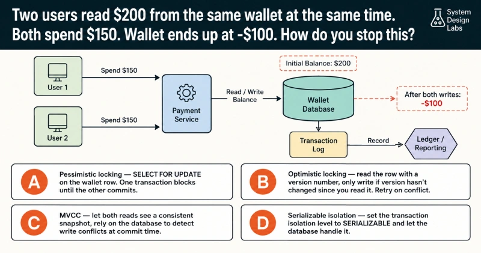

# Ngày 39: Preventing Concurrent Balance Overspend

[← Ngày trước](day-38-fitting-a-large-document-into-an-llm.md) | [Mục lục](README.md) | [Ngày tiếp theo →](day-40-offloading-heavy-work-off-the-main-thread.md)

---


# NGÀY 39 · THIẾT KẾ HỆ THỐNG (DAY 39 · SYSTEM DESIGN)

## Ngăn chặn tiêu vượt số dư đồng thời (Preventing Concurrent Balance Overspend)

Bạn đang vận hành một hệ thống thanh toán (**payment system**). Hai người dùng cố gắng chi tiêu từ cùng một số dư ví (**wallet balance**) tại cùng một thời điểm.

Cả hai đều đọc được số dư là **$200**. Cả hai đều muốn chi tiêu **$150**. Cả hai đều thấy số dư còn đủ. Cả hai cùng ghi nhận lệnh trừ tiền.

Số dư ví hiện tại rơi vào mức **-$100** (bị âm). Làm thế nào bạn ngăn chặn tình trạng này?



---

### Các phương án lựa chọn:

- **A. Khóa bi quan (Pessimistic locking)** — Sử dụng `SELECT FOR UPDATE` trên hàng dữ liệu của ví. Một giao dịch (**transaction**) sẽ bị chặn (**block**) cho đến khi giao dịch kia hoàn tất (**commit**).
- **B. Khóa lạc quan (Optimistic locking)** — Đọc hàng dữ liệu kèm theo số phiên bản (**version number**), chỉ thực hiện ghi nếu phiên bản chưa bị thay đổi kể từ lúc bạn đọc nó. Thử lại (**retry**) khi xảy ra xung đột.
- **C. Đa phiên bản kiểm soát đồng thời (MVCC - Multi-Version Concurrency Control)** — Cho phép cả hai lần đọc nhìn thấy một bản chụp nhất quán (**consistent snapshot**), dựa vào cơ sở dữ liệu để phát hiện xung đột ghi tại thời điểm commit.
- **D. Mức cô lập tuần tự (Serializable isolation)** — Đặt mức cô lập giao dịch thành `SERIALIZABLE` và để cơ sở dữ liệu tự xử lý.

---

# NGÀY 39 · ĐÁP ÁN & GIẢI THÍCH CHI TIẾT (DAY 39 · ANSWERS & EXPLANATIONS)


### Câu trả lời 1
### ✓ ĐÁP ÁN ĐÚNG: B

#### Tại sao B chiến thắng (Khóa lạc quan - Optimistic Locking):
Bạn đọc hàng dữ liệu ví và lấy ra số phiên bản (**version number**). Khi bạn thực hiện ghi, bạn đính kèm điều kiện `WHERE version = :read_version`. Nếu một transaction khác đã cập nhật hàng này trước đó, mệnh đề `WHERE` của bạn sẽ khớp với 0 dòng — xung đột được phát hiện, tiến hành thử lại (**retry**).

```sql
UPDATE wallets
SET balance = balance - 150, version = version + 1
WHERE id = :wallet_id AND version = :read_version;
```

Nếu `rows_affected = 0` → xảy ra xung đột (**conflict**) → thực hiện **retry**. 

Không có khóa nào bị giữ trong suốt quá trình đọc (**read**). Ở mức **10.000 TPS** với tỷ lệ xung đột thấp, phương pháp này nhanh hơn đáng kể so với khóa bi quan (**pessimistic locking**) — bạn chỉ phải trả chi phí retry khi thực sự xảy ra xung đột, thay vì phải chịu chi phí xin cấp phát khóa (**lock acquisition**) trên mọi thao tác đọc.

> [!WARNING]
> **Điểm mấu chốt cần lưu ý (The catch):**
> Dưới điều kiện **tranh chấp cao (HIGH contention)** (khi cùng một ví "nóng" - hot wallet bị truy cập liên tục), cơn bão thử lại (**retry storms**) sẽ nuốt chửng hệ thống của bạn. Các ví "nóng" cần sử dụng **Redis INCRBY** với cơ chế giảm nguyên tử (**atomic decrement**), hoặc đặt một hàng đợi (**queue**) phía trước tiến trình cập nhật ví.

---

### Câu trả lời 2

#### Tại sao A là câu trả lời bẫy (Khóa bi quan - Pessimistic Locking):
`SELECT FOR UPDATE` hoạt động được. Nó hoàn toàn chính xác về mặt logic. Nhưng nó giữ một khóa cấp dòng (**row-level lock**) trong toàn bộ vòng đời của transaction — mọi thao tác ghi đồng thời khác đều phải xếp hàng chờ.

Ở mức **10.000 TPS** trên một chiếc ví phổ biến (nhiều giao dịch), bạn đã vô tình tuần tự hóa (**serialized**) tất cả các thao tác ghi vào một hàng đợi duy nhất. Thông lượng (**throughput**) sụp đổ. 

Hiện tượng quá thời gian chờ khóa (**lock wait timeouts**) xảy ra dây chuyền — các transaction thất bại lại retry, tiếp tục đổ thêm xung đột vào hệ thống. Bạn vừa tự tạo ra một điểm nghẽn cổ chai tự củng cố (**self-reinforcing bottleneck**).

> [!TIP]
> Chỉ sử dụng **pessimistic locking** cho các luồng có mức độ tương tranh thấp (các thao tác quản trị - **admin ops**, các tác vụ xử lý theo lô - **batch jobs**) nơi xác suất xảy ra xung đột xấp xỉ 100%. **Không dùng** cho các luồng ghi thanh toán có thông lượng cao (**high-throughput payment writes**).

---

### Câu trả lời 3

#### Tại sao C là lỗi ngầm nguy hiểm (MVCC + Mức cô lập mặc định):
Đây là phương án cực kỳ nguy hiểm. PostgreSQL mặc định sử dụng mức cô lập **READ COMMITTED**. **MVCC** cung cấp cho mỗi transaction một bản chụp nhất quán (**consistent snapshot**) — nhưng ở mức **READ COMMITTED**, bản chụp đó được làm mới **theo từng câu lệnh (per statement)** chứ không phải theo từng transaction.

Hai transaction đồng thời đều đọc được **$200**, cả hai đều vượt qua bước kiểm tra "đủ số dư" (**sufficient funds check**), và cả hai đều commit thành công. Không có xung đột nào được phát hiện. Sự cố tiêu lạm tiền (**double spend**) xảy ra ngay trên môi trường production.

> [!NOTE]
> **MVCC** ngăn chặn hiện tượng đọc bẩn (**dirty reads**). Nó **KHÔNG** ngăn chặn hiện tượng mất mát dữ liệu cập nhật (**lost updates**) ở mức **READ COMMITTED**. Hầu hết các kỹ sư đều ngộ nhận rằng `MVCC = an toàn trước các thao tác ghi đồng thời`. Thực tế không phải như vậy!

---

### Câu trả lời 4

#### Tại sao D hầu như luôn là lựa chọn mặc định sai lầm (SERIALIZABLE):
Về mặt lý thuyết, phương án này chuẩn xác — cơ sở dữ liệu đảm bảo các transaction hành xử y như thể chúng được thực thi tuần tự (**serially**). Không xảy ra bất kỳ hiện tượng dị thường nào.

**Vấn đề là:** Bộ kiểm soát cô lập tuần tự dựa trên bản chụp của PostgreSQL (**SSI - Serializable Snapshot Isolation**) phải theo dõi các quan hệ phụ thuộc đọc-ghi (**read-write dependencies**) xuyên suốt giữa các transaction. Dưới điều kiện tương tranh cao, tỷ lệ lỗi tuần tự hóa (**serialization failures**) tăng vọt — các transaction bị hủy (**abort**) và phải retry ngay cả khi không có xung đột thực tế nào xảy ra. Gây sụt giảm thông lượng thực tế (**real throughput penalty**) rất lớn khi mở rộng quy mô (**at scale**).

> [!NOTE]
> Phù hợp cho các quy trình tài chính phức tạp nơi **tính toàn vẹn > thông lượng** (ví dụ: đối soát cuối ngày - **end-of-day reconciliation**).
> 
> Là lựa chọn mặc định **sai lầm** đối với một API xử lý giao dịch đơn lẻ yêu cầu thông lượng cao (**high-throughput per-transaction API**).

---

### Bảng tổng kết so sánh các giải pháp

| Cơ chế | Độ an toàn (Correctness) | Hiệu năng ở 10K TPS | Rủi ro chính | Ngữ cảnh phù hợp |
| :--- | :--- | :--- | :--- | :--- |
| **A. Pessimistic Locking** (`SELECT FOR UPDATE`) | Cao (Đúng) | Thấp (Sụp đổ khi hot wallet) | Lock wait timeouts, nghẽn cổ chai dây chuyền | Batch jobs, admin operations |
| **B. Optimistic Locking** (Version check) | **Cao (Đúng)** | **Cao (Tối ưu khi ít tranh chấp)** | Retry storm nếu gặp hot wallet | **API thanh toán thông lượng cao** |
| **C. MVCC** (Mặc định `READ COMMITTED`) | **Kém (Sai)** | Cao | **Double spend âm tiền trong production** | Các luồng chỉ đọc hoặc không phụ thuộc số dư |
| **D. Serializable Isolation** | Rất cao (Đúng) | Kém | Abort/retry vọt đỉnh do SSI overhead | Đối soát cuối ngày, luồng nghiệp vụ phức tạp |


---

[← Ngày trước](day-38-fitting-a-large-document-into-an-llm.md) | [Mục lục](README.md) | [Ngày tiếp theo →](day-40-offloading-heavy-work-off-the-main-thread.md)
