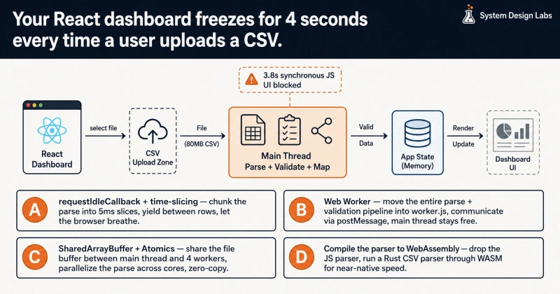

# Ngày 40: Offloading Heavy Work Off the Main Thread

[← Ngày trước](day-39-preventing-concurrent-balance-overspend.md) | [Mục lục](README.md) | [Ngày tiếp theo →](day-41-moving-from-batch-to-real-time-streaming.md)

---

# NGÀY 40 · THIẾT KẾ HỆ THỐNG (DAY 40 · SYSTEM DESIGN)
## Đẩy các tác vụ nặng ra khỏi luồng chính (Offloading Heavy Work Off the Main Thread)

Bảng điều khiển (dashboard) React của bạn bị đóng băng trong vòng 4 giây mỗi khi người dùng tải lên (upload) một tệp CSV.

Đây không phải là hiện tượng treo do mạng (network freeze). Đây là hiện tượng đóng băng trình duyệt (browser freeze). Tab không phản hồi (tab unresponsive). Các hiệu ứng hoạt họa bị kẹt (animations stuck). Hộp thoại "Trang không phản hồi" ("Page Unresponsive") xuất hiện liên tục trên Chrome.

### Dưới đây là những gì đang diễn ra trên môi trường Production:
* Người dùng thả một tệp CSV dung lượng **80MB (200.000 dòng, 40 cột)** vào vùng tải lên (upload zone).
* Mã nguồn của bạn: Gọi `Papa.parse(file, { complete: ... })` ngay trên **luồng chính (main thread)**.
* Quá trình phân tích cú pháp (parsing) + kiểm tra hợp lệ (validation) + ánh xạ lược đồ (schema mapping) = **3,8 giây thực thi JavaScript đồng bộ (synchronous JS)**.
* Trong suốt 3,8 giây đó: thao tác cuộn trang (scroll) bị tê liệt, biểu tượng xoay tải trang (loading spinner) ngừng quay, độ trễ nhập liệu (input lag) tăng vô hạn.
* Chỉ số **INP (Interaction to Next Paint)** trên dashboard hiệu năng của bạn chuyển sang màu đỏ. Lighthouse đang phát cảnh báo nghiêm trọng.

Đội ngũ Sản phẩm (Product) muốn vấn đề này phải được khắc phục trước buổi demo cho khách hàng doanh nghiệp (enterprise demo) vào thứ Sáu. Bốn phương án đang được đưa lên bàn cân:

* **A — `requestIdleCallback` + phân chia thời gian (time-slicing)**: Chia nhỏ quá trình phân tích cú pháp thành các lát cắt 5ms (5ms slices), nhường quyền điều khiển (yield) giữa các dòng, để trình duyệt "thở".
* **B — Web Worker**: Di chuyển toàn bộ đường ống xử lý phân tích cú pháp + kiểm tra tính hợp lệ (parse + validation pipeline) vào `worker.js`, giao tiếp qua `postMessage`, giữ cho **luồng chính (main thread)** hoàn toàn rảnh rỗi.
* **C — `SharedArrayBuffer` + `Atomics`**: Chia sẻ vùng đệm tệp (file buffer) giữa luồng chính và 4 worker, song song hóa quá trình parse trên nhiều lõi CPU (multi-core), không sao chép dữ liệu (zero-copy).
* **D — Biên dịch bộ phân tích cú pháp sang WebAssembly (WASM)**: Bỏ bộ phân tích cú pháp JS, chạy bộ phân tích cú pháp CSV viết bằng Rust thông qua WASM để đạt tốc độ gần như mã gốc (near-native speed).

---

# NGÀY 40 · ĐÁP ÁN & GIẢI THÍCH CHI TIẾT (DAY 40 · ANSWERS & EXPLANATIONS)

## Câu trả lời 1: Phương án B
> [!NOTE]
> ### ✓ ĐÁP ÁN CHÍNH XÁC (CORRECT ANSWER)

### Tại sao B chiến thắng (Why B wins):
Vấn đề thực sự ở đây không nằm ở tốc độ. Vấn đề nằm ở **nơi tác vụ đó được thực thi**. 

Luồng chính (**main thread**) chính là luồng đảm nhiệm việc cuộn trang (scroll), xử lý tương tác đầu vào (input), tính toán bố cục (layout), vẽ điểm ảnh (paint) và xử lý hoạt họa (animation). Bất kỳ tác vụ đồng bộ (synchronous) nào chạy trên luồng này = giật lag (jank). Chắc chắn là như vậy.

Một **Web Worker** là một luồng riêng biệt ở cấp hệ điều hành (separate OS-level thread) với vòng lặp sự kiện (**Event Loop**) độc lập của riêng nó. Bạn chuyển tệp sang (có thể chuyển nhượng quyền sở hữu qua `postMessage` bằng đối tượng `Transferable` để đạt trạng thái **zero-copy**), phân tích cú pháp ở bên luồng worker đó, rồi gửi trả các dòng đã phân tích về lại.

Luồng chính vẫn duy trì mượt mà ở mức **60fps** trong toàn bộ thời gian xử lý. Chỉ số INP giảm mạnh từ **3800ms xuống còn ~80ms**. Bài toán được giải quyết trọn vẹn.

Đây chính là kiến trúc mà:
* **Figma** sử dụng cho đường ống dựng hình (rendering pipeline) của họ.
* **Google Sheets** sử dụng để tính toán lại công thức (formula recalc).
* **Excalidraw** sử dụng cho việc xử lý hoạt cảnh (scene processing).
* **VS Code Web** sử dụng cho việc tô sáng cú pháp (syntax highlighting).

Mọi sản phẩm nghiêm túc chạy trên nền trình duyệt đều đẩy các tác vụ tính toán nặng (heavy compute) vào một worker. Đó là câu trả lời mộc mạc, kinh điển đã tồn tại 10 năm nay và hoàn toàn chính xác.

---

## Câu trả lời 2: Phương án A
> [!WARNING]
> ### Tại sao A sai — Cái bẫy "thông minh nửa vời" (Why A is wrong: the "clever" trap)

`requestIdleCallback` kết hợp với kỹ thuật **time-slicing** về mặt kỹ thuật vẫn giữ cho giao diện người dùng (UI) có phản hồi, nhưng nó sẽ kéo dài tổng thời gian thực tế để parse xong từ **3,8 giây lên khoảng ~6 giây thời gian thực (wall-clock time)**, bởi vì bạn liên tục phải nhường quyền điều khiển (yielding). 

Tệ hơn nữa: các lệnh gọi lại khi rảnh rỗi (idle callbacks) có mức độ ưu tiên rất thấp — khi hệ thống chịu tải cao, chúng thậm chí **sẽ không bao giờ được kích hoạt**. Cơ chế render đồng thời (concurrent rendering) của React 18 sử dụng time-slicing cho việc kết xuất giao diện (rendering), chứ không phải để gánh các tác vụ nặng có tính chất chặn vào/ra (blocking IO-shaped work). Đây là việc dùng sai công cụ.

---

## Câu trả lời 3: Phương án C
> [!CAUTION]
> ### Tại sao C sai — CÁI BẪY CỦA KỸ SƯ CAO CẤP (Why C is wrong: the SENIOR ENGINEER TRAP)

`SharedArrayBuffer` + `Atomics` là phương án nghe rất "bác học" trong các buổi thẩm định thiết kế (design review): *"Chúng ta sẽ song song hóa trên đa nhân! Zero-copy! Không dùng khóa (Lock-free)!"* 

Nhưng sau đó bạn sẽ phát hiện ra thực tế:
* Nó yêu cầu phải cấu hình các tiêu đề bảo mật **COOP (Cross-Origin-Opener-Policy)** + **COEP (Cross-Origin-Embedder-Policy)** trên toàn bộ trang web. Điều này sẽ **làm hỏng Stripe Elements, các video nhúng YouTube (YouTube embeds), widget hỗ trợ Intercom, và một nửa số script phân tích theo dõi (analytics scripts)** của bạn.
* Một tác vụ parse tệp CSV 80MB đơn lẻ là một bài toán tuần tự hiển nhiên (embarrassingly serializable) — việc chia nhỏ các dòng ra 4 nhân CPU chỉ tiết kiệm được cho bạn **~2 giây**, trong khi khiến bạn phải trả giá bằng **hàng tuần lễ rơi vào địa ngục cấu hình cô lập nguồn gốc chéo (cross-origin isolation hell)**.
* Bạn đang tự rước vào người gánh nặng phải tự quản lý và bảo trì một bể luồng tùy biến (custom thread pool) bằng JavaScript. Ngay trong năm 2026.

`SharedArrayBuffer` chỉ là câu trả lời chính xác cho đúng hai bài toán:
1. Xử lý âm thanh/video thời gian thực (real-time audio/video processing) — nơi bạn cần các vùng đệm vòng không khóa (lock-free ring buffers) giữa các luồng ở tần số 48kHz.
2. Trạng thái mô phỏng dùng chung (shared simulation state) — ví dụ như các công cụ trò chơi nhiều người chơi (multiplayer game engines) chạy trực tiếp trên trình duyệt.

Một tác vụ tải lên tệp CSV chạy một lần (one-shot CSV upload) hoàn toàn không thuộc về hai trường hợp trên.

---

## Câu trả lời 4: Phương án D
> [!TIP]
> ### Tại sao D sai (Why D is wrong)

WebAssembly (WASM) giúp bộ phân tích cú pháp **chạy nhanh hơn**. Nhưng nó **KHÔNG HỀ chuyển tác vụ đó ra khỏi luồng chính (main thread)**. 

Một bộ parser WASM chạy đồng bộ trên luồng chính vẫn sẽ làm đóng băng giao diện người dùng (UI freeze) như thường — chỉ là thời gian treo giảm xuống còn **1,2 giây thay vì 3,8 giây**. Cuối cùng, bạn vẫn bắt buộc phải đưa nó vào bên trong một Worker. 

Vì vậy, **D không phải là câu trả lời cho vấn đề cốt lõi**; nó chỉ là một bước tối ưu hóa tiềm năng nằm bên trong phương án B. Và thành thật mà nói, thư viện Papa Parse khi được đặt chạy bên trong một Worker đã đủ nhanh đến mức bạn không cần dùng đến WASM.

---

### Bảng tổng hợp so sánh các giải pháp kiến trúc:

| Phương án | Luồng chính có bị chặn không? | Thời gian parse thực tế | Đánh giá & Rủi ro kiến trúc |
| :--- | :---: | :---: | :--- |
| **A. `requestIdleCallback`** | Không (nhưng trễ) | ~6s (kéo dài) | ❌ **Sai công cụ**: Tăng wall-clock time, callback dễ bị drop khi tải nặng. |
| **B. Web Worker** | **HOÀN TOÀN KHÔNG (60fps)** | **~3.8s** |  **Chuẩn mực thiết kế**: Đơn giản, zero-copy qua `Transferable`, INP ~80ms. |
| **C. `SharedArrayBuffer`** | Không | ~1.8s | ❌ **Over-engineering**: Phá hỏng iframe/embed bên thứ ba do COOP/COEP. |
| **D. WASM trên Main Thread** | **CÓ (treo 1.2s)** | ~1.2s | ❌ **Không giải quyết gốc rễ**: Tối ưu tốc độ nhưng vẫn gây browser freeze. |

---

[← Ngày trước](day-39-preventing-concurrent-balance-overspend.md) | [Mục lục](README.md) | [Ngày tiếp theo →](day-41-moving-from-batch-to-real-time-streaming.md)
