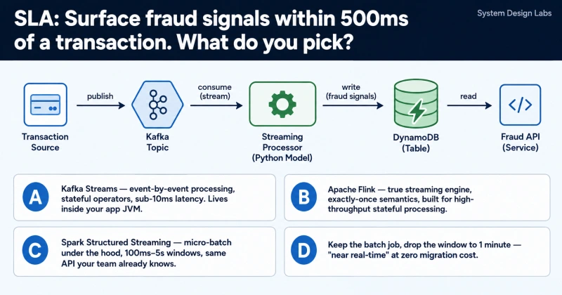

# Ngày 41: Moving from Batch to Real-Time Streaming

[← Ngày trước](day-40-offloading-heavy-work-off-the-main-thread.md) | [Mục lục](README.md) | [Ngày tiếp theo →](day-42-designing-memory-for-an-ai-agent.md)

---

# NGÀY 41 · THIẾT KẾ HỆ THỐNG (DAY 41 · SYSTEM DESIGN)

## Chuyển dịch từ Xử lý theo mẻ sang Luồng dữ liệu thời gian thực (Moving from Batch to Real-Time Streaming)

### Bối cảnh tình huống (Scenario)

Đội ngũ dữ liệu (data team) của bạn vừa nhận một cam kết chất lượng dịch vụ SLA (*Service Level Agreement*) mới: **phải phát hiện và hiển thị các tín hiệu gian lận (fraud signals) trong vòng 500ms kể từ khi giao dịch phát sinh**.

Hiện tại, bạn đang chạy các tác vụ xử lý theo mẻ định kỳ hàng đêm bằng Spark (*nightly Spark batch jobs*). Phía kinh doanh (*business*) yêu cầu phải đạt mức **"thời gian thực" (real-time)**. Đội ngũ của bạn đã rất quen thuộc và thành thạo với Spark. Đã có ai đó mở sẵn một Pull Request (PR) để thêm **Spark Structured Streaming**.

**Các thông số kỹ thuật:**
*   **Lưu lượng giao dịch (*Transaction volume*):** Đạt đỉnh 8.000 sự kiện/giây (*8,000 events/sec peak*).
*   **Hạ tầng:** Bạn đang triển khai trên nền tảng điện toán đám mây **AWS**.
*   **Mô hình phát hiện gian lận (*Fraud model*):** Được viết và chạy bằng **Python**.
*   **Đầu ra (*Output*):** Nạp dữ liệu vào một bảng **DynamoDB** để tầng API đọc trực tiếp từ đó.

Bạn cần phải thiết kế lại toàn bộ đường ống xử lý dữ liệu (*pipeline*). **Bạn sẽ chọn giải pháp nào?**

---

### Các phương án lựa chọn (Options)

*   **A) Kafka Streams** — Xử lý theo từng sự kiện (*event-by-event processing*), hỗ trợ các toán tử lưu trữ trạng thái (*stateful operators*), độ trễ dưới 10ms (*sub-10ms latency*). Chạy trực tiếp bên trong máy ảo Java của ứng dụng (*lives inside your app JVM*).
*   **B) Apache Flink** — Công cụ xử lý luồng thực thụ (*true streaming engine*), đảm bảo ngữ nghĩa xử lý chính xác một lần (*exactly-once semantics*), được kiến trúc chuyên biệt cho tác vụ xử lý có trạng thái với thông lượng cao (*high-throughput stateful processing*).
*   **C) Spark Structured Streaming** — Bản chất bên dưới vẫn là xử lý theo mẻ siêu nhỏ (*micro-batch under the hood*), kích thước cửa sổ từ 100ms–5s (*100ms–5s windows*), dùng chung API mà đội ngũ của bạn đã biết.
*   **D) Giữ nguyên tác vụ batch hiện tại, giảm kích thước cửa sổ gom mẻ xuống còn 1 phút** — Đạt mức "gần thời gian thực" (*near real-time*) với chi phí chuyển đổi hệ thống bằng 0 (*zero migration cost*).

---

# NGÀY 41 · ĐÁP ÁN & GIẢI THÍCH CHI TIẾT (DAY 41 · ANSWERS & EXPLANATIONS)

### Câu trả lời 1 (Answer 1)

> [!TIP]
> ### ✓ ĐÁP ÁN CHÍNH XÁC: B (Apache Flink)

#### Tại sao B chiến thắng (Why B wins - Apache Flink):
**Flink** là một công cụ xử lý luồng dữ liệu thực thụ (*true streaming engine*) — xử lý theo từng sự kiện đơn lẻ (*event-by-event*), chứ không phải theo mẻ (*not batch*). Mỗi giao dịch sẽ kích hoạt quy trình xử lý ngay khoảnh khắc nó vừa đến. 

*   **Độ trễ (*Latency*):** Có thể đạt mức **dưới 50ms từ đầu đến cuối (*sub-50ms end-to-end*)** nếu được tinh chỉnh cấu hình (*tuning*) đúng cách.
*   **Khả năng chịu tải:** Với lưu lượng **8.000 sự kiện/giây (8K events/sec)**, Flink xử lý vô cùng mượt mà mà không gặp bất kỳ trở ngại nào.
*   **Tính toàn vẹn dữ liệu:** Ngữ nghĩa xử lý chính xác một lần (*exactly-once semantics*) đảm bảo các tín hiệu gian lận không bị đếm trùng lặp (*double-counted*) khi có một node trong cụm gặp sự cố (*failover*).
*   **Tích hợp với mô hình Machine Learning:** Mô hình gian lận bằng Python có thể tích hợp trực tiếp thông qua **PyFlink** hoặc triển khai dưới dạng một vi dịch vụ đồng hành (*sidecar microservice*).
*   **Xử lý sai lệch thời gian:** Cơ chế đánh dấu mốc thời gian (*watermark model*) của Flink xử lý các sự kiện đến lệch thứ tự (*out-of-order events*) một cách chuẩn xác — điều này tối quan trọng khi các giao dịch được gửi đến từ nhiều cổng thanh toán phân tán (*distributed payment processors*) vốn luôn có độ lệch đồng hồ (*clock skew*).

Chi phí vận hành và độ phức tạp (*operational overhead*) là có thật. Tuy nhiên, cam kết SLA bắt buộc phải có nó. Bạn không hề lạm dụng Flink quá sớm (*reaching for Flink prematurely*) ở trường hợp này — nghiệp vụ kinh doanh yêu cầu phản hồi trong **500ms** và đưa ra lưu lượng tải **8.000 events/sec**. Đó chính xác là bài toán sinh ra để dành cho Flink giải quyết.

---

### Câu trả lời 2 (Answer 2)

#### Tại sao A suýt soát nhưng chưa phải là lựa chọn phù hợp nhất (Why A is close but not the cleanest fit - Kafka Streams):
**Kafka Streams** cũng xử lý theo từng sự kiện (*event-by-event*) — hoàn toàn có thể đạt mức độ trễ dưới 10ms (*sub-10ms achievable*). 

**Rào cản ở đây:** Kafka Streams chạy bên trong máy ảo Java của ứng dụng (*application JVM*). Trong khi đó, mô hình phát hiện gian lận của bạn lại được viết bằng **Python**. Điều này đồng nghĩa với việc Kafka Streams sẽ quản lý luồng dữ liệu (*stream topology*), nhưng logic chấm điểm mô hình (*model scoring*) lại phải nằm ở một service Python tách biệt, gây phát sinh thêm một chặng truyền thông qua mạng (*network hop*). Flink giải quyết ranh giới này mượt mà hơn nhờ **PyFlink**. 

Kafka Streams là quyết định chuẩn xác nếu toàn bộ logic gian lận là các phép tổng hợp có trạng thái thuần JVM (*stateful JVM-native aggregation*). Nhưng nó sẽ là lựa chọn mặc định sai lầm khi mô hình phân tích là một Python service.

---

### Câu trả lời 3 (Answer 3)

> [!WARNING]
> #### Tại sao C là cái bẫy dành cho Kỹ sư cấp cao (Why C is the senior engineer trap - Spark Structured Streaming):
> Pull Request (PR) đã được mở sẵn. Giao diện lập trình (API) trông rất quen thuộc. Nhưng Structured Streaming bản chất bên dưới vẫn là **xử lý mẻ siêu nhỏ (*micro-batch*)** — nó gom các sự kiện lại trong một khoảng thời gian kích hoạt (*trigger interval* - trên thực tế môi trường production thường dao động từ **100ms đến 5 giây**), sau đó mới xử lý chúng như một mẻ thu nhỏ (*mini-batch*). 
> 
> Bạn có thể tinh chỉnh cấu hình, nó có thể vượt qua môi trường kiểm thử (staging), nhưng chắc chắn nó sẽ **vi phạm cam kết SLA (breach SLA)** ngay trong lần đầu tiên chạm đỉnh tải (*peak traffic*). 
> 
> Nhầm lẫn chữ "Streaming" trong tên gọi với bản chất xử lý thực tế theo từng sự kiện (*event-by-event processing*) chính là cái bẫy chết người.

---

### Câu trả lời 4 (Answer 4)

#### Tại sao D bị loại bỏ ngay lập tức (Why D is eliminated immediately - batch, 1-minute windows):
Độ trễ tối thiểu (*minimum latency*) luôn bằng chính kích thước của cửa sổ gom mẻ (*window size*). 

Ở mức 60 giây, bạn đã **vượt quá giới hạn SLA gấp 120 lần** ngay cả trước khi dòng code logic kiểm tra gian lận đầu tiên được thực thi. "Gần thời gian thực" (*near real-time*) **không phải là một SLA hợp lệ**.

---

### Bảng đối chiếu tổng hợp kiến trúc (Architecture Comparison Table)

| Tiêu chí so sánh | A) Kafka Streams | B) Apache Flink (Winner) | C) Spark Structured Streaming | D) Batch (1-min Window) |
| :--- | :--- | :--- | :--- | :--- |
| **Mô hình xử lý (*Processing Model*)** | Theo từng sự kiện (*Event-by-event*) | Theo từng sự kiện thực thụ (*True streaming / Event-by-event*) | Xử lý mẻ siêu nhỏ (*Micro-batch*) | Xử lý theo mẻ thông thường (*Batch*) |
| **Độ trễ (*Latency*)** | Cực thấp (< 10ms) | Rất thấp (< 50ms end-to-end) | Trung bình (100ms – 5s) | Rất cao (≥ 60.000ms) |
| **Khả năng đáp ứng SLA 500ms** | Có thể, nhưng bị ảnh hưởng bởi network hop | **Hoàn toàn đáp ứng xuất sắc** | **Rất dễ vi phạm khi peak traffic** | **Vi phạm nghiêm trọng (trễ gấp 120 lần)** |
| **Tích hợp Python Model** | Cần gọi mạng sang Python service ngoại vi | Tích hợp sâu qua **PyFlink** hoặc Sidecar | Tích hợp qua PySpark nhưng gánh nặng micro-batch | Tích hợp qua Batch script |
| **Ngữ nghĩa xử lý (*Semantics*)** | Exactly-once | **Exactly-once** | Exactly-once | At-least-once / Idempotent |
| **Đánh giá chung** | Tốt cho hệ sinh thái thuần JVM | **Lựa chọn tối ưu nhất cho bài toán** | Cái bẫy "quen thuộc" của Senior | Loại ngay từ đầu |

---

[← Ngày trước](day-40-offloading-heavy-work-off-the-main-thread.md) | [Mục lục](README.md) | [Ngày tiếp theo →](day-42-designing-memory-for-an-ai-agent.md)
