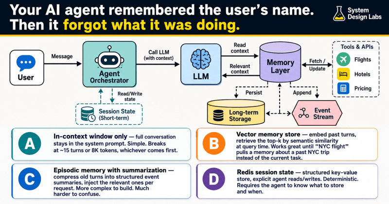

# Ngày 42: Designing Memory for an AI Agent

[← Ngày trước](day-41-moving-from-batch-to-real-time-streaming.md) | [Mục lục](README.md) | [Ngày tiếp theo →](day-43-reliable-cdn-cache-invalidation-on-deploy.md)

---

# NGÀY 42 · THIẾT KẾ HỆ THỐNG (SYSTEM DESIGN)
## Thiết Kế Bộ Nhớ Cho AI Agent (Designing Memory for an AI Agent)

> **Tình huống thực tế:**  
> AI agent của bạn nhớ được tên người dùng.  
> Nhưng sau đó nó quên mất nó đang làm gì.

### Bối cảnh bài toán:
Người dùng yêu cầu agent: đặt chuyến bay rẻ nhất tới NYC, tìm kiếm khách sạn dưới $150/đêm, sau đó so sánh tổng chi phí chuyến đi.

Đến bước thứ 3, agent gọi LLM với **8.000 tokens** lịch sử hội thoại thô (*raw conversation history*) — và nó vẫn trả lời như thể đây mới là lượt tương tác đầu tiên (*turn 1*).

Bạn cần một kiến trúc bộ nhớ (*memory architecture*) trước khi đưa tính năng này lên production. Bạn sẽ chọn phương án nào?

---

### Các Phương Án Lựa Chọn:

* **A) Chỉ dùng cửa sổ ngữ cảnh (In-context window only)**  
  Toàn bộ cuộc hội thoại được giữ trong *system prompt*. Đơn giản. Bị vỡ/quá tải ở khoảng ~15 lượt hội thoại (*turns*) hoặc chạm ngưỡng 8K tokens, tùy điều kiện nào đến trước.

* **B) Kho lưu trữ bộ nhớ vector (Vector memory store)**  
  Tạo vector nhúng (*embed*) các lượt hội thoại trước đó, truy xuất top-$k$ theo độ tương đồng ngữ nghĩa (*semantic similarity*) tại thời điểm truy vấn (*query time*). Hoạt động rất tốt cho đến khi cụm từ *"chuyến bay NYC"* lại truy xuất ra ký ức về một chuyến đi NYC trong quá khứ thay vì tác vụ hiện tại.

* **C) Bộ nhớ tình tiết kết hợp tóm tắt (Episodic memory with summarization)**  
  Nén các lượt hội thoại cũ thành các bản tóm tắt sự kiện có cấu trúc (*structured event summaries*), nạp (*inject*) các tóm tắt liên quan vào ngữ cảnh theo từng yêu cầu. Phức tạp hơn khi xây dựng. Khó bị nhầm lẫn hơn rất nhiều.

* **D) Trạng thái phiên làm việc trên Redis (Redis session state)**  
  Kho lưu trữ khóa - giá trị có cấu trúc (*structured key-value store*), agent thực hiện các thao tác đọc/ghi tường minh (*explicit reads/writes*). Mang tính tất định (*deterministic*). Đòi hỏi agent phải biết chính xác cần lưu trữ cái gì và lưu vào lúc nào.

---

# NGÀY 42 · ĐÁP ÁN & GIẢI THÍCH CHI TIẾT (ANSWERS & EXPLANATIONS)

---

### Phân tích Đáp án 1

> [!TIP]
> ### ✓ CÂU TRẢ LỜI ĐÚNG: C — Bộ nhớ tình tiết kết hợp tóm tắt (Episodic memory with summarization)

Đây là câu trả lời chính xác cho các agent định hướng tác vụ (*task-oriented agents*). Mô hình chuẩn (*pattern*) hoạt động như sau:

* $\rightarrow$ **Giữ $N$ lượt hội thoại gần nhất trong context** (*bộ nhớ ngắn hạn - short-term*)
* $\rightarrow$ **Nén các lượt hội thoại cũ hơn thành các bản tóm tắt sự kiện có cấu trúc** (*bộ nhớ tình tiết - episodic*)
* $\rightarrow$ **Chỉ nạp (*inject*) các bản tóm tắt liên quan theo từng yêu cầu mới**

Đây chính là kiến trúc mà các production agent tại **Anthropic**, **LangChain Memory v2**, và **OpenAI Assistants API** đều hội tụ về. 

Chi phí kỹ thuật ban đầu (*engineering upfront*) sẽ cao hơn — nhưng đây là mô hình duy nhất có khả năng suy giảm hiệu năng có kiểm soát và mượt mà (*degrades gracefully*) khi mở rộng quy mô (*at scale*).

---

### Phân tích Đáp án 2

> [!WARNING]
> ### A — Chỉ dùng cửa sổ ngữ cảnh (In-context window only)

Sụp đổ rất nhanh. Tại ngưỡng ~15 lượt hội thoại (*turns*) hoặc 8K tokens, bạn sẽ rơi vào tình thế: hoặc phải cắt cụt (*truncate*) ngữ cảnh ban đầu, hoặc chạm trần giới hạn context của mô hình (*model's limit*).

* Phương án này dùng được cho các bản demo.
* Thất bại hoàn toàn trên các production agent xử lý tác vụ đa bước (*multi-step tasks*).
* Luận điểm *"chỉ cần tăng độ dài ngữ cảnh (context length)"* đã hoàn toàn bỏ qua yếu tố chi phí (*cost*) và **vấn đề thất lạc thông tin ở giữa (*lost-in-the-middle problem*)** — các LLM thường xuyên bỏ qua các nội dung bị vùi lấp ở giữa các prompt dài một cách có hệ thống.

---

### Phân tích Đáp án 3

> [!CAUTION]
> ### B — Kho lưu trữ bộ nhớ vector (Vector memory store) — *Cạm bẫy thiết kế (The Trap Answer)*

Vấn đề truy xuất (*retrieval problem*) hiểm hóc và phức tạp hơn vẻ ngoài của nó rất nhiều:
* **Độ tương đồng ngữ nghĩa (*semantic similarity*) KHÔNG đồng nghĩa với mức độ liên quan của tác vụ (*task relevance*).**
* Trong một tác vụ đặt vé/phòng đa bước (*multi-step booking task*), việc embedding câu lệnh *"tìm khách sạn dưới $150"* có thể sẽ truy xuất nhầm một ký ức từ một session của người dùng khác — hoặc một cuộc hội thoại trong quá khứ về một thành phố hoàn toàn khác.
* Giải pháp này rất tuyệt vời cho việc **truy xuất tri thức (*knowledge retrieval / RAG*)**, nhưng cực kỳ **kém tin cậy đối với trạng thái tác vụ theo quy trình (*procedural task state*)**.

---

### Phân tích Đáp án 4

> [!NOTE]
> ### D — Trạng thái phiên làm việc trên Redis (Redis session state)

Rất vững chắc (*solid*) và mang tính tất định (*deterministic*).

Tuy nhiên điểm vướng mắc (*the catch*) là:
* Agent phải chủ động và tường minh đưa ra quyết định **cần ghi dữ liệu gì vào state** và **khi nào thì đọc nó ra**.
* Đó là một bài toán thiết kế không hề đơn giản — bạn thực chất đang phải xây dựng một giao thức bộ nhớ làm việc (*working memory protocol*) chạy đè lên trên các lệnh gọi công cụ (*tool calls / function calling*).
* Hầu hết các đội ngũ kỹ thuật đều đánh giá thấp độ phức tạp của việc thiết kế schema (*schema design*) mà giải pháp này yêu cầu.

---

### Bảng Tổng Hợp So Sánh Kiến Trúc Bộ Nhớ (Architectural Trade-offs)

| Kiến Trúc Bộ Nhớ | Tính Tất Định (*Determinism*) | Chi Phí Token (*Token Overhead*) | Độ Phức Tạp Triển Khai | Phù Hợp Cho Production? |
| :--- | :---: | :---: | :---: | :---: |
| **A) In-context window** | Thấp | Rất cao | Rất thấp | ❌ Không (Chỉ cho Demo/Single-turn) |
| **B) Vector Store** | Không | Trung bình | Trung bình | ❌ Không (Chỉ hợp Knowledge Retrieval) |
| **C) Episodic + Summary** | Cao | Thấp - Tối ưu | Cao |  **Chuẩn Production cho Task Agent** |
| **D) Redis State** | Tuyệt đối | Cực thấp | Rất cao (Schema phức tạp) | ⚠️ Cần cân nhắc (State Machine cứng) |

---

[← Ngày trước](day-41-moving-from-batch-to-real-time-streaming.md) | [Mục lục](README.md) | [Ngày tiếp theo →](day-43-reliable-cdn-cache-invalidation-on-deploy.md)
