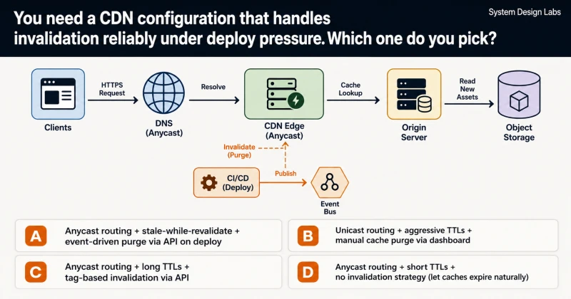

# Ngày 43: Reliable CDN Cache Invalidation on Deploy

[← Ngày trước](day-42-designing-memory-for-an-ai-agent.md) | [Mục lục](README.md) | [Ngày tiếp theo →](day-44-syncing-offline-edits-without-data-loss.md)

---

# NGÀY 43 · THIẾT KẾ HỆ THỐNG (SYSTEM DESIGN)

## Xóa Cache CDN Đáng Tin Cậy Khi Deploy (Reliable CDN Cache Invalidation on Deploy)

Hạ tầng CDN đã cứu bạn khỏi việc phải giải trình về thời gian tải trang (load time) lên tới **400ms** với Phó Chủ tịch (VP).

Thế rồi bản deploy của bạn được xuất xưởng (shipped). Và **chẳng ai nhận được bản vá lỗi (fix)** cả.

**Đây là những gì đã xảy ra:**
Các nút biên (edge nodes) của bạn vẫn đang phục vụ gói mã JavaScript cũ (old JS bundle) — thời gian sống (TTL - Time to Live) vẫn chưa hết hạn. Bạn đã kích hoạt thao tác xóa cache (cache purge) bằng tay. Nhưng bạn lại **bấm nhầm môi trường**. Kết quả là môi trường Production tiếp tục phục vụ phiên bản cũ kỹ (stale version) suốt **6 tiếng đồng hồ** tiếp theo.

> [!WARNING]
> Bạn cần một cấu hình CDN có khả năng xử lý việc vô hiệu hóa cache (invalidation) một cách đáng tin cậy ngay cả dưới áp lực căng thẳng của quá trình deploy. Bạn sẽ chọn phương án nào?

---

### Các phương án lựa chọn:

- **A)** Định tuyến Anycast (Anycast routing) + `stale-while-revalidate` + Xóa cache hướng sự kiện qua API khi deploy (event-driven purge via API on deploy)
- **B)** Định tuyến Unicast (Unicast routing) + Thiết lập TTL ngắn quyết liệt (aggressive TTLs) + Xóa cache thủ công qua bảng điều khiển (manual cache purge via dashboard)
- **C)** Định tuyến Anycast (Anycast routing) + Thiết lập TTL dài (long TTLs) + Vô hiệu hóa cache dựa trên thẻ qua API (tag-based invalidation via API)
- **D)** Định tuyến Anycast (Anycast routing) + Thiết lập TTL ngắn (short TTLs) + Không dùng chiến lược vô hiệu hóa (no invalidation strategy - để cache tự hết hạn tự nhiên)

---

# NGÀY 43 · ĐÁP ÁN & GIẢI THÍCH CHI TIẾT

## Câu trả lời 1

> [!TIP]
> ### ✓ ĐÁP ÁN ĐÚNG
> **A — Định tuyến Anycast + stale-while-revalidate + Xóa cache hướng sự kiện (event-driven purge) — Đây là câu trả lời chính xác.**

* **Định tuyến Anycast (Anycast routing):** Quảng bá cùng một địa chỉ IP từ nhiều điểm hiện diện (PoPs - Points of Presence). Giao thức định tuyến biên (BGP - Border Gateway Protocol) sẽ tự động điều hướng từng người dùng đến nút biên (edge) gần nhất. Người dùng ở Tokyo sẽ truy cập vào edge Tokyo — chứ không phải vòng sang Virginia.
* **Cơ chế `stale-while-revalidate`:** Phục vụ phiên bản đã được lưu trong cache ngay lập tức, đồng thời âm thầm tải một bản sao mới (fresh copy) ở chế độ nền (background). Nhờ đó, người dùng không bao giờ phải chờ đợi quá trình xử lý khi xảy ra hụt cache (cache miss).
* **Xóa cache hướng sự kiện (Event-driven purge):** Đường ống dẫn triển khai tự động (CI/CD pipeline) của bạn sẽ kích hoạt một lệnh gọi API đến Cloudflare hoặc CloudFront vào mỗi lần deploy, nhắm mục tiêu chính xác vào đúng các tài nguyên (assets) đã thay đổi. **Không có thao tác thủ công. Không có chuyện click nhầm môi trường. Không còn những sai sót ngớ ngẩn lúc 2 giờ sáng.**

---

## Câu trả lời 2

### C — Anycast + TTL dài + Vô hiệu hóa dựa trên thẻ (tag-based invalidation) — Rất vững chắc, nhưng ẩn chứa một cái bẫy

* **Vô hiệu hóa dựa trên thẻ (Tag-based invalidation):** (Ví dụ: `Cache-Tag` của Cloudflare, surrogate keys của Fastly) cho phép bạn gom nhóm các đối tượng và xóa toàn bộ các nhóm logic đó chỉ trong **một lệnh gọi API duy nhất**. Có ảnh sản phẩm mới? Chỉ cần vô hiệu hóa `tag:product-images`. Vừa sạch sẽ vừa chuẩn xác như phẫu thuật (surgical).
* **Cái bẫy nằm ở đây:** Thiết lập TTL dài hoạt động hoàn hảo khi pipeline triển khai của bạn vận hành trơn tru. Nhưng nếu lệnh gọi API vô hiệu hóa cache bị lỗi trong âm thầm (fails silently) giữa lúc sự cố xảy ra — đúng vào thời điểm bạn phải thao tác nhanh nhất — thì bạn sẽ rơi vào cảnh phục vụ sai phiên bản suốt nhiều giờ liền mà **không có cơ chế dự phòng từ TTL (TTL fallback) để cứu bạn**.

> [!NOTE]
> Cơ chế `stale-while-revalidate` của **Phương án A** có khả năng hạ cấp mềm dẻo, duy trì độ ổn định tốt hơn (degrades more gracefully) khi pipeline của bạn gặp trục trặc.

---

## Câu trả lời 3

### B — Unicast + TTL ngắn quyết liệt + Xóa thủ công (manual purge)

* **Định tuyến Unicast (Unicast routing):** Đồng nghĩa với việc bạn chỉ có một vùng biên (single edge region). Người dùng ở Tokyo của bạn đang bị định tuyến sang tận Virginia. Bạn triển khai một CDN nhưng thực tế lại đang định tuyến vượt qua (bỏ qua) hiệu năng của nó.
* **Xóa cache thủ công trên Dashboard trong khi deploy:** Chắc chắn sẽ có ai đó quên làm, bấm nhầm môi trường, hoặc bỏ qua hoàn toàn bước này vào lúc 2 giờ sáng.
* Việc cấu hình TTL ngắn quyết liệt (aggressive TTLs) có thể thu hẹp khoảng thời gian chịu thiệt hại — nhưng chúng **không làm cho việc vô hiệu hóa cache trở nên đáng tin cậy**.

---

## Câu trả lời 4

### D — TTL ngắn, không có chiến lược vô hiệu hóa (no invalidation)

> [!CAUTION]
> *"TTL ngắn = Dữ liệu luôn luôn mới"* chính là **quan niệm sai lầm tốn kém nhất** trong việc cấu hình CDN.

* Mỗi lần TTL hết hạn là một nguy cơ tiềm tàng dẫn đến hiện tượng **Cache Stampede** (sụp đổ do quá tải cache đồng loạt).
* Hãy hình dung kịch bản: **200k RPS (Requests Per Second)** tại thời điểm cao điểm (peak), TTL hết hạn trên một endpoint "nóng" (hot endpoint), mọi PoP trên toàn cầu sẽ đồng loạt gửi yêu cầu về máy chủ gốc (origin server). Hệ thống của bạn sẽ vọt từ **0 lên 200k RPS chỉ trong 2 giây**.
* Chưa kể, bạn sẽ hoàn toàn **không có quyền kiểm soát** đối với các bản vá khẩn cấp (hotfixes). Bạn chỉ biết bất lực ngồi chờ cho đến khi toàn bộ TTL tự cạn kiệt.

---

[← Ngày trước](day-42-designing-memory-for-an-ai-agent.md) | [Mục lục](README.md) | [Ngày tiếp theo →](day-44-syncing-offline-edits-without-data-loss.md)
