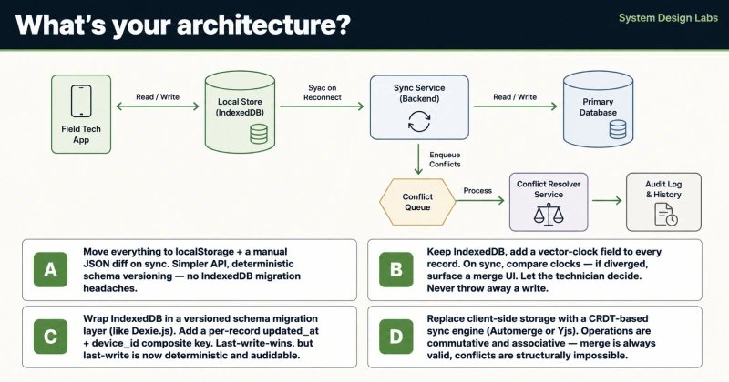

# Ngày 44: Syncing Offline Edits Without Data Loss

[← Ngày trước](day-43-reliable-cdn-cache-invalidation-on-deploy.md) | [Mục lục](README.md) | [Ngày tiếp theo →](day-45-scaling-full-text-search.md)

---

# NGÀY 44 · SYSTEM DESIGN (THIẾT KẾ HỆ THỐNG)
## Đồng bộ hóa các chỉnh sửa ngoại tuyến (Offline Edits) mà không làm mất dữ liệu (Without Data Loss)

> [!NOTE]  
> **Bối cảnh tình huống:**  
> Đội ngũ của bạn vừa phát hành "chế độ ngoại tuyến" (*offline mode*) cho ứng dụng dịch vụ hiện trường (*field-service app*).  
> Các kỹ thuật viên làm việc dưới tầng hầm, đường hầm, sàn nhà máy — nơi kết nối mạng cực kỳ chập chờn và không đáng tin cậy.

Bản demo trông rất tuyệt vời: `Navigator.onLine` báo `false`, ứng dụng vẫn tiếp tục hoạt động trơn tru, nút đồng bộ (*sync button*) nhấp nháy xanh lá.

Bạn đã triển khai ứng dụng tới 400 người dùng.

Sau đó, các báo cáo sự cố (*incident reports*) bắt đầu dồn dập kéo đến:
* **Kỹ thuật viên tại Munich** hoàn thành một công việc sửa chữa ở chế độ ngoại tuyến, sau đó đồng bộ khi bắt được sóng. Toàn bộ các cập nhật của cô ấy biến mất — bị ghi đè (*overwritten*) bởi một đồng nghiệp đã chỉnh sửa cùng bản ghi đó trực tuyến trước đó 12 phút. Cơ chế *Last-Write-Wins* (ghi đè theo lần ghi cuối). Bản ghi của cô ấy đã bị mất (*lost write*).
* **Kỹ thuật viên tại São Paulo** mở ứng dụng, ngắt kết nối mạng, chỉnh sửa ba tài sản (*assets*). Khi trực tuyến trở lại, ứng dụng quăng ra lỗi *Unhandled Promise Rejection* và sập hoàn toàn (*crash*). Lược đồ cơ sở dữ liệu IndexedDB của máy anh ta đang ở phiên bản 2 (version 2), trong khi bản cập nhật vừa phát hành phiên bản 3 (version 3). Quá trình di chuyển dữ liệu (*schema migration*) chưa từng được chạy vì anh ta chưa bao giờ mở ứng dụng khi đang có mạng.

Giờ đây, bạn được yêu cầu phải khắc phục triệt để kiến trúc ưu tiên ngoại tuyến (*offline-first*) trong thực tế — chứ không phải chỉ làm bản demo biểu diễn.

---

### Thiết lập bài toán (The Setup):

* **400 kỹ thuật viên hiện trường**, khoảng thời gian ngoại tuyến trung bình (*avg offline window*) là **40 phút**.
* Xung đột ghi (*write conflicts*) xảy ra **~3 lần mỗi ngày**, luôn rơi vào cùng **8 tài sản "nóng"** (*hot assets*).
* Cơ chế đồng bộ hiện tại chạy khi kết nối lại thông qua một yêu cầu `POST` hàng loạt đơn lẻ (*single bulk POST*).
* **IndexedDB** đang được sử dụng ở máy khách, nhưng quy trình di chuyển lược đồ (*schema migrations*) không hề có tài liệu hướng dẫn.
* Bạn cần giải quyết: **giải quyết xung đột** (*conflict resolution*), **an toàn khi di chuyển lược đồ** (*migration safety*), và **độ tin cậy của việc đồng bộ** (*sync reliability*).

---

### Kiến trúc của bạn là gì?

* **A)** Chuyển toàn bộ sang `localStorage` + thực hiện so khớp khác biệt JSON thủ công (*manual JSON diff*) khi đồng bộ. API đơn giản hơn, quản lý phiên bản lược đồ mang tính tất định (*deterministic schema versioning*) — không còn cơn đau đầu về migration trên IndexedDB.
* **B)** Giữ lại `IndexedDB`, thêm trường đồng hồ vector (*vector-clock field*) vào mỗi bản ghi. Khi đồng bộ, so sánh các đồng hồ — nếu bị phân nhánh (*diverged*), hiển thị giao diện hợp nhất (*merge UI*). Để kỹ thuật viên tự quyết định. Không bao giờ vứt bỏ bất kỳ lượt ghi nào.
* **C)** Bọc `IndexedDB` trong một tầng di chuyển lược đồ có quản lý phiên bản (như *Dexie.js*). Thêm khóa kết hợp (*composite key*) `updated_at` + `device_id` trên từng bản ghi. Áp dụng *Last-Write-Wins*, nhưng lần ghi cuối giờ đây mang tính tất định (*deterministic*) và có thể kiểm toán được (*auditable*).
* **D)** Thay thế bộ lưu trữ phía máy khách bằng một công cụ đồng bộ hóa dựa trên CRDT (*CRDT-based sync engine* như **Automerge** hoặc **Yjs**). Các thao tác có tính giao hoán (*commutative*) và kết hợp (*associative*) — quá trình hợp nhất (*merge*) luôn luôn hợp lệ, xung đột về mặt cấu trúc là bất khả thi (*structurally impossible*).

---

# CÂU TRẢ LỜI & GIẢI THÍCH CHI TIẾT (ANSWERS & EXPLANATIONS)

## Câu trả lời 1: ✓ CÂU TRẢ LỜI ĐÚNG (CORRECT ANSWER)

### Tại sao D chiến thắng (Công cụ CRDT — Automerge / Yjs):
**CRDTs (Conflict-free Replicated Data Types - Các kiểu dữ liệu sao chép không xung đột)** là phương pháp duy nhất mà ở đó việc hợp nhất (*merge*) được đảm bảo về mặt toán học là sẽ tạo ra cùng một kết quả bất kể thứ tự các thao tác gửi đến. Chúng có tính **giao hoán** (*commutative*), **kết hợp** (*associative*), và **khả đẵng** (*idempotent*).

Hai kỹ thuật viên có thể cùng chỉnh sửa một bản ghi tài sản ngoại tuyến trong vòng 6 giờ, đồng bộ theo bất kỳ thứ tự nào — và trạng thái cuối cùng luôn luôn mang tính tất định (*deterministic*). Không cần giao diện hợp nhất (*merge UI*). Không cần logic phân xử "ai thắng". Không mất dữ liệu (*no data loss*).

* **Linear** sử dụng Automerge.
* **Figma** sử dụng một CRDT tùy biến cho tính năng nhiều người cùng thao tác (*multiplayer*).
* **Notion** chạy mô hình tương tự cho kho lưu trữ khối dữ liệu (*block store*) của họ.

Đây không phải là giải pháp kỹ thuật thái quá (*overengineering*) — đây chính là đích đến mà các đội ngũ kỹ sư lựa chọn sau khi đã thử qua mọi phương án khác.

> [!NOTE]  
> **Đánh đổi (Tradeoff):**  
> Kích thước gói tin (*payload*) của CRDT sẽ lớn hơn (vì chúng phải mang theo lịch sử thao tác - *operation history*). `Yjs` nhẹ hơn `Automerge` trong hầu hết các trường hợp. Logic hợp nhất phía máy chủ (*server-side merge logic*) cần phải hiểu được các thao tác CRDT (*CRDT ops*), chứ không đơn thuần chỉ là ghi đè các hàng trong cơ sở dữ liệu.

---

## Câu trả lời 2: Lựa chọn thứ hai chính xác (The Correct Second Choice)

### Tại sao B là lựa chọn thứ hai đúng đắn (Vector Clocks + Merge UI):
**Đồng hồ vector (Vector clocks)** phát hiện chính xác thời điểm xảy ra xung đột — thiết bị nào đã ghi nội dung gì và theo thứ tự nào. Khi phát hiện phân nhánh, bạn hiển thị một giao diện hợp nhất (*merge UI*) và để kỹ thuật viên tự quyết định.

Đây là câu trả lời đúng khi **bắt buộc phải có con người tham gia vào quy trình quyết định** (*humans in the loop*). Ví dụ: Một kỹ thuật viên đánh dấu tài sản là "đã kiểm tra" (*inspected*) trong khi một người khác lại đánh dấu là "cần sửa chữa" (*needs repair*) — đó không phải là một xung đột mà thuật toán nên tự động giải quyết.

> [!WARNING]  
> **Đánh đổi (Tradeoff):**  
> Mỗi xung đột đều đòi hỏi hành động can thiệp của người dùng. Ở mức **3 lần/ngày**, khối lượng này hoàn toàn có thể kiểm soát được. Nhưng ở mức **300 lần/ngày**, nó sẽ biến thành một cơn ác mộng hỗ trợ kỹ thuật (*support nightmare*).

---

## Câu trả lời 3: Tốt nhưng chưa đủ (Good But Not Enough)

### Tại sao C tốt nhưng chưa đủ (IndexedDB có quản lý phiên bản + LWW):
`Dexie.js` giúp việc di chuyển lược đồ (*schema migrations*) trên IndexedDB thực sự dễ quản lý hơn. Cơ chế LWW (*Last-Write-Wins*) kết hợp với khóa tổng hợp tất định (`updated_at` + `device_id`) đạt chuẩn dùng cho môi trường thực tế (*production-grade*).

Tuy nhiên, **LWW lại vứt bỏ các lượt ghi thực tế của người dùng**. Kỹ thuật viên ở Munich luôn luôn bị xử thua trước bất kỳ ai chạm vào cùng một bản ghi trực tuyến trong khoảng thời gian chờ đợi. Trong một ứng dụng dịch vụ hiện trường, nơi trạng thái "đã kiểm tra" so với "chưa kiểm tra" có những hệ lụy ràng buộc về mặt pháp lý/quy chuẩn (*regulatory consequences*) — thì việc mất dữ liệu đó là điều bạn không thể chấp nhận.

> [!IMPORTANT]  
> LWW hoạt động tốt khi chi phí của việc mất một lượt ghi là thấp (chẳng hạn như tùy chọn giao diện UI). Nhưng nó sẽ đổ vỡ hoàn toàn khi mỗi lượt ghi đều mang ý nghĩa vận hành sống còn (*operational meaning*).

---

## Câu trả lời 4: Phương án thất bại (Fails)

### Tại sao A thất bại (localStorage + JSON diff):
* **`localStorage` bị giới hạn cứng ở mức ~5MB.** Chỉ cần tới 200 bản ghi kèm siêu dữ liệu đính kèm (*attachment metadata*), bạn sẽ chạm giới hạn này — và bị lỗi một cách âm thầm (*silently*), không hề có thông báo lỗi hữu ích nào trên các phiên bản Chrome cũ.
* Không hỗ trợ đánh chỉ mục (*no indexing*). Không hỗ trợ truy vấn theo khoảng (*no range queries*).
* Trong chế độ ẩn danh/riêng tư (*private/incognito mode*), phạm vi của nó bị giới hạn theo từng tab (*per-tab*) và sẽ bị xóa sạch ngay khi đóng tab.
* Cơ chế so khớp **JSON diff** sẽ sụp đổ khi gặp các mảng lồng nhau (*nested arrays*), cập nhật từng phần trường dữ liệu (*partial field updates*), và các thao tác xóa (*deletions*). Cuối cùng, bạn sẽ phải tự tay xây dựng một phiên bản mini-CRDT chắp vá mà không hề có các bảo đảm toán học vững chắc.

> [!CAUTION]  
> Phương án này có thể hoạt động tốt trong một bản nguyên mẫu làm trong kỳ nghỉ cuối tuần (*weekend prototype*), nhưng sẽ âm thầm làm sai lệch dữ liệu (*corrupts silently*) khi đưa vào môi trường thực tế (*production*).

---

### Bảng tổng hợp so sánh các phương án kiến trúc

| Tiêu chí / Giải pháp | A) localStorage + JSON diff | B) Vector Clocks + Merge UI | C) Dexie.js (IndexedDB) + LWW | D) CRDT (Automerge / Yjs) [Khuyên dùng] |
| :--- | :--- | :--- | :--- | :--- |
| **Bảo toàn dữ liệu** | Kém (dễ mất mát/lỗi âm thầm) | Rất cao (con người can thiệp) | Kém (bị mất các write cũ) | Tuyệt đối (đảm bảo toán học) |
| **Giải quyết xung đột** | Thủ công, dễ lỗi với mảng lồng | Thủ công qua Merge UI | Tự động (bỏ rơi write cũ) | Tự động không cần người can thiệp |
| **Trải nghiệm người dùng (UX)**| Rất tệ khi lỗi | Cần can thiệp khi có xung đột | Mượt mà nhưng âm thầm mất dữ liệu | Mượt mà, hoàn toàn trong suốt |
| **Độ phức tạp di chuyển DB**| Thấp | Trung bình | Giải quyết tốt qua Dexie.js | Độc lập với schema storage nhờ Ops log |
| **Đánh đổi chính** | Giới hạn 5MB, không index | Quá tải hỗ trợ nếu tần suất cao | Vi phạm nghiệp vụ tuân thủ (*compliance*) | Payload lớn hơn, Server cần hiểu CRDT Ops |

---

[← Ngày trước](day-43-reliable-cdn-cache-invalidation-on-deploy.md) | [Mục lục](README.md) | [Ngày tiếp theo →](day-45-scaling-full-text-search.md)
