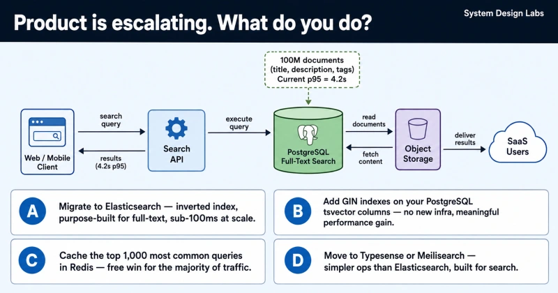
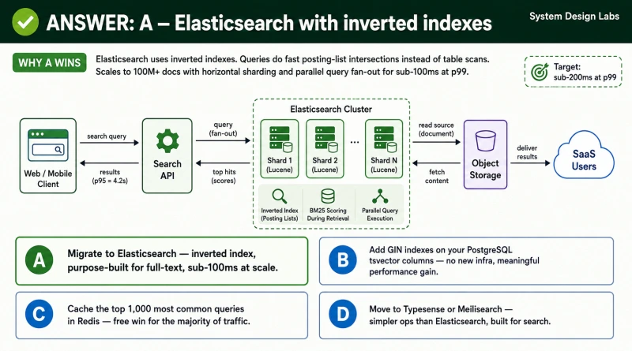

# Ngày 45: Scaling Full-Text Search

[← Ngày trước](day-44-syncing-offline-edits-without-data-loss.md) | [Mục lục](README.md) | [Ngày tiếp theo →](day-46-enforcing-structured-output-from-an-llm.md)

---

# DAY 45 · THIẾT KẾ HỆ THỐNG (SYSTEM DESIGN)
## Mở rộng quy mô tìm kiếm toàn văn (Scaling Full-Text Search)

Hộp tìm kiếm của bạn trả về kết quả trong vòng **80ms**.  
Sau đó bạn nạp thêm **50 triệu (50M)** tài liệu nữa. Giờ đây thời gian phản hồi là **4 giây**.  
DBA của bạn bảo: *"Thêm index đi."* Kỹ sư tìm kiếm (Search Engineer) của bạn lại nói: *"Cơ chế này không hoạt động như thế đâu."*  
Cả hai người họ đều đúng — nhưng là về những khía cạnh khác nhau.

### Bối cảnh bài toán (The Setup):
* **Nền tảng (Platform):** Sản phẩm SaaS, quy mô 100 triệu (100M) tài liệu.
* **Các trường tìm kiếm (Search fields):** Tiêu đề (`title`), mô tả (`description`), thẻ (`tags`), cụm từ khớp một phần (`partial phrases`).
* **Công nghệ hiện tại (Current stack):** PostgreSQL full-text search.
* **Hiệu năng hiện tại (Current perf):** p95 = **4.2s**.
* **Mục tiêu (Target):** Dưới 200ms (**sub-200ms**) ở phân vị **p99**.

Đội ngũ Sản phẩm (Product) đang leo thang vấn đề (escalating). **Bạn sẽ làm gì?**

---

### Các phương án lựa chọn:

* **A. Chuyển đổi sang Elasticsearch (Migrate to Elasticsearch):**  
  Sử dụng chỉ mục đảo (**Inverted Index**), được xây dựng chuyên biệt cho tìm kiếm toàn văn (**Full-Text Search**), đạt hiệu năng dưới 100ms (**sub-100ms**) ở quy mô lớn.

* **B. Thêm GIN index vào các cột `tsvector` trên PostgreSQL (Add GIN indexes on your PostgreSQL tsvector columns):**  
  Không phát sinh hạ tầng mới (**no new infra**), mang lại sự cải thiện hiệu năng rõ rệt.

* **C. Lưu bộ nhớ đệm (cache) cho 1.000 truy vấn phổ biến nhất vào Redis (Cache the top 1,000 most common queries in Redis):**  
  Một chiến thắng miễn phí (**free win**) cho phần lớn lưu lượng truy cập (traffic).

* **D. Chuyển sang Typesense hoặc Meilisearch (Move to Typesense or Meilisearch):**  
  Vận hành đơn giản hơn Elasticsearch, được thiết kế chuyên biệt cho tìm kiếm.

---

# DAY 45 · ĐÁP ÁN & GIẢI THÍCH CHI TIẾT (ANSWERS & EXPLANATIONS)

## Đáp án 1:
> [!NOTE]  
> **✓ CÂU TRẢ LỜI ĐÚNG: A**

### Vì sao phương án A chiến thắng (Elasticsearch):
**Elasticsearch** được xây dựng dựa trên cấu trúc **Chỉ mục đảo (Inverted Index)**. Khi bạn đánh chỉ mục (index) một tài liệu, Elasticsearch sẽ tách từ (tokenize) văn bản và ghi vào các danh sách vị trí (**posting lists**): 
* `"database"` → `[doc_1, doc_5, doc_23...]`
* `"index"` → `[doc_2, doc_5, doc_18...]`

Một truy vấn tìm kiếm `"database index"` sẽ thực hiện thao tác **giao nhau giữa các posting list (posting-list intersection)** cực nhanh — thay vì phải quét toàn bộ bảng (**table scan**).

Ở quy mô **100 triệu tài liệu (100M documents)**, phép giao đó vẫn chạy trong vài mili-giây vì:
1. Các **posting lists** được lưu trữ dưới dạng đã sắp xếp và nén vi sai (**delta-compressed sorted form**).
2. Các phân đoạn **Lucene segments** là bất biến (**immutable**) — loại bỏ hoàn toàn việc khóa dòng (**row locking**) hay chi phí quản lý đa phiên bản (**MVCC overhead**).
3. Hỗ trợ phân mảnh ngang tự nhiên (**Native Horizontal Sharding**) — các truy vấn được phân tán và xử lý song song (**fan out in parallel**).
4. Thuật toán chấm điểm mức độ phù hợp **BM25 scoring** được thực thi trực tiếp ngay trong quá trình truy xuất (**retrieval**) — chứ không phải tính toán sau khi truy xuất.

**Kết quả:** Đạt **dưới 100ms ở p99**, ngay cả ở quy mô trên 100 triệu tài liệu, miễn là kích thước phân mảnh (**shard sizing**) được thiết kế hợp lý. **Netflix, Uber và GitHub** đều đang vận hành một biến thể nào đó của kiến trúc này tại tầng tìm kiếm của họ.

> [!WARNING]  
> **Đánh đổi kiến trúc bạn phải chấp nhận (Tradeoffs):** 
> * Hạ tầng mới cần phải vận hành (quản lý vòng đời index - *Index Lifecycle Management*, tái cân bằng phân mảnh - *Shard Rebalancing*).
> * Khuếch đại ghi (**Write Amplification**) do quá trình hợp nhất phân đoạn (*Segment Merging*).
> * Tính nhất quán cuối cùng (**Eventual Consistency**) — theo mặc định, các tài liệu mới được đánh chỉ mục sẽ không thể tìm kiếm ngay lập tức trong khoảng **~1 giây**.

---

## Đáp án 2:
> [!WARNING]  
> **Vì sao B là phương án cạm bẫy (GIN indexes trên PostgreSQL):**

Chỉ mục **GIN (Generalized Inverted Index)** trên kiểu dữ liệu `tsvector` thực sự rất tốt. Với quy mô từ **1M – 5M tài liệu**, đây là lựa chọn hoàn toàn chuẩn xác — không tốn thêm hạ tầng mới, không phát sinh gánh nặng vận hành (**ops burden**), và đem lại sự cải thiện hiệu năng rõ rệt.

Tuy nhiên, ở quy mô **100 triệu tài liệu**, bạn sẽ đâm phải ba bức tường giới hạn:
1. **Dung lượng index phình to khủng khiếp:** Chỉ mục GIN rất lớn — dễ dàng chiếm tới **40–80GB**.
2. **Khả năng mở rộng đọc theo chiều ngang:** Tìm kiếm toàn văn trên PostgreSQL không có khả năng mở rộng đọc theo chiều ngang tự nhiên (**no native horizontal read scaling**).
3. **Chấm điểm liên quan BM25:** Thuật toán xếp hạng mức độ liên quan BM25 chỉ là giải pháp lắp ghép phụ trợ (**bolted on**), không phải là tính năng cốt lõi được tối ưu từ gốc (**not native**).

Bạn có thể giảm độ trễ từ **4.2s xuống còn khoảng 500ms**. Nhưng mục tiêu hệ thống yêu cầu là **200ms**. Kết quả này tiệm cận, nhưng PostgreSQL là **công cụ sai ở quy mô này**.

> [!TIP]  
> **GIN index** là thứ bạn tìm đến *trước khi* bạn thực sự cần một search engine chuyên dụng, chứ không thể dùng để *thay thế hoàn toàn* một search engine chuyên dụng.

---

## Đáp án 3:
> [!CAUTION]  
> **Vì sao C hoàn toàn trật mục tiêu (Redis cache):**

Lưu bộ nhớ đệm (caching) các truy vấn hàng đầu là một kỹ thuật tối ưu hóa có giá trị — nhưng nó **không phải là một kiến trúc tìm kiếm (not a search architecture)**. 

* 1.000 truy vấn phổ biến nhất của bạn có thể bao phủ được **40% lưu lượng truy cập (traffic)**. Nhưng **60% lưu lượng còn lại** vẫn sẽ rơi vào luồng xử lý chậm (**slow path**).
* Tệ hơn nữa: Mỗi khi có một tài liệu được cập nhật, logic xóa/làm mới bộ nhớ đệm (**cache invalidation**) của bạn sẽ bị ảnh hưởng hoặc phải kích hoạt lại. Bạn đã vô tình đưa thêm độ phức tạp vào hệ thống mà không hề giải quyết được độ trễ đuôi (**tail latency / p99**) — vốn là thứ mà bộ phận Sản phẩm đang thực sự phàn nàn.

**Phương án C chỉ là một miếng băng dán tạm thời (band-aid).** Vấn đề **p99** vẫn còn nguyên vẹn ngay khoảnh khắc bất kỳ người dùng nào gõ vào một từ khóa không nằm sẵn trong cache.

---

## Đáp án 4:
> [!NOTE]  
> **Vì sao D hấp dẫn nhưng còn nhiều hạn chế (Typesense / Meilisearch):**

**Typesense** và **Meilisearch** là những công cụ tuyệt vời — vận hành đơn giản hơn nhiều so với Elasticsearch, mang lại trải nghiệm lập trình viên (**Developer Experience - DX**) xuất sắc, và tích hợp sẵn khả năng chịu lỗi chính tả (**built-in typo tolerance**). Với quy mô **10M–30M tài liệu**, phương án D là một câu trả lời hoàn toàn hợp lý và giành chiến thắng nhờ tính tinh gọn, đơn giản.

Tuy nhiên, ở quy mô **100 triệu tài liệu** đi kèm các yêu cầu nghiêm ngặt về phân vị **p99** và nhu cầu tinh chỉnh độ liên quan phức tạp (**complex relevance tuning**), bạn bắt đầu chạm tới các ngưỡng giới hạn của chúng:
* Khả năng đánh chỉ mục phân tán (**Distributed Indexing**) chưa thực sự trưởng thành.
* Khả năng tùy biến chấm điểm chi tiết ở mức sâu (**Fine-grained Scoring Customization**) bị hạn chế.
* Bộ công cụ phục vụ vận hành ở quy mô lớn (**Operational Tooling at scale**) còn mỏng hơn rất nhiều so với hệ sinh thái lâu đời của Elasticsearch.

Đối với một sản phẩm quy mô vừa và nhỏ, **D là quyết định đúng đắn**. Nhưng ở quy mô **100M tài liệu với cam kết SLA nghiêm ngặt ở p99**, **Elasticsearch mới là đích đến cuối cùng của bạn.**

---

### Bảng so sánh tổng hợp kiến trúc:

| Tiêu chí | A. Elasticsearch | B. PostgreSQL (GIN) | C. Redis Cache | D. Typesense / Meilisearch |
| :--- | :--- | :--- | :--- | :--- |
| **Bản chất kiến trúc** | Search Engine phân tán chuyên dụng (Inverted Index) | RDBMS với tiện ích mở rộng Full-Text Search | Tầng đệm kết quả (Key-Value Cache) | Search Engine độc lập, tối ưu DX |
| **Khả năng đáp ứng 100M docs (p99 < 200ms)** | **Đạt** (Thường < 100ms với shard sizing chuẩn) | **Không đạt** (~500ms, nghẽn I/O & dung lượng index) | **Không đạt** (Chỉ tối ưu hit-cache, tail latency giữ nguyên) | **Rủi ro** (Gặp giới hạn về phân tán & tooling) |
| **Mở rộng theo chiều ngang (Horizontal Scaling)** | Hỗ trợ Native Sharding & Replicas phân tán | Phức tạp, không hỗ trợ horizontal read chuyên biệt | Mở rộng tầng cache độc lập (Cluster/Sentinel) | Khả năng phân tán cluster ở quy mô lớn còn non trẻ |
| **Đánh đổi chính (Trade-offs)** | Độ phức tạp vận hành cao, Eventual Consistency (~1s) | Index GIN phình to (40-80GB), thiếu tính năng relevance sâu | Cache invalidation phức tạp, không giải quyết được miss cache | Thiếu công cụ vận hành quy mô lớn, tinh chỉnh scoring hạn chế |

---

[← Ngày trước](day-44-syncing-offline-edits-without-data-loss.md) | [Mục lục](README.md) | [Ngày tiếp theo →](day-46-enforcing-structured-output-from-an-llm.md)
