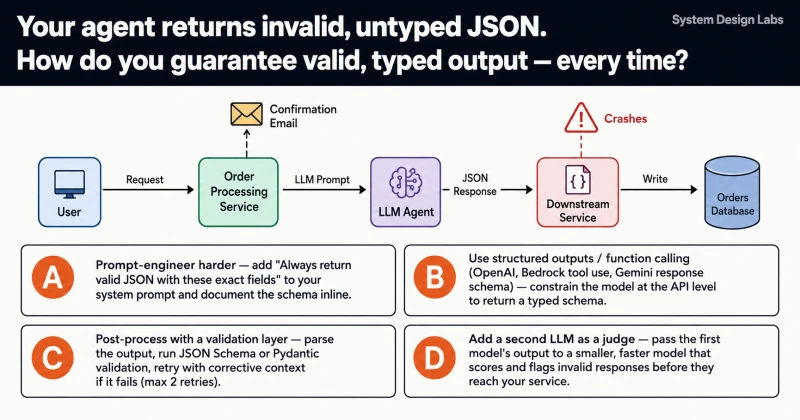

# Ngày 46: Enforcing Structured Output from an LLM

[← Ngày trước](day-45-scaling-full-text-search.md) | [Mục lục](README.md) | [Ngày tiếp theo →](day-47-incrementally-strangling-a-monolith.md)

---


# DAY 46 · THIẾT KẾ HỆ THỐNG (SYSTEM DESIGN)

## Bắt Buộc Xuất Dữ Liệu Có Cấu Trúc Từ LLM (Enforcing Structured Output from an LLM)



### Tình huống thực tế (Scenario)

Agent LLM trên môi trường production của bạn vừa trả về đoạn JSON sau cho dịch vụ xử lý đơn hàng (**order processing service**):

```json
{
 "action": "refund",
 "amount": "fifty dollars",
 "order_id": null,
 "confidence": "pretty high"
}
```

Dịch vụ hạ nguồn (**downstream service**) của bạn bị sập (**crash**). Cơ chế thử lại (**retry**) tiếp tục gọi vào đúng model đó. Vẫn là kết quả hỏng hóc y hệt. Yêu cầu hoàn tiền không bao giờ được kích hoạt — nhưng người dùng lại nhận được một email xác nhận.

Bạn cần agent của mình phải trả về dữ liệu đầu ra hợp lệ, có kiểu dữ liệu rõ ràng (**typed**), có cấu trúc (**structured output**) — **trong mọi lần gọi (every time)**. Bạn sẽ làm gì?

---

### Các phương án lựa chọn (Options)

* **A)** Tối ưu prompt quyết liệt hơn (**Prompt-engineer harder**) — thêm câu *"Always return valid JSON with these exact fields"* (Luôn trả về JSON hợp lệ với chính xác các trường này) vào **system prompt** của bạn và ghi rõ tài liệu về schema ngay trong prompt (**inline schema**).
* **B)** Sử dụng đầu ra có cấu trúc / gọi hàm (**Structured outputs / Function calling**) (như của OpenAI, Bedrock tool use, Gemini response schema) — ràng buộc model ngay ở cấp độ API (**API level**) để trả về một schema có kiểu dữ liệu chặt chẽ (**typed schema**).
* **C)** Hậu xử lý với một tầng xác thực (**Post-process with a validation layer**) — parse dữ liệu đầu ra, chạy xác thực với **JSON Schema** hoặc **Pydantic**, thử lại kèm theo ngữ cảnh sửa sai (**corrective context**) nếu xác thực thất bại (tối đa 2 lần thử lại).
* **D)** Thêm một LLM thứ hai làm trọng tài (**LLM as a judge**) — chuyển đầu ra của model đầu tiên sang một model nhỏ hơn, nhanh hơn để chấm điểm và gắn cờ các phản hồi không hợp lệ trước khi chúng đến được dịch vụ của bạn.

---

## NGÀY 46 · ĐÁP ÁN & GIẢI THÍCH CHI TIẾT (ANSWERS & EXPLANATIONS)


### Lựa chọn đáp án

| Lựa chọn | Đánh giá | Bản chất kỹ thuật |
| :--- | :---: | :--- |
| **A. Prompt engineering** | ❌ Sai | Chỉ là mong muốn viển vông (**wishful thinking**), không phải hợp đồng dữ liệu. |
| **B. Structured outputs** | **✓ ĐÁP ÁN ĐÚNG** | Ràng buộc giải mã (**constrained decoding**) ở cấp độ API, đảm bảo 100% tuân thủ schema. |
| **C. Post-process + Retry** | ⚠️ Đúng nhưng chưa đủ | Giải pháp dự phòng (**fallback**) khi không có tính năng native, tốn latency và chi phí token. |
| **D. LLM-as-a-judge** | 🪤 Cái bẫy (**Trap**) | Tăng độ trễ hot path, tốn kém, không đảm bảo tính toàn vẹn kiểu dữ liệu (**type safety**). |

---

### Phân tích chi tiết

#### Câu trả lời 1: ✓ ĐÁP ÁN ĐÚNG
#### Tại sao phương án B chiến thắng (Đầu ra có cấu trúc / Bắt buộc schema ở cấp độ API - Structured outputs / API-level schema enforcement):

Đây là phương án duy nhất loại bỏ vấn đề tận gốc rễ. Khi bạn sử dụng `response_format: { type: "json_schema" }` của OpenAI, **tool use / converse API** của AWS Bedrock, hoặc `response_schema` của Gemini, quá trình lấy mẫu token (**token sampling**) của model sẽ bị ràng buộc — nó **không thể** sinh ra dữ liệu đầu ra vi phạm schema. Không phải là *"ít khả năng vi phạm hơn"*. Mà là **HOÀN TOÀN KHÔNG THỂ**.

Về mặt bản chất cơ chế bên dưới (**under the hood**), các API này sử dụng kỹ thuật giải mã có ràng buộc (**constrained decoding**): phân phối xác suất đầu ra của model được che chắn (**masked**) sao cho các token không hợp lệ bị đưa xác suất về bằng 0 tại mỗi bước sinh từ. Kết quả là **đảm bảo 100% tuân thủ schema trên mọi lệnh gọi**. Không cần cơ chế thử lại (**no retries**). Không cần viết logic parse thủ công (**no parsing**). Không còn tình trạng *"nó chạy đúng 98% số lần"*.

> [!TIP]
> **Trong môi trường Production:** Sử dụng **Pydantic** (Python) hoặc **Zod** (TypeScript) để định nghĩa schema của bạn, truyền nó vào API của model, và deserialize trực tiếp dữ liệu trả về vào typed model của bạn. Dịch vụ hạ nguồn (**downstream service**) của bạn sẽ không bao giờ gặp phải một chuỗi ký tự (`string`) ở nơi mà nó đang kỳ vọng một số nguyên (`int`).

---

#### Câu trả lời 2: Tại sao phương án A là mong muốn viển vông (Kỹ nghệ câu lệnh - Prompt engineering):

*"Always return valid JSON"* (Luôn trả về JSON hợp lệ) không phải là một hợp đồng giao diện (**contract**). Nó chỉ là một lời gợi ý (**suggestion**).

Các LLM bản chất là các bộ dự đoán văn bản theo xác suất (**probabilistic text predictors**). Khi hệ thống chịu tải cao, gặp các câu prompt rơi vào trường hợp biên (**edge-case prompts**), hoặc cách diễn đạt hơi khác một chút, model sẽ bị trôi dạt (**drift**). Bạn sẽ nhận được JSON hợp lệ trong 97% trường hợp, và 3% còn lại sẽ là một khối mã markdown (markdown code block ` ```json `). Với quy mô 10.000 requests/ngày, con số đó tương đương 300 lỗi. Ở quy mô 100.000 requests/ngày, sẽ có 3.000 lỗi nổ ra.

**Prompt engineering** là bước đầu tiên khi bạn làm bản thử nghiệm (**prototyping**). Nó không phải là một chiến lược xác thực đầu ra (**output validation strategy**) cho môi trường production. Các đội ngũ phụ thuộc vào cách này cuối cùng sẽ phải viết các system prompt dài tới 50 dòng nhằm liệt kê mọi kịch bản lỗi có thể xảy ra. Nhưng model vẫn sẽ vượt rào và phá vỡ cấu trúc.

---

#### Câu trả lời 3: Tại sao phương án C đúng nhưng chưa đầy đủ (Tầng hậu xử lý + Vòng lặp thử lại - Post-process + retry loop):

Tầng xác thực (**validation layer**) + thử lại kèm theo ngữ cảnh sửa sai (**retry with corrective context**) là một pattern hoàn toàn hợp lệ, được sử dụng rộng rãi — đặc biệt là khi bạn không thể sử dụng tính năng **structured outputs** (ví dụ: các mô hình mã nguồn mở như Llama, Mistral, hoặc các model tự fine-tune chạy qua Ollama/vLLM).

**Cách triển khai thực tế:** 
1. Parse dữ liệu đầu ra 
2. Xác thực với **Pydantic** / **JSON Schema** 
3. Khi thất bại: truyền ngược lại (**re-inject**) prompt ban đầu + đầu ra bị sai + một câu lệnh hướng dẫn sửa lỗi (*"Đầu ra trước đó của bạn có các lỗi sau: [danh sách]. Hãy thử lại."*) 
4. Thử lại (**retry**), tối đa 2 lần thử 
5. Nếu vẫn lỗi: dừng hẳn (**fail hard**) và đưa ra cho con người đánh giá (**human review**).

> [!WARNING]
> **Điểm hạn chế cốt tử:** Đây là phương án dự phòng (**fallback**), không phải là lựa chọn ưu tiên hàng đầu (**primary**). Mỗi lần retry đều cộng thêm độ trễ (**latency**) + chi phí token (**cost**). Dưới tải cao, các cơn bão thử lại (**retry storms**) có thể khiến chi phí API của bạn tăng vọt gấp 3–4 lần. Ngữ cảnh sửa sai cũng không giúp ích gì khi model về mặt căn bản không đủ năng lực sinh ra thứ bạn yêu cầu — bạn sẽ chỉ retry và rơi vào đúng lỗi cũ.
> 
> 👉 **Quy tắc thiết kế:** Sử dụng **C** khi **B** không khả dụng. Sử dụng **B** khi nền tảng có hỗ trợ.

---

#### Câu trả lời 4: Tại sao phương án D là một cái bẫy (Dùng LLM làm trọng tài để xác thực - LLM-as-judge for validation):

**LLM-as-a-judge** là một mô hình đánh giá (**eval pattern**) có thật — nó được sử dụng để chấm điểm chất lượng, giọng văn (**tone**), tính an toàn (**safety**), và tính đúng đắn trong các luồng đánh giá ngoại tuyến (**offline evaluation pipelines**) và diễn tập tấn công kiểm thử (**red-teaming**).

Nhưng dùng nó để xác thực cấu trúc đầu ra trên luồng xử lý trực tiếp (**hot path**)? 
- **Tốn kém** về mặt tài nguyên và chi phí API.
- **Rất chậm** (thêm khoảng ~200–500ms độ trễ cho mỗi request).
- **Không đáng tin cậy** cho việc bắt buộc tuân thủ schema (**schema enforcement**). 

Một model trọng tài chỉ có thể bảo với bạn *"câu trả lời này trông có vẻ sai"* — nó không thể đảm bảo một đối tượng có kiểu dữ liệu hợp lệ (**valid typed object**). Bạn chỉ đang tự rước thêm độ trễ và chi phí vào hệ thống mà không thực sự giải quyết được bài toán.

> [!NOTE]
> **Vị trí chuẩn của LLM-as-a-judge:** Nó thuộc về bộ khung đánh giá (**eval harness**) của bạn (các đợt chạy hàng đêm - nightly runs, luồng CI/CD) — hoàn toàn không thuộc về vòng lặp request/response thời gian thực đòi hỏi tính toàn vẹn dữ liệu (**data integrity**).

Kịch bản lỗi tồi tệ hơn: Các đội ngũ kỹ thuật đưa thêm một model judge vào kèm với kỹ thuật prompt cấu trúc kém, cảm thấy an tâm hơn rồi đưa thẳng lên production. Nhưng cả hai model hoàn toàn có thể **cùng ảo giác đồng bộ (hallucinate in sync)**. Model judge gật đầu đồng ý rằng kết quả đầu ra hỏng hóc trông vẫn ổn. Dữ liệu sai lệch âm thầm lọt vào hệ thống production (**silent corruption**).


---

[← Ngày trước](day-45-scaling-full-text-search.md) | [Mục lục](README.md) | [Ngày tiếp theo →](day-47-incrementally-strangling-a-monolith.md)
