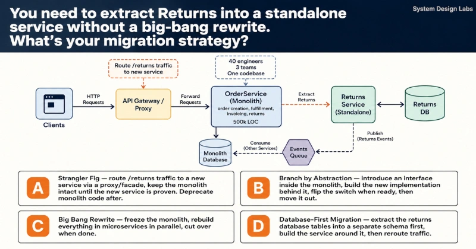
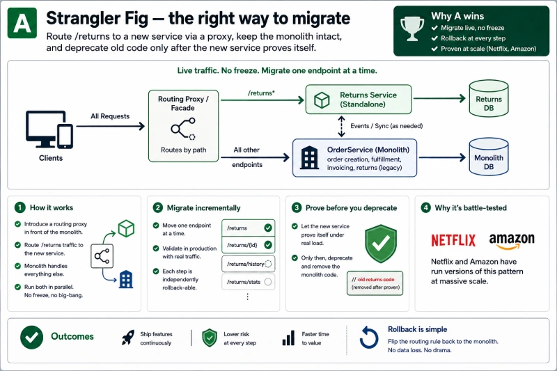

# Ngày 47: Incrementally Strangling a Monolith

[← Ngày trước](day-46-enforcing-structured-output-from-an-llm.md) | [Mục lục](README.md) | [Ngày tiếp theo →](day-48-how-an-agent-chooses-which-tools-to-call.md)

---

# NGÀY 47 · THIẾT KẾ HỆ THỐNG (DAY 47 · SYSTEM DESIGN)

## Từng bước bóp nghẹt một hệ thống Monolith (Incrementally Strangling a Monolith)

Hệ thống nguyên khối (**monolith**) của bạn đã có tuổi đời 6 năm.
500.000 dòng mã nguồn (**500k lines of code**). Tần suất triển khai: 3 tuần một lần (**one deploy every 3 weeks**). Chỉ một đợt di chuyển cơ sở dữ liệu lỗi (**one bad migration**) là đánh sập toàn bộ hệ thống.

Ban lãnh đạo yêu cầu: *"Viết lại từ đầu đi" (Rewrite it).* Bạn đã từng chứng kiến hậu quả khi các đội ngũ làm điều đó: 18 tháng ròng rã. Thấu chi ngân sách (**budget overruns**). Một nửa số tính năng cũ không bao giờ được đưa trở lại. Hệ thống mới ra mắt và chẳng ai tin tưởng nó cả.

Có một con đường tốt hơn. Bạn không viết lại toàn bộ — bạn áp dụng chiến lược **"bóp nghẹt" (strangle)**.

### Hiện trạng hệ thống của bạn (Here's your system):
* **OrderService (Monolith)** đảm nhiệm: tạo đơn hàng (**order creation**), hoàn tất đơn hàng (**fulfillment**), lập hóa đơn (**invoicing**), và xử lý trả hàng (**returns**).
* 40 kỹ sư. 3 nhóm phát triển. Tất cả đều triển khai chung vào một cơ sở mã (**same codebase**).
* Quy trình xử lý trả hàng (**Returns processing**) là một điểm nghẽn cổ chai (**bottleneck**). Khối kinh doanh yêu cầu bóc tách phần này ra đầu tiên.
* Bạn **không thể đóng băng (freeze)** việc phát triển tính năng mới trong quá trình di chuyển (**migration**).

> [!IMPORTANT]
> **Yêu cầu cốt lõi:**
> Bạn cần bóc tách module **Returns** thành một dịch vụ độc lập (**standalone service**) mà không dùng đến phương pháp viết lại toàn bộ theo kiểu "Big-Bang" (**big-bang rewrite**).

**Chiến lược di chuyển (Migration Strategy) của bạn là gì?**

---

## Các phương án lựa chọn (Options)

* **A) Strangler Fig (Mô hình cây si leo bóp nghẹt)** — Điều hướng lưu lượng truy cập `/returns` sang một dịch vụ mới thông qua một **proxy/facade**, giữ nguyên hệ thống **monolith** cho đến khi dịch vụ mới chứng minh được độ ổn định và tin cậy. Sau đó mới dọn dẹp và loại bỏ (**deprecate**) mã nguồn cũ trong monolith.
* **B) Branch by Abstraction (Tách nhánh bằng lớp trừu tượng)** — Đưa vào một interface trừu tượng bên trong monolith, xây dựng phần hiện thực mới (**new implementation**) ẩn phía sau interface đó, bật cờ chuyển mạch (**feature flag / switch**) khi sẵn sàng, sau đó mới tách ra ngoài.
* **C) Big Bang Rewrite (Viết lại toàn bộ kiểu Big-Bang)** — Đóng băng monolith (**freeze the monolith**), xây dựng lại toàn bộ kiến trúc microservices song song, và chuyển đổi toàn bộ (**cut over**) khi hoàn tất.
* **D) Database-First Migration (Di chuyển tầng cơ sở dữ liệu trước)** — Trích xuất các bảng dữ liệu của returns ra một **schema** riêng biệt trước, xây dựng dịch vụ mới bao quanh nó, sau đó mới định tuyến lại lưu lượng truy cập (**reroute traffic**).

---

## NGÀY 47 · CÂU TRẢ LỜI & GIẢI THÍCH CHI TIẾT (DAY 47 · ANSWERS & EXPLANATIONS)

### Câu trả lời 1 (Answer 1)
> [!TIP]
> ### ✓ CÂU TRẢ LỜI ĐÚNG: Phương án A
> **Tại sao A chiến thắng (Why A wins):**
> 
> Bạn đặt một proxy định tuyến (**routing proxy / API Gateway / Facade**) đứng trước monolith. Lưu lượng truy cập `/returns` sẽ được định tuyến sang dịch vụ mới. Monolith vẫn tiếp tục xử lý mọi lưu lượng còn lại. 
> 
> Bạn cho cả hai hệ thống chạy song song — **không đóng băng tính năng, không big-bang**. Di chuyển từng endpoint một tại một thời điểm, và mỗi bước đều có khả năng quay xe hoàn nguyên (**rollback-able**) một cách độc lập. Chỉ loại bỏ mã nguồn cũ trong monolith sau khi dịch vụ mới đã tự chứng minh được năng lực chịu tải thực tế (**real load**). Cả **Netflix** và **Amazon** đều đã vận hành các biến thể của mô hình này ở quy mô cực lớn.

---

### Câu trả lời 2 (Answer 2)
> [!NOTE]
> ### Tại sao B gần đúng nhưng về bản chất lại khác (Branch by Abstraction):
> 
> Đây là một mẫu thiết kế có thật (**real pattern**) — nhưng nó tồn tại **bên trong nội bộ cơ sở mã (codebase)**. Bạn bao bọc logic nghiệp vụ phía sau một interface, xây dựng mã triển khai mới ẩn sau một cờ tính năng (**feature flag**), sau đó gạt cờ kích hoạt. 
> 
> Về bản chất, nó là một **công cụ tái cấu trúc mã (refactoring tool)**, chứ không phải là một **chiến lược triển khai (deployment strategy)**. Mẫu này thường được sử dụng *bên trong* một đợt di chuyển theo Strangler Fig để chuẩn bị cấu trúc nội bộ. Nhưng nếu chỉ dùng riêng nó, bạn sẽ không thể đạt được mục tiêu tạo ra một dịch vụ được triển khai độc lập (**independently deployed service**).

---

### Câu trả lời 3 (Answer 3)
> [!WARNING]
> ### Tại sao C sai (Big Bang Rewrite):
> 
> Monolith sẽ không chịu "đứng yên đóng băng" trong khi bạn xây dựng lại. Khối kinh doanh vẫn liên tục tung ra các tính năng mới (**shipping features**). Dự án viết lại song song của bạn sẽ ngay lập tức bị phân kỳ và lệch pha so với thực tế (**diverges from reality**). Khái niệm "hoàn thành" (**"Done"**) sẽ là một cái đích luôn luôn dịch chuyển. 
> 
> Quá trình chuyển đổi toàn bộ (**cutover**) là một sự kiện rủi ro cực kỳ cao (**single high-stakes event**) mà không có bất kỳ bước kiểm chứng gia tăng (**incremental validation**) nào. Nhà đồng sáng lập Stack Overflow, **Joel Spolsky**, từng gọi đây là: *"sai lầm chiến lược tồi tệ nhất duy nhất mà bất kỳ công ty phần mềm nào có thể mắc phải"* — bởi vì mỗi đoạn mã chắp vá (**hack**) trong cơ sở mã cũ thực chất đều là một bản vá lỗi thực tế (**real bug fix**) mà hệ thống mới của bạn giờ đây đã hoàn toàn lãng quên.

---

### Câu trả lời 4 (Answer 4)
> [!CAUTION]
> ### Tại sao D nguy hiểm hơn vẻ bề ngoài của nó (Database-First):
> 
> Việc bóc tách các bảng cơ sở dữ liệu (**DB tables**) ra trước nghe có vẻ hợp lý nhưng nó sẽ **phá vỡ ngay lập tức tầng ánh xạ đối tượng ORM (Object-Relational Mapping)** của monolith. Bạn vừa tự tạo ra một bài toán dữ liệu phân tán (**distributed data problem**) trước cả khi xây dựng được một hệ thống phân tán đủ năng lực để kiểm soát nó.
> 
> **Di chuyển dữ liệu phải là bước cuối cùng** — hãy bóc tách logic dịch vụ trước, tạm thời giữ dữ liệu nằm chung một chỗ (**co-located**), sau đó mới di chuyển dữ liệu bằng kỹ thuật ghi đồng thời (**dual-write**). Làm theo thứ tự ngược lại sẽ nhân cấp số nhân rủi ro tại mỗi bước thực thi.

---

### Bảng tổng hợp so sánh chiến lược di chuyển

| Chiến lược | Phạm vi tác động | Nguy cơ rủi ro | Khả năng Rollback | Đánh giá kiến trúc |
| :--- | :--- | :--- | :--- | :--- |
| **A) Strangler Fig** | Tầng mạng / Routing Proxy | **Thấp** (Kiểm chứng từng bước) | **Dễ dàng** (Chuyển traffic ngay lập tức) | **Tối ưu nhất** cho việc phân rã monolith |
| **B) Branch by Abstraction** | Nội bộ Codebase | **Trung bình** (Vẫn dính deploy chung) | **Nhanh** (Bằng Feature Flag) | Tốt cho refactor, thiếu tính chất độc lập dịch vụ |
| **C) Big Bang Rewrite** | Toàn bộ hệ thống | **Cực cao** (All-or-nothing) | **Gần như không thể** | Thất bại phổ biến nhất trong công nghiệp |
| **D) Database-First** | Tầng lưu trữ (Storage/ORM) | **Rất cao** (Gãy transaction & ORM) | **Rất phức tạp** | Sai quy trình phân rã phân tán |

---

[← Ngày trước](day-46-enforcing-structured-output-from-an-llm.md) | [Mục lục](README.md) | [Ngày tiếp theo →](day-48-how-an-agent-chooses-which-tools-to-call.md)
