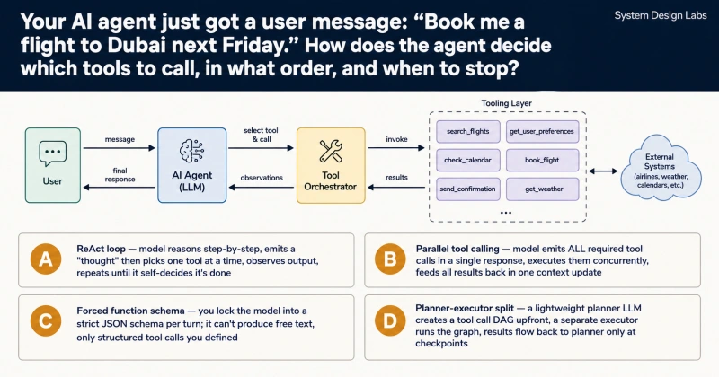
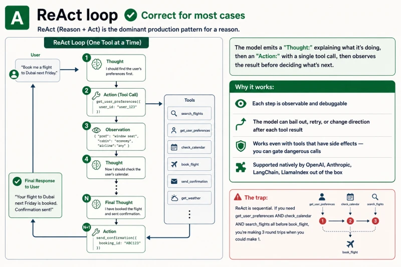

# Ngày 48: How an Agent Chooses Which Tools to Call

[← Ngày trước](day-47-incrementally-strangling-a-monolith.md) | [Mục lục](README.md) | [Ngày tiếp theo →](day-49-controlling-data-warehouse-query-costs.md)

---

# NGÀY 48 · SYSTEM DESIGN (THIẾT KẾ HỆ THỐNG)
## Cách một AI Agent lựa chọn công cụ (Tools) nào để gọi

### 📌 Đề bài tình huống (Scenario)

AI Agent của bạn vừa nhận được một tin nhắn từ người dùng: *"Đặt cho tôi một chuyến bay đến Dubai vào thứ Sáu tuần tới."* (*"Book me a flight to Dubai next Friday."*)

Mô hình ngôn ngữ lớn (LLM - Large Language Model) có quyền truy cập vào 12 công cụ (tools): `search_flights` (tìm kiếm chuyến bay), `get_user_preferences` (lấy sở thích người dùng), `check_calendar` (kiểm tra lịch trình), `book_flight` (đặt vé máy bay), `send_confirmation` (gửi xác nhận), `get_weather` (xem thời tiết)…

**Làm thế nào để Agent quyết định công cụ nào cần gọi, theo thứ tự nào, và khi nào thì dừng lại?**

---

### 🔘 Các phương án lựa chọn (Options)

* **A) Vòng lặp ReAct (ReAct loop)** — Mô hình suy luận từng bước (step-by-step), phát ra một "suy nghĩ" (*"thought"*), sau đó chọn từng công cụ một tại một thời điểm (*one tool at a time*), quan sát kết quả trả về (*observes output*), và lặp lại cho đến khi nó tự quyết định rằng tác vụ đã hoàn thành (*self-decides it's done*).
* **B) Gọi công cụ song song (Parallel tool calling)** — Mô hình phát ra TẤT CẢ các lệnh gọi công cụ cần thiết trong một lượt phản hồi duy nhất (*single response*), thực thi chúng đồng thời (*concurrently*), sau đó nạp toàn bộ kết quả trở lại trong một lần cập nhật ngữ cảnh duy nhất (*one context update*).
* **C) Ép buộc lược đồ hàm (Forced function schema)** — Bạn khóa mô hình vào một lược đồ JSON nghiêm ngặt (*strict JSON schema*) cho mỗi lượt; mô hình không thể tạo văn bản tự do (*free text*), mà chỉ có thể tạo các lệnh gọi công cụ có cấu trúc do bạn định nghĩa sẵn (*structured tool calls*).
* **D) Tách rời bộ lập kế hoạch - bộ thực thi (Planner-executor split)** — Một mô hình LLM lập kế hoạch tinh gọn (*lightweight planner LLM*) sẽ tạo sẵn một đồ thị có hướng không chu trình chứa các lệnh gọi công cụ (tool call DAG - Directed Acyclic Graph) ngay từ đầu, một bộ thực thi riêng biệt (*separate executor*) chạy đồ thị đó, và kết quả chỉ truyền ngược lại cho bộ lập kế hoạch tại các điểm kiểm tra (*checkpoints*).

---

---

# NGÀY 48 · ĐÁP ÁN & GIẢI THÍCH CHI TIẾT (ANSWERS & EXPLANATIONS)

## Đáp án 1

### ✓ ĐÁP ÁN CHÍNH XÁC
### **A — Vòng lặp ReAct (ReAct loop) — Chính xác cho phần lớn các trường hợp**

**ReAct (Reason + Act - Suy luận + Hành động)** là mô hình thiết kế chủ đạo trong môi trường production (môi trường thực tế) vì những lý do rất xác đáng.

Mô hình phát ra một suy nghĩ `"Thought:"` giải thích những gì nó đang làm, sau đó là một hành động `"Action:"` kèm theo một lệnh gọi công cụ duy nhất (*single tool call*), tiếp theo là quan sát kết quả (*observes the result*) trước khi quyết định bước đi kế tiếp là gì.

> [!NOTE]
> **Tại sao giải pháp này hiệu quả (Why it works):**
> * **Khả năng quan sát và gỡ lỗi (Observable & Debuggable):** Từng bước đều có thể quan sát, theo dõi và gỡ lỗi chi tiết.
> * **Khả năng tự hiệu chỉnh (Self-correction):** Mô hình có thể hủy bỏ (*bail out*), thử lại (*retry*), hoặc đổi hướng sau mỗi kết quả trả về từ công cụ.
> * **An toàn với tác dụng phụ (Side-effect safe):** Hoạt động tốt ngay cả với các công cụ có tác dụng phụ (side effects) — bạn có thể thiết lập cơ chế kiểm duyệt/chặn (*gate*) đối với các lệnh gọi nguy hiểm (như thanh toán, xóa dữ liệu).
> * **Hỗ trợ sẵn (Out of the box):** Được hỗ trợ gốc (*natively supported*) bởi OpenAI, Anthropic, LangChain, LlamaIndex mà không cần cấu hình phức tạp.

> [!WARNING]
> **Cái bẫy (The trap):** 
> ReAct mang tính tuần tự (*sequential*). Nếu bạn cần gọi đồng thời `get_user_preferences` VÀ `check_calendar` VÀ `search_flights` trước khi gọi `book_flight`, bạn đang phải thực hiện **3 lượt khứ hồi (3 round trips)** trong khi hoàn toàn có thể chỉ cần **1 lượt khứ hồi**.

---

## Đáp án 2

### **B — Gọi công cụ song song (Parallel tool calling) — Đúng đắn khi quan hệ phụ thuộc cho phép**

Các mô hình LLM hiện đại (GPT-4o, Claude 3.5+) có khả năng phát ra nhiều lệnh gọi công cụ cùng lúc trong một phản hồi duy nhất (*single response*).

Nếu các công cụ độc lập với nhau — hãy chạy chúng song song (*in parallel*). Đây là một chiến thắng vượt bậc về độ trễ (*massive latency win*).

* **Ví dụ:** `get_user_preferences` + `check_calendar` hoàn toàn không phụ thuộc lẫn nhau. Hãy gọi cả hai cùng lúc. Sau đó nạp kết quả của cả hai trở lại ngữ cảnh trước khi gọi `search_flights`.

> [!CAUTION]
> **Cái bẫy (The trap):** 
> Không phải tất cả các công cụ đều độc lập. Nếu **Công cụ B** cần đầu ra của **Công cụ A**, việc gọi song song sẽ làm hỏng ngữ cảnh (*breaks your context*) của bạn. Mô hình không hề "biết" rằng B thất bại là do A chưa kịp chạy — nó chỉ đơn thuần nhận lại một kết quả lỗi/xấu và có thể bắt đầu ảo tưởng (*hallucinate*) ra một cách sửa sai không có thực.

> [!TIP]
> **Mẫu kiến trúc thực tế (Production pattern):** 
> Sử dụng **gọi công cụ song song (parallel calling)** cho giai đoạn tỏa ra (fan-out phase), và sử dụng **ReAct** cho giai đoạn ra quyết định tuần tự (sequential decision phase).

---

## Đáp án 3

### **C — Ép buộc lược đồ hàm (Forced function schema) — Cái bẫy của Senior Engineer**

Trông có vẻ như bạn đang nắm toàn quyền kiểm soát (*looks like control*). Nhưng trên thực tế nó lại giới hạn bạn (*actually limits you*).

Khi bạn ép buộc chế độ lược đồ JSON nghiêm ngặt (*strict JSON schema mode*), bạn sẽ đánh mất khả năng suy luận của mô hình (*ability to reason*) trước khi thực hiện lệnh gọi.

Kiến trúc này sẽ nhanh chóng đổ vỡ khi:
* Ý định của người dùng còn mơ hồ (*ambiguous intent*) — liệu agent nên gọi `search_flights` hay gọi `clarify_intent` (làm rõ ý định)?
* Một công cụ bị lỗi và mô hình cần đưa ra quyết định xem nên thử lại (*retry*) hay từ bỏ (*give up*).
* Bạn cần logic điều kiện (*conditional logic*) giữa các bước thực thi.

> [!IMPORTANT]
> **Quy tắc thiết kế:**
> Hãy sử dụng việc thực thi lược đồ (schema enforcement) cho **xác thực đầu ra (output validation)**, chứ không phải để **điều phối công cụ (tool dispatch)**. Hãy xác thực những gì được mô hình trả về — đừng trói tay trói chân mô hình ngay từ đầu vào.

---

## Đáp án 4

### **D — Tách rời bộ lập kế hoạch - bộ thực thi (Planner-executor split) 🏗️ — Chuẩn xác ở quy mô lớn, nhưng là quá mức cần thiết (overkill) cho hầu hết trường hợp**

Đây là kiến trúc đứng sau các pipeline agentic trong môi trường production như Devin, các hệ thống dạng AutoGPT, và các framework agent cấp doanh nghiệp (enterprise agent frameworks).

Bộ lập kế hoạch (*planner*) sẽ xây dựng một đồ thị DAG gồm các lệnh gọi công cụ ngay từ đầu. Bộ thực thi (*executor*) sẽ chạy đồ thị đó. Bộ lập kế hoạch chỉ can thiệp trở lại tại các điểm kiểm tra (*checkpoints*) hoặc khi xảy ra lỗi (*failure*).

**Lợi ích (Benefits):**
* **Xử lý song song mặc định (Parallelism by default):** Đồ thị DAG có các cạnh phụ thuộc (dependency edges) cực kỳ rõ ràng.
* **Tối ưu chi phí (Cost-efficient):** Mô hình planner mạnh mẽ (và tốn kém) sẽ chạy ít lần hơn.
* **Khả năng kiểm toán cao (Auditable):** Bạn có thể kiểm tra toàn bộ kế hoạch trước khi cho phép chạy.

> [!WARNING]
> **Cái bẫy (The trap):** 
> Bộ lập kế hoạch phải đưa ra toàn bộ kế hoạch chính xác tuyệt đối trước khi quá trình thực thi bắt đầu. Nếu thế giới bên ngoài thay đổi giữa chừng (API trả về dữ liệu không lường trước, người dùng cập nhật yêu cầu), bạn sẽ cần phải lập lại kế hoạch (*replanning*). Đó lại là cả một bài toán phức tạp thứ hai phát sinh.

### 🎯 Tổng kết định hướng kiến trúc (Architectural Takeaway)

| Giai đoạn phát triển | Khuyến nghị kiến trúc |
| :--- | :--- |
| **Bắt đầu (Start)** | Luôn bắt đầu với **Vòng lặp ReAct (ReAct loop)**. |
| **Tối ưu độ trễ (Optimization)** | Bổ sung **Gọi công cụ song song (Parallel tool calling)** khi độ trễ (latency) bắt đầu gây ảnh hưởng tiêu cực đến trải nghiệm người dùng. |
| **Quy mô lớn & Phức tạp (Scale & Complexity)** | Chỉ xây dựng mô hình **Planner-Executor** khi bạn sở hữu các quy trình làm việc đa bước phức tạp với trên 10 công cụ (tools) cùng các yêu cầu xử lý song song thực sự khắt khe.

---

[← Ngày trước](day-47-incrementally-strangling-a-monolith.md) | [Mục lục](README.md) | [Ngày tiếp theo →](day-49-controlling-data-warehouse-query-costs.md)
