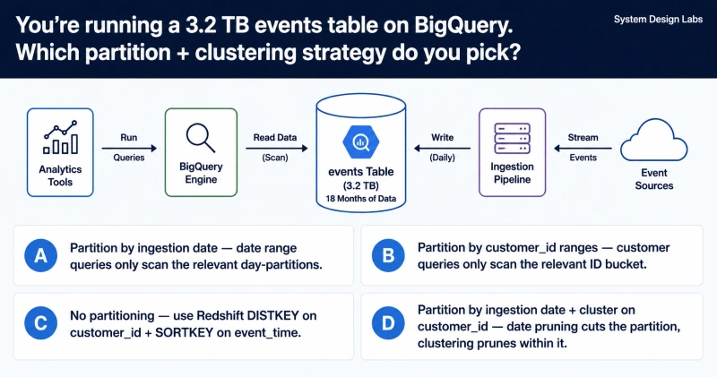
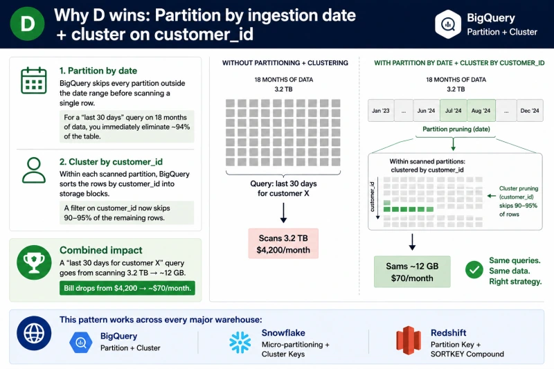

# Ngày 49: Controlling Data-Warehouse Query Costs

[← Ngày trước](day-48-how-an-agent-chooses-which-tools-to-call.md) | [Mục lục](README.md) | [Ngày tiếp theo →](day-50-serving-ml-models-at-high-throughput.md)

---

# NGÀY 49 · SYSTEM DESIGN (THIẾT KẾ HỆ THỐNG)
## Kiểm Soát Chi Phí Truy Vấn Kho Dữ Liệu (Controlling Data-Warehouse Query Costs)

Đội ngũ dữ liệu (data team) của bạn vừa nhận một hóa đơn BigQuery trị giá **$4,200**.  
Chỉ trong **một tháng duy nhất**. Do **một chuyên viên phân tích (analyst)**. Với vỏn vẹn **12 câu truy vấn (queries)**.

Các câu truy vấn này không hề sai cú pháp. Chúng cũng không phải là SQL kém hiệu quả. Chúng là các truy vấn phân tích hoàn toàn hợp lý — kiểu như: *"lấy toàn bộ sự kiện (events) trong 30 ngày qua của khách hàng X"*. Vấn đề nằm ở chỗ: **mỗi một câu truy vấn đều quét toàn bộ bảng (full table scan) dung lượng 3.2 TB**. Không hề có loại trừ phân vùng (partition pruning). Không có cơ chế kiểm soát chi phí. Chỉ toàn là quét toàn bảng (full scans) trong mọi lần chạy.

> [!WARNING]
> Đây là **"lỗi ngầm gây tốn kém nhất" (most expensive silent bug)** trong ngành kỹ thuật dữ liệu (data engineering). Bạn viết một câu truy vấn. Nó chạy trông có vẻ nhanh. Nó trả về kết quả đúng. Nhưng mỗi lần thực thi, nó âm thầm cày nát hàng terabyte dữ liệu mà bạn đang phải trả tiền trên từng byte dữ liệu bị quét (pay per-byte to scan).

Giải pháp xử lý là áp dụng **chiến lược phân vùng (partition strategy)** — nhưng việc chọn sai chiến lược không những không giải quyết được vấn đề mà còn khiến tình hình tồi tệ hơn rõ rệt.

---

### Bối cảnh bài toán (The Setup):

Bạn đang vận hành một bảng `events` dung lượng **3.2 TB** trên Google BigQuery. Dữ liệu tích lũy trong **18 tháng**. Dữ liệu được nạp vào hàng ngày (ingested daily). Các câu truy vấn của chuyên viên phân tích hầu như luôn lọc theo 2 điều kiện: 
1. Một khoảng thời gian (date range) — ví dụ: *"30 ngày qua"* (`"last 30 days"`).
2. Mã định danh khách hàng (`customer_id`) — ví dụ: *"cho khách hàng X"* (`"for customer X"`).

**Bạn sẽ chọn chiến lược phân vùng kết hợp gom cụm (partition + clustering strategy) nào sau đây?**

* **A)** Phân vùng theo ngày nạp dữ liệu (Partition by ingestion date) — các câu truy vấn theo khoảng thời gian sẽ chỉ quét các phân vùng theo ngày (day-partitions) tương ứng.
* **B)** Phân vùng theo dải mã khách hàng (Partition by customer_id ranges) — các câu truy vấn theo khách hàng sẽ chỉ quét đúng thùng/nhóm ID (ID bucket) tương ứng.
* **C)** Không phân vùng (No partitioning) — sử dụng Redshift DISTKEY trên `customer_id` + SORTKEY trên `event_time`.
* **D)** Phân vùng theo ngày nạp dữ liệu + Gom cụm theo mã khách hàng (Partition by ingestion date + cluster on customer_id) — cơ chế loại trừ theo ngày (date pruning) cắt giảm phân vùng, cơ chế gom cụm (clustering) tiếp tục loại trừ các khối dữ liệu bên trong phân vùng đó.

---

## NGÀY 49 · ĐÁP ÁN & GIẢI THÍCH CHI TIẾT (ANSWERS & EXPLANATIONS)

### Đáp án 1 (Answer 1)
### ✓ ĐÁP ÁN ĐÚNG: D

#### Vì sao D chiến thắng (Why D wins):
Các câu truy vấn của chuyên viên phân tích luôn lọc trên **hai cột**: một khoảng thời gian (date range) và một `customer_id`. Một chiến lược chỉ dùng một khóa đơn lẻ (single-key strategy) sẽ chỉ bảo vệ được một tiêu chí và bỏ qua tiêu chí còn lại.

Dưới đây là cách phương án **D** hoạt động trong BigQuery:
* **Phân vùng theo ngày (Partition by date):** BigQuery bỏ qua mọi phân vùng (partition) nằm ngoài khoảng thời gian được lọc trước khi tiến hành quét bất kỳ một dòng (row) nào. Đối với truy vấn "30 ngày qua" trên tập dữ liệu 18 tháng, bạn ngay lập tức **loại bỏ được ~94% dung lượng bảng**.
* **Gom cụm theo mã khách hàng (Cluster by customer_id):** Bên trong mỗi phân vùng được quét, BigQuery sắp xếp các dòng theo `customer_id` vào các khối lưu trữ (storage blocks). Khi có bộ lọc theo `customer_id`, hệ thống tiếp tục **bỏ qua thêm 90–95% số dòng còn lại**.

> [!NOTE]
> **Hiệu quả kết hợp:** Câu truy vấn *"30 ngày qua cho khách hàng X"* từ chỗ phải quét **3.2 TB → giảm xuống chỉ còn ~12 GB**. Hóa đơn giảm từ **$4,200 → còn ~$70/tháng**. Vẫn là những câu truy vấn đó. Vẫn tập dữ liệu đó. Nhưng đúng chiến lược kiến trúc.

Mô hình (pattern) này phát huy hiệu quả trên mọi nền tảng kho dữ liệu (Data Warehouse) lớn:
* **BigQuery:** Partition + Cluster
* **Snowflake:** Micro-partitioning + Cluster keys
* **Redshift:** Partition key + Compound SORTKEY

---

### Đáp án 2 (Answer 2)
#### Vì sao A chưa hoàn thiện (Chỉ phân vùng theo ngày - date partition only):

Chỉ phân vùng theo ngày (Date partition alone) thực sự là một bước cải thiện đáng kể — bộ lọc khoảng thời gian sẽ loại trừ các phân vùng không liên quan ngay lập tức. Hóa đơn của bạn có thể sẽ giảm từ 60–70%.

Tuy nhiên, các câu truy vấn của chuyên viên phân tích còn lọc theo cả `customer_id`. Bên trong mỗi phân vùng ngày, dữ liệu của tất cả khách hàng bị xếp xen kẽ lẫn lộn (interleaved) trên khắp các khối lưu trữ (storage blocks). BigQuery buộc phải đọc toàn bộ phân vùng ngày đó để tìm ra các dòng dữ liệu của khách hàng X.

Bạn đã giảm dung lượng quét từ **3.2 TB → ~500 GB** (khoảng dữ liệu của 30 ngày qua), nhưng bạn vẫn đang phải **quét qua tất cả khách hàng khác** bên trong khung thời gian đó.

> [!TIP]
> **A** là bước đi đầu tiên hiển nhiên. Nhưng **D** mới là bước đi hoàn chỉnh và triệt để nhất của A.

---

### Đáp án 3 (Answer 3)
#### Vì sao B là cái bẫy dành cho Kỹ sư cấp cao (Phân vùng theo dải customer_id - customer_id range partitioning):

Cái bẫy này thường đánh lừa cả những kỹ sư thông minh. Chuyên viên phân tích luôn lọc theo `customer_id` — vậy tại sao lại không phân vùng theo trường đó?

Bởi vì trong thực tế, **sự phân bổ của `customer_id` không bao giờ đồng đều (never uniform)**. Các khách hàng cấp doanh nghiệp (Enterprise clients - ví dụ các ID từ 1 đến 10,000) thường tạo ra tới 80% tổng số sự kiện (events). Mọi câu truy vấn phân tích nhắm vào các khách hàng đang hoạt động tích cực đều sẽ đánh thẳng vào cùng một phân vùng. Lợi ích loại trừ phân vùng (pruning benefit) hoàn toàn biến mất — toàn bộ dữ liệu quan trọng đáng quan tâm đều bị dồn ứ vào một thùng chứa duy nhất.

Tệ hơn nữa: các truy vấn của bạn còn lọc theo cả ngày tháng. Lúc này, BigQuery buộc phải quét toàn bộ phân vùng khách hàng khổng lồ đó chỉ để tìm ra các dòng thuộc 30 ngày qua. Bạn đã đổi từ việc quét toàn bộ bảng (full table scan) sang việc **quét toàn bộ một phân vùng nóng nhất (full-partition scan on your hottest partition)**. Chi phí vẫn đắt đỏ như cũ, chỉ khác nhau ở cách gọi tên.

> [!IMPORTANT]
> Hiện tượng **phân vùng quá tải / điểm nóng (hot partitions)** trên các dải ID có lưu lượng truy cập cao là sai lầm tốn kém phổ biến nhất trong thiết kế kho dữ liệu (data warehouse design). Về mặt lý thuyết thì trông có vẻ đúng, nhưng không bao giờ hiệu quả trên môi trường thực tế (production).

---

### Đáp án 4 (Answer 4)
#### Vì sao C thất bại ở quy mô này (DISTKEY + SORTKEY, không phân vùng):

* **DISTKEY:** Phân phối các dòng dữ liệu qua các node của Redshift dựa trên hàm băm (hash) của `customer_id` — tối ưu hóa cho các thao tác kết hợp bảng (joins).
* **SORTKEY:** Được thiết lập trên `event_time`, giúp sắp xếp các dòng dữ liệu trên đĩa cứng bên trong từng lát cắt dữ liệu (slice) — hỗ trợ các thao tác quét khoảng thời gian đọc các khối dữ liệu liền kề (contiguous blocks).

Cả hai đều là những cơ chế tối ưu hóa thực tế. Tuy nhiên, **không cơ chế nào có thể thay thế được việc loại trừ phân vùng (partition pruning) ở quy mô 3.2 TB**.

Nếu không có phân vùng (partitioning), mỗi câu truy vấn đều sẽ kích hoạt quét toàn bảng (full table scan) trên tất cả các node. Nếu sự phân bổ của DISTKEY bị lệch (skewed) — điều chắc chắn sẽ xảy ra khi các khách hàng doanh nghiệp chiếm ưu thế — một node Redshift duy nhất có thể phải chứa từ 60–70% dữ liệu của bạn. Mọi câu truy vấn tốn kém tài nguyên đều sẽ dội thẳng và vắt kiệt node đó.

Bạn đã vô tình biến một bài toán đơn thuần về chi phí thành **vấn đề kép: Độ trễ cao + Chi phí đắt đỏ (latency + cost problem)**.

> [!NOTE]
> DISTKEY + SORTKEY là giải pháp vững chắc để tối ưu hóa phép nối (joins) và cho các bảng có quy mô nhỏ hơn. Nó **không thể thay thế** cho cơ chế loại trừ phân vùng (partition pruning) ở quy mô hàng Terabyte (terabyte scale).

---

### Bảng tổng hợp so sánh các chiến lược:

| Phương án | Cơ chế xử lý | Lượng dữ liệu quét (Ước tính) | Đánh giá kiến trúc |
| :--- | :--- | :--- | :--- |
| **A (Chỉ Date Partition)** | Loại trừ phân vùng ngày, quét toàn bộ khách hàng trong ngày đó. | ~500 GB | **Chưa triệt để:** Cải thiện một phần chi phí nhưng vẫn lãng phí I/O lớn cho việc lọc `customer_id`. |
| **B (Customer ID Range)** | Dồn dữ liệu vào dải ID, gây ra điểm nóng (Hot Partition). | ~2.5 TB – 3.2 TB (với Enterprise) | **Cái bẫy thiết kế:** Data skew khiến các phân vùng doanh nghiệp bị quá tải; vẫn phải quét full phân vùng để lọc ngày. |
| **C (Redshift DISTKEY + SORTKEY)** | Phân tán node theo hash ID + sắp xếp block theo thời gian. | Quét toàn bộ cluster (Full Scan) | **Thất bại ở quy mô TB:** Không có partition pruning, node chứa khách hàng lớn bị nghẽn cổ chai (skewed node). |
| **D (Date Partition + Customer Cluster)** | Pruning loại bỏ 94% ngày + Clustering loại bỏ 90-95% khối dữ liệu khách hàng. | **~12 GB** | **Chiến thắng tuyệt đối:** Tối ưu hóa 2 chiều, hóa đơn giảm từ $4,200 xuống ~$70/tháng. |

---

[← Ngày trước](day-48-how-an-agent-chooses-which-tools-to-call.md) | [Mục lục](README.md) | [Ngày tiếp theo →](day-50-serving-ml-models-at-high-throughput.md)
