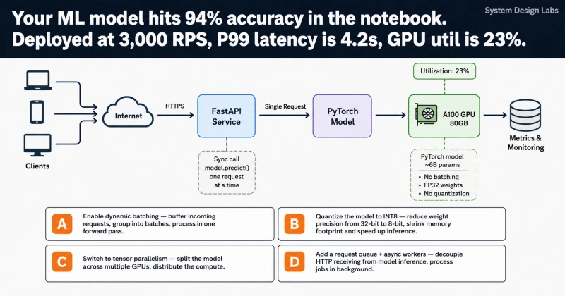

# Ngày 50: Serving ML Models at High Throughput

[← Ngày trước](day-49-controlling-data-warehouse-query-costs.md) | [Mục lục](README.md) | [Ngày tiếp theo →](day-51-isolating-noisy-tenants-in-multi-tenant-saas.md)

---

# DAY 50 · SYSTEM DESIGN

## Phục Vụ Mô Hình ML Với Thông Lượng Cao (Serving ML Models at High Throughput)

Đội ngũ Machine Learning (ML) của bạn đã huấn luyện một mô hình đạt độ chính xác 94% (accuracy) trong môi trường notebook.  
Sau đó bạn triển khai nó lên môi trường production.  
Lưu lượng đỉnh điểm (Peak traffic): **3.000 yêu cầu suy luận/giây (inference requests/second - RPS)**.  
Độ trễ P99 (P99 latency) vọt lên tới **4,2 giây**.  
Mức độ sử dụng GPU (GPU utilization): **23%**.  
Mô hình hoạt động tốt. Tầng phục vụ (serving layer) chính là nút thắt cổ chai (bottleneck).  

### Cấu hình hiện tại (Here's the setup):
* **Mô hình PyTorch**, kích thước khoảng **~6 tỷ tham số (~6B params)**
* **Một GPU A100 duy nhất**, dung lượng **80GB VRAM**
* **FastAPI wrapper** gọi trực tiếp `model.predict()` cho từng request một (one request at a time)
* **Không áp dụng gom nhóm (No batching)**, trọng số ở định dạng **FP32**, **không lượng tử hóa (no quantization)**

Người dùng liên tục gặp lỗi hết thời gian chờ (timeouts). GPU phần lớn thời gian rơi vào trạng thái nhàn rỗi (idle). Chi phí hạ tầng (infra bill) của bạn đang tăng vọt.  

**Bạn sẽ xử lý vấn đề gì đầu tiên? (What do you fix first?)**

---

## Các phương án lựa chọn (Options)

* **A)** Kích hoạt gom nhóm động (**Enable dynamic batching**) — lưu đệm các request gửi đến (buffer incoming requests), nhóm chúng thành các batch, và xử lý trong một lượt lan truyền xuôi duy nhất (process in one forward pass).
* **B)** Lượng tử hóa mô hình sang INT8 (**Quantize the model to INT8**) — giảm độ chính xác trọng số từ 32-bit xuống 8-bit, thu nhỏ dung lượng bộ nhớ (shrink memory footprint) và tăng tốc suy luận (speed up inference).
* **C)** Chuyển sang song song hóa tensor (**Switch to tensor parallelism**) — chia nhỏ mô hình trên nhiều GPU, phân tán năng lực tính toán (distribute the compute).
* **D)** Thêm hàng đợi yêu cầu + tiến trình xử lý bất đồng bộ (**Add a request queue + async workers**) — tách rời tầng tiếp nhận HTTP khỏi tầng suy luận mô hình (decouple HTTP receiving from model inference), xử lý các tác vụ ở chế độ chạy nền (background jobs).

---

# DAY 50 · ĐÁP ÁN & GIẢI THÍCH CHI TIẾT (ANSWERS & EXPLANATIONS)

### Câu trả lời 1 (Answer 1)
> [!TIP]
> **✓ CÂU TRẢ LỜI CHÍNH XÁC: Đáp án A — Dynamic Batching ✅**

### Phân tích chi tiết (Here's the breakdown):

#### Vì sao đáp án A chiến thắng (Why A wins - Dynamic Batching):
"Dấu vết hiện trường" rõ ràng nhất (smoking gun) chính là tổ hợp các thông số: **3K RPS**, **P99 = 4.2s**, **GPU utilization = 23%**.

Mức độ sử dụng GPU ở mức 23% cho bạn biết GPU đang **bị bỏ đói (starving)**. Nó không hề bị quá tải — nó đang nhàn rỗi đến mức nhàm chán (it's bored). Mỗi request gửi đến đều đi lẻ tẻ từng cái một, phải trả toàn bộ chi phí khởi chạy nhân tính toán của GPU (**GPU kernel launch overhead**), sau đó GPU lại rảnh rỗi chờ request tiếp theo nhỏ giọt tới. GPU sinh ra là để xử lý song song (**parallelism**). Chúng muốn nhận 256 đầu vào để tính toán đồng thời, chứ không phải 1.

**Dynamic batching** sẽ lưu đệm (buffer) các request trong vài mili-giây (ví dụ: 50ms), gom lại từ 32–128 request, và thực thi một lượt lan truyền xuôi (**single forward pass**). Cùng một GPU đó vốn chỉ chạy ở mức 23% utilization có thể nhảy vọt lên **85–90%**. Độ trễ được cải thiện rõ rệt vì thông lượng theo batch (batch throughput) vượt trội hoàn toàn so với việc gọi tuần tự từng request đơn lẻ (sequential per-request calls), ngay cả khi phải chịu khoảng thời gian chờ đệm ngắn.

Đây chính xác là cách thức hoạt động mặc định của **NVIDIA Triton Inference Server**, **TorchServe**, và **vLLM** (dành cho LLM). Gom nhóm (Batching) luôn là giải pháp đầu tiên bạn cần nghĩ đến khi **GPU utilization thấp và RPS cao**.

---

### Câu trả lời 2 (Answer 2)

#### Vì sao đáp án B là bẫy (Why B is the trap answer - INT8 Quantization):
Lượng tử hóa (**Quantization**) là một kỹ thuật hoàn toàn hợp lý và có giá trị — nhưng nó dùng để giải quyết một bài toán khác. Nó giúp giảm kích thước mô hình (nhỏ hơn khoảng ~4 lần) và tăng tốc từng lượt forward pass đơn lẻ. Nếu bạn bị giới hạn bộ nhớ (**memory-constrained**) hoặc không thể nạp vừa mô hình vào VRAM, lượng tử hóa là yếu tố sống còn. Tuy nhiên, mô hình 6B này đã nằm vừa vặn, thoải mái trong bộ nhớ **80GB VRAM** và GPU thì chưa hề bị bão hòa.

Lượng tử hóa sang INT8 cũng tiềm ẩn rủi ro làm suy giảm độ chính xác (**precision loss**) mà bạn bắt buộc phải kiểm thử và đánh giá kỹ lưỡng (validate). Ngoài ra, mức tăng tốc trên một GPU A100 hiện đại đối với một mô hình 6B tham số khi đứng độc lập là khá khiêm tốn — chỉ khoảng 1,5–2 lần. Điều đó không thể giải quyết triệt để mức tải **3K RPS** với cơ chế suy luận tuần tự. Bạn vẫn sẽ gặp tình trạng thực thi tuần tự từng request, chỉ là mỗi lần gọi diễn ra nhanh hơn một chút.

> [!NOTE]
> **Thứ tự ưu tiên đúng đắn:** Gom nhóm trước (**batch first**), lượng tử hóa sau (**quantize second** — dành cho bài toán tối ưu bộ nhớ hoặc chi phí, không phải dùng để giải cứu khẩn cấp vấn đề độ trễ).

---

### Câu trả lời 3 (Answer 3)

#### Vì sao đáp án C sai trong trường hợp này (Why C is wrong here - Tensor Parallelism):
Song song hóa tensor (**Tensor parallelism**) chia tách các lớp mô hình (model layers) trên nhiều GPU bằng cách sử dụng **NVLink** hoặc các đường kết nối liên kết tốc độ cao (interconnects). Kỹ thuật này giúp giảm độ trễ trên từng request đối với các mô hình cực lớn không thể nạp vừa trên một thiết bị đơn lẻ, hoặc khi bạn bắt buộc phải đạt độ trễ dưới 100ms (sub-100ms) trên một mô hình khổng lồ.

Thế nhưng, đây là mô hình chỉ có **6B tham số** chạy trên một **GPU A100 80GB** — nó hoàn toàn vừa vặn trên một card đơn. Tensor parallelism sẽ làm tăng thêm chi phí điều phối (**coordination overhead**) cùng độ phức tạp kiến trúc, và nó hoàn toàn không giải quyết được nút thắt cổ chai bắt nguồn từ việc xử lý request tuần tự. Bạn cũng sẽ cần tối thiểu từ 2 GPU trở lên, điều này làm đội chi phí hạ tầng lên cao trước khi bạn kịp thử giải pháp đơn giản và tiết kiệm nhất.

---

### Câu trả lời 4 (Answer 4)

#### Vì sao đáp án D sai (Why D is wrong - Async Queue + Workers):
Một hàng đợi bất đồng bộ (**async queue**) giúp tách rời tầng HTTP khỏi tầng suy luận (inference) và ngăn chặn các lỗi timeout phía client — đây là một điểm cộng về mặt độ tin cậy (**reliability win**). Tuy nhiên, nó không hề cải thiện mức độ sử dụng GPU hay nâng cao thông lượng thực tế (**actual throughput**). Bạn vẫn đang xử lý từng request một theo cách tuần tự, chỉ khác là chuyển sang chế độ bất đồng bộ. Thay vì bị timeout, lúc này người dùng sẽ nhận về các `job_id`, nhưng tổng thời gian chờ theo đồng hồ thực (wall-clock wait) vẫn giữ nguyên hoặc thậm chí còn tệ hơn.

> [!WARNING]
> Xếp hàng đợi mà không gom nhóm (**Queuing without batching**) chẳng khác nào bạn xây thêm sảnh chờ cho một nhà hàng phục vụ chậm chạp. Nó chỉ che giấu đi sự tắc nghẽn — chứ không hề giải quyết được tận gốc vấn đề.

---

### Bảng tóm tắt so sánh các phương án (Architectural Decision Matrix)

| Phương án | Bản chất kỹ thuật | Giải quyết được 3K RPS + GPU đói? | Đánh giá kiến trúc |
| :--- | :--- | :---: | :--- |
| **A) Dynamic Batching** | Gom request theo cửa sổ thời gian (ví dụ 50ms) để chạy song song trên GPU | **CÓ** | **Lựa chọn số 1.** Khai phóng sức mạnh tính toán song song của GPU A100, đẩy utilization từ 23% lên 85-90%. |
| **B) INT8 Quantization** | Giảm kích thước trọng số FP32 $\rightarrow$ INT8 để giảm VRAM | **KHÔNG** | **Bẫy tối ưu sớm.** Mô hình 6B đã nạp vừa 80GB VRAM; tính tuần tự vẫn tồn tại. |
| **C) Tensor Parallelism** | Cắt lát mô hình qua nhiều GPU thông qua NVLink | **KHÔNG** | **Over-engineering & tốn kém.** Gây overhead điều phối không cần thiết cho mô hình 6B. |
| **D) Async Queue + Workers** | Hàng đợi đệm HTTP (RabbitMQ/Kafka/Celery) | **KHÔNG** | **Che giấu triệu chứng.** Chỉ tránh được HTTP timeout, bản chất GPU vẫn bị nghẽn do xử lý tuần tự. |

---

[← Ngày trước](day-49-controlling-data-warehouse-query-costs.md) | [Mục lục](README.md) | [Ngày tiếp theo →](day-51-isolating-noisy-tenants-in-multi-tenant-saas.md)
