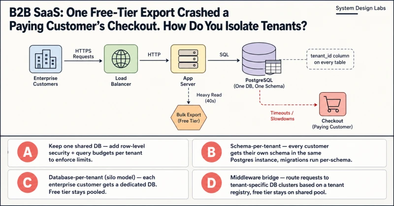

# Ngày 51: Isolating Noisy Tenants in Multi-Tenant SaaS

[← Ngày trước](day-50-serving-ml-models-at-high-throughput.md) | [Mục lục](README.md) | [Ngày tiếp theo →](day-52-versioning-an-api-without-breaking-clients.md)

---

# NGÀY 51 · THIẾT KẾ HỆ THỐNG (SYSTEM DESIGN)

## Cô lập khách thuê gây nhiễu trong mô hình SaaS đa người thuê (Isolating Noisy Tenants in Multi-Tenant SaaS)

Bạn đang xây dựng một sản phẩm B2B SaaS với 50 khách hàng doanh nghiệp (enterprise customers). Mỗi khách hàng đều muốn dữ liệu của mình được cô lập (isolated). Một số khách hàng đang dùng gói miễn phí (free plans). Một số ít khác đang trả **50.000 USD/năm** và yêu cầu cam kết chất lượng dịch vụ (SLA guarantees) nghiêm ngặt.

### Thiết lập hiện tại của bạn:
* $\rightarrow$ **Một cơ sở dữ liệu (Database)**. Một lược đồ dữ liệu (**Schema**). Một cột `tenant_id` trên mọi bảng.
* $\rightarrow$ **Một máy chủ ứng dụng (App server)** xử lý toàn bộ lưu lượng truy cập (traffic).
* $\rightarrow$ Một khách hàng gói miễn phí (free-tier) chạy một tác vụ xuất dữ liệu hàng loạt (bulk export) viết rất ẩu, vừa khiến DB của bạn bị "nghẽn/quá tải" liên tục trong 40 giây. Luồng thanh toán (checkout flow) của một khách hàng doanh nghiệp trả phí cao đã bị quá thời gian chờ (**timed out**).

Các nhà đầu tư của bạn không hề hài lòng. Khách hàng doanh nghiệp kia cũng vậy.

> [!WARNING]
> **Vấn đề kỹ thuật đặt ra (The engineering question):** Làm thế nào để bạn cô lập các khách thuê (tenants) mà **không phải đập đi xây lại toàn bộ sản phẩm**?

---

### Các phương án lựa chọn:

* **A)** Giữ nguyên một DB dùng chung (**shared DB**) — bổ sung bảo mật cấp hàng (**Row-Level Security - RLS**) + ngân sách truy vấn (**query budgets**) cho từng tenant để thực thi các giới hạn định mức (limits).
* **B)** Mỗi khách thuê một schema riêng (**Schema-per-tenant**) — mỗi khách hàng có schema riêng của họ trong cùng một phiên bản Postgres (**Postgres instance**), các tác vụ di chuyển dữ liệu/cấu trúc (**migrations**) được chạy theo từng schema.
* **C)** Mỗi khách thuê một cơ sở dữ liệu riêng (**Database-per-tenant / Silo model**) — mỗi khách hàng doanh nghiệp nhận một DB chuyên dụng (**dedicated DB**). Nhóm khách hàng miễn phí (free tier) vẫn giữ ở cụm dùng chung (**pooled**).
* **D)** Cầu nối trung gian (**Middleware bridge**) — định tuyến các yêu cầu (route requests) đến các cụm DB riêng biệt của từng tenant dựa trên một sổ đăng ký khách thuê (**tenant registry**), nhóm khách hàng miễn phí vẫn giữ trên cụm dùng chung (**shared pool**).

---

---

# NGÀY 51 · ĐÁP ÁN & GIẢI THÍCH CHI TIẾT

## Câu trả lời 1: Phương án D

> [!NOTE]
> ### ✓ ĐÁP ÁN CHÍNH XÁC (CORRECT ANSWER)
> **Vì sao D thắng (Middleware bridge — hybrid model):**
> Đây chính là mô hình kiến trúc mà **Salesforce, HubSpot** và mọi nền tảng B2B SaaS trưởng thành cuối cùng đều hội tụ về.

### Kiến trúc tổng thể:
* $\rightarrow$ **Khách thuê nhỏ / miễn phí (Free/small tenants)** $\rightarrow$ DB nhóm dùng chung (**Shared pool DB**) (hiệu quả về chi phí, rủi ro ở mức chấp nhận được).
* $\rightarrow$ **Khách thuê tầm trung (Mid-tier tenants)** $\rightarrow$ Mỗi khách thuê một schema riêng (**Schema-per-tenant**) trong một cụm Postgres dùng chung.
* $\rightarrow$ **Khách thuê doanh nghiệp (Enterprise tenants)** $\rightarrow$ Cụm DB chuyên dụng (**Dedicated DB cluster**) (cô lập hoàn toàn, cam kết được SLA).

Một **Tenant Registry** (sử dụng Redis hoặc một microservice gọn nhẹ) sẽ ánh xạ:
$$\text{tenant\_id} \longrightarrow \text{connection config (cấu hình kết nối)}$$ 
ngay tại thời điểm nhận request (**at request time**).

Máy chủ ứng dụng (**App server**) của bạn không cần quan tâm tenant đó đang dùng mô hình nào — nó chỉ việc hỏi sổ đăng ký (**registry**) và nhận lại chuỗi kết nối (**connection string**).

### Lợi ích mang lại (The payoff):
* $\rightarrow$ **Vấn đề "hàng xóm ồn ào" (Noisy neighbor) được ngăn chặn và khoanh vùng.** Một lệnh export chạy quá tải từ gói miễn phí chỉ có thể ảnh hưởng đến các khách thuê miễn phí khác trong shared pool.
* $\rightarrow$ **Các khách hàng doanh nghiệp hoàn toàn không thể chạm tới nhau (hoàn toàn độc lập). Tuyệt đối an toàn.**
* $\rightarrow$ Bạn có thể nâng cấp một tenant lên nấc thang cô lập cao hơn khi họ phát triển quy mô — **mà không cần sửa bất kỳ dòng mã nguồn ứng dụng (app code) nào**.
* $\rightarrow$ Việc xóa dữ liệu theo chuẩn GDPR đối với khách hàng doanh nghiệp chỉ đơn giản là một lệnh hủy cơ sở dữ liệu (`DROP DATABASE`), chứ không phải là một chuỗi thao tác xóa liên hoàn (**cascade delete**) phức tạp quét qua các bảng dùng chung.

---

## Bảng so sánh tổng quan các phương án

| Mô hình | Mức độ cô lập | Chi phí tài nguyên | Rủi ro Noisy Neighbor | Vận hành / Migration | Đánh giá |
| :--- | :--- | :--- | :--- | :--- | :--- |
| **A) RLS + Query Budgets** | Thấp | Rất thấp | Cực cao (chung CPU, RAM, I/O buffer pool) | Đơn giản (1 DB duy nhất) | Miếng băng dán tạm thời; vỡ trận ở quy mô lớn |
| **B) Schema-per-tenant** | Trung bình | Trung bình | Vẫn còn (chung process, lock bảng hệ thống) | Rất rủi ro (hàng trăm DDL tuần tự) | Cực đại cục bộ; chạm trần giới hạn Postgres |
| **C) Database-per-tenant (Full Silo)** | Tuyệt đối | Cực kỳ đắt đỏ | Không có | Phức tạp cho hàng ngàn DB | Thiết kế thừa thái (Overengineering) nếu áp dụng đại trà |
| **D) Middleware Bridge (Hybrid)** | Linh hoạt tùy tầng | Tối ưu hóa cao | Đã được khoanh vùng triệt để | Quản lý qua Tenant Registry | **Chiến thắng** (Chuẩn công nghiệp B2B SaaS) |

---

## Câu trả lời 2: Vì sao A thất bại

> [!WARNING]
> ### Vì sao A thất bại (Row-Level Security + Query Budgets):
> **Row-Level Security (RLS)** có hoạt động. **Query budgets** cũng có thể phát huy tác dụng. Nhưng tất cả bọn họ **đều dùng chung một tiến trình DB (DB process)**.

Một tenant mở 500 kết nối, kích hoạt khóa bảng (**table lock**), hoặc làm tràn nhật ký ghi trước (**Write-Ahead Log - WAL**) — sự cố đó sẽ lập tức lan truyền và ảnh hưởng trực tiếp đến mọi tenant khác trên cùng instance đó. 

Bạn có thể điều tiết (throttle) xung nhịp CPU, nhưng bạn **không thể điều tiết bán kính ảnh hưởng của I/O (I/O blast radius)** một khi dữ liệu đã tràn ngập trong vùng đệm bộ nhớ (**buffer pool**).

> Đây chỉ là giải pháp chắp vá mang tính tạm thời (band-aid answer). Ổn khi chỉ có 5 tenants. **Sẽ hoàn toàn sụp đổ khi chạm mốc 50 tenants.**

---

## Câu trả lời 3: Vì sao B nguy hiểm

> [!CAUTION]
> ### Vì sao B nguy hiểm (Schema-per-tenant):
> Mô hình Schema-per-tenant nghe có vẻ rất sạch sẽ, tách bạch. Đúng là như vậy, cho đến khi:
> * $\rightarrow$ **300 tenants cần chạy migration**: Đó là **300 thao tác DDL tuần tự** trên cùng một phiên bản Postgres. Khung thời gian bảo trì để migration biến thành một sự kiện rủi ro kéo dài nhiều giờ đồng hồ.
> * $\rightarrow$ **Tại mốc 500 tenants**: Bạn sẽ đốt sạch các vị trí kết nối (**connection slots**) nhanh hơn cả tốc độ bạn có thể xoay xở cấu hình với **PgBouncer**.
> * $\rightarrow$ **Một truy vấn chạy dài trong `schema_tenant_247`**: Vẫn giữ các khóa (locks) trên các bảng hệ thống dùng chung (**shared system tables**). Vấn đề "hàng xóm ồn ào" không hề biến mất — bạn chỉ là không nhìn thấy nó một cách rõ ràng như trước mà thôi.

Mô hình Schema-per-tenant chỉ là một **cực đại cục bộ (local maximum)**. Bạn sẽ va phải những bức tường giới hạn mở rộng (scaling walls) của Postgres trước khi đạt tới điểm mà mô hình này thực sự mang lại hiệu quả kinh tế.

---

## Câu trả lời 4: Vì sao C quá đắt đỏ khi triển khai quá sớm

> [!TIP]
> ### Vì sao C quá tốn kém ở giai đoạn đầu (Full silo):
> Mô hình Silo độc lập là **mô hình cô lập chuẩn xác nhất dành riêng cho các khách hàng doanh nghiệp (enterprise customers)**.

Tuy nhiên, việc áp dụng mô hình này cho **tất cả** các khách thuê — bao gồm cả nhóm miễn phí (free tier) với 1.000 tài khoản — đồng nghĩa với việc bạn phải duy trì **1.000 phiên bản Postgres riêng biệt**. Con số đó ngốn tới **40.000 USD/tháng chi phí RDS** ngay cả trước khi bạn kiếm ra được một đồng doanh thu nào.

> Mô hình Silo toàn phần cho tất cả mọi người là nước đi cuối cùng (right endgame) thích hợp cho **Top 5%** tập khách hàng của bạn. Áp dụng nó tràn lan ở mọi nơi chính là **thiết kế quá mức cần thiết (overengineering)**.

---

[← Ngày trước](day-50-serving-ml-models-at-high-throughput.md) | [Mục lục](README.md) | [Ngày tiếp theo →](day-52-versioning-an-api-without-breaking-clients.md)
