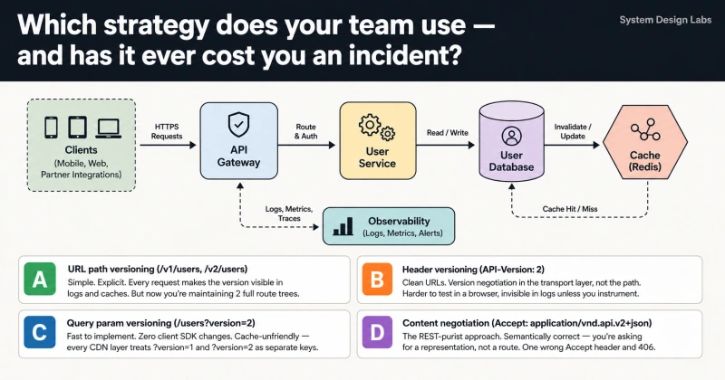

# Ngày 52: Versioning an API Without Breaking Clients

[← Ngày trước](day-51-isolating-noisy-tenants-in-multi-tenant-saas.md) | [Mục lục](README.md) | [Ngày tiếp theo →](day-53-zero-downtime-schema-migrations.md)

---


# NGÀY 52 · THIẾT KẾ HỆ THỐNG (SYSTEM DESIGN)
## Đánh Phiên Bản API Mà Không Làm Hỏng Ứng Dụng Client (Versioning an API Without Breaking Clients)

---

### Tình huống thực tế (Scenario)

API của bạn vừa release một **breaking change** (thay đổi gây phá vỡ tính tương thích).

Endpoint `/users` hiện trả về trường `fullName` thay vì `first_name` + `last_name`. Kết quả là: 3 ứng dụng di động (mobile clients) bị crash/lỗi. 1 tích hợp từ đối tác (partner integration) bị sập. Kỹ sư trực ca on-call của bạn đang vô cùng bực bội.

Bạn đã từng có một chiến lược đánh phiên bản (versioning strategy). Chỉ là nó không phải là chiến lược phù hợp mà thôi.



Có **4 cách** để đánh phiên bản cho một API. Dưới đây là những gì thực sự diễn ra khi bạn chọn từng cách trong môi trường production thực tế:

---

### Các phương án lựa chọn (Options)

#### **A — URL Path Versioning (Đánh phiên bản qua đường dẫn URL)**
```http
/v1/users
/v2/users
```
* **Đặc điểm:** Đơn giản. Rõ ràng. Mọi request đều làm cho phiên bản hiển thị trực quan ngay trong logs và caches. 
* **Hệ quả:** Tuy nhiên, giờ đây bạn đang phải bảo trì 2 cây định tuyến (route trees) hoàn chỉnh. Một bản vá lỗi (bugfix) ở tầng business logic dùng chung sẽ phải được áp dụng vá ở cả hai phiên bản. Các nhóm phát triển thường âm thầm bỏ mặc cho `v1` dần mục ruỗng, lỗi thời.

#### **B — Header Versioning (Đánh phiên bản qua Custom Header)**
```http
API-Version: 2
```
* **Đặc điểm:** URL sạch sẽ, chuẩn mực. Việc đàm phán phiên bản (version negotiation) diễn ra ở tầng giao vận (transport layer), không phải ở đường dẫn.
* **Hệ quả:** Khó kiểm thử trực tiếp trên trình duyệt hơn, vô hình trong hệ thống logs trừ khi bạn chủ động cấu hình thu thập dữ liệu (instrumentation), và các client thường quên gửi header này — dẫn đến server tự động mặc định fallback về bất cứ phiên bản nào mà nó coi là "mới nhất" (latest).

#### **C — Query Param Versioning (Đánh phiên bản qua tham số truy vấn URL)**
```http
/users?version=2
```
* **Đặc điểm:** Triển khai cực nhanh. Không yêu cầu thay đổi phía SDK của client.
* **Hệ quả:** Rất không thân thiện với bộ nhớ đệm (Cache-unfriendly) — mọi tầng CDN đều coi `?version=1` và `?version=2` là các cache keys tách biệt nhau hoàn toàn. Giải pháp này chỉ hoạt động tạm ổn cho đến khi bạn có 40 endpoints và hiện tượng trôi dạt phiên bản (version drift) trở nên mất kiểm soát, không thể theo dõi nổi.

#### **D — Content Negotiation (Đàm phán nội dung qua Accept Header)**
```http
Accept: application/vnd.api.v2+json
```
* **Đặc điểm:** Hướng tiếp cận theo trường phái thuần túy REST (REST-purist). Chuẩn xác về mặt ngữ nghĩa (semantically correct) — bạn đang yêu cầu một biểu diễn cụ thể (representation), chứ không phải một tuyến đường (route) khác.
* **Hệ quả:** Hầu như chẳng ai triển khai nó đúng chuẩn. Khả năng hỗ trợ từ các thư viện client không đồng nhất. Chỉ cần một header `Accept` cấu hình sai là bạn sẽ nhận ngay mã lỗi `406 Not Acceptable`.

---


---

### Đáp án & Giải thích chi tiết (Answers & Explanations)

#### Câu trả lời 1:
> [!IMPORTANT]
> **✓ ĐÁP ÁN CHÍNH XÁC: D — Content negotiation: Chuẩn đặc tả trên giấy, nhưng sai lầm ngoài thực tế (correct spec, wrong reality)**

* Header `Accept: application/vnd.api.v2+json` chính là những gì mà chuẩn đặc tả HTTP (HTTP spec) định hướng thiết kế. Bạn đang yêu cầu một biểu diễn dữ liệu cụ thể (specific representation) của một tài nguyên, chứ không phải một route khác. Về mặt ngữ nghĩa (semantically), đây là cách chuẩn xác nhất.
* **Trên thực tế:** Việc phân tích cú pháp (parsing) header `Accept` không đồng nhất giữa các thư viện client khác nhau. Các tầng phần mềm trung gian (Middleware) thường âm thầm loại bỏ (strip) các custom headers. Một client cấu hình sai sẽ nhận ngay lỗi `406 Not Acceptable` mà không có thông báo lỗi rõ ràng nào chỉ ra vấn đề nằm ở trường phiên bản. GitHub từng thử nghiệm đàm phán nội dung (content negotiation) trong giai đoạn đầu của API, sau đó đã phải chuyển sang URL versioning. Điều đó đã nói lên tất cả.

---

#### Câu trả lời 2:
> [!NOTE]
> **A — URL path versioning: Lựa chọn mặc định mang tính thực dụng (không sai, nhưng phải trả giá)**

* Đây là cách mà **Stripe**, **Twilio** và **GitHub** đang sử dụng. Không phải vì nó thuần khiết về mặt lý thuyết — thực tế nó không hề thuần khiết — mà bởi vì nó **hoàn toàn rõ ràng về mặt vận hành (operationally obvious)**.
* Mọi Proxy, công cụ gom log (Log Aggregator) và CDN đều hiểu được nó mà không cần bất kỳ cấu hình phức tạp nào. Sự khác biệt giữa `/v1/` và `/v2/` hiển thị trực quan ở khắp mọi nơi mà không cần cài đặt đo kiểm (instrumentation).
* **Cái giá phải trả là có thật:** Bạn phải duy trì các cây định tuyến (route trees) song song, và món nợ bảo trì (maintenance debt) của `v1` sẽ tăng lên theo cấp số nhân. Một bản vá lỗi (bugfix) trong business logic dùng chung phải được patch trên cả hai phiên bản. Câu trả lời của Stripe là ghim cứng client vào một phiên bản cụ thể ở cấp độ API key và thực hiện lộ trình ngừng hỗ trợ (deprecate) từ từ qua nhiều năm. Hầu hết các đội ngũ kỹ thuật đều không có đủ tính kỷ luật đó — do vậy `v1` âm thầm mục nát trong khi `v2` nhận được mọi sự chú ý.

---

#### Câu trả lời 3:
> [!WARNING]
> **B — Header versioning: Lý thuyết tốt, nhưng thực tế góc cạnh gồ ghề (good theory, rough edges)**

* Kiến trúc sạch (Clean architecture). URL đại diện cho tài nguyên, còn header đại diện cho sự đàm phán (negotiation). Đây là cách mà các hệ thống microservices nội bộ thường dùng để đánh phiên bản — khi bạn kiểm soát được cả phía client lẫn server, nó hoạt động rất tốt.
* **Vấn đề tồn tại:** Hoàn toàn vô hình trên các tab trình duyệt, bất khả thi để chia sẻ dưới dạng một lệnh `curl` đơn giản nếu không kèm thêm các flags phụ, và hành vi "mặc định về phiên bản mới nhất" (default to latest) khi thiếu header chính là một cái bẫy tự bắn vào chân mình (**footgun**). Sang năm thứ hai, một client cũ (legacy client) âm thầm làm rơi mất header. Server của bạn tự động fallback về `v2`. Client bị sập. Không một ai biết nguyên nhân tại sao — nó không hiển thị trên URL, và cũng không xuất hiện trong logs trừ khi bạn đã chủ động instrument riêng cho nó.

---

#### Câu trả lời 4:
> [!TIP]
> **C — Query params: Bản vá tạm thời nhưng lại tồn tại mãi mãi (the quick fix that stays forever)**

* Triển khai cực nhanh. Không yêu cầu bất kỳ thay đổi nào trong SDK của client. Hoạt động được ngay lập tức.
* **Vô hiệu hóa bộ đệm (Cache Invalidation) trở nên hỗn loạn ở quy mô lớn:** Mọi tầng CDN đều coi `?version=1` và `?version=2` là các cache keys riêng biệt, khiến tỷ lệ trúng cache (**cache hit rate**) của bạn tụt dốc thảm hại. Vấn đề lớn hơn là **hiện tượng trôi dạt phiên bản (version drift)**: do không có cơ chế cưỡng ép cập nhật (forcing function), các client sẽ nằm rải rác khắp nơi từ `v1`, `v2` đến `v3` mà không gặp bất kỳ áp lực nào buộc phải chuyển đổi (deprecation pressure). Cách này phù hợp cho các công cụ nội bộ nơi bạn nắm toàn quyền kiểm soát tất cả các clients, nhưng sẽ trở nên vô cùng tốn kém và nguy hiểm đối với các Public APIs.

---

### Bảng tổng hợp so sánh các chiến lược Versioning API

| Tiêu chí so sánh | A — URL Path (`/v1/...`) | B — Header (`API-Version: 2`) | C — Query Param (`?version=2`) | D — Content Negotiation (`Accept: ...`) |
| :--- | :--- | :--- | :--- | :--- |
| **Tính rõ ràng trong Logs/CDN** | Rất cao, mặc định hỗ trợ | Ẩn, phải instrument riêng | Tách rời cache key | Ẩn, middleware dễ nuốt header |
| **Trải nghiệm kiểm thử / Debug** | Dễ nhất (Browser, curl đơn giản) | Phức tạp (Cần thêm header flag) | Dễ dàng trên URL | Khó khăn, dễ nhận nhầm mã 406 |
| **Độ chuẩn mực REST** | Thấp (Xem phiên bản là tài nguyên) | Cao (Phân tách rõ ràng) | Thấp (Trộn lẫn tham số lọc) | Rất cao (Chuẩn đặc tả HTTP) |
| **Gánh nặng bảo trì (Maintenance)** | Route tree kép, nợ kỹ thuật lớn | Rủi ro fallback default to latest | Version drift mất kiểm soát | Client library hỗ trợ thiếu ổn định |
| **Độ phủ thực tế (Industry Adoption)** | Chuẩn thực tế (Stripe, GitHub) | Tốt cho Microservices nội bộ | Tạm thời / Công cụ nội bộ | Hiếm khi áp dụng thành công |


---

[← Ngày trước](day-51-isolating-noisy-tenants-in-multi-tenant-saas.md) | [Mục lục](README.md) | [Ngày tiếp theo →](day-53-zero-downtime-schema-migrations.md)
