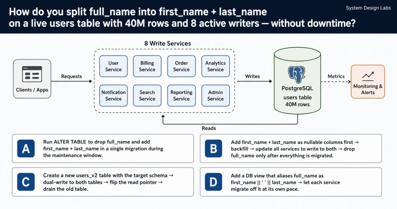
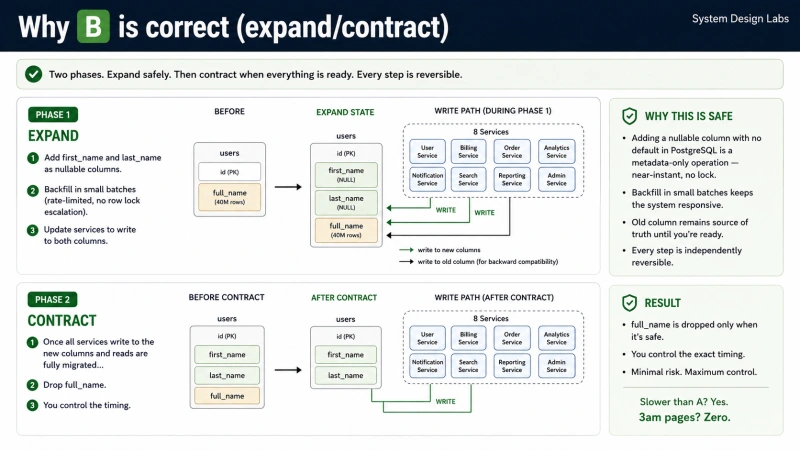

# Ngày 53: Zero-Downtime Schema Migrations

[← Ngày trước](day-52-versioning-an-api-without-breaking-clients.md) | [Mục lục](README.md) | [Ngày tiếp theo →](day-54-handling-embedding-drift-in-rag.md)

---

# NGÀY 53 · THIẾT KẾ HỆ THỐNG (SYSTEM DESIGN)
## Nâng cấp Schema không gián đoạn dịch vụ (Zero-Downtime Schema Migrations)

Bản migration của bạn đã chạy mượt mà trên môi trường thử nghiệm (staging).  
Thế rồi bạn cho chạy nó trên môi trường sản xuất (production).  
Ứng dụng bị sập hoàn toàn (down).  
Không phải vì câu lệnh SQL bị sai. Mà là vì bạn đã chạy nó trực tiếp trên một bảng đang hoạt động (live table) chứa tới **40 triệu dòng (40 million rows)** trong khi **8 dịch vụ (services)** khác nhau đang liên tục ghi dữ liệu vào đó.

### Bối cảnh hệ thống của bạn (Your setup):
* **Cơ sở dữ liệu:** PostgreSQL. Bảng `users`. 40 triệu dòng (40M rows). Có lưu lượng ghi liên tục từ 8 dịch vụ độc lập (active writes from 8 services).
* **Yêu cầu từ phía Sản phẩm (Product request):** Tách cột `full_name` thành hai cột `first_name` + `last_name`.
* **Khung thời gian:** Bạn có một khung thời gian bảo trì (maintenance window) kéo dài 2 giờ vào đêm nay.

> [!IMPORTANT]
> **Câu hỏi kỹ thuật (The engineering question):** Làm thế nào để bạn triển khai thay đổi này mà hoàn toàn không gây gián đoạn hệ thống (zero downtime)?

---

### Các phương án lựa chọn (Options):

* **A)** Chạy lệnh `ALTER TABLE` để xóa (`drop`) cột `full_name` và thêm hai cột `first_name` + `last_name` trong một đợt migration duy nhất suốt khung thời gian bảo trì (maintenance window).
* **B)** Thêm `first_name` + `last_name` dưới dạng các cột cho phép giá trị null (`nullable columns`) trước tiên → chạy nạp bù dữ liệu cũ (backfill) → cập nhật toàn bộ các dịch vụ để ghi đồng thời vào cả hai bên (write to both) → chỉ xóa (`drop`) cột `full_name` sau khi mọi thứ đã được di chuyển hoàn tất.
* **C)** Tạo một bảng `users_v2` hoàn toàn mới với cấu trúc schema đích → triển khai cơ chế ghi kép vào cả hai bảng (dual-write to both tables) → chuyển hướng con trỏ đọc (flip the read pointer) → xả và dọn sạch bảng cũ (drain the old table).
* **D)** Thêm một Database View đặt bí danh cho `full_name` dưới dạng `first_name || ' ' || last_name` → để từng dịch vụ tự di chuyển dần khỏi cột cũ theo tiến độ riêng của chúng.

---

# NGÀY 53 · ĐÁP ÁN & GIẢI THÍCH CHI TIẾT (ANSWERS & EXPLANATIONS)

### Câu trả lời 1 (Answer 1)
### ✓ ĐÁP ÁN ĐÚNG: LỰA CHỌN B

#### Tại sao B là phương án chính xác (Why B is correct)
Áp dụng mẫu kiến trúc hai giai đoạn **Expand and Contract (Mở rộng và Thu hẹp)**:

* **Giai đoạn 1 — Mở rộng (Phase 1 — Expand):**  
  Thêm hai cột `first_name` và `last_name` dưới dạng các cột cho phép giá trị null (`nullable columns`). Trên PostgreSQL, việc thêm một cột `nullable` không có giá trị mặc định (`no default`) hoàn toàn chỉ là một thao tác cập nhật siêu dữ liệu (metadata-only operation) — diễn ra gần như tức thì và không áp đặt khóa bảng (no lock).  
  Tiến hành nạp bù dữ liệu cũ (backfill) theo từng đợt nhỏ (small batches) có giới hạn tốc độ (rate-limited, tránh hiện tượng leo thang khóa dòng / row lock escalation). Cập nhật đồng thời tất cả các dịch vụ để ghi dữ liệu mới vào cả hai nhóm cột cùng một lúc (write to both columns simultaneously).

* **Giai đoạn 2 — Thu hẹp (Phase 2 — Contract):**  
  Một khi mọi dịch vụ đều đã ghi ổn định vào các cột mới và toàn bộ thao tác đọc đã được chuyển hướng hoàn toàn, tiến hành xóa bỏ (`drop`) cột `full_name`. Bạn hoàn toàn chủ động kiểm soát thời điểm thực hiện thao tác này.

> [!TIP]
> **Đặc tính cốt lõi (The key property):** Mọi bước trong quy trình này đều có khả năng đảo ngược độc lập (independently reversible). Nếu có sự cố phát sinh sau Giai đoạn 1, bạn chỉ cần dừng lại — cột cũ vẫn còn nguyên vẹn ở đó, và các dịch vụ phiên bản cũ vẫn tiếp tục vận hành bình thường.  
> 
> *Chậm hơn phương án A không? Có. Nhưng số lượng cảnh báo khẩn cấp lúc 3 giờ sáng (3am pages)? Bằng không (Zero).*

---

### Câu trả lời 2 (Answer 2)
#### Tại sao phương án A sẽ khiến bạn bị gọi dậy giữa đêm (Why A will get you paged)
Lệnh `ALTER TABLE` khi chạy trên một bảng đang hoạt động (live table) sẽ yêu cầu chiếm quyền khóa độc quyền truy cập (**`ACCESS EXCLUSIVE lock`**) trong PostgreSQL. Khóa này sẽ **chặn đứng toàn bộ mọi thao tác đọc lẫn ghi** trong suốt thời gian lệnh thực thi. 

Trên một bảng có 40 triệu dòng đang chịu tải truy cập liên tục, thời gian giữ khóa đó sẽ kéo dài hàng phút — chứ không phải vài giây. Toàn bộ 8 dịch vụ của bạn sẽ bị quá thời gian chờ (timeout). Hàng đợi yêu cầu (queue) sẽ bị dồn ứ nghiêm trọng. Hệ thống giám sát sẽ đồng loạt kích hoạt cảnh báo đỏ.

> [!WARNING]
> Từ khóa `CONCURRENTLY` chỉ có tác dụng hỗ trợ tạo chỉ mục (index creation). Nó hoàn toàn không hỗ trợ cho các thao tác xóa cột (`drop column`) hoặc đổi tên cột (`rename column`). Khung thời gian bảo trì (maintenance window) không thể cứu được bạn — **bản thân cơ chế khóa bảng (lock) mới chính là vấn đề, chứ không phải thời điểm thực thi (timing)**.

---

### Câu trả lời 3 (Answer 3)
#### Tại sao phương án C là giải pháp quá mức cần thiết (Why C is overkill)
Mô hình bảng bóng (shadow table) kết hợp ghi kép (dual-write) là một giải pháp hoạt động được. Tuy nhiên, nó đòi hỏi bạn phải triển khai một tầng xử lý ghi kép (dual-write layer) ở bên trong từng dịch vụ, phải xử lý việc chuyển hướng con trỏ đọc nguyên tử (atomic read-pointer flip), và trải qua một giai đoạn xả rỗng/dọn dẹp (drain/cleanup phase) cho bảng cũ.

Phương án này chỉ xứng đáng đánh đổi đối với các đợt tái cấu trúc kiến trúc dữ liệu thực sự lớn — ví dụ như thay đổi khóa chính (new primary key), tái phân vùng bảng (re-partitioning), hoặc thay đổi các công cụ lưu trữ (storage engines).  
Đối với bài toán chỉ đơn giản là tách một cột trên một bảng đơn lẻ? Đó là việc tiêu tốn **3 tuần kỹ thuật để giải quyết một vấn đề chỉ cần 3 ngày**.

---

### Câu trả lời 4 (Answer 4)
#### Tại sao phương án D chỉ là hành động trì hoãn vấn đề (Why D defers the problem)
Việc sử dụng một Database View để đặt bí danh cho `full_name` có thể giúp bạn kéo dài thêm thời gian. Nó có thể hữu ích nếu đóng vai trò như một tầng chuyển tiếp trung gian bên trong Lựa chọn B. 

Tuy nhiên, cơ chế view cho phép ghi xuyên thấu (write-through views) của PostgreSQL chỉ hoạt động trên các view đơn bảng đơn giản, không chứa các liên kết bảng (`joins`) hoặc hàm tổng hợp (`aggregates`). Cuối cùng thì bạn vẫn bắt buộc phải thực hiện nạp bù dữ liệu (backfill) cho các cột thật tế.  
Giải pháp này chỉ **trì hoãn** đợt migration, chứ **không thể thay thế** được nó.

---

### Bảng tổng hợp so sánh các phương án (Architectural Decision Matrix)

| Tiêu chí so sánh | Phương án A (Single ALTER TABLE) | Phương án B (Expand & Contract) | Phương án C (Shadow Table & Dual-write) | Phương án D (Database View Alias) |
| :--- | :--- | :--- | :--- | :--- |
| **Mức độ rủi ro Downtime** | **Rất cao (Critical)** - Do `ACCESS EXCLUSIVE lock` | **Không có (Zero-downtime)** | **Rất thấp** | **Thấp** |
| **Khả năng đảo ngược (Reversibility)** | Rất khó / Gây hỏng dữ liệu | **Độc lập ở từng bước** | Phức tạp | Trung bình |
| **Độ phức tạp triển khai** | Thấp nhất (nhưng gây sập hệ thống) | **Tối ưu, chuẩn công nghiệp** | Quá phức tạp (Overkill) | Chỉ là giải pháp tạm thời |
| **Đánh giá của Architect** | ❌ Bị loại (Trap answer) | ✅ **Lựa chọn tối ưu nhất** | ❌ Lãng phí nguồn lực | ❌ Chưa giải quyết triệt để |

---

[← Ngày trước](day-52-versioning-an-api-without-breaking-clients.md) | [Mục lục](README.md) | [Ngày tiếp theo →](day-54-handling-embedding-drift-in-rag.md)
