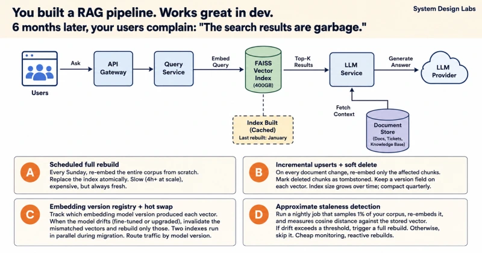

# Ngày 54: Handling Embedding Drift in RAG

[← Ngày trước](day-53-zero-downtime-schema-migrations.md) | [Mục lục](README.md) | [Ngày tiếp theo →](day-55-parallel-agents-with-shared-state.md)

---

# NGÀY 54 · THIẾT KẾ HỆ THỐNG (DAY 54 · SYSTEM DESIGN)
## Xử lý Hiện tượng Lệch Embedding trong RAG (Handling Embedding Drift in RAG)

Bạn đã xây dựng một **RAG pipeline** (Retrieval-Augmented Generation). Mọi thứ hoạt động hoàn hảo trên môi trường phát triển (dev).

6 tháng sau, người dùng của bạn phàn nàn: *"Kết quả tìm kiếm toàn là rác."*

Bạn không hề thay đổi một dòng code nào.

**Dưới đây là chuyện đã xảy ra:**
Sản phẩm của bạn đã phát triển. Có thêm tính năng mới, tài liệu mới, ticket hỗ trợ mới. Dữ liệu đã bị trôi dạt/lệch (*data drift*) — nhưng **chỉ mục embedding** (*embedding index*) của bạn thì không hề thay đổi.

Hiện tại bạn đang phục vụ một **FAISS index dung lượng 400GB** vốn được rebuild lần cuối từ tận tháng 1. Các đoạn dữ liệu (*chunks*) của bạn đã lỗi thời (*stale*). Kết quả tìm kiếm láng giềng gần nhất (*nearest-neighbor search*) trỏ vào các tài liệu đã bị deprecated (ngưng sử dụng). Mô hình LLM của bạn đang tự tin bịa đặt (*confidently hallucinating*) dựa trên ngữ cảnh (*context*) đã lỗi thời.

Bạn cần phải khắc phục sự cố này. 4 kỹ sư đưa ra 4 giải pháp:

* **A) Xây dựng lại toàn bộ theo lịch định kỳ (Scheduled full rebuild):**
  Vào mỗi Chủ nhật, tái embedding toàn bộ kho ngữ liệu (*entire corpus*) từ đầu. Thay thế chỉ mục (*index*) một cách nguyên tử (**atomic swap**). Chậm (hơn 4 giờ ở quy mô lớn), tốn kém chi phí, nhưng đảm bảo dữ liệu luôn mới (*fresh*).

* **B) Cập nhật gia tăng kèm xóa mềm (Incremental upserts + soft delete):**
  Mỗi khi tài liệu thay đổi, chỉ tái embedding các đoạn dữ liệu (*chunks*) bị ảnh hưởng. Đánh dấu các chunk bị xóa là **tombstoned**. Lưu giữ trường phiên bản (*version field*) trên mỗi vector. Kích thước chỉ mục tăng dần theo thời gian; nén dọn dẹp định kỳ hàng quý (*compact quarterly*).

* **C) Sổ đăng ký phiên bản embedding kèm cơ chế tráo nóng (Embedding version registry + hot swap):**
  Theo dõi phiên bản mô hình embedding nào đã tạo ra mỗi vector. Khi mô hình bị trôi dạt/thay đổi (*model drift - do fine-tune hoặc nâng cấp*), vô hiệu hóa các vector không khớp phiên bản và chỉ rebuild lại những vector đó. Chạy song song hai chỉ mục (*two indexes in parallel*) trong quá trình dịch chuyển (*migration*). Điều hướng lưu lượng truy cập (**route traffic**) theo phiên bản mô hình.

* **D) Phát hiện độ trôi dạt/lỗi thời xấp xỉ (Approximate staleness detection):**
  Chạy một tác vụ ngầm hàng đêm (**nightly job**) lấy mẫu ngẫu nhiên 1% kho ngữ liệu của bạn, tái embedding nó và đo khoảng cách cosin (**cosine distance**) so với vector đang lưu trữ. Nếu độ trôi dạt vượt quá một ngưỡng nhất định, kích hoạt rebuild toàn bộ (*trigger a full rebuild*). Nếu không thì bỏ qua. Chi phí giám sát rẻ, kích hoạt rebuild phản ứng linh hoạt (*reactive rebuilds*).

> [!IMPORTANT]
> **Ràng buộc thực tế trong bài toán (Real constraint):**
> Kho ngữ liệu của bạn có **50 triệu chunks**. 
> - Rebuild toàn bộ một lần = **4 giờ chạy** + tốn khoảng **$800 chi phí Embedding API**.
> - Bạn triển khai cập nhật mô hình định kỳ **mỗi 6 tuần/lần**.

---

# NGÀY 54 · ĐÁP ÁN & GIẢI THÍCH CHI TIẾT (DAY 54 · ANSWERS & EXPLANATIONS)

## Câu trả lời 1: ĐÁP ÁN ĐÚNG (CORRECT ANSWER)

> [!TIP]
> **C là đáp án chính xác — Embedding Version Registry + Hot Swap**

Đây là giải pháp duy nhất giải quyết được vấn đề thực tế: **mô hình embedding của bạn đã thay đổi**. 

Khi bạn **fine-tune** hoặc **nâng cấp** mô hình của mình, Phương án A và B vẫn phục vụ một chỉ mục hỗn tạp (**mixed index**) — một số vector được tạo từ mô hình v1, một số từ mô hình v2. Phép toán đo độ tương đồng cosin (**cosine similarity**) của bạn bị phá vỡ hoàn toàn vì bạn đang so sánh các vector từ các **không gian embedding khác nhau** (*different embedding spaces*). Chúng không thể so sánh được với nhau về mặt toán học. 

**C** là phương án duy nhất theo vết được mô hình nào đã sinh ra vector nào và thực hiện định tuyến truy vấn (**route queries**) đến đúng phiên bản chỉ mục trong suốt quá trình dịch chuyển dữ liệu. Việc duy trì **hai chỉ mục song song** (*two indexes in parallel*) trong giai đoạn chuyển tiếp đồng nghĩa với:
- **Zero downtime** (Không có thời gian chết).
- **Zero mixed-space comparisons** (Không xảy ra tình trạng so sánh vector chéo không gian).

**Lợi thế thực chiến trong Production (The production win):**
Bạn có thể di chuyển dần **10% lưu lượng truy cập (traffic)** sang chỉ mục mới theo chiến lược Canary, kiểm chứng chất lượng truy xuất (*validate retrieval quality*), sau đó mới thực hiện chuyển đổi toàn bộ (**cut over**). Không áp dụng cách tiếp cận rủi ro *big bang*. Không phải chịu trận việc rebuild 4 tiếng vào Chủ nhật làm tắc nghẽn công việc của cả team.

---

## Câu trả lời 2: Bẫy kỹ sư Senior (The senior engineer trap)

> [!WARNING]
> **B là cái bẫy dành cho kỹ sư Senior (B is the senior engineer trap)**

Cập nhật gia tăng (**Incremental upserts**) nghe có vẻ rất thông minh — bạn chỉ tái embedding những gì thực sự thay đổi. Nhưng đây chính là kẻ sát nhân thầm lặng: **Độ trôi dạt mô hình (Model Drift)**. 

Bạn cập nhật mô hình embedding của mình mỗi 6 tuần. Giờ đây, chỉ mục của bạn chứa các vector đến từ **4 phiên bản mô hình khác nhau**:
- Chunk A được embedding bằng `text-embedding-ada-002`.
- Chunk B được tạo bởi mô hình `fine-tuned v2` của chính bạn.

Thuật toán tìm kiếm láng giềng gần nhất (*nearest neighbor search*) trên một chỉ mục có không gian hỗn hợp (**mixed-space index**) sẽ trả về toàn kết quả rác — **không phải vì dữ liệu bị cũ, mà vì hình học không gian vector không còn nhất quán (inconsistent geometry)**. 

Phương án B giải quyết được bài toán **lệch dữ liệu (data drift)**. Nhưng nó hoàn toàn bó tay trước bài toán **lệch mô hình (model drift)**. Với chu kỳ cập nhật mô hình 6 tuần/lần, độ trôi dạt mô hình (*model drift*) mới chính là vấn đề cốt lõi thực sự của bạn.

---

## Câu trả lời 3: Nợ vận hành theo lối bạo lực (Brute-force ops debt)

> [!NOTE]
> **A là nợ vận hành bằng cách vét cạn / bạo lực (A is brute-force ops debt)**

Tốn **$800 vào mỗi Chủ nhật** bất kể bạn có thực sự cần nó hay không. Với chu kỳ cập nhật mô hình 6 tuần một lần, hầu hết các lần rebuild định kỳ hàng tuần đều là **chi phí lãng phí** dành cho dữ liệu chưa hề có thay đổi đáng kể. 

Phương án này có hoạt động không? Có. Nhưng nó vô cùng tốn kém và thô thiển. Nó có thể ổn với một startup có quy mô dữ liệu nhỏ ở mức 1 triệu chunks. Nhưng sẽ cực kỳ đau đớn khi chạm ngưỡng **50 triệu chunks**.

---

## Câu trả lời 4: Giám sát chứ không phải là giải pháp sửa lỗi (Monitoring, not a fix)

> [!NOTE]
> **D chỉ là giải pháp giám sát, không phải là một phương án khắc phục (D is monitoring, not a fix)**

Phát hiện độ lỗi thời (*staleness detection*) thực sự rất hữu ích — nhưng nó chỉ đóng vai trò là một **tín hiệu cảnh báo (signal)**, chứ không phải một **chiến lược kiến trúc (strategy)**. 

Mẫu kiểm tra 1% chỉ cho bạn biết rằng hệ thống **đang có hiện tượng trôi dạt**, chứ không thể cho bạn biết chính xác **những vector nào bị ảnh hưởng** hoặc **lý do tại sao**. Sau cùng, bạn vẫn bắt buộc phải có một chiến lược rebuild cụ thể. 

Phương án D chỉ là một **cò kích hoạt (trigger)**, không phải là một **kiến trúc hoàn chỉnh (architecture)**. Bạn nên kết hợp D cùng với C để tạo ra một hệ thống toàn diện.

---

### Bảng tóm tắt so sánh các phương án (Architectural Decision Matrix)

| Tiêu chí so sánh | A) Scheduled Full Rebuild | B) Incremental Upserts | C) Version Registry + Hot Swap | D) Staleness Detection |
| :--- | :--- | :--- | :--- | :--- |
| **Xử lý Data Drift** | Có (Độ trễ tối đa 1 tuần) | Có (Gần như thời gian thực) | Có (Theo dõi chính xác vector lỗi) | Không (Chỉ phát hiện, không xử lý) |
| **Xử lý Model Drift** | Có (Nhưng lãng phí nếu chạy tuần) | **Không** (Lỗi Mixed-space geometry) | **Có (Cô lập không gian vector chuẩn xác)** | Không (Chỉ đưa ra tín hiệu) |
| **Chi phí API & Tính toán**| Cực cao ($800/tuần cố định) | Thấp (Chỉ tính trên delta thay đổi) | Tối ưu (Chỉ rebuild vector mismatch) | Cực thấp (Chỉ sample 1%) |
| **Downtime / Rủi ro** | Rủi ro gián đoạn khi swap lớn | Trả về kết quả rác do lệch geometry | **Zero-downtime, hỗ trợ Canary 10%** | Không tác động trực tiếp |
| **Đánh giá kiến trúc** | Giải pháp tạm thời (Brute-force) | Cạm bẫy kỹ sư (Trap answer) | **Lựa chọn tối ưu cấp Production** | Công cụ giám sát đi kèm (Monitoring) |

---

[← Ngày trước](day-53-zero-downtime-schema-migrations.md) | [Mục lục](README.md) | [Ngày tiếp theo →](day-55-parallel-agents-with-shared-state.md)
