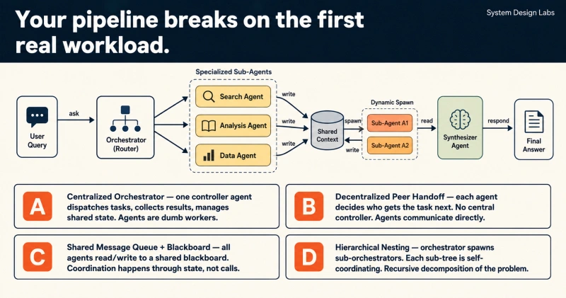
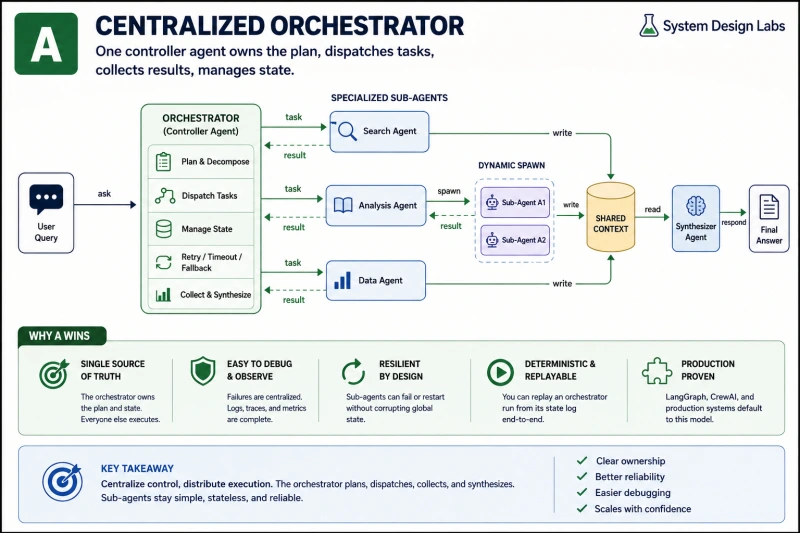

# Ngày 55: Parallel Agents with Shared State

[← Ngày trước](day-54-handling-embedding-drift-in-rag.md) | [Mục lục](README.md) | [Ngày tiếp theo →](day-56-tracking-long-running-async-jobs.md)

---

# DAY 55 · THIẾT KẾ HỆ THỐNG (SYSTEM DESIGN)

## Các Agent chạy song song với Trạng thái chia sẻ (Parallel Agents with Shared State)

Bạn đã xây dựng thành công một agent. Nó hoạt động tốt.  
Bây giờ bạn cần 5 agent như vậy chạy song song (**in parallel**), cùng chia sẻ trạng thái (**sharing state**), và bàn giao công việc (**handing off work**) cho nhau.  
Đường ống xử lý (**pipeline**) của bạn sụp đổ ngay từ khối lượng công việc thực tế đầu tiên.

### Thiết lập bài toán (The Setup):
Bạn đang xây dựng một hệ thống agent nghiên cứu (**research agent system**). Người dùng đặt ra một câu hỏi phức tạp. Bạn cần phải:
* Phân nhánh song song (**Fan out**) tới 3 sub-agent chuyên biệt cùng một lúc.
* Một agent có thể tự sinh thêm 2 agent nữa dựa trên những gì nó tìm thấy.
* Tất cả chúng đều ghi dữ liệu ngược trở lại ngữ cảnh dùng chung (**shared context**).
* Một agent cuối cùng sẽ tổng hợp (**synthesize**) mọi thứ.

Đây là bài toán điều phối đa tác tử kinh điển (**Classic multi-agent orchestration**). Bạn có 4 lựa chọn cho cách các agent phối hợp với nhau:

---

### Các phương án lựa chọn (Options)

* **A) Bộ điều phối trung tâm (Centralized Orchestrator)** — Một agent đóng vai trò bộ điều khiển (**controller agent**) thực hiện phân phối tác vụ (**dispatches tasks**), thu thập kết quả (**collects results**), và quản lý trạng thái chia sẻ (**manages shared state**). Các agent còn lại chỉ là các worker đơn giản, không tự quyết định (**dumb workers**).

* **B) Bàn giao ngang hàng phi tập trung (Decentralized Peer Handoff)** — Mỗi agent tự quyết định xem ai sẽ nhận tác vụ tiếp theo. Không có bộ điều khiển trung tâm (**No central controller**). Các agent giao tiếp trực tiếp với nhau (**communicate directly**).

* **C) Hàng đợi tin nhắn chia sẻ + Bảng đen (Shared Message Queue + Blackboard)** — Tất cả các agent đều đọc/ghi vào một bảng đen chia sẻ (**shared blackboard**). Việc phối hợp diễn ra thông qua trạng thái (**state**), không phải qua các lệnh gọi trực tiếp (**calls**).

* **D) Phân cấp lồng nhau (Hierarchical Nesting)** — Bộ điều phối sinh ra các bộ điều phối con (**sub-orchestrators**). Mỗi cây con (**sub-tree**) tự điều phối nội bộ. Phân rã bài toán theo kiểu đệ quy (**Recursive decomposition of the problem**).

---

# DAY 55 · ĐÁP ÁN & GIẢI THÍCH CHI TIẾT (ANSWERS & EXPLANATIONS)

### Câu trả lời 1 (Answer 1)

> [!TIP]
> ### ✓ ĐÁP ÁN CHÍNH XÁC
> **Đáp án: A — Bộ điều phối trung tâm (Centralized Orchestrator)**

Dưới đây là phân tích toàn diện — và vị trí ứng dụng thực tế của từng mô hình:

#### Vì sao phương án A chiến thắng (Centralized Orchestrator):
Một agent duy nhất nắm giữ toàn bộ kế hoạch (**owns the plan**). Nó thực hiện phân phối (**dispatches**), thu thập (**collects**), thử lại (**retries**), và tổng hợp (**synthesizes**). Mọi sub-agent đều là **stateless** (phi trạng thái) và được thiết kế "dumb" (không tự xử lý logic phức tạp ngoài phạm vi) một cách có chủ đích — chúng nhận tác vụ, trả về kết quả, thế là xong.

Đây không phải là một hạn chế. Đây là một tính năng (**feature**).

Khi có sự cố xảy ra, bạn biết chính xác mình cần tìm lỗi ở đâu: **chính là bộ điều phối (orchestrator)**. Nó nắm giữ logic thử lại (**retry logic**), ngân sách thời gian chờ (**timeout budgets**), và các kịch bản dự phòng (**fallback paths**). Các sub-agent có thể chết và khởi động lại mà không làm hỏng trạng thái toàn cục (**global state**), bởi vì bộ điều phối là thực thể duy nhất duy trì trạng thái đó.

**LangGraph**, **CrewAI**, và mọi framework agentic cấp độ production đều mặc định sử dụng mô hình này vì một lý do: Nó có thể **debug** được (**debuggable**), có khả năng quan sát giám sát (**observable**), và có tính đơn định (**deterministic**). Bạn có thể phát lại (**replay**) một lượt chạy của orchestrator từ nhật ký trạng thái (**state log**) của nó. Thử làm điều đó với mô hình bàn giao ngang hàng peer-to-peer xem!

---

### Câu trả lời 2 (Answer 2)

> [!WARNING]
> #### Vì sao phương án B là cái bẫy (Decentralized Peer Handoff):
> Mô hình này nghe có vẻ rất thanh lịch trên lý thuyết: Các agent tự tổ chức (**self-organize**), không có nút thắt cổ chai (**bottleneck**) ở tầng đầu não.

**Vấn đề là:** Ai sẽ là người giải quyết xung đột (**resolves conflicts**)? Nếu Agent A bàn giao cho Agent B, và Agent B quyết định tác vụ này thực chất thuộc về Agent C, rồi Agent C lại bàn giao ngược lại cho Agent A — bạn sẽ rơi vào một **vòng lặp vô tận (cycle)** mà không có cơ chế ngắt mạch (**circuit breaker**).

Bàn giao ngang hàng (**Peer handoff**) chỉ hoạt động tốt trong các đường ống khép kín, có phạm vi định nghĩa rõ ràng (như chuỗi Git commit hook). Nó sẽ sụp đổ ngay khoảnh khắc bạn xuất hiện các điều kiện định tuyến rẽ nhánh (**conditional routing**), phục hồi lỗi (**error recovery**), hoặc phân nhánh song song (**parallel fan-out**).

---

### Câu trả lời 3 (Answer 3)

> [!NOTE]
> #### Vì sao phương án C chỉ được tính điểm một phần (Shared Blackboard):
> Mô hình bảng đen chia sẻ (**shared blackboard**) là có thật và hữu ích — nhưng chỉ với tư cách là **một tầng dữ liệu (data layer)**, chứ không phải là một cơ chế điều phối (**coordination mechanism**).

Việc các agent cùng ghi vào và đọc từ trạng thái chia sẻ hoạt động tốt cho mục đích truyền ngữ cảnh (**passing context**). Điều mà nó **không thể** làm một cách rõ ràng, gãy gọn là điều phối xem **ai sẽ chạy tiếp theo, vào lúc nào, và với dữ liệu đầu vào nào**. Cuối cùng, bạn sẽ lại phải tự dựng lên một bộ điều phối ngầm (**implicit orchestrator**) thông qua cơ chế thăm dò (**polling**) — bản chất vẫn là một, nhưng hoàn toàn mất đi tính minh bạch (**zero visibility**).

* Hãy dùng **Blackboard** cho việc chia sẻ trạng thái (**state sharing**).
* Hãy dùng **Orchestrator** cho việc định tuyến tác vụ (**task routing**).  
Chúng mang tính bổ trợ cho nhau, chứ không phải là phương án thay thế lẫn nhau.

---

### Câu trả lời 4 (Answer 4)

#### Vì sao phương án D chỉ phù hợp cho một bài toán đặc thù (Hierarchical Nesting):
Điều phối phân cấp (**Hierarchical orchestration**) là mô hình chuẩn xác khi chính bản thân bài toán có thể phân rã theo cấu trúc phân cấp (**hierarchically decomposable**) — ví dụ như một pipeline mà tác vụ "Tóm tắt các bài báo AI" phân nhánh (**fan out**) thành 10 sub-task, và mỗi sub-task đó lại tiếp tục phân nhánh sâu hơn.

**Điểm đánh đổi (The catch):** Đệ quy sẽ làm tăng thêm độ trễ (**latency**) và độ phức tạp khi gỡ lỗi (**debugging complexity**) ở từng tầng lớp. Nếu bài toán của bạn không phân rã một cách tự nhiên thành các cây con sạch sẽ, bạn chỉ đang thêm vào các tầng gián tiếp (**indirection**) mà không thu lại bất kỳ lợi ích nào.  
> **Nguyên tắc:** Hãy luôn mặc định bắt đầu với mô hình điều phối trung tâm dạng phẳng (**flat centralized orchestration**). Chỉ tìm đến mô hình phân cấp (**hierarchical**) khi bản chất bài toán thực sự đòi hỏi.

---

### Bảng tổng kết so sánh các mẫu kiến trúc điều phối Agent (Architectural Summary)

| Mẫu kiến trúc (Pattern) | Khả năng kiểm soát & Quan sát (Observability) | Xử lý lỗi & Timeout (Fault Tolerance) | Tránh vòng lặp (Cycle Prevention) | Trường hợp sử dụng tối ưu (Best Use Case) |
| :--- | :--- | :--- | :--- | :--- |
| **Centralized Orchestrator (A)** | Rất cao (Đơn định, Log tập trung, Replayable) | Tập trung tại Orchestrator (Retry, Fallback) | Tuyệt đối (Có Graph / State Machine kiểm soát) | **Lựa chọn mặc định cho hầu hết hệ thống Agent Production** |
| **Decentralized Peer Handoff (B)** | Rất thấp (Khó truy vết luồng chạy) | Phức tạp (Dễ đứt gãy luồng) | Kém (Dễ dính Deadlock hoặc Infinite Loop) | Pipeline tuần tự, đơn giản, khép kín (như Hook chain) |
| **Shared Blackboard (C)** | Trung bình (Tốt về dữ liệu, kém về luồng thực thi) | Khó xác định trạng thái thất bại của từng tác vụ | Dễ xung đột đọc/ghi (Race condition) | Chia sẻ bộ nhớ / ngữ cảnh chung (kết hợp với Orchestrator) |
| **Hierarchical Nesting (D)** | Phức tạp dần theo độ sâu đệ quy | Phân tầng theo từng Sub-tree | Kiểm soát được nếu phân nhánh dạng cây (Tree) | Bài toán đệ quy lớn, chia để trị tự nhiên (Map-Reduce sâu) |

---

[← Ngày trước](day-54-handling-embedding-drift-in-rag.md) | [Mục lục](README.md) | [Ngày tiếp theo →](day-56-tracking-long-running-async-jobs.md)
