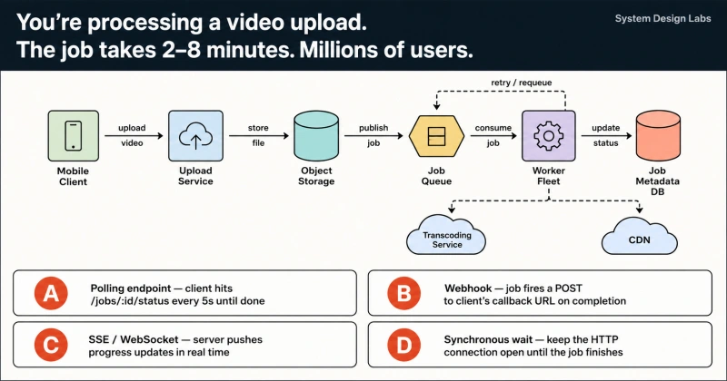
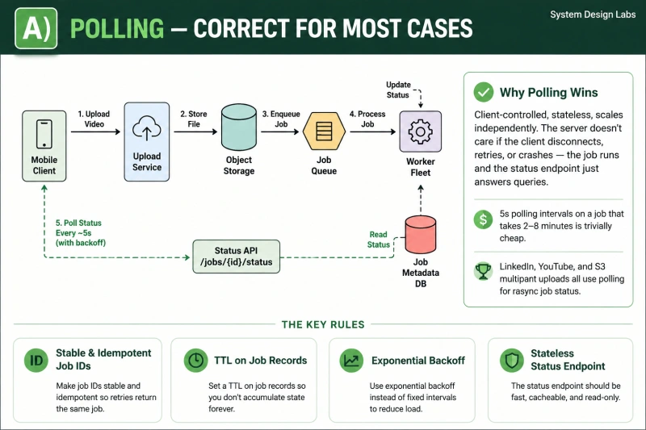

# Ngày 56: Tracking Long-Running Async Jobs

[← Ngày trước](day-55-parallel-agents-with-shared-state.md) | [Mục lục](README.md) | [Ngày tiếp theo →](day-57-consistency-for-payment-confirmation-reads.md)

---

# NGÀY 56 · SYSTEM DESIGN: THEO DÕI CÁC TÁC VỤ BẤT ĐỒNG BỘ CHẠY LÂU (TRACKING LONG-RUNNING ASYNC JOBS)

---

## 📌 TÌNH HUỐNG THỰC TẾ (SCENARIO)

> **Tác vụ nền (background job) của bạn đã chạy suốt 4 phút và không ai biết liệu nó đã hoàn thành hay chưa.**  
> Đó không phải là vấn đề của hàng đợi tác vụ (job queue). Đó là **vấn đề của một thiết kế kiến trúc bị thiếu sót**.

Các tác vụ chạy lâu (long-running jobs) phá vỡ mọi giả định mà bạn từng xây dựng cho các API đồng bộ (synchronous APIs):
- Bộ cân bằng tải (**Load Balancer**) của bạn sẽ bị hết thời gian chờ (**timeout**) sau 30 giây.
- Ứng dụng di động phía máy khách (**mobile client**) không biết liệu có nên thử lại (**retry**) hay không.
- Logic thử lại (**retry logic**) của bạn lại chạy lại một tác vụ đã hoàn thành được một nửa.

### Bài toán thực tế:
Bạn đang xử lý một tác vụ tải video lên (**video upload**).  
- Tác vụ mất từ **2 đến 8 phút**.  
- Hệ thống phục vụ **hàng triệu người dùng (millions of users)**.

**Bạn sẽ cung cấp cơ chế nào cho phía client?**

* **A) Endpoint thăm dò (Polling endpoint)** — Client gọi định kỳ tới `/jobs/:id/status` mỗi 5 giây một lần cho đến khi hoàn thành.
* **B) Webhook** — Tác vụ sẽ kích hoạt một yêu cầu POST tới URL phản hồi (**callback URL**) của client khi hoàn tất.
* **C) SSE / WebSocket** — Máy chủ đẩy (**push**) các cập nhật tiến độ theo thời gian thực (**real time**).
* **D) Chờ đồng bộ (Synchronous wait)** — Giữ kết nối HTTP mở liên tục cho đến khi tác vụ chạy xong.

> [!NOTE]
> **Chỉ có một phương án** có khả năng mở rộng quy mô lên hàng triệu người dùng mà không làm ràng buộc (coupling) hạ tầng của bạn vào thời gian hoạt động trực tuyến (**uptime**) của client.

---

Những phương án còn lại đều tiềm ẩn các **trạng thái lỗi nghiêm trọng trong môi trường production (hard production failure modes)** mà phần lớn các đội ngũ kỹ thuật chỉ phát hiện ra vào lúc 3 giờ sáng.

Vấn đề cốt lõi sâu xa hơn ở đây không nằm ở giao thức truyền tải (**transport**) — mà nằm ở **4 yếu tố then chốt** mà hầu như không ai làm đúng ngay từ lần đầu tiên:

1. **Tính bất biến / Tính lũy đẳng (Idempotency):**  
   Mọi tác vụ đều phải đảm bảo an toàn tuyệt đối khi chạy lại. Nếu logic thử lại (**retry logic**) của bạn có thể gây ra trừ tiền hai lần (**double-charge**), gửi hai lần (**double-send**), hoặc xử lý trùng lặp (**double-process**) — thì bạn không hề có cơ chế thử lại, bạn chỉ đang có sẵn những lỗi nghiêm trọng đang chực chờ bùng phát.
2. **Độ chi tiết của tiến độ (Progress granularity):**  
   Báo cáo `"0% → 100%"` hoàn toàn vô dụng đối với một tác vụ kéo dài 6 phút. Bạn cần các trạng thái trung gian: `queued` (đã xếp hàng), `processing` (đang xử lý), `transcoding` (đang chuyển mã), `uploading` (đang tải lên), `complete` (hoàn thành). Client cần một thông tin cụ thể để hiển thị cho người dùng.
3. **Hết thời gian chờ so với Thất bại thực sự (Timeout vs Failure):**  
   Một tác vụ ngừng phản hồi không đồng nghĩa với một tác vụ đã thất bại. Công nhân xử lý bị chết (**dead workers**), tiến trình bị hủy do tràn bộ nhớ (**OOM kills**), các máy chủ bị thu hồi ngoài dự kiến (**spot instance evictions**) — hàng đợi của bạn cần một cơ chế gửi tín hiệu duy trì hoạt động (**heartbeat**) hoặc cơ chế thời gian chờ hiển thị (**visibility timeout**), chứ không chỉ đơn thuần là một khối lệnh `try/catch`.
4. **Khử trùng lặp (Deduplication):**  
   Phía client sẽ gửi lại yêu cầu (**retry**). Hàng đợi của bạn cũng sẽ phân phối lại thông điệp (**redeliver**). Bạn cần một khóa khử trùng lặp (**dedup key**) được gắn phạm vi theo **yêu cầu gốc (original request)** — chứ không phải theo lần chạy của tác vụ (**job run**).

---

## 🎯 ĐÁP ÁN & GIẢI THÍCH CHI TIẾT (ANSWERS & EXPLANATIONS)

### Câu trả lời 1: Phương án A
> [!TIP]
> ### ✓ ĐÁP ÁN ĐÚNG
> **A) Polling (Thăm dò định kỳ) — Chính xác cho phần lớn các trường hợp**

- **Do client chủ động kiểm soát (Client-controlled), phi trạng thái (Stateless), và mở rộng quy mô độc lập (Scales independently):**  
  Máy chủ không cần quan tâm việc client bị ngắt kết nối, gửi lại yêu cầu, hay gặp sự cố sập ứng dụng — tác vụ vẫn tiếp tục chạy ngầm và endpoint trạng thái chỉ đơn giản là trả lời các truy vấn.
- **Chi phí cực kỳ thấp:** Khoảng thời gian thăm dò 5 giây cho một tác vụ kéo dài từ 2 đến 8 phút là vô cùng rẻ về mặt tài nguyên.
- **Các nguyên tắc then chốt:**
  1. Tạo mã định danh tác vụ (**Job ID**) ổn định và đảm bảo tính lũy đẳng (**idempotent**).
  2. Thiết lập thời gian sống (**TTL - Time To Live**) cho các bản ghi tác vụ để không tích lũy trạng thái vĩnh viễn trong cơ sở dữ liệu.
  3. Áp dụng thuật toán lùi thời gian theo cấp số nhân (**exponential backoff**) thay vì dùng các khoảng thời gian cố định.
- **Thực tế áp dụng:** LinkedIn, YouTube, và cơ chế tải lên nhiều phần của AWS S3 (**S3 multipart uploads**) đều sử dụng cơ chế thăm dò (**polling**) để kiểm tra trạng thái tác vụ bất đồng bộ.

---

### Câu trả lời 2: Phương án B
> [!WARNING]
> **B) Webhook — Ý tưởng đúng, nhưng là lựa chọn mặc định sai lầm (Right idea, wrong default)**

- **Phù hợp cho:** Giao tiếp giữa máy chủ với máy chủ (**server-to-server flows**), nơi mà bên nhận có một endpoint HTTPS cố định và ổn định.
- **Sụp đổ khi áp dụng cho client cuối:**
  - Hoàn toàn thất bại đối với các ứng dụng di động (**mobile clients**) do không có địa chỉ IP/URL công khai.
  - Không hoạt động được trong môi trường mạng nằm sau **NAT** hoặc tường lửa (**firewall**).
  - Thất bại nếu bên nhận bị sập/ngoại tuyến tại thời điểm phân phối webhook.
- **Độ phức tạp vận hành cao:** Bạn sẽ cần phải xây dựng thêm một hàng đợi thử lại (**retry queue**), cơ chế đảm bảo phân phối tin cậy (**delivery guarantees**), và xác thực chữ ký số (**signature verification**) chỉ để làm cho nó hoạt động tin cậy.
- **Kết luận:** Webhook hoạt động rất tốt với vai trò là cơ chế phân phối bổ trợ cho các tích hợp nền tảng (**platform integrations**) — chứ **không phải** là kênh thông báo client chính cho người dùng cuối.

---

### Câu trả lời 3: Phương án C
> [!NOTE]
> **C) SSE / WebSocket — Quá tốn kém tài nguyên cho ca sử dụng này (Expensive for this use case)**

- **Đẩy dữ liệu thời gian thực (Real-time push)** là giải pháp tuyệt vời cho các ứng dụng trò chuyện (**chat**), bảng điều khiển trực tiếp (**live dashboards**), và chỉnh sửa tài liệu cộng tác thời gian thực (**collaborative editing**).
- **Không phù hợp cho tác vụ chạy 2–8 phút chỉ kích hoạt một lần:** Bạn đang phải duy trì một kết nối mở liên tục, tiêu tốn bộ mô tả tệp (**file descriptor**), và tự tạo thêm sự phức tạp trong việc quản lý kết nối (**connection-management complexity**) chỉ để đổi lấy vỏn vẹn khoảng 3 lần thay đổi trạng thái có ý nghĩa.
- **Khi nào nên dùng:** **Server-Sent Events (SSE)** chỉ thực sự hợp lý khi bạn thực sự cần các bản cập nhật có độ trễ dưới một giây (**sub-second updates**) hoặc luồng dữ liệu liên tục (**continuous streaming**). Đối với tiến độ tác vụ bất đồng bộ thông thường, **polling rẻ hơn và đơn giản hơn rất nhiều**.

---

### Câu trả lời 4: Phương án D
> [!CAUTION]
> **D) Synchronous wait (Chờ đồng bộ) — Mẫu hình phản thiết kế trong Production (Production antipattern)**

- **Làm sập bộ cân bằng tải:** Việc duy trì kết nối HTTP mở liên tục từ 2 đến 8 phút sẽ giết chết bộ cân bằng tải (**Load Balancer**) của bạn (phần lớn LB đều có thời gian timeout mặc định từ 30 đến 60 giây).
- **Chiếm dụng tài nguyên:** Chiếm giữ liên tục một luồng xử lý (**thread**) hoặc tiến trình (**process**) của máy chủ Web.
- **Không có đường lui khi lỗi mạng:** Client hoàn toàn không có cơ chế khôi phục nếu kết nối bị đứt giữa chừng. Đây chính là nguyên nhân khiến các hệ thống rơi vào trạng thái "bị treo" (**stuck**) — các tác vụ nền đã xử lý hoàn tất nhưng client không bao giờ nhận được thông tin vì kết nối mạng đã bị ngắt từ phút thứ 3.
- **Quy tắc vàng:** **Tuyệt đối không bao giờ chặn (block) luồng xử lý đối với các công việc chạy lâu.** Luôn luôn trả về phản hồi ngay lập tức kèm theo một mã định danh tác vụ (**Job ID**).

---

### Bảng tổng kết so sánh các phương án

| Phương án | Tính mở rộng (Scalability) | Độ phức tạp (Complexity) | Khả năng phục hồi (Resilience) | Đánh giá kiến trúc |
| :--- | :--- | :--- | :--- | :--- |
| **A) Polling (với Backoff)** | **Rất cao** (Stateless) | **Rất thấp** | **Rất cao** (Client tự retry độc lập) | **Khuyên dùng (Chuẩn thực tế)** |
| **B) Webhook** | Thấp (với Mobile/NAT) | Cao (Cần Retry queue, Auth) | Kém với End-user client | Chỉ dùng cho Server-to-Server |
| **C) SSE / WebSocket** | Trung bình (Tốn Connection) | Cao (Stateful, Connection pool) | Trung bình (Cần reconnect logic) | Lãng phí tài nguyên cho Job ít đổi trạng thái |
| **D) Synchronous Wait** | Kém | Thấp | Rất kém (Timeout ở LB, mất kết nối) | **Anti-pattern (Nghiêm cấm)** |

---

[← Ngày trước](day-55-parallel-agents-with-shared-state.md) | [Mục lục](README.md) | [Ngày tiếp theo →](day-57-consistency-for-payment-confirmation-reads.md)
