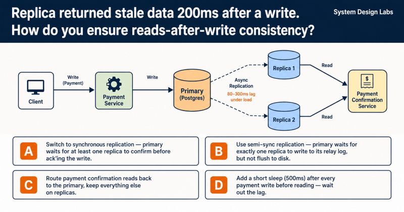
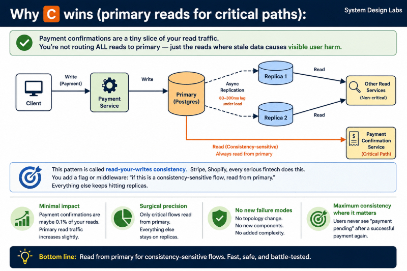

# Ngày 57: Consistency for Payment-Confirmation Reads

[← Ngày trước](day-56-tracking-long-running-async-jobs.md) | [Mục lục](README.md) | [Ngày tiếp theo →](day-58-observability-for-llm-agent-pipelines.md)

---

# NGÀY 57 · SYSTEM DESIGN

## Tính Nhất Quán Cho Luồng Đọc Xác Nhận Thanh Toán (Consistency for Payment-Confirmation Reads)

Lưu lượng ghi (**write traffic**) của bạn vừa chạm mốc **50.000 writes/giây (50k writes/sec)**. Lưu lượng đọc (**read traffic**) cao gấp 10 lần con số đó (**500k reads/sec**).

Bạn đã phân tách cụm cơ sở dữ liệu Postgres của mình thành: **1 node Primary (chính) + 2 node Replicas (bản sao)**. Mọi thao tác đọc đều được điều hướng sang các node Replicas. Hiện tại, bạn đang triển khai luồng xác nhận thanh toán (**payment confirmation flow**) — và một node Replica đã trả về dữ liệu cũ/lỗi thời (**stale data**) sau khi ghi 200ms. Kết quả là người dùng nhìn thấy trạng thái *"Đang chờ thanh toán" (payment pending)* trong khi giao dịch thực tế đã thành công.

### Thiết lập hệ thống hiện tại (The setup):
* **Primary**: Xử lý toàn bộ các thao tác ghi (**writes**).
* **Two read replicas, async replication**: 2 node bản sao chỉ đọc, sử dụng cơ chế sao chép bất đồng bộ (**asynchronous replication**).
* **Payment confirmation reads from a replica**: Luồng xác nhận thanh toán đọc dữ liệu từ một node Replica.
* **Replication lag**: Độ trễ sao chép dao động từ **80–300ms** khi chịu tải (**under load**).

> [!IMPORTANT]
> **Bài toán đặt ra:**  
> Bạn cần đảm bảo tính nhất quán đọc-sau-khi-ghi (**reads-after-write consistency** / **read-your-writes consistency**) trên các luồng thanh toán mà **không làm sụt giảm thông lượng ghi (write throughput)** của hệ thống. Bạn sẽ làm gì?

---

### Các phương án lựa chọn:

* **A.** Chuyển sang cơ chế sao chép đồng bộ (**synchronous replication**) — node Primary sẽ đợi ít nhất một node Replica xác nhận trước khi gửi phản hồi xác nhận ghi thành công (**ack'ing the write**).
* **B.** Sử dụng cơ chế sao chép bán đồng bộ (**semi-sync replication**) — node Primary đợi đúng một node Replica ghi dữ liệu vào nhật ký chuyển tiếp (**relay log**) của nó, nhưng không cần xả xuống đĩa (**flush to disk**).
* **C.** Điều hướng các truy vấn đọc xác nhận thanh toán (**payment confirmation reads**) quay trở lại node Primary, giữ nguyên tất cả các truy vấn đọc khác trên các node Replicas.
* **D.** Thêm một khoảng thời gian chờ ngắn (**short sleep 500ms**) sau mỗi thao tác ghi thanh toán trước khi thực hiện thao tác đọc — để chờ cho độ trễ sao chép (**lag**) trôi qua.

---

# NGÀY 57 · ĐÁP ÁN & GIẢI THÍCH CHI TIẾT (ANSWERS & EXPLANATIONS)

## Đáp án 1: ✓ ĐÁP ÁN ĐÚNG

### Vì sao C chiến thắng (Đọc từ Primary cho các đường dẫn trọng yếu - primary reads for critical paths):

Xác nhận thanh toán chỉ chiếm một phần rất nhỏ (**a tiny slice**) trong tổng lưu lượng đọc của bạn. Bạn **không hề** định tuyến TẤT CẢ các truy vấn đọc về Primary — bạn chỉ định tuyến những truy vấn đọc mà việc gặp phải dữ liệu cũ/lỗi thời (**stale data**) sẽ gây ra tác hại hữu hình đối với trải nghiệm người dùng (**visible user harm**).

Mô hình này được gọi là **Tính nhất quán Đọc-sau-khi-ghi (Read-Your-Writes Consistency)**. Stripe, Shopify và mọi công ty Fintech nghiêm túc đều áp dụng kỹ thuật này.

Bạn chỉ cần thêm một cờ đánh dấu (**flag**) hoặc một lớp **Middleware**: *"Nếu đây là một luồng nhạy cảm với tính nhất quán (consistency-sensitive flow), hãy đọc từ Primary."* Mọi tác vụ đọc khác vẫn tiếp tục truy vấn vào các node Replicas.

Lưu lượng đọc trên node Primary sẽ tăng nhẹ — nhưng luồng "vừa xác nhận thanh toán" chỉ chiếm khoảng **0.1%** tổng lượng đọc của bạn. Hoàn toàn không đáng kể (**negligible**). Không làm thay đổi cấu trúc liên kết (**topology**), không tạo ra các trạng thái lỗi mới (**failure modes**), chuẩn xác như một mũi phẫu thuật (**surgical precision**).

---

## Đáp án 2: Vì sao A hấp dẫn nhưng là một sự đánh đổi sai lầm (Sao chép đồng bộ - Synchronous replication):

Trong Postgres, cấu hình `synchronous_commit = on` — node Primary sẽ đợi một Replica xác nhận trước khi phản hồi xác nhận thao tác ghi (**ack'ing the write**). Độ trễ sao chép bằng không (**Zero lag**). Các thao tác đọc luôn luôn nhất quán.

**Cái giá phải trả:** Mỗi thao tác ghi giờ đây sẽ tốn:
$$\text{Thời gian ghi trên Primary} + \text{Thời gian truyền nhận qua mạng tới Replica (Network Roundtrip)}$$
Bình thường con số này mất khoảng **1–5ms**.

Nhưng dưới điều kiện tải cao cùng với một Replica chập chờn (**flaky replica**)? Độ trễ ghi (**write latency**) của bạn sẽ bị "bắt làm con tin" bởi chính node Replica chậm chạp nhất (**slowest replica**).

Nếu node Replica đồng bộ đó gặp sự cố sập (**goes down**) $\rightarrow$ bạn buộc phải chọn giữa việc: **dừng toàn bộ thao tác ghi (halt writes)** hoặc **hạ cấp về bất đồng bộ (fallback to async)** và tự phá vỡ cam kết đảm bảo nhất quán của mình. Quyết định khó khăn đó thường sẽ phải đưa ra vào lúc 3 giờ sáng dưới áp lực tột độ.

Sao chép đồng bộ (**Sync replication**) là một cam kết kiến trúc mang tính đánh đổi rất lớn cho toàn bộ cơ sở dữ liệu. Trong khi đó, việc điều hướng các truy vấn đọc thanh toán về Primary giải quyết chính xác cùng một vấn đề một cách tinh gọn và chính xác.

---

## Đáp án 3: Vì sao B là câu trả lời sai đầy cạm bẫy (Sao chép bán đồng bộ - Semi-sync replication):

Sao chép bán đồng bộ (`rpl_semi_sync` trong MySQL) — node Primary đợi một Replica ghi dữ liệu vào **relay log** của nó. Nghe qua có vẻ là một giải pháp dung hòa trung gian hợp lý. Nhưng thực tế **hoàn toàn không phải**.

Node Replica chỉ mới xác nhận là đã nhận được các byte dữ liệu — **chứ chưa hề áp dụng (applied) và đưa dữ liệu đó vào trạng thái có thể đọc được (readable)**. **Relay log** chỉ là hàng đợi tiếp nhận đầu vào (**incoming queue**), không phải là trạng thái dữ liệu đã áp dụng (**applied state**). Bạn vẫn hoàn toàn có thể đọc phải dữ liệu cũ (**stale data**) ngay sau khi ghi.

> [!WARNING]
> * **Semi-sync replication** bảo vệ bạn khỏi việc mất mát dữ liệu (**data loss**) khi node Primary gặp sự cố (failover).
> * Nó **KHÔNG HỀ** bảo vệ bạn khỏi độ trễ sao chép (**replication lag**) trong các tác vụ đọc. Đây là hai bài toán hoàn toàn khác nhau.

Các kỹ sư cấp cao (**Senior engineers**) rất hay nhầm lẫn giữa khái niệm *"Replica đã có dữ liệu"* với *"Replica đã áp dụng dữ liệu"*. Chúng không hề giống nhau.

---

## Đáp án 4: Vì sao D sẽ hủy hoại hệ thống ở quy mô lớn (Bù đắp độ trễ bằng lệnh chờ - Sleep-based lag compensation):

Nghe có vẻ thực dụng. Hoạt động ổn định được trong khoảng... **2 tuần**.

Độ trễ sao chép (**Replication lag**) không phải là một hằng số cố định:
* Bây giờ nó có thể là **50ms**.
* Trong lúc lưu lượng ghi tăng đột biến (**write spike**), nó là **300ms**.
* Khi database đang chạy tiến trình dọn dẹp bộ nhớ (**vacuum**), nó có thể lên tới **2 giây (2s)**.

Nếu bạn gắn cứng (**hardcode**) một lệnh `sleep`, bạn đã tự tay xây dựng một hệ thống: hoặc là quá chậm chạp không cần thiết ($\text{sleep} > \text{lag}$), hoặc là vẫn bị lỗi dữ liệu ($\text{lag} > \text{sleep}$).

Mọi đường dẫn xác nhận thanh toán lúc này đều bị làm chậm một cách nhân tạo thêm 500ms. Và khi khoảng thời gian `sleep` đó không đủ bù đắp độ trễ trong các đợt tải đột biến — bạn sẽ quay trở lại đúng lỗi ban đầu (**stale data bug**), nhưng với độ trễ phản hồi (**latency**) tồi tệ hơn nhiều.

> [!CAUTION]
> Dùng cơ chế chờ (`sleep`) để giải quyết tính nhất quán luôn luôn là một **mùi hôi của mã nguồn/kiến trúc (Architectural Code Smell)**.

---

### Bảng tổng hợp so sánh các phương án:

| Tiêu chí / Phương án | A. Synchronous Replication | B. Semi-Sync Replication | C. Route Critical Reads to Primary (Đúng) | D. Sleep-based Lag Wait |
| :--- | :--- | :--- | :--- | :--- |
| **Tính nhất quán cho đọc** | Đảm bảo tuyệt đối | ❌ Vẫn dính Stale Read (Dữ liệu chưa apply) | ✅ Đảm bảo tuyệt đối cho luồng thanh toán | ❌ Dễ vỡ khi lag vượt ngưỡng sleep |
| **Tác động Write Throughput** | ⚠️ Giảm mạnh, phụ thuộc mạng & Replica chậm nhất | Giảm nhẹ | ✅ **Không ảnh hưởng** đến thông lượng ghi | ✅ Không ảnh hưởng thông lượng ghi |
| **Độ trễ người dùng (Latency)** | Tăng nhẹ ở phía Write | Bình thường | ✅ **Tối ưu**, phản hồi ngay lập tức | ❌ Tăng thêm 500ms một cách vô nghĩa |
| **Rủi ro vận hành** | Rất cao khi Replica chết lúc 3h sáng | Trung bình | ✅ **Rất thấp**, không đổi topology DB | Cao, gây tắc nghẽn connection pool |

---

[← Ngày trước](day-56-tracking-long-running-async-jobs.md) | [Mục lục](README.md) | [Ngày tiếp theo →](day-58-observability-for-llm-agent-pipelines.md)
